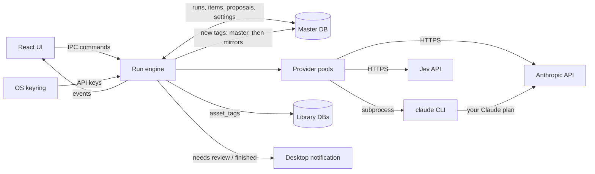
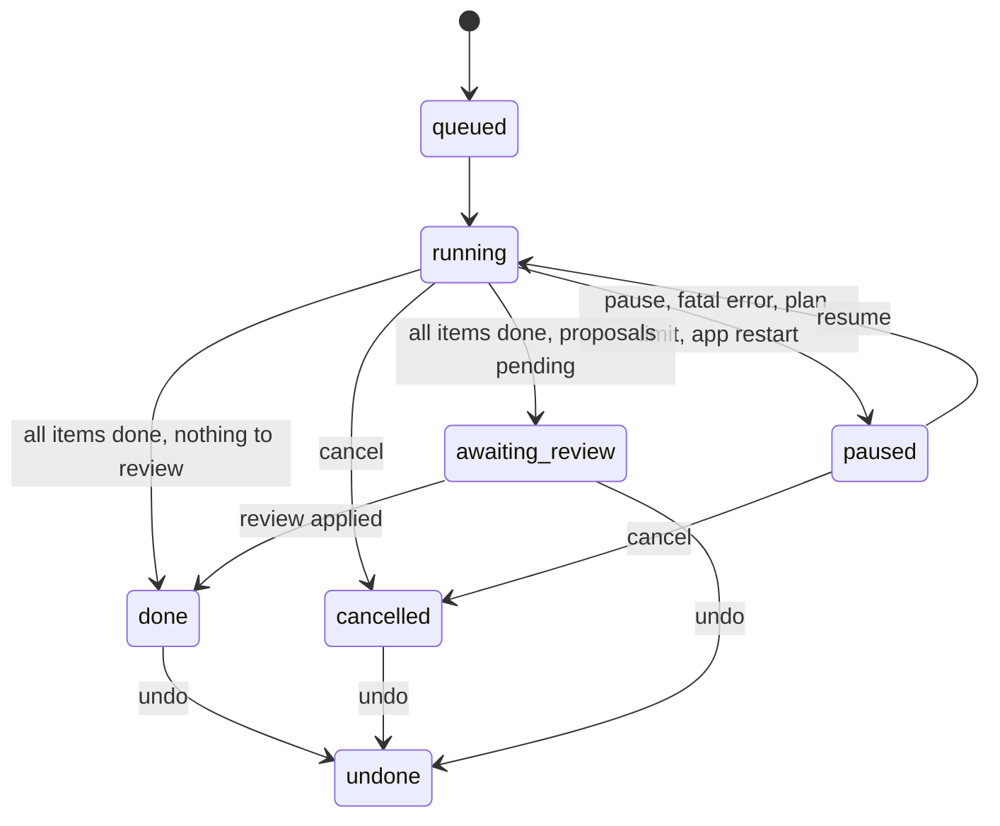

# AI auto-tagging: Anthropic and Jev, in background runs

Status: approved 2026-10-16. Shaped in a three-round interview (D1-D32) and approved at review,
where you kept the technical choices the plan made on its own (D33). Follow-up: once this plan
merges, Mission Control slices it into dependency-linked tickets.

## Summary

You can ask a model to tag one asset, a selection, or a whole library. The work runs in the
background as **runs**: several runs can be active at once, each shows progress in a Runs panel,
and runs survive a restart. Each run uses one of three **modes**:

| Mode | What happens to existing tags | What happens to new tag names |
|---|---|---|
| **Existing only** | Applied automatically (only ever added) | Never proposed |
| **Prefer existing** | Applied automatically | Collected; the run pauses once at the end for one review |
| **Create freely** | Applied automatically | Created and applied without asking |

Two providers ship first:

| Provider | Access | What it sees | Modes |
|---|---|---|---|
| **Anthropic** | API key over HTTPS, **or** your Claude plan through the installed `claude` CLI | Thumbnail + file name, relative path, kind, extension, metadata | All three |
| **Jev** (TypeSafe AI) | API key over HTTPS | Text only (same fields, no image) | Existing only |

Nothing leaves the machine until you configure a provider, and only for runs you start.

## Context

- **Tags today.** The master DB is the tag catalog (`tags`: id, name, color, parent_id). Each
  library DB mirrors the definitions and holds its own `asset_tags` rows
  (`db::upsert_tag`, `Database::library_of_asset`). There are `create_tag` and `delete_tag`
  commands but **no `update_tag`**, so tags cannot be renamed, recoloured or re-parented.
- **Background work today.** Only previews: a `preview_jobs` table per library DB, drained by
  `preview::start_preview_worker`, with the status bar polling `get_preview_progress` every 3s.
- **Thumbnails.** `.opendam/thumbs/<asset id>_thumb.png|jpg` in each library. 3D model thumbnails
  are rendered later by the frontend, so a model can have no thumbnail yet.
- **No settings storage, no secrets, no context menus.** There is no settings UI, no stored
  credentials, and no right-click menu anywhere in the app.
- **Network.** The webview CSP allows only `ipc:` and `asset:`, so every model call must happen
  in the Rust backend. CLAUDE.md states a **zero-telemetry** invariant; this feature adds the
  app's first outbound calls to third-party services.

## Decisions

Every decision below was made by you: D1-D32 in the shaping interview (rounds 1-3, 2026-10-16),
D33 at plan review.

| # | Decision | Answer |
|---|---|---|
| D1 | How Jev fits, given it is text-only and cannot invent tag names | Jev supports **Existing only**. Anthropic supports all three modes. Picking Jev disables the other two modes in the run dialog. |
| D2 | What the model sees | Anthropic: thumbnail + file name, relative path, kind, extension and metadata. Without a thumbnail it gets the text alone. Jev gets the text part only. |
| D3 | Credentials | A Settings dialog stores keys in the OS keyring (Secret Service). `ANTHROPIC_API_KEY` / `TYPESAFE_API_KEY` override it. Anthropic must also work through **your Claude plan**. |
| D4 | Default Claude model | Sonnet 5.5 (`claude-sonnet-5-5`), selectable in Settings |
| D5 | "Stop and wait" in Prefer existing on a group | The run keeps going, applies existing-tag matches as it goes and collects new-tag proposals. It then pauses **once at the end** for one review. |
| D6 | Applying existing-tag matches | Automatic in every mode, additive only: a run never removes a tag. |
| D7 | Quitting the app | Runs persist in the DB and resume on the next launch, including pending proposals |
| D8 | Where a run starts | "Auto-tag..." for the selection (toolbar button and grid right-click menu), "Suggest tags" in the detail panel's Tags tab, "Auto-tag library" on a sidebar library. Not on indexing. |
| D9 | Zero-telemetry rule | Off until a provider is configured. Calls are made only for runs you start. CLAUDE.md is amended to name AI tagging as the one allowed outbound call. |
| D10 | Using the Claude plan | Rust spawns the installed `claude` CLI headless: thumbnail in as stream-json, JSON-schema result out |
| D11 | API key vs Claude plan | One "Anthropic" provider with an **Access** setting: API key or Claude plan. The model picker applies to both. |
| D12 | Parallelism | A shared limit per provider (default 4 requests in flight), handed out round-robin across active runs, adjustable in Settings. One asset per request. |
| D13 | Same asset in two runs | A new run skips assets already queued in another active run and says how many it skipped |
| D14 | Where runs are stored | Master DB: a run table plus per-asset item rows (asset id + library id, status, result, proposals). Machine-local; library folders stay portable. |
| D15 | Watching runs | A status bar entry opens a Runs panel: progress, provider, cost so far, pause/resume, cancel and "Review N proposals". A desktop notification fires when a run needs review or finishes. |
| D16 | Review actions | Accept or reject each proposal, rename it, map it onto an existing tag, untick individual assets, accept all / reject all |
| D17 | "Suggest tags" on one asset | Uses the same run machinery. Existing matches are applied, and proposals appear inline in the Tags tab as chips to accept or reject. |
| D18 | Placement of new tags | The model sees tags as full paths ("Nature > Rock") and may suggest an existing parent. The review shows the parent and lets you change it. |
| D19 | Tag hints | Tags get a description ("hint") column, editable from the sidebar and sent to both providers |
| D20 | "Auto-tag library" scope | Untagged assets by default, with an "All assets" checkbox |
| D21 | Noise limits (editable) | Claude: at most 8 tags and 3 new-tag proposals per asset. Jev: keep tags scoring 0.7 or higher, at most 8 per asset. |
| D22 | Cost guard | The run dialog shows the asset count plus an estimated cost (API key access) or a request count (Claude plan). No hard cap. |
| D23 | Undo | "Undo run" removes exactly the tags the run added, then deletes any tag it created that no asset uses any more |
| D24 | Message Batches API | Not now. Normal requests, with prompt caching on the shared tag list. |
| D25 | Unfinished runs at launch | Come back **paused**. Each one has a Resume button, plus "Resume all". |
| D26 | Consistency within a run | Pending proposals, and tags created in Create freely, join the vocabulary for later assets. Identical names are merged case-insensitively. |
| D27 | Failures | 429 and 5xx retry with backoff, 3 tries, before the item fails. Auth errors, a missing `claude` or a logged-out CLI pause the whole run with a message. The Runs panel offers "Retry failed". |
| D28 | Retention | Finished runs stay, and stay undoable, until you clear them (per run, or "Clear finished") |
| D29 | Tag editing | A new `update_tag` command edits hint, name, parent and color, from an "Edit tag" dialog in the sidebar |
| D30 | Non-secret preferences | A key/value `settings` table in the master DB |
| D31 | Grid right-click menu | A small general menu: Auto-tag..., Reveal in file manager, Open, Delete. It acts on the selection, or on the clicked asset if that isn't selected. |
| D32 | Provider and mode for "Suggest tags" | The last provider and mode you started a run with, shown in the button tooltip. Never run before: Anthropic + Prefer existing. |
| D33 | Technical choices the plan made on its own | Kept as written: the debug-only fake provider (`OPENDAM_AUTOTAG_FAKE`), thumbnails downscaled to 512 px, Anthropic `effort: "low"` with server-side refusal fallback, Jev questions in chunks of 50, desktop notifications only for multi-asset runs, and undo from `done`, `cancelled` or `awaiting_review`. |

### Facts checked while shaping (not decisions)

- **Jev** ([docs.typesafe.ai](https://docs.typesafe.ai)):
  - **Request:** `POST https://api.typesafe.ai/v1/systemone` with `Authorization: Bearer <key>` and model `jev-latest` (currently `jev-1.13.0`).
  - **Questions:** a text `state` plus named questions of type `choice` (one of up to 255 labels), `score` or `noul` (a yes/no probability, 0-1). Questions are evaluated in parallel.
  - **Limits:** **text input only**, **no free-form output**, 64k context.
  - **Price:** about $0.04 per million input tokens.
  - **Unknown:** the docs state no maximum number of questions per request. Their cookbooks show 13-15.
- **Anthropic API:** `POST /v1/messages` accepts base64 images and structured output (`output_config.format` with `type: "json_schema"`). Rust has no official SDK, so the app calls it over raw HTTP. Prices per million input / output tokens:

  | Model | Input | Output |
  |---|---|---|
  | Sonnet 5.5 | $2 | $10 |
  | Opus 5.5 | $4 | $20 |
  | Haiku 5.5 | $0.10 | $0.50 |

- **The `claude` CLI** (v2.1.296 here, logged in with `authMethod: "claude.ai"`), probed with one tiny Haiku request:
  - **Flags:** `-p --input-format stream-json --output-format stream-json --verbose --json-schema <schema> --model <id or alias> --tools "" --safe-mode --no-session-persistence --system-prompt <text>`. Stream-json input **requires** stream-json output.
  - **Result:** the last stdout line is `{"type":"result","subtype":"success","is_error":false,"structured_output":{...},"usage":{...},"total_cost_usd":...}`.
  - **Rate limits:** a `{"type":"rate_limit_event","rate_limit_info":{"status":"allowed","resetsAt":<unix>,...}}` line reports plan limits.
  - **Speed:** one call took about 1.1s.
  - **Auth status:** `claude auth status --json` reports `loggedIn` and `authMethod`.
  - **Flags that don't fit:** `--bare` disables OAuth, so it can't be used with a plan.
- **Policy.** Anthropic's Agent SDK docs say third-party developers may not offer claude.ai login or rate limits in their products. This app is personal and never handles the login: it only runs the owner's own installed `claude`. The Claude-plan access mode is for personal use and must be removed or disabled if the app is ever distributed. A code comment and CLAUDE.md say so.
- **Keyring.** This KDE session provides `org.freedesktop.secrets` (ksecretd).
- **Tauri version check.** `check-tauri-versions.mjs` pairs `@tauri-apps/*` npm packages with their crates. Adding the notification plugin as a Rust crate only, with no npm package, needs no pairing.

## Target state

### Flow: a tagging run

The UI starts and controls runs through IPC commands. The **run engine** owns all run state in
the master DB, hands work to one **provider pool** per provider, writes tags to the asset's own
library DB, and pushes progress to the UI as events.

### Flow: run lifecycle

Cancel stops the remaining items. Tags already applied stay. Proposals already collected still
go to review (`awaiting_review`), where "Reject all" discards them. Undo is available once a run
has stopped: `done`, `cancelled` or `awaiting_review` (which also rejects its pending
proposals). A paused run is cancelled first.

### Data model

**Tags** (master and every library mirror): add `description TEXT NOT NULL DEFAULT ''` with the
same tolerant `ALTER TABLE ... ADD COLUMN` pattern `db.rs` already uses. `TagRow`, `models::Tag`,
`db::upsert_tag` and `sync_open_libraries` carry it, so hints follow the existing
master-wins mirror rules.

**New master DB tables** (`CREATE TABLE IF NOT EXISTS` in `Database::new`, or a new
`migrations/003_master_autotag.sql` included there):

| Table | Columns (sketch) | Purpose |
|---|---|---|
| `settings` | `key TEXT PRIMARY KEY, value TEXT NOT NULL` (JSON) | Access, model, concurrency, limits, last-used provider and mode (D30) |
| `tag_runs` | `id, label, provider, access, model, mode, status, pause_reason, inline, options` (JSON snapshot of limits and threshold), `input_tokens, output_tokens, cost_usd, created_at, finished_at` | One row per run |
| `tag_run_items` | `run_id, asset_id, library_id, status` (queued/running/done/failed/skipped), `attempts, error, result` (JSON), primary key `(run_id, asset_id)` | Per-asset work and outcome |
| `tag_run_proposals` | `id, run_id, name, normalized_name, parent_id, status` (pending/accepted/rejected/mapped), `final_tag_id, created_tag` (bool) | New tag names, merged per run by `normalized_name` (D26) |
| `tag_run_proposal_assets` | `proposal_id, asset_id, included` | Which assets each proposal is for; `included` drives the review's checkboxes |
| `tag_run_applied` | `run_id, asset_id, library_id, tag_id` | Only the `asset_tags` rows this run inserted, so undo removes exactly those (D23) |

`normalized_name` is the name lowercased and trimmed, with inner whitespace collapsed.
Create freely records its tags as proposals with `status = accepted, created_tag = 1`, so undo
and the Runs panel treat both modes the same way.

**Secrets** never touch a DB. Keyring service `com.opendam.desktop`, entries `anthropic-api-key`
and `typesafe-api-key`. Lookup order: env var, then keyring. Settings shows only where a key
comes from ("from ANTHROPIC_API_KEY", "saved in keyring", "not set"), never the key.

### Run engine (`src-tauri/src/autotag/`)

- **Start.** `lib.rs` starts the engine next to the preview worker. At startup, every `queued` or
  `running` run becomes `paused` with the reason "app restarted", and every `running` item goes
  back to `queued` (D25).
- **Scheduling (D12).** Each provider has one semaphore sized by its concurrency setting.
  - **Round-robin:** the scheduler hands permits out across that provider's running runs,
    taking one item from each in turn.
  - **Wake-ups:** it wakes on a `Notify` when a run is started or resumed, not on a timer.
- **Per item:**
  1. Resolve the asset's library.
  2. Build the input. The thumbnail is downscaled to at most 512 px on its long edge in
     `spawn_blocking`, which is about 350 image tokens. With no thumbnail, the input is text only.
  3. Build the vocabulary:
     - every catalog tag as a full path, with its hint and id;
     - this run's pending proposals or created tags (D26).
  4. Call the provider, then validate the result:
     - drop unknown tag ids;
     - drop proposals that match a catalog tag name, and count them as that tag;
     - apply the D21 caps.
  5. Write it.
- **Writing tags.**
  - **Matches:** one small transaction per item in the asset's library DB:
    `INSERT OR IGNORE INTO asset_tags`. A row is recorded in `tag_run_applied` only when the
    insert actually added it.
  - **Prefer existing:** upserts proposals by `normalized_name` and links the asset.
  - **Create freely:** creates the tag through the same path as `create_tag` (master first, then
    every open mirror), under the suggested parent if it still exists. An engine mutex
    serializes creation, so parallel items can't create the same name twice. The tag is then
    applied like a match.
  - **Order:** these writes go to a single DB per item, ordered so that a crash leaves at worst
    an item to redo, never a tag the run can't undo.
- **Finishing.** Prefer existing with pending proposals goes to `awaiting_review`, and anything
  else goes to `done`. Multi-asset runs send a desktop notification (D15). Single-asset runs
  from "Suggest tags" (`inline = 1`) don't.
- **Overlap (D13).** Creating a run leaves out assets that have a `queued` or `running` item in
  another run that is `queued`, `running` or `paused`. The response reports `queued` and
  `skipped` counts.
- **Failures (D27).**
  - **Retryable** (HTTP 429/529/5xx, timeouts, connection errors): backoff of 2s, 8s and 30s,
    honouring `retry-after`. After the third try the item `failed`.
  - **Fatal for the run** (401/403, no key, `claude` not found, `loggedIn: false`, unknown model):
    the run `paused` with a readable `pause_reason`, and the item goes back to `queued`.
  - **Claude plan limit:** a `rate_limit_event` whose status isn't `allowed` pauses the run with
    "Claude plan limit reached, resets at HH:MM".
  - **Item-specific** (refusal, unparseable output after one retry, asset gone): the item
    `failed`, with the error stored.
  - **Retry failed** re-queues `failed` items.
- **Undo (D23)**, for a run that is `done`, `cancelled` or `awaiting_review`:
  1. Delete each `tag_run_applied` row from its asset's library DB.
  2. Delete every tag this run created (`created_tag = 1`) that no `asset_tags` row in any open
     library still uses. This goes through the existing `delete_tag` path.
  3. Mark the run `undone`.
- **Clear (D28)** deletes the rows of a run that is not `running` or `paused`.
- **Events.** The engine emits `autotag:updated`, carrying the run summary and the asset ids
  whose tags changed, throttled to about 4 per second. The asset store re-fetches only the
  loaded assets that changed. The Runs panel and status bar subscribe instead of polling.

### Providers

One trait, `TagProvider`, with a fake implementation for tests. Every provider returns
`{ existing: [tag id], proposed: [{ name, parent_id | null }] }`. Existing only uses a schema
with no `proposed` field.

| Provider | Request | Notes |
|---|---|---|
| **Anthropic, API key** | `POST https://api.anthropic.com/v1/messages` with `x-api-key` and `anthropic-version: 2023-06-01` (`reqwest` + rustls). Body: model; small `max_tokens`; `output_config: { format: { type: "json_schema", schema }, effort: "low" }`; `system` = instructions + the catalog vocabulary, marked `cache_control: ephemeral`; user content = the image block + asset text + the run's pending proposals. | **Caching:** the volatile run vocabulary goes in the user message so the cached system prefix survives (D24). **Refusals:** on models that accept it (Sonnet 5.5, Opus 5.5), send `fallbacks: "default"` with the `server-side-fallback-2026-07-01` beta header. A final `stop_reason: "refusal"` fails the item. **Cost:** usage tokens are added to the run's totals and cost. |
| **Anthropic, Claude plan** | Spawn `claude -p --input-format stream-json --output-format stream-json --verbose --json-schema <schema> --model <model> --tools "" --safe-mode --no-session-persistence --system-prompt <instructions + vocabulary>`, with the app data dir as cwd. Write one user message (image block + text), close stdin, read lines until the `result` line, then take `structured_output`. | **Rate limits:** `rate_limit_event` lines feed the plan-limit pause. **Usage:** tokens are recorded; cost shows as "on your plan". **Settings:** shows the `claude` path, version and `claude auth status --json`. **Policy:** personal use only (see Facts). |
| **Jev** | `POST https://api.typesafe.ai/v1/systemone`, `Authorization: Bearer`, `model: "jev-latest"`. `state` = the asset text. One `noul` question per catalog tag ("This asset should be tagged '<path>'. <hint>"), with ids `q0..qN` mapped back to tag ids. | **Selection:** keep tags with `noul >= threshold` (0.7), highest first, at most 8 (D21). **Chunking:** questions are sent in chunks of 50 per request until the real limit is known. **Cost:** usage tokens priced at $0.04/M. |

A `pricing.rs` table gives per-model input and output prices for the run-dialog estimate and the
running cost. The estimate per asset is: image tokens + text + vocabulary tokens (by length) +
expected output. Update the table when prices change.

### Settings and credentials

- **Settings dialog.** A toolbar gear button opens it. Its "AI tagging" section holds:
  - **Anthropic:**
    - Access (API key / Claude plan).
    - An API key field: write-only, with Save and Clear and the key's source shown.
    - The Claude plan status: `claude` found, version, logged in.
    - The model: Sonnet 5.5 by default, Opus 5.5, Haiku 5.5, or a custom id.
    - Concurrency.
    - Max tags and max proposals per asset.
    - "Test connection".
  - **Jev:** API key (as above), concurrency, threshold, max tags, "Test connection".
- **Commands:** `get_ai_settings`, `set_ai_settings(patch)`, `set_api_key(provider, key | null)`,
  `get_provider_status()`, `test_provider(provider)`.

### UI

- **Run dialog ("Auto-tag N assets").**
  - **Provider:** a provider that isn't configured is disabled, with a "Set up in Settings" link.
  - **Mode:** Jev disables Prefer existing and Create freely, with the reason shown (D1).
  - **Library runs:** an "All assets" checkbox (D20).
  - **Estimate (D22)** and the overlap-skip count, then Start.
  - **Remembered:** starting saves the provider and mode as "last used" (D32).

- **Entry points (D8, D31):**
  - The toolbar "Auto-tag" button, enabled with a selection.
  - The new grid right-click menu (Auto-tag..., Reveal in file manager, Open, Delete).
  - A right-click menu on a sidebar library row with "Auto-tag library...".

- **Detail panel Tags tab (D17):**
  - A "Suggest tags" button whose tooltip names the provider and mode.
  - Applied tags appear in the existing list.
  - Proposals show as chips with accept and reject.
  - The button is disabled, with a tooltip, when no provider is configured.

- **Status bar:** the tagging summary sits next to the preview progress, for example
  "Tagging 2 runs - 120/400", "1 run needs review" or "2 runs paused". Clicking it opens the
  Runs panel.

- **Runs panel.** Each run shows:
  - label, provider/model, mode and status (with the pause reason);
  - progress and failed count;
  - tokens and cost (or "on your plan");
  - actions: Pause/Resume, Cancel, Retry failed, Review (N), Undo, Clear.

  The panel header has Resume all and Clear finished.

- **Review modal (D16, D18).** One row per proposal:
  - an editable name;
  - the parent, preselected from the model's suggestion;
  - "Map to existing tag";
  - the asset thumbnails, each with a checkbox;
  - Accept and Reject.

  The modal also has Accept all, Reject all and Apply. Applying creates tags (master, then
  mirrors), applies them to the ticked assets, records them for undo, and moves the run to
  `done`. Command: `review_autotag_proposals(run_id, decisions)`.

- **Edit tag dialog (D29).** Opened from a tag's right-click menu in the sidebar. It edits the
  name, color (existing swatches), parent (excluding the tag itself and its descendants) and
  hint. Command: `update_tag(id, patch)`. It writes master, then mirrors through
  `db::upsert_tag`. A name collision returns an error the dialog shows.

- **Run commands:** `estimate_autotag_run`, `start_autotag_run` (asset ids, or a library id with
  `all_assets`; provider; mode; `inline`), `list_autotag_runs`, `get_autotag_run`,
  `pause_autotag_run`, `resume_autotag_run`, `resume_all_autotag_runs`, `cancel_autotag_run`,
  `retry_failed_autotag_items`, `undo_autotag_run`, `clear_autotag_runs`.

### New dependencies

- **Rust:** `reqwest` (rustls, json), `keyring` (Secret Service backend), `base64`, and
  `tauri-plugin-notification`, with the `notification:default` permission in
  `capabilities/default.json`. Image downscaling reuses the `image` crate.
- **npm:** none required.

### Dev affordance

Debug builds only (`cfg(debug_assertions)`): `OPENDAM_AUTOTAG_FAKE=1` adds a "Fake" provider
that tags from file-name words, after a short delay. Agents and you can then exercise and
screenshot every flow without a key or any spend. Release builds never include it.

### Docs

- **CLAUDE.md:**
  - **Zero telemetry** becomes: "The app makes no network calls to analytics or tracking
    services. The only outbound calls are AI tagging requests to the provider you configured
    (the Anthropic API, your local `claude` CLI, or TypeSafe's Jev). They are made only for runs
    you start, and nothing is sent until a provider is set up."
  - **Layout** gains `src/autotag/`.
  - A note that Claude-plan access is personal use only.
- **`docs/agents/running-the-app.md`:** how to use `OPENDAM_AUTOTAG_FAKE=1`.

## Work, in order

Suggested slices for the ticket follow-up. Each one leaves the app working.

1. **Tag hints and editing.** The `description` column (master and mirrors), `update_tag`, and
   the Edit tag dialog.
2. **Settings and credentials.** The `settings` table, keyring with env override, Settings
   dialog, provider status, "Test connection" for the Anthropic API key.
3. **Run engine tracer bullet.**
   - The run tables, engine, per-provider pool, the Anthropic API-key provider, and Existing only.
   - The run dialog from the toolbar, `autotag:updated` events, the status bar entry and the Runs
     panel (pause, resume, cancel).
   - Paused-on-restart.
4. **Claude plan access.** The CLI provider, plan-limit pause, and CLI status in Settings.
5. **Jev provider.** Noul-per-tag, threshold, chunking, and Jev's "Test connection".
6. **Prefer existing.**
   - Proposals with the shared vocabulary, `awaiting_review`, and the review modal.
   - Desktop notifications.
   - "Suggest tags" with inline chips and last-used defaults.
7. **Create freely.** Serialized tag creation with the suggested parent.
8. **Run housekeeping.** Undo, Clear, Retry failed, the overlap skip, and failure classification
   with backoff.
9. **Entry points and estimates.** The grid right-click menu, the sidebar "Auto-tag library"
   (untagged by default), and the run-dialog estimate.
10. **Docs and dev affordance.** The CLAUDE.md amendments, `OPENDAM_AUTOTAG_FAKE`, and
    running-the-app notes.

## Testing

No test calls a live service. CI never needs a key.

- **Rust (nextest, in-memory DBs via `memory_database`, fake provider and in-memory keyring):**
  - **Runs:**
    - Overlap skip.
    - Round-robin across two runs with a concurrency of 2 (the fake counts calls in flight).
    - Additive apply that records only newly inserted rows.
    - Prefer existing merges "Rock" and "rock" into one proposal and ends in `awaiting_review`.
  - **Create freely and review:**
    - Under parallel items, Create freely creates a tag once and mirrors it to every open library.
    - Review accept, rename, map, untick and reject.
  - **Undo** removes exactly the run's rows, plus the created tags no asset uses any more.
  - **Restart and failures:**
    - Restart turns `running` into `paused`.
    - Retryable failures retry 3 times and then fail the item; fatal failures pause the run.
  - **Providers and tags:**
    - Jev threshold and cap selection, from a fixture response.
    - Anthropic response parsing, from fixtures: unknown ids dropped, caps applied, refusal.
    - CLI `result` and `rate_limit_event` parsing, from the probe's recorded lines.
    - Request-body builders: image block, cache marker, schema by mode.
    - `update_tag` mirroring and its cycle guard.
    - Settings round-trip.
- **TypeScript (bun):** pure helpers: the status-bar summary text, estimate formatting, and the
  review-decision reducer.
- **Manual smoke (you, once per provider):** run about 5 Kenney assets through each mode with the
  API key, the Claude plan and Jev. Screenshot the Runs panel and the review modal.

## Acceptance checks

- With no provider configured, nothing is sent and every auto-tag entry point says why it is
  disabled.
- A 50-asset Prefer-existing run with Anthropic applies matches while it runs, then notifies
  once and opens a review. Applying the review creates the accepted tags in master and every
  open library, and tags the ticked assets.
- Two runs progress together, and in-flight requests per provider never exceed the setting.
- Quitting mid-run and relaunching shows the run paused. Resume finishes it, and pending
  proposals are still there.
- Undo of a finished run restores every asset's tags to their pre-run state.
- Selecting Jev allows only Existing only, and Jev requests carry no image.
- Claude-plan runs make no HTTPS call from the app itself. They go through `claude`, and a
  logged-out CLI pauses the run with a message.
- No API key is stored in any DB, log or event payload.

## Manual steps for you

- Add an Anthropic API key in Settings, or keep `claude` logged in to use your plan.
- Create a TypeSafe account and an API key for Jev (the console is open without a waitlist since
  2026-09-20).
- Run the manual smoke test above after the provider slices land.

## Out of scope and known gaps

- **Not now (decided):**
  - auto-tagging on index;
  - Message Batches;
  - a hard budget cap;
  - a Jev-then-Claude cascade.
- **Not planned:** generating asset descriptions.
- **Near-duplicates** that differ by more than case and spacing (rock / rocks / stone) are only
  merged in review, with "Map to existing tag".
- **Undo edge case.** Undo removes a pair the run inserted even if you later confirmed the same
  tag by hand.
- **Jev's question limit per request is unverified.** Chunks of 50 are a guess, to confirm in
  slice 5.
- **The pricing table is hardcoded** and goes stale when prices change.
- **Assets with no thumbnail yet** (models not rendered) are tagged from text only. Re-run them
  after previews finish for better tags.
- **Claude-plan access is personal use only.** It must be removed or disabled before any
  distribution of the app.
