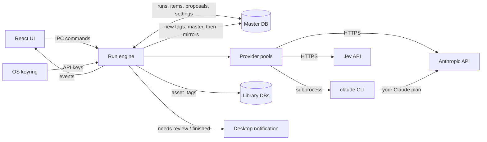
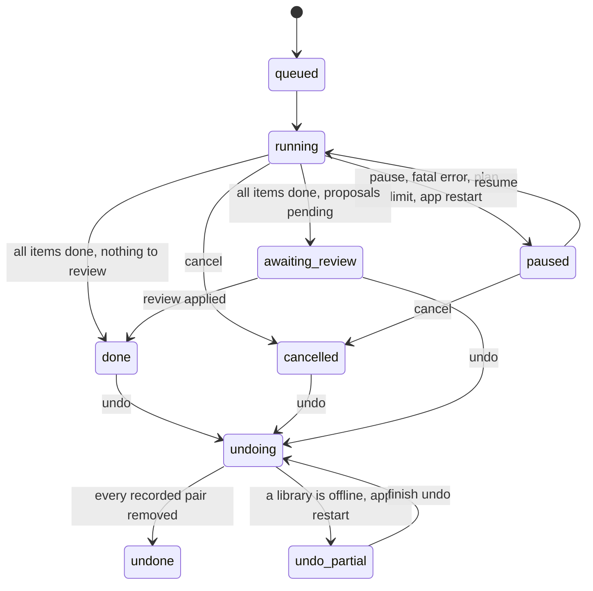

# AI auto-tagging: Anthropic and Jev, in background runs

Status: approved 2026-10-16. Shaped in a three-round interview (D1-D32) and approved at review,
where you kept the technical choices the plan made on its own (D33). Follow-up: once this plan
merges, Mission Control slices it into dependency-linked tickets.

Revised 2026-10-16 after Plan Validation repair round 1. These close validation gaps inside the
approved decisions; no decision changed:
- **Crash-safe, undoable writes.** Each item records an intent row in the master DB before it
  touches the library, so a crash at any point leaves nothing the run can't undo. With a library
  offline, undo leaves the run `undo_partial`, keeping the rows it couldn't remove, and finishes
  once that library is back.
- **External contracts verified.**
  - The CLI is now probed with an image block and with an error result, and its documented
    rate-limit and error types are cited.
  - The `effort` and `fallbacks` request fields cite the API docs.
  - Slices 3 and 4 open with a contract check, and the CLI pause and error paths get fixtures.
- **UI verification.** The fake provider moves to slice 3. Every user-facing acceptance check
  names its automated test and its screenshot, taken in a throwaway profile.

Revised again 2026-10-16 after the GitHub Inspector review of PR #43. These are corrections
inside the approved decisions:
- **Claude-plan runs can't bill an API key.**
  - The `claude` child starts from a cleaned environment, so an `ANTHROPIC_API_KEY` set for the
    app (D3) can't reach it. Probed: an inherited key makes the CLI use that key instead of your
    login.
  - Every run's `init` line must report `apiKeySource: "none"`.
- **Cancel and Retry failed fit the lifecycle.**
  - A cancelled run keeps its proposals reviewable and stays `cancelled`.
  - "Retry failed" starts a new run over the failed assets.
  - So no run leaves `done` or `cancelled` except through undo.
- **AGENTS.md, not CLAUDE.md.** The invariants live in `AGENTS.md`; `CLAUDE.md` is only a
  symlink to it. D9's amendment now names the real file.

Revised a third time 2026-10-16 after the second GitHub Inspector round on PR #43:
- **Replay never undoes an undo.** It skips rows whose run is `undoing`, `undo_partial` or
  `undone`.
- **Review apply keeps a cancelled run `cancelled`.** It moves only an `awaiting_review` run to
  `done`.
- **Created tags can't come back from an offline mirror.** Undo deletes them only while every
  registered library is open. Otherwise the run stays `undo_partial`.

Revised a fourth time 2026-10-16 after the third GitHub Inspector round on PR #43:
- **The vocabulary never goes through argv.** Claude-plan runs pass it with
  `--system-prompt-file`. Probed: a 515 KB file works, while Linux rejects any single argument
  over 128 KiB.
- **Clear keeps writes still waiting for replay.** Pending rows outlive a cleared run until
  replay applies them, except for an `undo_partial` run, whose rows are meant to be removed.

Revised a fifth time 2026-10-16 after the fourth GitHub Inspector round on PR #43:
- **The vocabulary file is replaced atomically.** A catalog change writes a temp file and renames
  it over `system.txt`, so a `claude` child started mid-run never reads a partial vocabulary.

## Summary

You can ask a model to tag one asset, a selection, or a whole library. The work runs in the
background as **runs**: several runs can be active at once, each shows progress in a Runs panel,
and runs survive a restart. Each run uses one of three **modes**:

| Mode | What happens to existing tags | What happens to new tag names |
|---|---|---|
| **Existing only** | Applied automatically (only ever added) | Never proposed |
| **Prefer existing** | Applied automatically | Collected; the run pauses once at the end for one review |
| **Create freely** | Applied automatically | Created and applied without asking |

Two providers ship first:

| Provider | Access | What it sees | Modes |
|---|---|---|---|
| **Anthropic** | API key over HTTPS, **or** your Claude plan through the installed `claude` CLI | Thumbnail + file name, relative path, kind, extension, metadata | All three |
| **Jev** (TypeSafe AI) | API key over HTTPS | Text only (same fields, no image) | Existing only |

Nothing leaves the machine until you configure a provider, and only for runs you start.

## Context

- **Tags today.** The master DB is the tag catalog (`tags`: id, name, color, parent_id). Each
  library DB mirrors the definitions and holds its own `asset_tags` rows
  (`db::upsert_tag`, `Database::library_of_asset`). There are `create_tag` and `delete_tag`
  commands but **no `update_tag`**, so tags cannot be renamed, recoloured or re-parented.
- **Background work today.** Only previews: a `preview_jobs` table per library DB, drained by
  `preview::start_preview_worker`, with the status bar polling `get_preview_progress` every 3s.
- **Thumbnails.** `.opendam/thumbs/<asset id>_thumb.png|jpg` in each library. 3D model thumbnails
  are rendered later by the frontend, so a model can have no thumbnail yet.
- **No settings storage, no secrets, no context menus.** There is no settings UI, no stored
  credentials, and no right-click menu anywhere in the app.
- **Network.** The webview CSP allows only `ipc:` and `asset:`, so every model call must happen
  in the Rust backend. `AGENTS.md` (which `CLAUDE.md` links to) states a **zero-telemetry** invariant; this feature adds the
  app's first outbound calls to third-party services.

## Decisions

Every decision below was made by you: D1-D32 in the shaping interview (rounds 1-3, 2026-10-16),
D33 at plan review.

| # | Decision | Answer |
|---|---|---|
| D1 | How Jev fits, given it is text-only and cannot invent tag names | Jev supports **Existing only**. Anthropic supports all three modes. Picking Jev disables the other two modes in the run dialog. |
| D2 | What the model sees | Anthropic: thumbnail + file name, relative path, kind, extension and metadata. Without a thumbnail it gets the text alone. Jev gets the text part only. |
| D3 | Credentials | A Settings dialog stores keys in the OS keyring (Secret Service). `ANTHROPIC_API_KEY` / `TYPESAFE_API_KEY` override it. Anthropic must also work through **your Claude plan**. |
| D4 | Default Claude model | Sonnet 5.5 (`claude-sonnet-5-5`), selectable in Settings |
| D5 | "Stop and wait" in Prefer existing on a group | The run keeps going, applies existing-tag matches as it goes and collects new-tag proposals. It then pauses **once at the end** for one review. |
| D6 | Applying existing-tag matches | Automatic in every mode, additive only: a run never removes a tag. |
| D7 | Quitting the app | Runs persist in the DB and resume on the next launch, including pending proposals |
| D8 | Where a run starts | "Auto-tag..." for the selection (toolbar button and grid right-click menu), "Suggest tags" in the detail panel's Tags tab, "Auto-tag library" on a sidebar library. Not on indexing. |
| D9 | Zero-telemetry rule | Off until a provider is configured. Calls are made only for runs you start. `AGENTS.md` (the file `CLAUDE.md` links to) is amended to name AI tagging as the one allowed outbound call. |
| D10 | Using the Claude plan | Rust spawns the installed `claude` CLI headless: thumbnail in as stream-json, JSON-schema result out |
| D11 | API key vs Claude plan | One "Anthropic" provider with an **Access** setting: API key or Claude plan. The model picker applies to both. |
| D12 | Parallelism | A shared limit per provider (default 4 requests in flight), handed out round-robin across active runs, adjustable in Settings. One asset per request. |
| D13 | Same asset in two runs | A new run skips assets already queued in another active run and says how many it skipped |
| D14 | Where runs are stored | Master DB: a run table plus per-asset item rows (asset id + library id, status, result, proposals). Machine-local; library folders stay portable. |
| D15 | Watching runs | A status bar entry opens a Runs panel: progress, provider, cost so far, pause/resume, cancel and "Review N proposals". A desktop notification fires when a run needs review or finishes. |
| D16 | Review actions | Accept or reject each proposal, rename it, map it onto an existing tag, untick individual assets, accept all / reject all |
| D17 | "Suggest tags" on one asset | Uses the same run machinery. Existing matches are applied, and proposals appear inline in the Tags tab as chips to accept or reject. |
| D18 | Placement of new tags | The model sees tags as full paths ("Nature > Rock") and may suggest an existing parent. The review shows the parent and lets you change it. |
| D19 | Tag hints | Tags get a description ("hint") column, editable from the sidebar and sent to both providers |
| D20 | "Auto-tag library" scope | Untagged assets by default, with an "All assets" checkbox |
| D21 | Noise limits (editable) | Claude: at most 8 tags and 3 new-tag proposals per asset. Jev: keep tags scoring 0.7 or higher, at most 8 per asset. |
| D22 | Cost guard | The run dialog shows the asset count plus an estimated cost (API key access) or a request count (Claude plan). No hard cap. |
| D23 | Undo | "Undo run" removes exactly the tags the run added, then deletes any tag it created that no asset uses any more |
| D24 | Message Batches API | Not now. Normal requests, with prompt caching on the shared tag list. |
| D25 | Unfinished runs at launch | Come back **paused**. Each one has a Resume button, plus "Resume all". |
| D26 | Consistency within a run | Pending proposals, and tags created in Create freely, join the vocabulary for later assets. Identical names are merged case-insensitively. |
| D27 | Failures | 429 and 5xx retry with backoff, 3 tries, before the item fails. Auth errors, a missing `claude` or a logged-out CLI pause the whole run with a message. The Runs panel offers "Retry failed". |
| D28 | Retention | Finished runs stay, and stay undoable, until you clear them (per run, or "Clear finished") |
| D29 | Tag editing | A new `update_tag` command edits hint, name, parent and color, from an "Edit tag" dialog in the sidebar |
| D30 | Non-secret preferences | A key/value `settings` table in the master DB |
| D31 | Grid right-click menu | A small general menu: Auto-tag..., Reveal in file manager, Open, Delete. It acts on the selection, or on the clicked asset if that isn't selected. |
| D32 | Provider and mode for "Suggest tags" | The last provider and mode you started a run with, shown in the button tooltip. Never run before: Anthropic + Prefer existing. |
| D33 | Technical choices the plan made on its own | Kept as written: the debug-only fake provider (`OPENDAM_AUTOTAG_FAKE`), thumbnails downscaled to 512 px, Anthropic `effort: "low"` with server-side refusal fallback, Jev questions in chunks of 50, desktop notifications only for multi-asset runs, and undo from `done`, `cancelled` or `awaiting_review`. |

### Facts checked while shaping (not decisions)

- **Jev** ([docs.typesafe.ai](https://docs.typesafe.ai)):
  - **Request:** `POST https://api.typesafe.ai/v1/systemone` with `Authorization: Bearer <key>` and model `jev-latest` (currently `jev-1.13.0`).
  - **Questions:** a text `state` plus named questions of type `choice` (one of up to 255 labels), `score` or `noul` (a yes/no probability, 0-1). Questions are evaluated in parallel.
  - **Limits:** **text input only**, **no free-form output**, 64k context.
  - **Price:** about $0.04 per million input tokens.
  - **Unknown:** the docs state no maximum number of questions per request. Their cookbooks show 13-15.
- **Anthropic API:** `POST /v1/messages` accepts base64 images and structured output (`output_config.format` with `type: "json_schema"`). Rust has no official SDK, so the app calls it over raw HTTP. Prices per million input / output tokens:

  | Model | Input | Output |
  |---|---|---|
  | Sonnet 5.5 | $2 | $10 |
  | Opus 5.5 | $4 | $20 |
  | Haiku 5.5 | $0.10 | $0.50 |

- **The `claude` CLI** (v2.1.296 here, logged in with `authMethod: "claude.ai"`), probed with three small Haiku requests:
  - **Flags:** `-p --input-format stream-json --output-format stream-json --verbose --json-schema <schema> --model <id or alias> --tools "" --safe-mode --no-session-persistence --system-prompt <text>`. Stream-json input **requires** stream-json output.
  - **Result:** the last stdout line is `{"type":"result","subtype":"success","is_error":false,"structured_output":{...},"usage":{...},"total_cost_usd":...}`.
  - **Rate limits:** a `{"type":"rate_limit_event","rate_limit_info":{"status":"allowed","resetsAt":<unix>,...}}` line reports plan limits.
  - **Speed:** one call took about 1.1s.
  - **Auth status:** `claude auth status --json` reports `loggedIn` and `authMethod`.
  - **Flags that don't fit:** `--bare` disables OAuth, so it can't be used with a plan.
  - **Image input:** a stream-json user message whose content holds a base64 PNG `image` block
    works. A red square with a white circle came back as `{"existing":["t1","t3"]}` (Color > Red,
    Shape > Circle). The Agent SDK reference says images belong in `message.content`.
  - **Error result:** an unknown model exits 1. The assistant line carries
    `"error":"model_not_found"`. The `result` line reads `"subtype":"success","is_error":true,`
    `"api_error_status":404,"terminal_reason":"api_error"`. So errors are detected from
    `is_error`, the assistant `error` token and `api_error_status`, never from `subtype` alone.
  - **Inherited API key:** with `ANTHROPIC_API_KEY` in its environment, the CLI uses that key
    instead of the claude.ai login:
    - `claude auth status --json` switches to `authMethod: "api_key"` and
      `apiKeySource: "ANTHROPIC_API_KEY"`;
    - a headless run's `init` line reports `apiKeySource: "ANTHROPIC_API_KEY"`, and an invalid key
      failed with `authentication_failed` (401);
    - with an environment of only `HOME`, `PATH`, `USER` and `LANG`, the status stays
      `authMethod: "claude.ai"`, and without a key the probed runs' `init` lines report
      `apiKeySource: "none"`.
  - **System prompt from a file:** `--system-prompt-file <path>` works with `-p`. The help text
    names it only under `--bare`.
    - **Large file:** a 514,761-byte vocabulary file (4,002 tags with hints) returned the right
      tags with `apiKeySource: "none"`. It cost about 213k input tokens.
    - **Argument limit:** Linux rejects any single argument over 131,072 bytes
      (`MAX_ARG_STRLEN`). A 140,000-byte argument failed with `E2BIG`.
  - **Documented types** ([Agent SDK TypeScript reference](https://code.claude.com/docs/en/agent-sdk/typescript)):
    - `rate_limit_info.status` is `allowed`, `allowed_warning` or `rejected`. Optional fields are
      `resetsAt`, `utilization` and `errorCode: "credits_required"` (subscription usage exhausted).
    - The assistant `error` is one of `authentication_failed`, `oauth_org_not_allowed`,
      `account_on_hold`, `billing_error`, `rate_limit`, `overloaded`, `invalid_request`,
      `model_not_found`, `server_error`, `max_output_tokens`, `cloud_credential_error` or `unknown`.
    - Error results add the subtypes `error_max_turns`, `error_during_execution`,
      `error_max_budget_usd` and `error_max_structured_output_retries`, each with
      `errors: string[]`.
- **Anthropic API request fields:**
  - **Effort:** `output_config.effort` is GA with no beta header on Sonnet 5.5, Opus 5.5 and
    Haiku 5.5. It accepts `low` through `max` and sits beside `format` in `output_config`
    ([effort docs](https://platform.claude.com/docs/en/build-with-claude/effort)).
  - **Fallbacks:** `fallbacks: "default"` needs the `anthropic-beta:
    server-side-fallback-2026-07-01` header. It is a Claude API beta. Haiku 5.5 has no server-side
    fallback, and on Sonnet 5.5 it retries only `cyber` and `frontier_llm` declines
    ([refusals and fallback docs](https://platform.claude.com/docs/en/build-with-claude/refusals-and-fallback)).
  - **Refusals:** a decline is an HTTP 200 with `stop_reason: "refusal"`.
- **Policy.** Anthropic's Agent SDK docs say third-party developers may not offer claude.ai login or rate limits in their products. This app is personal and never handles the login: it only runs the owner's own installed `claude`. The Claude-plan access mode is for personal use and must be removed or disabled if the app is ever distributed. A code comment and `AGENTS.md` say so.
- **Keyring.** This KDE session provides `org.freedesktop.secrets` (ksecretd).
- **App data dir.** The master DB lives in `$XDG_DATA_HOME/com.opendam.desktop/`
  (`docs/agents/running-the-app.md`), so a throwaway `XDG_DATA_HOME` gives a fresh master DB.
  `Database::new` opens a library only when its root exists, so a library can be offline.
- **Tauri version check.** `check-tauri-versions.mjs` pairs `@tauri-apps/*` npm packages with their crates. Adding the notification plugin as a Rust crate only, with no npm package, needs no pairing.

## Target state

### Flow: a tagging run

The UI starts and controls runs through IPC commands. The **run engine** owns all run state in
the master DB, hands work to one **provider pool** per provider, writes tags to the asset's own
library DB, and pushes progress to the UI as events.

### Flow: run lifecycle

**Cancel** stops the remaining items, which become `skipped`, and the run stays `cancelled`.
- Tags already applied stay.
- Proposals already collected stay reviewable. The Runs panel keeps "Review (N)" on the cancelled
  run, and applying or rejecting them leaves it `cancelled`.

**Undo** is available once a run has stopped: `done`, `cancelled` or `awaiting_review`. It
rejects any pending proposals first. A paused run is cancelled first. Undo runs as `undoing` and ends `undone`, or
`undo_partial` when a library is offline (see [Undo](#undo-d23-and-offline-libraries)).

### Data model

**Tags** (master and every library mirror): add `description TEXT NOT NULL DEFAULT ''` with the
same tolerant `ALTER TABLE ... ADD COLUMN` pattern `db.rs` already uses. `TagRow`, `models::Tag`,
`db::upsert_tag` and `sync_open_libraries` carry it, so hints follow the existing
master-wins mirror rules.

**New master DB tables** (`CREATE TABLE IF NOT EXISTS` in `Database::new`, or a new
`migrations/003_master_autotag.sql` included there):

| Table | Columns (sketch) | Purpose |
|---|---|---|
| `settings` | `key TEXT PRIMARY KEY, value TEXT NOT NULL` (JSON) | Access, model, concurrency, limits, last-used provider and mode (D30) |
| `tag_runs` | `id, label, provider, access, model, mode, status, pause_reason, inline, options` (JSON snapshot of limits and threshold), `input_tokens, output_tokens, cost_usd, created_at, finished_at` | One row per run |
| `tag_run_items` | `run_id, asset_id, library_id, status` (queued/running/done/failed/skipped), `attempts, error, result` (JSON), primary key `(run_id, asset_id)` | Per-asset work and outcome |
| `tag_run_proposals` | `id, run_id, name, normalized_name, parent_id, status` (pending/accepted/rejected/mapped), `final_tag_id, created_tag` (bool) | New tag names, merged per run by `normalized_name` (D26) |
| `tag_run_proposal_assets` | `proposal_id, asset_id, included` | Which assets each proposal is for; `included` drives the review's checkboxes |
| `tag_run_applied` | `run_id, asset_id, library_id, tag_id, state` (pending/applied), primary key `(run_id, asset_id, tag_id)` | Every `asset_tags` row this run adds, recorded **before** the library write (see the write protocol), so undo removes exactly those (D23). `pending` rows can outlive a cleared run until replay applies them |

`normalized_name` is the name lowercased and trimmed, with inner whitespace collapsed.
Create freely records its tags as proposals with `status = accepted, created_tag = 1`, so undo
and the Runs panel treat both modes the same way.

**Secrets** never touch a DB. Keyring service `com.opendam.desktop`, entries `anthropic-api-key`
and `typesafe-api-key`. Lookup order: env var, then keyring. Settings shows only where a key
comes from ("from ANTHROPIC_API_KEY", "saved in keyring", "not set"), never the key.

### Run engine (`src-tauri/src/autotag/`)

- **Start.** `lib.rs` starts the engine next to the preview worker. At startup:
  - every `queued` or `running` run becomes `paused` with the reason "app restarted" (D25);
  - every `running` item goes back to `queued`;
  - a run left `undoing` becomes `undo_partial`;
  - `pending` `tag_run_applied` rows are replayed, except rows of runs being undone (see the write
    protocol).
- **Scheduling (D12).** Each provider has one semaphore sized by its concurrency setting.
  - **Round-robin:** the scheduler hands permits out across that provider's running runs,
    taking one item from each in turn.
  - **Wake-ups:** it wakes on a `Notify` when a run is started or resumed, not on a timer.
- **Per item:**
  1. Resolve the asset's library.
  2. Build the input. The thumbnail is downscaled to at most 512 px on its long edge in
     `spawn_blocking`, which is about 350 image tokens. With no thumbnail, the input is text only.
  3. Build the vocabulary:
     - every catalog tag as a full path, with its hint and id;
     - this run's pending proposals or created tags (D26).
  4. Call the provider, then validate the result:
     - drop unknown tag ids;
     - drop proposals that match a catalog tag name, and count them as that tag;
     - apply the D21 caps.
  5. Write it with the write protocol below.
- **Finishing.** Prefer existing with pending proposals goes to `awaiting_review`, and anything
  else goes to `done`. Multi-asset runs send a desktop notification (D15). Single-asset runs
  from "Suggest tags" (`inline = 1`) don't.
- **Overlap (D13).** Creating a run leaves out assets that have a `queued` or `running` item in
  another run that is `queued`, `running` or `paused`. The response reports `queued` and
  `skipped` counts.
  - **Built:** the item insert itself rechecks the overlap, so a run created at the same moment
    can't take the same asset. A run left with nothing to tag is refused and not created.
    `missing` counts assets no open library holds, which `skipped` used to count.
- **Clear (D28)** removes a run from the Runs panel. It isn't offered while the run is `running`,
  `paused` or `undoing`.
  - **`undo_partial` run:** Clear asks first, then deletes every row of the run, `pending` ones
    included. The tags left in the offline library stay there, and its unapplied pairs are never
    applied.
  - **Any other run:** Clear deletes the run's rows except its `pending` `tag_run_applied` rows.
    Those stay, without their run, until replay applies them, and replay then deletes them. A
    cleared run's waiting writes still land when their library comes back.
  - **Clear finished (built):** takes `done`, `cancelled` and `undone` runs with no proposals
    waiting for review. A run waiting for review, or partly undone, is cleared on its own, and a
    partly undone one asks for a second click ("Confirm clear"). A run with an item still in
    flight is refused, like undo. Command: `clear_autotag_runs(run_id | null)`, null for Clear
    finished.
  - **Shared pairs (built):** an `applied` row of a cleared run stays while another run records
    the same pair, so undoing that run leaves the tag both added. Each clear drops the rows of
    cleared runs no remaining run shares.
- **Events.** The engine emits `autotag:updated`, carrying the run summary and the asset ids
  whose tags changed, throttled to about 4 per second. The asset store re-fetches only the
  loaded assets that changed. The Runs panel and status bar subscribe instead of polling.

### Write protocol: every tag a run adds stays undoable

An item's writes span two databases. `asset_tags` lives only in the asset's library DB, while
the run's records live in the master DB. SQLite can't commit both atomically through separate
pools, so each item writes in this order:

1. **Intent (one master transaction).**
   - First, outside the transaction, read which of the item's pairs the asset's library already
     has. A pair that already has a `tag_run_applied` row for this run counts as the run's own.
   - Then, in one transaction:
     - insert a `pending` `tag_run_applied` row for every pair the library lacks;
     - upsert proposals (Prefer existing);
     - for Create freely, insert each new tag into master `tags` **together with** its proposal row
       (`accepted`, `created_tag = 1`, `final_tag_id`), through a transaction-taking variant of
       `create_tag_in`;
     - mark the item `done`.
2. **Mirrors.** Upsert any tag created in step 1 into every open library with `db::upsert_tag`.
   This is idempotent, and `sync_open_libraries` repairs it at the next open anyway.
3. **Library (one transaction in the asset's library DB).** `INSERT OR IGNORE` the pending pairs
   into `asset_tags`.
4. **Confirm (one master transaction).** Mark those rows `applied`.

**Replay.** At startup, and whenever a library opens, every `pending` row whose library is open
is replayed: steps 3 and 4, both idempotent. Rows for an offline library wait for it. A step 3
or 4 that fails during a run, such as a NAS lock timeout, also leaves its rows `pending` for
replay. The item is never sent to the model again. Replay skips every row whose run is
`undoing`, `undo_partial` or `undone`, because those rows are waiting to be removed, not applied.
Rows whose run was cleared are replayed like any other, then deleted.

**Why a crash can't escape undo.** Every pair the run might have written is recorded before the
library sees it:
- **After step 1:** replay inserts the pairs and confirms them. The item isn't sent to the model
  again.
- **After step 3:** replay's insert is a no-op, and the rows are confirmed.
- **Create freely:** the tag and its `created_tag = 1` record commit in the same transaction, so
  the tag can't exist without the run owning it.

**Review apply** uses the same four steps. Its intent transaction creates the accepted tags,
resolves the proposals and inserts `pending` rows for the ticked assets. It moves an
`awaiting_review` run to `done`; a `cancelled` run keeps its status.

**Batching.** Library writes stay batched at about 200 rows per transaction (the repository
invariant). Review apply and undo split larger sets.

### Undo (D23) and offline libraries

Undo works on a run that is `done`, `cancelled` or `awaiting_review`. It moves the run to
`undoing`, then:

1. **Remove the run's pairs.** For each library that holds any of the run's `tag_run_applied`
   rows (`pending` or `applied`):
   - **Open library:** delete those pairs from its `asset_tags` in batched transactions, then
     delete the matching master rows. Deleting an unapplied `pending` pair is a no-op.
   - **Offline library** (its root is missing, so `Database::new` never opened it): leave its rows
     untouched.
2. **If every row is gone and every library registered in OpenDAM is open:** delete the tags this
   run created (`created_tag = 1`) that no `asset_tags` row still uses, through the existing
   `delete_tag` path. The run becomes `undone`.
3. **Otherwise** the run becomes `undo_partial`. The reason is either "Library <name> offline: N
   tags not removed" or, when only the created tags are left, "Created tags kept until <name> is
   back".
   - **Created tags are kept** while any registered library is offline. That library's mirror
     still holds them, and opening it runs `add_definitions_master_lacks`, which would add them
     straight back to master.
   - **Finish undo** in the Runs panel runs the same steps again once the library is back.
   - **Crash during undo:** a crash leaves the run `undoing`, which startup turns into
     `undo_partial`. A crash between the library delete and the master delete leaves master rows
     for pairs the library no longer has. Replay skips them, and Finish undo removes them.
4. **Built differently, or added:**
   - **In flight (built):** undo is refused, with "Wait for the requests still in flight to
     finish", while any of the run's items is `running`. An engine lock keeps an item's steps 1-4,
     a review's apply and replay from running at the same time as an undo, and replay re-reads
     its rows under that lock, so a row read before the undo started is never applied.
   - **Offline libraries (built):** a registered library that is offline holds back only created
     tags. A run that created none, and whose rows are all gone, ends `undone`.
   - **Removed libraries (built):** rows for a library no longer registered are dropped, since
     there is nothing left to undo there.
   - **Kept parents (built):** a created tag stays when a tag that stays sits under it, so undo
     never moves your own tag to the top level.
   - **Restart (built):** the reason reads "App restarted during undo: Finish undo removes the
     rest".
   - **Runs panel (built):** Undo is also offered on a paused run and cancels it first. It asks
     for a second click ("Confirm undo"). The status bar counts runs partly undone.

### Failures (D27)

Each failure falls into one of four classes:
- **API key path:** the HTTP status decides.
- **Claude plan path:** the CLI's assistant `error` token, the `result` line (`is_error`,
  `api_error_status`, error subtypes) and the process exit decide, never `subtype` alone.

| Class | API key (HTTP) | Claude plan (CLI) | What happens |
|---|---|---|---|
| Retryable | 429, 529, 5xx, timeouts, connection errors | `rate_limit`, `overloaded`, `server_error`; `api_error_status` 429, 529 or 5xx; the process killed by the 120 s timeout | Backoff of 2s, 8s and 30s (honouring `retry-after` on HTTP); after the third try the item `failed` |
| Fatal for the run | 401, 403, 404 (unknown model), no key | `authentication_failed`, `oauth_org_not_allowed`, `account_on_hold`, `billing_error`, `model_not_found`, `cloud_credential_error`; `claude` not on `PATH` or failing to spawn (for example `E2BIG`); `claude auth status --json` reports `loggedIn: false` or an `authMethod` other than `claude.ai`; the `init` line reports an `apiKeySource` other than `none` | The run `paused` with a readable `pause_reason`; the item goes back to `queued` |
| Plan limit | - | `rate_limit_event` with `status: "rejected"` | The run `paused` with "Claude plan limit reached, resets at HH:MM" (from `resetsAt`), or "Claude plan usage exhausted" with `errorCode: "credits_required"`. `allowed_warning` never pauses: the Runs panel shows the utilization. |
| Item-specific | 400, `stop_reason: "refusal"`, output that doesn't parse after one retry, asset gone | `invalid_request`, `max_output_tokens`, `unknown` or an unrecognized token, an error subtype such as `error_max_structured_output_retries`, an exit with no `result` line, no `structured_output` | The item `failed`, with the error stored |

**Retry failed** starts a new run over the run's `failed` assets:
- It keeps the same provider, mode and options and is labelled "Retry of <label>".
- The original run keeps its status and history, so no run leaves `done` or `cancelled` except
  through undo, and each run undoes only its own tags.
- It is offered on any run with failed items, except one that is `undoing`, `undo_partial` or
  `undone`.
- **Built:** the retry also keeps the run's access and model, so a Claude-plan run retries on
  the plan, and its `inline` flag. It doesn't change the last-used provider and mode (D32). Like
  any new run, it leaves out failed assets another active run already has queued (D13).

### Providers

One trait, `TagProvider`, with a fake implementation for tests. Every provider returns
`{ existing: [tag id], proposed: [{ name, parent_id | null }] }`. Existing only uses a schema
with no `proposed` field.

| Provider | Request | Notes |
|---|---|---|
| **Anthropic, API key** | `POST https://api.anthropic.com/v1/messages` with `x-api-key` and `anthropic-version: 2023-06-01` (`reqwest` + rustls). Body: model; small `max_tokens`; `output_config: { format: { type: "json_schema", schema }, effort: "low" }`; `system` = instructions + the catalog vocabulary, marked `cache_control: ephemeral`; user content = the image block + asset text + the run's pending proposals. | **Caching:** the volatile run vocabulary goes in the user message so the cached system prefix survives (D24). **Refusals:** on Sonnet 5.5 and Opus 5.5 only, send `fallbacks: "default"` with the `anthropic-beta: server-side-fallback-2026-07-01` header. Never send it on Haiku 5.5, which has no server-side fallback (see Facts). A final `stop_reason: "refusal"` fails the item. **Effort:** `low` is documented for all three models (see Facts). **Cost:** usage tokens are added to the run's totals and cost. |
| **Anthropic, Claude plan** | Spawn `claude -p --input-format stream-json --output-format stream-json --verbose --json-schema <schema> --model <model> --tools "" --safe-mode --no-session-persistence --system-prompt-file <path>`, with the app data dir as cwd and a **cleaned environment**. **No large argument:** the instructions and catalog vocabulary go in a per-run file, `autotag/<run id>/system.txt` under the app data dir. **Atomic replace:** when the catalog changes, the run's one writer (a per-run lock) writes a temp file in the same directory, then `rename`s it over `system.txt`. A child reads the old vocabulary or the new one in full, never a partial file, and a child that already opened the old file keeps reading it intact. The file is deleted with the run and never passed in argv. `--json-schema` stays a few hundred bytes because the schema never lists tag ids. The child starts empty and gets only `HOME`, `PATH`, `USER`, `LANG`, and `TMPDIR` and `CLAUDE_CONFIG_DIR` when set, so no auth override reaches it (`ANTHROPIC_API_KEY`, `ANTHROPIC_AUTH_TOKEN`, `ANTHROPIC_BASE_URL`, `ANTHROPIC_PROFILE`, `CLAUDE_CODE_USE_BEDROCK`, `CLAUDE_CODE_USE_VERTEX`, `CLAUDE_CODE_USE_FOUNDRY` or any other). Write one user message whose `message.content` holds the image block, the asset text and the run's pending proposals, as on the API-key path (probed, see Facts). Close stdin, read lines until the `result` line, then take `structured_output`. | **Billing guard:** the `init` line must report `apiKeySource: "none"`. Any other value kills the child and pauses the run with "Claude plan run would bill an API key (<source>)". **Rate limits and errors:** classified as in [Failures](#failures-d27). **Usage:** tokens are recorded; cost shows as "on your plan". **Settings:** shows the `claude` path and version, and runs `claude auth status --json` with the same cleaned environment. Claude-plan access counts as configured only with `loggedIn: true` and `authMethod: "claude.ai"`. **Policy:** personal use only (see Facts). |
| **Jev** | `POST https://api.typesafe.ai/v1/systemone`, `Authorization: Bearer`, `model: "jev-latest"`. `state` = the asset text. One `noul` question per catalog tag ("This asset should be tagged '<path>'. <hint>"), with ids `q0..qN` mapped back to tag ids. | **Selection:** keep tags with `noul >= threshold` (0.7), highest first, at most 8 (D21). **Chunking:** questions are sent in chunks of 50 per request until the real limit is known. **Cost:** usage tokens priced at $0.04/M. |

A `pricing.rs` table gives per-model input and output prices for the run-dialog estimate and the
running cost. The estimate per asset is: image tokens + text + vocabulary tokens (by length) +
expected output. Update the table when prices change.
- **Estimate (built):** `estimate_autotag_run(scope, provider, mode)` sends nothing and returns
  the asset count, the skipped and missing counts, and a cost or a Claude-plan request count.
  - **By length:** text counts at three bytes per token, an overestimate. Every asset is
    counted with a 350-token thumbnail and a typical asset text. The expected output is 120
    tokens plus 20 per tag or new name the caps allow.
  - **Caching:** the cached system block is billed as one cache write, then cache reads, when
    it reaches the 512-token caching minimum. Without that, a large catalog would read about
    ten times its real cost.
  - **Jev:** every question chunk of one asset, by length, at Jev's input-only rate.

### Settings and credentials

- **Settings dialog.** A toolbar gear button opens it. Its "AI tagging" section holds:
  - **Anthropic:**
    - Access (API key / Claude plan).
    - An API key field: write-only, with Save and Clear and the key's source shown.
    - The Claude plan status: `claude` found, version, and logged in with the claude.ai login
      (checked in the same cleaned environment the runs use).
    - The model: Sonnet 5.5 by default, Opus 5.5, Haiku 5.5, or a custom id.
    - Concurrency.
    - Max tags and max proposals per asset.
    - "Test connection".
  - **Jev:** API key (as above), concurrency, threshold, max tags, "Test connection".
- **Commands:** `get_ai_settings`, `set_ai_settings(patch)`, `set_api_key(provider, key | null)`,
  `get_provider_status()`, `test_provider(provider)`.

### UI

- **Run dialog ("Auto-tag N assets").**
  - **Provider:** a provider that isn't configured is disabled, with a "Set up in Settings" link.
  - **Mode:** Jev disables Prefer existing and Create freely, with the reason shown (D1).
  - **Library runs:** an "All assets" checkbox (D20).
  - **Estimate (D22)** and the overlap-skip count, then Start.
  - **Remembered:** starting saves the provider and mode as "last used" (D32).

- **Entry points (D8, D31):**
  - The toolbar "Auto-tag" button, enabled with a selection.
  - The new grid right-click menu (Auto-tag..., Reveal in file manager, Open, Delete).
    - **Selection (built):** right-clicking an asset outside the selection also selects it, so
      the menu acts on what you see selected.
    - **Open and Reveal cap (built):** both act on each target asset, up to 10. Past 10 they are
      disabled with "Works on up to 10 assets at once", so a misclick can't launch hundreds of
      apps.
    - **Delete (built):** opens the same confirmation as the Delete key.
  - A right-click menu on a sidebar library row with "Auto-tag library...". It opens the run
    dialog with "All assets" unticked, so the run covers the library's untagged assets (D20).
  - **Disabled items (built):** an item that can't run shows its reason under its label,
    because disabled buttons show no tooltip in this webview. The menus share one
    `ContextMenu`, which closes on Escape from anywhere in the window, since a menu whose items
    are all disabled holds no focus.

- **Detail panel Tags tab (D17):**
  - A "Suggest tags" button whose tooltip names the provider and mode.
  - Applied tags appear in the existing list.
  - Proposals show as chips with accept and reject.
  - The button is disabled, with a tooltip, when no provider is configured.
  - **Last used (built):** every run start saves `autotag.lastUsed` in `settings`
    (`get_autotag_last_used`). If that provider isn't ready, the button stays disabled and says
    so, even when another provider is ready: D32 picks the provider, and a run from Auto-tag...
    switches it.
  - **Chips (built):** `get_autotag_suggestions(asset_id)` returns the asset's newest inline run
    and older ones still holding proposals. Two runs proposing the same name show one chip, and
    accepting or rejecting it sends one `review_autotag_proposals` decision to each run.

- **Status bar:** the tagging summary sits next to the preview progress, for example
  "Tagging 2 runs - 120/400", "1 run needs review" or "2 runs paused". Clicking it opens the
  Runs panel.

- **Runs panel.** Each run shows:
  - label, provider/model, mode and status (with the pause reason);
  - progress and failed count;
  - tokens and cost (or "on your plan");
  - actions: Pause/Resume, Cancel, Retry failed, Review (N) (on `awaiting_review` runs and on
    cancelled runs with pending proposals), Undo or Finish undo, Clear.

  The panel header has Resume all and Clear finished.

- **Review modal (D16, D18).** One row per proposal:
  - an editable name;
  - the parent, preselected from the model's suggestion;
  - "Map to existing tag";
  - the asset thumbnails, each with a checkbox;
  - Accept and Reject.

  The modal also has Accept all, Reject all and Apply. Applying creates tags (master, then
  mirrors), applies them to the ticked assets and records them for undo. It moves an
  `awaiting_review` run to `done`; a cancelled run stays `cancelled`. Command:
  `review_autotag_proposals(run_id, decisions)`.

- **Edit tag dialog (D29).** Opened from a tag's right-click menu in the sidebar. It edits the
  name, color (existing swatches), parent (excluding the tag itself and its descendants) and
  hint. Command: `update_tag(id, patch)`. It writes master, then mirrors through
  `db::upsert_tag`. A name collision returns an error the dialog shows.

- **Run commands:** `estimate_autotag_run`, `start_autotag_run` (`scope`; provider; mode;
  `inline`), `list_autotag_runs`, `get_autotag_run`,
  `pause_autotag_run`, `resume_autotag_run`, `resume_all_autotag_runs`, `cancel_autotag_run`,
  `retry_failed_autotag_run` (returns the new run), `undo_autotag_run`, `clear_autotag_runs`.
  - **`scope` (built):** one argument instead of separate asset ids, library id and
    `all_assets`, so a call can't name both or neither. It is `{ "kind": "assets", "assetIds":
    [...] }` or `{ "kind": "library", "libraryId": "...", "allAssets": false }` (`RunScope` in
    `autotag/engine.rs`).
  - **Library runs:** `allAssets: false` covers the library's assets with no `asset_tags` row,
    and `true` covers all of them. An offline library, or one with nothing to tag, is refused
    and no run is created.

### New dependencies

- **Rust:** `reqwest` (rustls, json), `keyring` (Secret Service backend), `base64`, and
  `tauri-plugin-notification`, with the `notification:default` permission in
  `capabilities/default.json`. Image downscaling reuses the `image` crate.
- **npm:** none required.

### Dev affordance

In debug builds only (`cfg(debug_assertions)`), these variables let agents and you exercise and
screenshot every flow without a key or any spend. Slice 3 lands them, so every UI slice can use
them. Release builds never include them.
- `OPENDAM_AUTOTAG_FAKE=1` adds two providers that tag from file-name words:
  - **Fake** supports all three modes and proposes words that aren't in the catalog.
  - **Fake text-only** supports Existing only, like Jev.
- `OPENDAM_AUTOTAG_FAKE_DELAY_MS` (default 300) slows each call, so a run can be paused, quit or
  photographed mid-way.
- `OPENDAM_NO_KEYRING=1` ignores the OS keyring. With the two key env vars unset, the app then
  shows the unconfigured state even on a machine with saved keys.

### Docs

- **`AGENTS.md`.** Edit this file directly. `CLAUDE.md` is a symlink to it and must stay one.
  - **Zero telemetry** becomes: "The app makes no network calls to analytics or tracking
    services. The only outbound calls are AI tagging requests to the provider you configured
    (the Anthropic API, your local `claude` CLI, or TypeSafe's Jev). They are made only for runs
    you start, and nothing is sent until a provider is set up."
  - **Layout** gains `src/autotag/`.
  - A note that Claude-plan access is personal use only.
- **`docs/agents/running-the-app.md`:** the throwaway profile and the debug variables above (see
  [Verification of acceptance checks](#verification-of-acceptance-checks)).

## Work, in order

Suggested slices for the ticket follow-up. Each one leaves the app working.

1. **Tag hints and editing.** The `description` column (master and mirrors), `update_tag`, and
   the Edit tag dialog.
2. **Settings and credentials.** The `settings` table, keyring with env override, Settings
   dialog, provider status, "Test connection" for the Anthropic API key.
3. **Run engine tracer bullet.**
   - **Resolve first:** the API contract check (see [Contract checks](#contract-checks-before-building)).
   - The fake providers and debug variables, so this and every later UI slice is verified in the
     throwaway profile.
   - The run tables, engine, write protocol and replay, per-provider pool, the Anthropic API-key
     provider, and Existing only.
   - The run dialog from the toolbar, `autotag:updated` events, the status bar entry and the Runs
     panel (pause, resume, cancel).
   - Paused-on-restart.
4. **Claude plan access.** **Resolve first:** the CLI contract check and its fixtures. Then the CLI
   provider, failure classification for CLI results, the plan-limit pause, and CLI status in
   Settings.
5. **Jev provider.** **Resolve first:** the questions-per-request limit. Then noul-per-tag,
   threshold, chunking, and Jev's "Test connection".
6. **Prefer existing.**
   - Proposals with the shared vocabulary, `awaiting_review`, and the review modal.
   - Desktop notifications.
   - "Suggest tags" with inline chips and last-used defaults.
7. **Create freely.** Serialized tag creation with the suggested parent.
8. **Run housekeeping.** Undo with `undo_partial` and Finish undo, Clear, Retry failed, the overlap
   skip, and HTTP failure classification with backoff.
9. **Entry points and estimates.** The grid right-click menu, the sidebar "Auto-tag library"
   (untagged by default), and the run-dialog estimate.
10. **Docs.** The `AGENTS.md` amendments and the running-the-app notes for the throwaway profile.

Each slice registers, as workflow evidence, the tests and screenshots its rows in
[Verification of acceptance checks](#verification-of-acceptance-checks) name.

### Contract checks before building

Like Jev's question limit, these are confirmed before code depends on them:
- **Slice 3, API key.**
  - **First call:** the first "Test connection" call uses your key and sends the full production
    request shape: an image block, `output_config.format` with `effort: "low"`, the cached system
    block, and on Sonnet 5.5 `fallbacks: "default"` with its beta header.
  - **Fixture:** its response, with no key in it, becomes the parser fixture.
  - **If a field is rejected:** a 400 drops that field. The slice's PR records it before
    anything builds on it.
  - **Sources:** the field shapes come from the docs cited in Facts.
- **Slice 4, Claude plan.**
  - **Recorded fixtures:** rerun the four recorded probes (text, image, unknown model, inherited
    invalid API key) with the installed `claude` and commit their output lines as fixtures.
  - **Synthesized fixtures,** from the documented types:
    - `rate_limit_event` with `rejected`, with and without `credits_required`;
    - `rate_limit_event` with `allowed_warning`;
    - results carrying `authentication_failed`, `rate_limit`, `overloaded` and
      `error_max_structured_output_retries`.
  - **Replay:** a stub `claude` script on a test `PATH` replays each fixture.
  - **`--system-prompt-file`:** confirm it with the installed `claude`. If a later CLI drops it,
    move the vocabulary into the user message, which arrives on stdin and has no size limit.
- **Slice 5, Jev.** Confirm the questions-per-request limit before relying on chunks of 50.

## Testing

No test calls a live service. CI never needs a key.

- **Rust (nextest, in-memory DBs via `memory_database`, fake provider and in-memory keyring):**
  - **Runs:**
    - Overlap skip.
    - Round-robin across two runs with a concurrency of 2 (the fake counts calls in flight).
    - Additive apply that records only newly inserted rows.
    - Prefer existing merges "Rock" and "rock" into one proposal and ends in `awaiting_review`.
  - **Create freely and review:**
    - Under parallel items, Create freely creates a tag once and mirrors it to every open library.
    - Review accept, rename, map, untick and reject.
    - A cancelled run's pending proposals can be applied, and the run stays `cancelled`. Applying
      an `awaiting_review` run's review moves it to `done`.
    - Retry failed starts a new run over exactly the failed assets, and the original run's status
      doesn't change.
  - **Undo** removes exactly the run's rows, plus the created tags no asset uses any more.
  - **Write protocol, crash points:**
    - **Points tested:** after the intent commit, after the library commit, and after a Create
      freely tag's master insert.
    - **Mechanism:** a test-only fault hook stops the item at each point. The test then runs the
      startup path and undoes the run.
    - **Assertion:** every asset's `asset_tags` and the tag catalog match the pre-run snapshot.
  - **Undo with an offline library:**
    - **Setup:** a run spans libraries A and B, and B is unregistered before undo.
    - **Result:** the run ends `undo_partial`, with A restored and B's rows kept.
    - **Finish undo:** after B is reopened, Finish undo ends `undone`, and only then are the run's
      created tags deleted.
    - **Replay during `undo_partial`:** B also holds a `pending` row. When B reopens before Finish
      undo, replay leaves B's `asset_tags` unchanged.
    - **Crash between the deletes:** stopping undo between the library delete and the master
      delete, then restarting, leaves the library restored and the run `undo_partial`.
    - **Offline mirror:** a third registered library C is offline and holds none of the run's
      rows. The run stays `undo_partial` and keeps its created tags. Once C reopens, Finish undo
      deletes them from master and every mirror, and reopening C again doesn't bring them back.
  - **Clear:**
    - Clearing a `done` run that has a `pending` row for an offline library keeps that row.
      Reopening the library applies the tag and deletes the row.
    - Clearing an `undo_partial` run drops its `pending` rows, so reopening the library applies
      nothing.
  - **Restart and failures:**
    - Restart turns `running` into `paused`.
    - Retryable failures retry 3 times and then fail the item; fatal failures pause the run.
  - **Providers and tags:**
    - Jev threshold and cap selection, from a fixture response.
    - Anthropic response parsing, from fixtures: unknown ids dropped, caps applied, refusal.
    - The CLI provider against the stub `claude`, replaying each fixture:
      - success with text and with an image;
      - `model_not_found` and a logged-out CLI pause the run;
      - `rejected` pauses with the reset time, and `allowed_warning` doesn't pause;
      - `rate_limit` retries;
      - `error_max_structured_output_retries` fails the item;
      - the stub records its environment. With `ANTHROPIC_API_KEY`, `ANTHROPIC_AUTH_TOKEN` and
        `CLAUDE_CODE_USE_BEDROCK` set for the app, none reaches the child, for runs or for the
        auth-status call;
      - an `init` fixture with `apiKeySource: "ANTHROPIC_API_KEY"` pauses the run;
      - a catalog of 5,000 tags with hints, whose vocabulary is over 128 KiB, still runs. The stub
        reads the whole vocabulary from the file, and no argv element is over 4 KiB;
      - a catalog change while 4 items are in flight. A test-only hook holds the rewrite between
        the temp write and the rename, and a child started then reads the previous vocabulary in
        full. Every vocabulary the stub records is one the engine wrote in full.
    - Secrets: a sentinel key sits in the in-memory keyring and in the env. After a run, the master
      DB file, the captured `tracing` output and every emitted event payload are free of it.
    - Request-body builders: image block, cache marker, schema by mode.
    - `update_tag` mirroring and its cycle guard.
    - Settings round-trip.
- **TypeScript (bun):** pure helpers:
  - the status-bar summary text;
  - estimate formatting;
  - the review-decision reducer;
  - `autotagAvailability(status)`: each entry point's enabled state and its reason;
  - `modeOptions(capabilities)`: Jev and Fake text-only allow only Existing only, with the
    reason.
- **Manual smoke (you, once per provider):** run about 5 Kenney assets through each mode with the
  API key, the Claude plan and Jev. Screenshot the Runs panel and the review modal.

## Acceptance checks

- With no provider configured, nothing is sent and every auto-tag entry point says why it is
  disabled.
- A 50-asset Prefer-existing run with Anthropic applies matches while it runs, then notifies
  once and opens a review. Applying the review creates the accepted tags in master and every
  open library, and tags the ticked assets.
- Two runs progress together, and in-flight requests per provider never exceed the setting.
- Quitting mid-run and relaunching shows the run paused. Resume finishes it, and pending
  proposals are still there.
- Undo of a finished run restores every asset's tags to their pre-run state, even after a crash
  mid-item. With a library offline, the run stays `undo_partial` until that library is back.
- Selecting Jev allows only Existing only, and Jev requests carry no image.
- Claude-plan runs make no HTTPS call from the app itself. They go through `claude`, and a
  logged-out CLI pauses the run with a message.
- A Claude-plan run never bills an API key, even when `ANTHROPIC_API_KEY` is set for the app.
- No API key is stored in any DB, log or event payload.

## Verification of acceptance checks

**Throwaway profile.** UI checks never touch your real Kenney library, which
`docs/agents/running-the-app.md` treats as read-only:
- **Fresh data:** launch `make dev` with `XDG_DATA_HOME` set to a new temp dir, so the master DB,
  settings and runs start empty.
- **Scratch library:** copy about 60 assets from the Kenney library into a temp folder. Register it
  by seeding the throwaway master DB's `libraries` row with `sqlite3` before launch, because
  `add_library` accepts only folders picked in the dialog.
- **Screenshots:** take them with `spectacle` into `.evidence/`, as that doc describes.

| Acceptance check | Automated test | Screenshot (throwaway profile) | Slice |
|---|---|---|---|
| No provider configured: nothing is sent, and every entry point says why | Rust: `start_autotag_run` with nothing configured returns an error, and the provider stub records zero calls. bun: `autotagAvailability` | `OPENDAM_NO_KEYRING=1`, no key env vars, no fake: the toolbar button, grid menu item, "Suggest tags" and sidebar library item, each disabled with its reason | 3, 6, 9 |
| A 50-asset Prefer-existing run applies matches as it runs, notifies once, then opens a review; applying creates the tags in master and every open library and tags the ticked assets | Rust: an engine test with the fake provider over 50 assets in two libraries. The notifier fake records one call, and review apply checks master, both mirrors and `asset_tags` | Fake: the Runs panel mid-run, the status bar "1 run needs review", the review modal, and the grid after Apply | 6 |
| Two runs progress together, and in-flight requests never exceed the setting | Rust: two runs at concurrency 2; the fake records the maximum in flight | Fake with a delay: the Runs panel with two running runs | 3 |
| Quit mid-run and relaunch: the run is paused, Resume finishes it, and pending proposals are still there | Rust: the restart test | Fake with a delay: the run paused with "app restarted" after a kill and relaunch, then finished after Resume | 3, 6 |
| Undo restores the pre-run state, including after a crash, and stays `undo_partial` while a library is offline | Rust: the crash-point and offline-library tests above | The Runs panel after Undo, and `undo_partial` while the scratch library folder is moved away | 8 |
| Jev allows only Existing only and sends no image | Rust: the Jev request builder has no image block. bun: `modeOptions` | Fake text-only selected in the run dialog, with two modes disabled and the reason shown | 5 |
| Claude-plan runs make no HTTPS call from the app, a logged-out CLI pauses the run, and no run bills an API key | Rust: the CLI provider has no HTTP client. The stub `claude` fixtures cover logged out, `rejected` and errors. The stub's recorded environment holds no auth override, and an `init` line with an API-key source pauses the run | The Settings CLI status, taken with `ANTHROPIC_API_KEY` set for the app and still showing the claude.ai login | 4 |
| No API key in any DB, log or event | Rust: the sentinel-key test | - | 2, 3 |

## Manual steps for you

- Add an Anthropic API key in Settings, or keep `claude` logged in to use your plan.
- Create a TypeSafe account and an API key for Jev (the console is open without a waitlist since
  2026-09-20).
- Run the manual smoke test above after the provider slices land.

## Out of scope and known gaps

- **Not now (decided):**
  - auto-tagging on index;
  - Message Batches;
  - a hard budget cap;
  - a Jev-then-Claude cascade.
- **Not planned:** generating asset descriptions.
- **Near-duplicates** that differ by more than case and spacing (rock / rocks / stone) are only
  merged in review, with "Map to existing tag".
- **Undo edge case.** Undo removes a pair the run inserted even if you later confirmed the same
  tag by hand.
- **Offline libraries:** a `pending` row for an offline library is applied when that library
  opens again. Until then, that asset lacks the tag.
- **Removed libraries:** undo doesn't check a library that was removed from OpenDAM. If its
  mirror held a tag the run created and it is added back later, the tag returns. That is the
  existing no-tombstones gap for any deleted tag.
- **Jev's question limit per request is unverified.** Chunks of 50 are a guess, to confirm in
  slice 5.
- **The pricing table is hardcoded** and goes stale when prices change.
- **Large catalogs make every request large.** Each request carries the whole vocabulary: 4,000
  tags with hints measured about 213k input tokens. Prompt caching softens repeat requests.
- **Assets with no thumbnail yet** (models not rendered) are tagged from text only. Re-run them
  after previews finish for better tags.
- **Claude-plan access is personal use only.** It must be removed or disabled before any
  distribution of the app.
