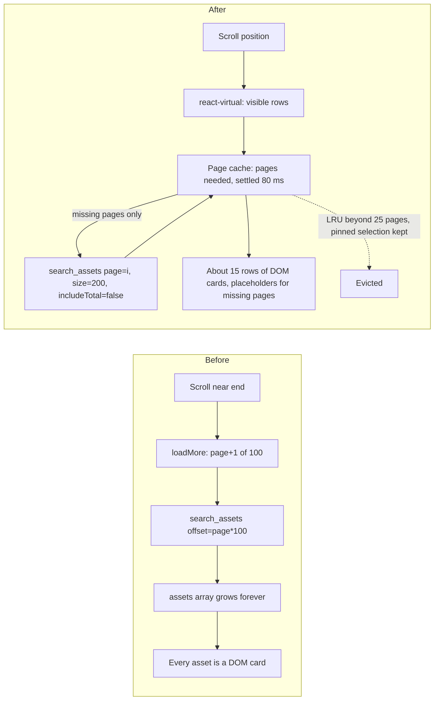
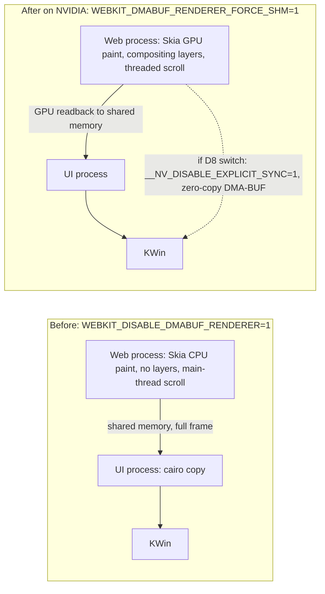

# Fast browsing for big collections: windowed grid, GPU rendering, lean thumbnails

Status: approved 2026-10-16. Shaped in a three-round interview (D1-D19) and approved at review,
where you kept the technical choices the plan made on its own (D20). Follow-up: once this plan
merges, Mission Control slices it into dependency-linked tickets.

Revised 2026-10-16 after rebasing on `main` at 56c00e4, where #62 (auto-tag runs from the grid
and sidebar menus) had landed. These are consistency repairs inside the approved decisions; no
decision changed:

- The page cache also serves `refreshAssets`, which #62 added for auto-tag updates.
- The windowed grid and list keep #62's right-click menu.
- The merge-conflict risk with ticket #50 is gone, because it landed as #62.

Revised again 2026-10-16 after Plan Validation repair round 1. These close validation gaps inside
the approved decisions; no decision changed:

- **No reader left behind between steps.** Step 3 removes `assets`, so it also moves the list view
  and the footer onto the page cache. Step 4 adds only keyboard paging and the scrub label.
- **Render mode from step 1.** `bench_render_mode` reports the effective mode read from the
  environment (`describe_render_env`). So it works before step 7, and step 7 doesn't change it.
- **Benchmarks and checks never touch your live library.** Agents run them on a fresh copy of a
  golden snapshot of the Kenney library, in a throwaway profile, so the step-1 baseline can be
  rerun on identical data at any later step.
- **UI checks.** Each user-facing behavior gets a scripted check (U1-U8) in the dev harness, with
  screenshots.
- **WebKitGTK capabilities.**
  - A probe confirmed that `image-rendering: pixelated` works in WebKitGTK 2.54.1.
  - The scrub label no longer depends on `pointerdown` events from the native scrollbar, which
    are unverified. It keys off scroll speed, which any thumb drag on a big collection exceeds.
- **Interrupt-safe cleanup pass.** It deletes a batch's files before committing the batch.
  - An interrupted pass redoes that batch on the next open and never orphans files.
  - A card whose thumbnail fails to load falls back to the original.
  - A test covers the interruption.

Revised a third time 2026-10-16 after the GitHub Inspector review of PR #66. These are
corrections inside the approved decisions; no decision changed:

- **No double scrolling from real key presses.** The container's key handler calls
  `preventDefault()` for Home, End, Page Up, Page Down and Space, so WebKit's built-in scrolling
  never runs on top of the plan's own. U7 checks `defaultPrevented`, because scripted key events
  never trigger built-in scrolling.
- **User-set compositing gets its own mode name.** `WEBKIT_DISABLE_COMPOSITING_MODE` on its own now
  reports `no-compositing` instead of `webkit-default`, and the tests cover it.

## Problem

In your words: scanning big collections with the infinite scroll gets slow. The scrollbar doesn't
show the size of the collection, dragging it down means waiting for the next 100 to load, and the
more you've loaded, the slower it gets. You asked whether the app is hardware accelerated, and
whether there's a smarter way to load and unload assets.

## What we measured

All numbers come from your Kenney library (83,095 assets, one library) on this machine, read from
a copy of `~/Documents/Kenney/Assets/.opendam/library.sqlite` and its `.opendam/thumbs` folder.

| Finding | Evidence |
|---|---|
| The database is not the bottleneck. | A 100-asset page sorted by date takes under 2 ms at any offset. Sorted by name or size it takes 83-92 ms, because neither column has an index. With a `file_name COLLATE NOCASE` index and a `size_bytes` index, a 200-asset page at the same offset takes 1.1-1.3 ms. |
| The grid never unloads anything. | `AssetGrid.tsx` maps every loaded asset to a full `AssetCard`: thumbnail, hover transform, fade-in animation and chip strip. Each card subscribes to the tag and collection stores and builds its own collection-name map. |
| Work grows with how far you've scrolled. | Every `preview:done` event, favorite toggle or collection change copies the whole `assets` array with `assets.map(...)`, and React re-checks every loaded card. `library:updated` makes `refresh()` refetch every loaded page in one request. |
| The scrollbar only covers what has loaded. | The scroll height is the loaded rows. An `IntersectionObserver` sentinel 1,200 px below the end appends 100 more. Dragging to the bottom waits for each page in turn. |
| Thumbnails are bigger than their sources. | 98.5% of a 400-file sample of texture PNGs are 512 px or smaller, and half are 64 px or smaller. The originals average 4 KB. Each still gets a 512x512 thumbnail: 31 KB median, 1 MB decoded. The 58,147 texture thumbnails take 3.2 GB on disk. Round 2's "roughly 1.8 GB" was an estimate from the median; this is the measured total. |
| SVGs are drawn from their originals. | The 5,907 SVG "image" assets have no thumbnail, so the webview rasterizes each original. |
| Sort order has ties. | Only 3,655 distinct `modified_at` values exist across 83,095 assets. Today's `ORDER BY` has no tie-break. |
| Paging across several libraries does unnecessary work. | The all-libraries view fetches `offset + 100` full rows from every library and sorts them in Rust. For a window of 80,200 rows in one library, the sqlite3 CLI takes 77-81 ms for full rows and 14-15 ms for `rowid` plus the sort key alone. You have one library today, so this is latent. |

## Is it hardware accelerated? No.

`main.rs` sets `WEBKIT_DISABLE_DMABUF_RENDERER=1` to avoid the Error 71 crash on NVIDIA with
Wayland. In the installed WebKitGTK (2.54.1, NVIDIA driver 615.78.08, RTX 5080), that variable
means pure CPU rendering:

- Skia paints on the CPU.
- There are no compositing layers and no threaded scrolling.
- The GTK side copies every whole frame.

Hover transforms, box-shadows and fade-ins all repaint on the main thread. `backdrop-filter` blur
(the video badge) is documented as broken in this mode (WebKit bug 303811). Sources:
[AcceleratedBackingStore.cpp](https://github.com/WebKit/WebKit/blob/webkitgtk-2.54.1/Source/WebKit/UIProcess/gtk/AcceleratedBackingStore.cpp),
[HardwareAccelerationManager.cpp](https://github.com/WebKit/WebKit/blob/webkitgtk-2.54.1/Source/WebKit/UIProcess/gtk/HardwareAccelerationManager.cpp),
[environment-variables.md.in](https://github.com/WebKit/WebKit/blob/webkitgtk-2.54.1/Source/WebKit/glib/environment-variables.md.in).

We ran MiniBrowser at `webkit://gpu` in a nested headless KWin on this machine:

| Setting | Result |
|---|---|
| WebKit default (DMA-BUF on) | Crashes with Error 71, which is the open [WebKit bug 280210](https://bugs.webkit.org/show_bug.cgi?id=280210) (NVIDIA explicit sync). |
| `WEBKIT_DISABLE_COMPOSITING_MODE=1` | Crashes with Error 71. |
| `WEBKIT_DISABLE_DMABUF_RENDERER=1` (today) | Runs. Acceleration policy "never", no GPU in the render process. |
| `WEBKIT_DMABUF_RENDERER_FORCE_SHM=1` | Runs. Policy "always", GPU rendering on the RTX 5080, frames sent through shared memory. |
| `__NV_DISABLE_EXPLICIT_SYNC=1` | Runs. Full GPU path with zero-copy DMA-BUF buffers. |

The nested test shows which mode each variable selects and that the crash goes away. It does not
show behavior on your real Plasma session (scaling, several monitors), flicker over time, or
scroll performance.

## Decisions

D1-D7 are from round 1 of the interview, D8-D14 from round 2, D15-D19 from round 3, and D20 from
the review.

| # | Decision | Your answer |
|---|---|---|
| D1 | How the grid stops slowing down | Windowed DOM: render only visible rows plus a margin, and recycle them. |
| D2 | What the scrollbar represents | Full size from the start: the thumb maps to all N results. Placeholder tiles show until the page under the viewport arrives. Pages you fly past while dragging are not fetched. |
| D3 | How much asset data stays in memory | A bounded LRU page cache of about 5,000 assets. Selected and focused assets are never evicted. |
| D4 | Fixed card height | Always reserve the one-line chip strip, empty on untagged assets. |
| D5 | Scrub label | Position plus sort key, for example `41,200 of 83,095 - M`. |
| D6 | Related fixes in scope | All four: window the list view, no 512 px thumbnails for images 512 px or smaller (show the original), name and size sort indexes, and deep paging across several libraries. |
| D7 | Proof | A scripted scroll benchmark on Kenney, run before and after, plus unit tests for the windowing math. |
| D8 | GPU rendering on NVIDIA | Default to `WEBKIT_DMABUF_RENDERER_FORCE_SHM=1`. The benchmark also runs `__NV_DISABLE_EXPLICIT_SYNC=1`, and we switch to it if it is clearly faster and you see no flicker. Values you set yourself still win. |
| D9 | Windowing library | `@tanstack/react-virtual`. |
| D10 | Existing upscaled thumbnails | A one-time background pass when a library opens clears `thumbnail_path` and deletes the `_thumb` file wherever the source is 512 px or smaller. |
| D11 | Scaling small originals | A toolbar toggle between smooth and pixelated, remembered across sessions. |
| D12 | Name sort case | Case-insensitive everywhere, through a `COLLATE NOCASE` index. |
| D13 | Where the benchmark lives | Committed and dev-only. It starts with `VITE_SCROLL_BENCH=1` and prints a JSON report. |
| D14 | Round 2 technical defaults | Accepted as listed (see below). |
| D15 | Where the scaling toggle applies | Everywhere an image is enlarged: grid, list, detail panel preview and QuickLook. |
| D16 | The toggle's first-run state | Pixelated. |
| D17 | Keyboard | Home, End, Page Up and Page Down work in the grid and the list once you click into them. |
| D18 | Acceptance targets | As proposed (see [Acceptance targets](#acceptance-targets)). |
| D19 | Round 3 technical defaults | Accepted as listed (see below). |
| D20 | The plan's own technical choices, C1-C14 (review) | Kept as written. |

**D14, the round 2 defaults:**

- **Pages** of 200 assets, cached by index. Fetching waits about 80 ms for the scroll to settle,
  so pages you pass aren't fetched.
- **Placeholders** are static tiles with no shimmer.
- **Card animation.** The fade-in on mount is removed; the hover lift stays.
- **Live updates.** `library:updated` invalidates the cache and refetches only the visible pages,
  keeping the asset at the top of the view anchored. `preview:done` patches one cached asset.
- **Grid size.** Changing sm/md/lg keeps the first visible asset in place.
- **Multi-library merge.** It fetches only `id + sort key` for the merge window, then full rows
  for the one page.
- **Total count.** It is computed once per query, not on every page.

**D19, the round 3 defaults:**

- **TGA and TIFF.** WebKit can't display them, so a small TGA or TIFF still gets a thumbnail, at
  its own size and never upscaled. Only webview-displayable formats (png, jpg, jpeg, webp, bmp,
  gif) skip thumbnails entirely.
- **Pixelated scaling** applies only where an image is shown larger than its pixel size. Shrunk
  images always render smooth.
- **Scrub label keys:**
  - Name: the first letter, with `#` for anything else.
  - Date: `Mar 2024`.
  - Size: `12 MB`.
  - Rating: stars.
  - Kind: the kind label.
  - Favorite: `Favorites` or `Others`.

  The label shows while you drag the thumb or fling, and hides about 0.6 s after you stop.
- **GPU startup.** NVIDIA is detected by `/proc/driver/nvidia/version`. The chosen mode is logged
  at startup, and the docs are updated.
- **Benchmark.**
  - Metrics: rAF frame intervals (p50, p95, frames over 50 ms), DOM node count, time from a jump
    to filled tiles, and web-process RSS from `/proc`.
  - Scenarios: continuous scroll, 20 random jumps, and each grid size.
- **Explicit-sync switch.** It needs p95 frame time at least 15% better than FORCE_SHM, and no
  flicker in about 10 minutes of your own use.

## Choices this plan makes on its own

These weren't asked in the interview. They follow from the decisions above or the code, and you
kept them at review (D20).

| # | Choice | Why |
|---|---|---|
| C1 | Every search `ORDER BY` ends with `a.rowid` in the sort direction. | The `modified_at` ties make offset paging nondeterministic. With random-access pages, a tie group split across a page boundary could show an asset twice or skip one. `EXPLAIN QUERY PLAN` shows a `rowid` tie-break uses the same index scan at no cost. A tie-break on `a.id` would add a temp B-tree. |
| C2 | "Settled" (D14) means the set of pages under the viewport, plus overscan, hasn't changed for 80 ms. | This fetches nothing while you drag past pages. A slow scroll stays inside a page's span for thousands of pixels, so its page set counts as settled and it never waits on scroll events stopping. |
| C3 | Prefetch the next page in the scroll direction when the viewport comes within 2 screens of it. | A 200-asset page is 10 or more screens tall at md size, so a steady scroll never reaches a placeholder. |
| C4 | Deleting assets calls `refresh()` instead of splicing the cache. | Deletes shift every later index. Refetching the visible pages, anchored as in D14, is simpler and costs a few ms. |
| C5 | The refresh anchor is found by asset id. | After a refresh, the asset that was at the top is looked up within the refetched pages around its old index (±200). If found, the scroll position shifts by the difference. If not, the index is kept and clamped to the new total. |
| C6 | `SearchPayload` gains `includeTotal` (default `true`). `SearchResult.total` becomes optional. | This is how D14's "count once per query" reaches the backend. Only the first page of a query and refreshes ask for the total. |
| C7 | The multi-library merge compares exactly as SQLite does. | Each library's list arrives sorted by SQLite, so the merge must use the same comparator or the global top N can miss rows. Names compare with NOCASE semantics (ASCII-only folding, then bytewise), `kind` bytewise, and numbers numerically. Ties break by library position, then `rowid`. Today's Rust comparator uses Unicode `to_lowercase` and has no tie-break. |
| C8 | Cards stop building per-card maps. | One shared memoized collection-name map replaces the map each `AssetCard` builds on every render. |
| C9 | Without a thumbnail, the grid and list choose the original by file extension, not by asset kind. | The rule is: show the original if it is webview-displayable (png, jpg, jpeg, webp, bmp, gif, svg). `DetailPanel` already uses this list. Today a small PNG of kind `material` would show a placeholder once its thumbnail is gone. A thumbnail that fails to load falls back to the original the same way, before the placeholder. |
| C10 | The cleanup pass is recorded in a new per-library `library_meta (key, value)` table, under key `thumbs_no_upscale`. | Once recorded, it never re-reads 57k image headers on later opens, which matters on network shares. It is resumable, because cleared rows no longer match. |
| C11 | The cleanup pass only touches assets whose own extension is a raster image. | 3D-model thumbnails are also named `<id>_thumb.png`, so matching on the file name would delete them. |
| C12 | The footer shows the visible range, `41,201-41,236 of 83,095 assets`. | "Loaded of total" means nothing once pages are evicted. |
| C13 | Bench support is debug-only: Tauri commands compiled under `#[cfg(debug_assertions)]` read RSS and write the report. | JavaScript can't read `/proc`, and WebKit has no `performance.memory`. Nothing reaches release builds. |
| C14 | The scaling toggle compares device pixels. | An image is enlarged when its rendered box times `devicePixelRatio` is larger than its natural size. The box is the scale factor for `object-fit: cover` or `contain`. |

## Design

### Data flow

Today the grid appends pages forever and renders every loaded asset. After this plan, the
virtualizer turns the scroll position into a row range, the page cache works out which 200-asset
pages that range needs, and only missing pages go to `search_assets`. Far pages are evicted.



### Search backend (`commands/asset.rs`, `migrations/002_library_schema.sql`)

- **Stable order (C1).** `ORDER BY <sort expr> <dir>, a.rowid <dir>`, where the name sort is
  `a.file_name COLLATE NOCASE` (D12).
- **Indexes (D6).** `002_library_schema.sql` gains these two lines. They run on every library open
  and are created once.

  ```sql
  CREATE INDEX IF NOT EXISTS idx_assets_file_name_nocase ON assets(file_name COLLATE NOCASE);
  CREATE INDEX IF NOT EXISTS idx_assets_size_bytes ON assets(size_bytes);
  ```

- **Count once (C6).** `count_assets` runs only when `includeTotal` is true.
- **Multi-library deep paging (D6, C7).**
  1. Per library, run `SELECT a.rowid, <sort expr> FROM assets a <where> ORDER BY ... LIMIT
     offset+limit`. That is two narrow columns from the index, with no JSON subqueries.
  2. Merge with the SQLite-equivalent comparator, breaking ties by library position in
     `get_all_libraries` order, then `rowid`.
  3. Take the page's slice.
  4. Per library, fetch full rows `WHERE a.rowid IN (...)` and reassemble them in merged order.

  The single-library path keeps `LIMIT/OFFSET`, which stays under 2 ms with the indexes.

### Page cache (`store/index.ts`)

`useAssetStore` drops `assets`, `page`, `pageSize` and `loadMore`, and holds:

| Field | Meaning |
|---|---|
| `total` | Result count for the current query. |
| `pages: Map<number, Asset[]>` | Page index to up to 200 assets. |
| `lru: number[]` | Page indices, least recently wanted first. At most 25 pages (5,000 assets, D3) are kept, and pages currently wanted are never evicted. |
| `indexById: Map<string, number>` | Global index of every cached asset. |
| `pinned: Map<string, Asset>` | Copies of selected and focused assets (D3). These are kept in sync with `useUIStore` selection and focus, and updated by every patch. |
| `pending: Set<number>` | Pages in flight. |
| `generation` | Bumped by every `search()`. Results from an older generation are dropped, as `queryGeneration` does today. |

Actions:

| Action | What it does |
|---|---|
| `search()` | Clears the cache and fetches page 0 with the total. |
| `ensurePages(indices)` | Fetches missing pages that aren't already pending, without the total, then evicts. |
| `assetAt(i)` | Returns the asset at index `i`, if cached. |
| `getById(id)` | Looks in `pinned`, then the cache. |
| `patchCached(id, fn)` | Replaces one asset in its page, so only that page's rows re-render. It also updates the pinned copy. `patchAsset`, `updateAssetPreview`, `setPreviewStatus`, `refreshAssets` and the collection store's add/remove loops all use it. |
| `refresh()` | Invalidates the cache but keeps stale pages on screen until they are replaced, refetches the total and the wanted pages, then applies the anchor (C5). |

These callers move off `assets`, all in the same build step (step 3):

- `AssetGrid.tsx`: the grid, the list view (`assets.map` into `AssetListRow`) and the footer
  (`assets.length`).
- `App.tsx` and `DetailPanel.tsx`: focused-asset lookups use `getById`.
- `CollectionsSection.tsx`: `resolveDroppedAssetId` gets the cached assets.
- `refreshAssets(ids)`: `useAutotagStore.applyUpdate` calls it for assets an auto-tag run changed.
  It re-fetches only the cached and pinned ones and writes them back through `patchCached`.
- `deleteAsset(s)`: refreshes (C4).

### Windowed grid and list (`components/AssetGrid/`)

- **Geometry (`gridGeometry.ts`, pure).** It replicates today's `repeat(auto-fill, minmax(tile, 1fr))`
  so cards keep their size:
  - `columns = max(1, floor((contentWidth + gap) / (tileMin + gap)))`
  - `tileWidth = (contentWidth - gap * (columns - 1)) / columns`
  - `rowPitch = tileWidth + CARD_BODY_HEIGHT + border + gap`

  It also maps indices to rows, maps row ranges to pages, and computes the anchor row when the
  column count changes.
- **Virtualizer (D9).** `useVirtualizer` from `@tanstack/react-virtual` runs on the scroll
  container (`id="asset-scroll"`):
  - `count` is `ceil(total / columns)`.
  - `estimateSize` returns `rowPitch`.
  - `overscan` is 2 rows.
  - When the width or grid size changes, it calls `measure()`, then `scrollToIndex` on the anchor
    row, so the first visible asset stays in view (D14).
  - Each virtual row is a CSS grid of `columns` cards, positioned with `translateY`.
- **Fixed card height (D4).** `CARD_BODY_HEIGHT` is exported from TypeScript and set as the CSS
  variable `--card-body-height`, so CSS and the geometry share one value. The chip strip is always
  rendered at a fixed height, empty when an asset has no chips.
- **Placeholders (D2, D14).** Indices whose page isn't cached render static card-shaped tiles.
- **Card cost.**
  - `.card`'s `animation: fadeIn` is removed. The hover lift stays.
  - Images use `decoding="async"` and drop `loading="lazy"`, since offscreen tiles aren't mounted.
  - Cards read the shared collection-name map (C8).
- **Context menu (#62).** Cards and rows keep `onContextMenu`. `AssetContextMenu` keeps resolving
  paths through `getById`, which also finds pinned assets.
- **List view (D6).** It uses the same virtualizer with a fixed 36 px row (`AssetListRow`) plus a
  1 px gap.
- **Wanted pages.** These are the pages covering the visible rows plus overscan, plus the prefetch
  page (C3). They are handed to `ensurePages` once settled (C2).
- **Size limit.** WebKit lays out up to about 33.5 million px (`LayoutUnit`), so the grid works up
  to roughly half a million assets at md on a narrow window. Larger libraries are out of scope.

### Navigation (D5, D17, C12)

- **Scrub label.**
  - Placement: a floating label at the scroll container's right edge, at the scrollbar thumb's
    height.
  - Text: `41,200 of 83,095 - M`, where the position is the first visible index plus 1. The key
    shows once that asset's page is cached.
  - When it shows: while scroll speed exceeds 2 viewport heights per second.
    - That covers flings, and it covers every thumb drag on a big collection: there, one pixel of
      thumb travel moves the content thousands of pixels, several viewport heights.
    - It doesn't rely on `pointerdown` from the native scrollbar. Whether WebKitGTK dispatches that
      event is unverified, so the plan doesn't use it.
  - It hides 600 ms after the last scroll event, and is `aria-hidden`.
  - Keys come from the pure function `scrubKey(asset, sortField)`:

  | Sort | Key |
  |---|---|
  | name | First character uppercased if it is a letter, otherwise `#` |
  | date | `modified_at` as a short month and year, for example `Mar 2024` |
  | size | `formatSize(sizeBytes)`, for example `12 MB` |
  | rating | `★★★☆☆`, or `Unrated` |
  | kind | The kind's display label |
  | favorite | `Favorites` or `Others` |

- **Footer (C12).** It shows the visible range: `41,201-41,236 of 83,095 assets`.
- **Keyboard (D17).** The scroll container gets `tabIndex={0}` and takes focus on pointerdown,
  unless the target is itself focusable.
  - Home and End scroll to the top and bottom.
  - Page Down and Page Up scroll by one viewport height minus one row.
  - The handler calls `preventDefault()` for Home, End, Page Up, Page Down and Space. Otherwise
    WebKit's built-in scrolling of the focused container would also run, and one real Page Down
    would scroll twice.
  - Space still opens QuickLook: `App.tsx`'s window handler sees the event as it bubbles up.
  - The keys are ignored while a text field has focus (`isEditingText`). Arrow keys keep their
    native small-step scrolling, since arrow-key tile navigation is out of scope.

### Thumbnails (D6, D10, D19, C9-C11)

- **New rule (`preview.rs`).** `generate_image_thumb` reads the source dimensions from the image
  header first (`image::image_dimensions`).

  | Source | Result |
  |---|---|
  | Max side 512 px or smaller, and png, jpg, jpeg, webp, bmp or gif | No file is written. The job completes with `thumbnail_path = NULL`. |
  | Max side 512 px or smaller, and tga, tif or tiff | A PNG at native size, never resized. |
  | Larger than 512 px | Downscaled to fit 512, as today. |

  `complete_job` needs an explicit clear, since today's `COALESCE(?, thumbnail_path)` keeps the old
  path. The `preview:done` event carries `thumbnailPath: null`, and `updateAssetPreview` clears the
  path instead of keeping it.
- **Fallback (C9).** `isWebviewDisplayable(ext)` lives in `utils/`. The grid, list and detail panel
  all use it.
- **One-time cleanup pass (D10, C10, C11).** It runs in the background for each open library after
  `sync_open_libraries`, unless `library_meta.thumbs_no_upscale = 'done'`.
  1. It selects assets with a non-null `thumbnail_path` whose own extension is a raster format
     (png, jpg, jpeg, webp, bmp, gif, tga, tif, tiff).
  2. It reads each source's header. Sources that are missing or unreadable are skipped.
  3. Where the max side is 512 px or smaller:
     - **Webview-displayable sources:** it works in batches of 200. It deletes the batch's
       thumbnail files first (ignoring NotFound), then sets `thumbnail_path = NULL` for the batch
       in one transaction.
       - If the pass is interrupted between the two, those rows still point at deleted files, so
         the next open redoes the batch. No file is orphaned and no row is lost.
       - Until then, a card whose thumbnail fails to load shows the original (C9).
     - **TGA and TIFF:** it re-queues a preview job, so the image queue rewrites the thumbnail at
       native size.
  4. It sets the meta key to `done` and emits `library:updated` once.

  On Kenney, expect about 57k rows cleared and up to 3.2 GB freed.

### Image scaling toggle (D11, D15, D16, C14)

- **Preference.** `useUIStore` gains `imageScaling: 'pixelated' | 'smooth'`. It defaults to
  `pixelated` (D16) and is added to the persisted `partialize`.
- **Control.** A toolbar button (`id="image-scaling-toggle"`) sits beside the grid-size group and
  shows in both grid and list views. Its title is "Image scaling: Pixelated" or "Image scaling:
  Smooth".
- **Rule.** The pure function `shouldPixelate(pref, natural, box, fit, dpr)` returns true only when
  the preference is pixelated and the image is enlarged in device pixels (D19, C14). A hook,
  `useImageScaling`, applies `image-rendering: pixelated` to the grid card, the list thumbnail,
  the detail panel preview and the QuickLook image (D15). It re-checks on load and on resize.
- **Verified in WebKitGTK.** A probe ran MiniBrowser in a nested headless KWin on this machine
  (WebKitGTK 2.54.1). A 4x4 checkerboard scaled to 256 px rendered with hard pixel edges under
  `image-rendering: pixelated`, also with `object-fit: cover`. That held in both CPU mode and
  `WEBKIT_DMABUF_RENDERER_FORCE_SHM=1`. Without the property, the same image rendered blurred.

### GPU rendering (D8, D19)



- **Choosing the mode.** `choose_render_env(lookup_env, nvidia_present)` is a pure function that
  returns which variable to set and a mode name:
  - If any of `WEBKIT_DISABLE_DMABUF_RENDERER`, `WEBKIT_DMABUF_RENDERER_FORCE_SHM`,
    `__NV_DISABLE_EXPLICIT_SYNC`, `WEBKIT_DISABLE_COMPOSITING_MODE` or
    `WEBKIT_SKIA_ENABLE_CPU_RENDERING` is set, it sets nothing. The mode is `user-set` and names
    the variables.
  - Otherwise, if `/proc/driver/nvidia/version` exists, it sets
    `WEBKIT_DMABUF_RENDERER_FORCE_SHM=1`. The mode is `gpu-shm`.
  - Otherwise it sets nothing. The mode is `webkit-default`.
- **Reporting the mode.** `describe_render_env(lookup_env)` is a pure function added in step 1. It
  names the effective mode from the variables that are set once `main.rs` has applied its defaults:
  - `cpu`: `WEBKIT_DISABLE_DMABUF_RENDERER` or `WEBKIT_SKIA_ENABLE_CPU_RENDERING` is set.
  - `gpu-shm`: otherwise, if `WEBKIT_DMABUF_RENDERER_FORCE_SHM` is set.
  - `explicit-sync`: otherwise, if `__NV_DISABLE_EXPLICIT_SYNC` is set.
  - `no-compositing`: otherwise, if `WEBKIT_DISABLE_COMPOSITING_MODE` is set.
  - `webkit-default`: none of them is set.

  Until step 7, `main.rs` always sets `WEBKIT_DISABLE_DMABUF_RENDERER=1`, so it reports `cpu`. The
  startup log and `bench_render_mode` both use it. Step 7 therefore changes what gets set, not how
  it is reported.
- **Applying it.** `main.rs` applies the choice before Tauri starts any threads and passes it to
  `opendam_desktop_lib::run`. Once tracing is up, `run` logs the choice's reason and the
  `describe_render_env` mode under the `render` target.
- **Effect.** On NVIDIA, GPU painting, compositing layers and threaded scrolling come back. Machines
  without NVIDIA move from today's CPU mode (the variable is set unconditionally now) to WebKit's
  default DMA-BUF path. Setting `WEBKIT_DISABLE_DMABUF_RENDERER=1` yourself restores the old
  behavior.
- **The explicit-sync switch (D8, D19).** The benchmark runs in three modes:
  - `cpu`: `WEBKIT_DISABLE_DMABUF_RENDERER=1`
  - `gpu-shm`: the new default
  - `explicit-sync`: `__NV_DISABLE_EXPLICIT_SYNC=1`

  The NVIDIA default becomes `__NV_DISABLE_EXPLICIT_SYNC=1` only if two things hold:
  - its md continuous-scroll p95 frame interval is at least 15% better than `gpu-shm`;
  - you see no flicker in about 10 minutes of normal use on your Plasma session.

  Otherwise it stays `gpu-shm`.

### Scroll benchmark (D7, D13, D19, C13)

- **Entry point.** `main.tsx` loads `apps/desktop/src/dev/scrollBench.ts` only when
  `import.meta.env.DEV` is true and `VITE_SCROLL_BENCH` is set: `1` runs the timing scenarios and
  `checks` runs the UI checks. Vite drops the branch from release builds.
- **Debug-only Tauri commands (C13).**
  - `bench_rss` sums `VmRSS` of descendant processes whose `comm` starts with `WebKitWebProces`
    (`comm` is truncated to 15 characters).
  - `bench_render_mode` returns `describe_render_env` for the environment the app started
    with. It works from step 1 on and needs no change in step 7.
  - `bench_report(json)` prints the report and writes
    `apps/desktop/src-tauri/target/scroll-bench/<mode>-<unix-ts>.json`, which is gitignored.
- **DOM markers.**
  - The scroll container has `id="asset-scroll"`.
  - Every tile has `data-tile`, with `data-tile-state="ready"` once its asset is cached and its
    image has loaded or failed, and `"placeholder"` otherwise.

  The first build step adds these markers to today's grid, so the baseline and the new grid use
  the same harness.
- **Scenarios.** Each runs at sm, md and lg; targets are judged at md.
  1. **Continuous scroll:** 60 s at 3,000 px/s from the top, driven by rAF.
  2. **End to end:** 200 equal steps from top to bottom, with a 150 ms dwell, sampling DOM nodes
     and RSS at each step.
  3. **Random jumps:** 20 jumps from a fixed seed, timing each until every visible tile is ready,
     with a 5 s timeout.
- **Report contents.**
  - Frame intervals: p50, p95, max, and counts over 50 ms and over 100 ms.
  - DOM nodes (`document.getElementsByTagName('*').length`): min and max.
  - RSS: start, end and max.
  - Jump time-to-ready: p50, p95 and max.
  - Run context: render mode, window size, `devicePixelRatio`, total assets and git commit.
- **Baseline on today's grid.**
  - Scenario 1 runs as is.
  - Scenario 2 becomes "jump to the bottom repeatedly until 20,000 assets have loaded or 120 s
    pass".
  - Scenario 3 is reported as unsupported.
- **UI checks.** `VITE_SCROLL_BENCH=checks` runs the checks U1-U8 (see
  [Acceptance targets](#acceptance-targets)) instead of the timing scenarios.
  - It writes PASS or FAIL for each check into the same report.
  - It logs a named pause wherever the nested-KWin script should take a screenshot, which goes
    into `.evidence/` for the PR.
  - Key presses are dispatched to the scroll container as cancelable `keydown` events, which
    exercises the plan's own key handler.
  - Scripted events never trigger WebKit's built-in scrolling, so the check also asserts
    `defaultPrevented`. That is what keeps a real press from scrolling twice.
  - No tool for injecting real key presses (`wtype`, `ydotool`, `xdotool`) is installed here, so
    your feel check covers real presses.
- **Bench data, never the live library.** Agent builds from this plan's branches never open
  `~/Documents/Kenney/Assets` or the real master DB, because they write to any library they open
  (indexes, `library_meta`, the cleanup pass).
  1. **Golden snapshot, once, in step 1.**
     - `rsync -a` the live library root to `~/.cache/opendam-bench/kenney-golden/`, excluding
       `.opendam/library.sqlite*`, `.opendam/index.lock` and `.opendam/backup-*`.
     - Copy the DB with `sqlite3 -readonly <live>/.opendam/library.sqlite ".backup <golden>/.opendam/library.sqlite"`,
       which stays consistent even while your app holds the DB.
     - The snapshot is about 5.5 GB. The disk is ext4, which has no reflinks, and has 666 GB free.
     - A `golden.json` records the source, the time, the asset count and the commit.
  2. **Each run.**
     - `cp -a` the golden snapshot into a fresh run directory and start from a fresh
       `XDG_DATA_HOME`.
     - Register the run copy as the only library by seeding the throwaway master DB, as in
       "A throwaway profile".
     - Delete the run directory afterwards.
  3. **Comparisons.** Every comparison (baseline, after, GPU modes) uses the same golden snapshot,
     so the step-1 baseline can be rerun on identical data at any later step. The cleanup pass and
     the new indexes only ever run on run copies. Your live library gets them when you run a build
     that has them.
- **Where it runs.** Agents run it in a nested headless KWin with a virtual 1400x900 output, its own
  D-Bus session and `OPENDAM_NO_KEYRING=1`, never on your desktop session. You can rerun it on the
  real session.

## Acceptance targets

These are D18's targets. The benchmark measures them at md grid size with the new GPU default, in
the nested headless KWin, on a run copy of the golden Kenney snapshot. The report also records the
CPU-mode numbers and the pre-change baseline for comparison.

| # | Target | Scenario |
|---|---|---|
| T1 | DOM node count stays within 10% (max/min ≤ 1.10) from asset 0 to 80,000. | End to end |
| T2 | A jump to any offset fills the visible tiles within 300 ms at p95. | Random jumps |
| T3 | Continuous-scroll p95 frame interval is 20 ms or less, with no frame over 100 ms. | Continuous scroll |
| T4 | Web-process RSS grows by less than 150 MB after scrolling end to end. | End to end |

The UI checks run in the harness's `checks` mode on a run copy. Each must pass in the step that
delivers its behavior and again in the final run (step 8).

| # | Check | Behavior | Step |
|---|---|---|---|
| U1 | With only page 0 cached, `scrollHeight` matches `ceil(total / columns) x rowPitch` within one row. | Full-size scrollbar (D2) | 3 |
| U2 | After a jump to 75%, placeholders show, then every visible tile is ready within 300 ms. Screenshot after the fill. | Jumping and placeholders (D2, T2) | 3 |
| U3 | In list view, rendered rows stay under 60 from top to bottom, and the footer reads `first-last of total assets`. | Windowed list and footer (D6, C12) | 3 |
| U4 | Changing the grid size keeps the first visible asset in the first visible row. | Anchoring (D14) | 3 |
| U5 | Right-clicking a card at offset 60,000 opens the menu with `grid-menu-autotag`, and Escape closes it. | #62's context menu kept | 3 |
| U6 | During a scripted scroll faster than 2 viewport heights per second, under name and date sort, the label shows `<n> of <total> - <key>`. It hides 0.6 s after the scroll stops. Screenshot while visible. | Scrub label (D5, D19) | 4 |
| U7 | With the container focused, End shows the last row, Home the first, and Page Down advances by one viewport minus one row. Each of Home, End, Page Up, Page Down and Space comes back with `defaultPrevented` true. | Keyboard (D17) | 4 |
| U8 | `#image-scaling-toggle` flips an enlarged small image's computed `image-rendering` between `pixelated` and `auto`. A shrunk image stays `auto`, and the setting survives a reload. Screenshots of both states. | Scaling toggle (D11, D15, D16) | 6 |

Two checks need a human:

- your feel check after the windowed grid lands, and after step 4, that one real Page Down moves
  exactly one screen;
- the 10-minute flicker check that gates the D8 explicit-sync switch.

## Tests

Tests run by file, as `AGENTS.md` says. Each regression test must fail on `main`.

- **TypeScript (`bun test`):**
  - `gridGeometry.test.ts`: columns, tile width and row pitch match the CSS rule at several widths;
    index-to-row and row-range-to-pages; the anchor row across column-count changes.
  - Page cache: LRU eviction at 25 pages; wanted and pinned assets are never evicted; stale
    generations are dropped; settle (C2) and prefetch (C3) choose the right pages; `patchCached`
    replaces only one page; the refresh anchor (C5).
  - `scrubKey.test.ts`: every sort field, including digits, non-letters, unrated and favorites.
  - `shouldPixelate`: enlarged versus shrunk, `cover` versus `contain`, and `devicePixelRatio`.
  - `isWebviewDisplayable`: the extension list.
- **Rust (`cargo nextest run`):**
  - `commands::asset`:
    - With many tied `modified_at` values, consecutive pages neither overlap nor skip.
    - Name order is case-insensitive.
    - The key-only multi-library merge returns the same page as a full sort for several offsets
      across two in-memory libraries, including ties and non-ASCII names.
    - `includeTotal = false` skips the count.
  - `preview`:
    - A small PNG gets no thumbnail and `thumbnail_path` NULL.
    - A small TGA gets a native-size PNG.
    - A large PNG gets a 512 px thumbnail.
    - A job over an existing thumbnail clears the path.
  - The cleanup pass:
    - It clears small rasters and deletes their files.
    - It keeps large rasters and leaves model thumbnails alone.
    - It re-queues small TGAs.
    - It records `library_meta`, and a second run does nothing.
    - It is safe to interrupt. A test hook stops the pass after it deletes a batch's files but
      before it commits the batch. A rerun redoes that batch and finishes the rest. It sets
      `library_meta` only at the end, and leaves the same rows and files as an uninterrupted run.
  - `choose_render_env`: user-set variables win, NVIDIA gets FORCE_SHM, and other GPUs keep the
    default.
  - `describe_render_env`: each variable maps to its mode, `WEBKIT_DISABLE_DMABUF_RENDERER` wins
    over the others, `WEBKIT_DISABLE_COMPOSITING_MODE` alone gives `no-compositing`, and no
    variable gives `webkit-default`.
- **UI checks U1-U8:** these run in the nested KWin through the harness's `checks` mode (see
  [Acceptance targets](#acceptance-targets)), not in `bun test`.

## Suggested build order

The follow-up ticket slicing decides the final cut. This is the dependency order the design
implies:

1. **Benchmark harness, snapshot and baseline.**
   - Commit the harness with its `checks` mode, the DOM markers on today's grid, and the
     debug-only commands with `describe_render_env`.
   - Take the golden snapshot.
   - Record the baseline report in CPU mode on a run copy.
2. **Search backend.** The `rowid` tie-break, NOCASE and size indexes, `includeTotal`, and the
   key-only multi-library merge.
3. **Page cache, windowed grid and windowed list.** Depends on step 2.
   - Every reader of `assets` moves in this step, so nothing reads it once it's gone:
     - the grid, the list view and the footer range (C12);
     - `App.tsx`, `DetailPanel.tsx` and `CollectionsSection.tsx`;
     - `refreshAssets` and the collection store's loops.
   - Fixed card height, placeholders, no fade-in, anchoring and the shared collection map also
     land here.
   - Checks U1-U5.
4. **Navigation.** Keyboard paging and the scrub label. Checks U6-U7. Depends on step 3.
5. **Thumbnails.** The no-upscale rule, the extension-based fallback and the cleanup pass.
   Independent of step 3, apart from a small overlap in `AssetCard`'s image branch. Its tests
   include the interrupted pass.
6. **Image scaling toggle.** Check U8. After steps 3 and 5.
7. **GPU default and mode comparison.** Independent. The comparison uses step 1's harness and
   `bench_render_mode` unchanged, and means most after step 3.
8. **Final run.** T1-T4 and U1-U8 on a fresh run copy after all of the above, then the human
   checks.

## Docs and invariants

- **`AGENTS.md`, Architecture invariants (`CLAUDE.md` is a symlink to it).** Add:
  - **Deterministic search order.** Every search `ORDER BY` ends with `a.rowid`, and across
    libraries with the library's position, so offset pages never overlap or skip.
  - **No upscaled thumbnails.** Raster sources 512 px or smaller that the webview can display get
    no thumbnail. Smaller TGA and TIFF get native-size ones.
  - **Windowed results.** The grid and list render only the visible rows from the page cache.
    Nothing maps over all results.
- **`docs/agents/running-the-app.md`.** Replace the note that `main.rs` sets
  `WEBKIT_DISABLE_DMABUF_RENDERER=1` with the mode selection and how to override it. Document the
  benchmark and its `checks` mode:
  - how to run it, the nested-KWin recipe, and where reports land;
  - the bench data recipe: the golden snapshot, run copies, and the rule that builds from these
    branches never open the live library.

## Risks and known gaps

- **Readback cost.** FORCE_SHM reads every frame back from the GPU. The benchmark runs at
  1400x900, and the cost at 4K on your monitor is unmeasured until your feel check.
- **Machines without NVIDIA.** They move from CPU rendering to WebKit's default DMA-BUF path, which
  is untested here. The escape hatch is setting `WEBKIT_DISABLE_DMABUF_RENDERER=1` yourself.
- **The nested KWin isn't your session.** Its frame pacing differs from the real one; the targets
  are judged there because agents can't use your desktop.
- **Concurrent work.** Open tickets from the AI auto-tagging plan may still touch `AssetGrid.tsx`
  or the asset store. Whichever lands second rebases.
- **Snapshot drift.** The golden snapshot is frozen at step 1, so later changes to your live
  library aren't in it. That's intended: comparisons need identical data.
- **Disk use.** The golden snapshot takes about 5.5 GB under `~/.cache/opendam-bench`, and each
  run copy takes as much again until it is deleted.
- **The cleanup pass on network shares.** It reads about 57k image headers once per library. It is
  background work and resumable, but it can take minutes over SMB.

## Out of scope

- **SVG thumbnails.** The 5,907 SVGs are still rasterized from their originals. A Rust rasterizer
  such as `resvg` would be a follow-up.
- **Arrow-key tile navigation** (D17 chose paging keys only).
- **Natural sort**, so that `tile_2` comes before `tile_10`.
- **Libraries beyond the WebKit layout height limit**, roughly half a million assets.
- **An upstream fix for WebKit bug 280210.**
