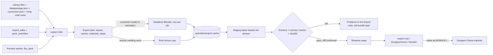

# Game export: collections to Dungeon Game bundles

Status: shaped 2026-10-22 in a three-round interview (D1-D34 below) and approved at final review.
Once this plan merges, Mission Control slices it into tickets.

Revised 2026-10-22 after the plan validation workflow's review. No decision changed:

- **Every intermediate step is safe to ship.** The build order now guards textures as it guards
  models. Until step 3, a texture under a `conversion.json` is refused. Until step 5, so is a
  texture that needs a conversion. Neither ships with a false `conversion: []` or unconverted
  pixels.
- **Animations wait for step 7.** Until then, a domain holding an animation is refused. The
  mesh-less fixture, the animation assertions, AC6 and AC2's animation move to step 7, so step 6
  consumes nothing that step 7 makes.
- **Default names come in step 1,** with the first export, and step 2 adds editing them.

Revised again 2026-10-22 after the workflow's second review. No decision changed:

- **Fixtures grow with the steps that use them.** `make_fixtures.py` and the fixture library land
  in step 1 and gain each fixture in the first step that tests it. Step 6 adds only the CI
  Blender install and the Blender-backed tests. The cut-out base color is now a PNG, since a
  JPG has no alpha.
- **Every part of the Game tab has a step.** Material, texture role, layout and convention editors
  come in step 4, rig and facing in step 6, and the humanoid suggestion and avatarFrom in step 7.
  The sha256 memo (A4) comes in step 1.
- **A texture used by no model** defaults to its own stem, as a shared texture does (C5).

Revised a third time 2026-10-22 after the workflow's third review. No decision changed:

- **Blender is needed only when Blender runs.** The 5.2.x gate (D29) refuses an export only when
  it has an uncached model or animation job, so a texture-only domain, or one whose models are
  all cached, exports without Blender. The Blender path setting, the gate and the test against
  CI's pin land in step 6, with the CI install, instead of step 1.

Revised a fourth time 2026-10-22 after the workflow's fourth review. No decision changed:

- **The slot and take checks compare like with like.** One collision rule (C9) now decides the
  kept meshes for both `fbx_facts` and the Blender script. Both list only the materials of kept
  meshes, without assimp's synthetic `DefaultMaterial`, and only takes that animate something.
  The script reports its source's kept slots and takes as well as what it wrote, so a lossy round
  trip is caught in the same run, and the worker's lists are compared as sets.
- **A kept mesh with no material gets one.** The script gives it a material named after the
  model, so every exported model has at least one slot, as the schema requires.
- **New fixtures:** a `UCX_` hull with its own material, one with no material, and a model with
  no material at all. All three must export.
- **A cached export needs no Blender.** Cache keys use `BLENDER_SERIES` (`5.2`) rather than the
  exact Blender version, and each entry keeps the exact version it was made with, for its step.

Revised a fifth time 2026-10-22 after GitHub Inspector's review of PR #165. No decision changed:

- **An animation's cache key includes its model's.** A change to the followed model (its
  source, facing or origin) re-runs the animation, so a stale clip never ships (C11).
- **Crash recovery keeps the last bundle.** A `.D.old-*` folder is renamed back to `D/` when
  `D/` is missing, and is deleted only when `D/` exists (C15).
- **A lone FBX is a model or an animation,** treated as a group of one. A lone OBJ, glTF, GLB
  or `.blend` is refused like a group with no FBX (C3, D31, A5).
- **`Mat` is no longer a name prefix,** so `Mattress_01` stays `Mattress01`. `MAT_` still drops,
  in any case (C5).

Revised a sixth time 2026-10-22 after GitHub Inspector's second review of PR #165. No decision
changed:

- **The collision patterns are in every Blender cache key,** so changing them re-runs the jobs
  instead of reusing a model cut with the old patterns (C11).
- **An export root inside a library, or holding one, is refused,** so exported files never get
  indexed as new assets (C2, AC15).

Revised a seventh time 2026-10-22 after GitHub Inspector's third review of PR #165. No decision
changed:

- **Models and animations are told apart by kept meshes.** An FBX whose only meshes are
  collision hulls counts as having no mesh. One with neither a kept mesh nor a take is refused
  with a named problem, rather than failing schema validation later (C3).
- **One rule decides what a `conversion.json` covers.** Origin inference uses the same nearest
  `conversion.json` walk, up to the library root, that C10 uses. A converter that writes its
  `conversion.json` above the pack folder still makes the pack `unreal` (C6, A1).

Revised an eighth time 2026-10-22 after GitHub Inspector's fourth review of PR #165. No decision
changed:

- **The Blender script starts from an empty scene,** so the default cube and its `Material`
  never reach the bounds, the FBX or the slot names. An FBX with two materials of one name is
  refused by name, because Blender would rename one (C9, C12).
- **Export re-checks everything the Check read.** The Check keeps a fingerprint of the edits,
  overrides, settings, membership and every file it opened. Export compares it and asks for a
  new Check when anything changed, so a rename made after the Check never ships stale (C14).

Revised a ninth time 2026-10-22 after GitHub Inspector's fifth review of PR #165. No decision
changed:

- **The fingerprint covers files that appear after the Check.** It also records every path the
  Check probed and found missing (each `conversion.json` and `<file>.meta` it looked for), and
  each pack's indexed file list. A `conversion.json`, `.meta` or newly matching texture added
  between Check and Export makes Export ask for a new Check (C14, AC11).

Revised a tenth time 2026-10-22 after GitHub Inspector's sixth review of PR #165. No decision
changed:

- **The added material has a fixed name, chosen before Blender runs.** It is `OpenDAMDefault`, or
  `OpenDAMDefault2` and up when a kept slot already uses that name. Rust picks it from
  `fbx_facts`, the Game tab shows it, and the job carries it, so it is in the cache key. Renaming
  a file no longer leaves a stale slot name in the cache, and the name can't clash with a source
  slot (C7, C9, C11, C12).
- **A clashing pack id's suffix skips ids already in the manifest,** so `foo-2` can't collide
  with a pack really named `foo-2` (C6).

Revised an eleventh time 2026-10-22 after GitHub Inspector's seventh review of PR #165. No
decision changed:

- **A real material named `DefaultMaterial` is kept.** `fbx_facts` builds its slot list from the
  materials the FBX itself declares, read by a small reader of the file's node tree, so only the
  material assimp adds for a mesh without one is left out (C12, C16, AC4, AC5).
- **Renaming the domain or the root collection forces a new Check.** Their names make the bundle
  path and the manifest's `domain`, so they are in the Check's fingerprint (C14, AC11).

Revised a twelfth time 2026-10-22 after GitHub Inspector's eighth review of PR #165. No
decision changed:

- **Images become textures by set, not one by one.** Images in one folder whose stems match,
  once the prefix and the role or layout suffix are dropped, form a texture set, and C8 converts
  its sources together. So a standalone `T_Rock_R` and `T_Rock_M` export as one `Rock`
  MetallicSmoothness, and an ORM member as an Occlusion and a MetallicSmoothness of one name. A
  lone metallic map gets URP Lit's default smoothness, 0.5. A texture edit sets a source's layout,
  and its role only when it passes through, and the name belongs to the set (C3, C4, C5, C8,
  C13, C16, AC7).
- **A pack id that slugifies to nothing becomes `pack`,** which the clash suffix then makes unique
  like any other (C6, AC9).

Revised a thirteenth time 2026-10-22 after GitHub Inspector's ninth review of PR #165. No
decision changed:

- **A `_DX` or `_GL` suffix is dropped before anything else is read.** It sets a normal map's
  convention (D14), and the role or layout suffix before it is read next, so `T_Rock_N_DX` is the
  `Rock` set's Normal in DirectX and exports with its green flipped. Sets, suffix lookups and
  default names all compare stems without it (C5, C7, C8, C16, AC4, AC7).

Revised a fourteenth time 2026-10-22 after GitHub Inspector's tenth review of PR #165. No
decision changed:

- **When several images match a slot's role, one texture set wins, by folder.** The model's own
  folder first, then the nearest folder, then the folder path ignoring case. A role never mixes
  files from two sets, so resolution variants and copies in other folders bind the same set on
  every run (C7, C16, AC4).

## Goal

The Dungeon Game takes its art only as **bundles** that OpenDAM exports and the game's importer
(`make art BUNDLE=<path>`) validates and places. The game side has decided the contract. This
plan builds OpenDAM's half of it. When it is done:

- You pick an export root folder and a root collection (`DungeonGame`) in Settings. Each child
  collection of that root is a **domain** (`Warden`, `Valuables`, `Dungeon`, ...).
- A domain's **Export** view lists every asset with its game name and status, the problems that
  block the export, and the diff against the last export. **Export** writes
  `<export root>/DungeonGame/<Domain>/` with `manifest.json` and exactly the files it lists.
- A **Game** tab in the detail panel shows and lets you correct each asset's `assetName`, its
  rig and facing, its materials (slot, role and texture), and each texture's role, channel layout
  and normal-map convention. Inferred values are marked as inferred, and your edits as yours.
- Every exported model has been rewritten by headless Blender to metres, Y up, facing +Z, with
  its pivot at the bottom centre. Every texture is ready for its URP Lit role. Every manifest is
  valid against the contract's schema, and every conversion is recorded.

## The contract is the source of truth

The contract lives in the private repository `ramiro314/dungeon-game`:

| File | What it is |
|---|---|
| `docs/asset-contract.md` | The prose spec, contract version 1 |
| `docs/asset-contract.schema.json` | JSON Schema 2020-12 for `manifest.json` and (under `$defs/conversionFile`) `conversion.json` |
| `docs/adr/0002-opendam-asset-contract.md` | The contract's decisions D1-D21 and the rejected options |
| `docs/plans/opendam-importer/plan.md` | The game's importer plan, which says what the importer checks |

This plan implements the contract as of dungeon-game commit
`05279adae1cf2151af12a3ef307f27eac695b1ad`, the schema's last change. The schema and spec are
the same at `origin/main` `dfab743` (checked 2026-10-22). OpenDAM never drifts from it. If this
plan or its implementation needs the contract to change, the change is proposed in dungeon-game
first, with a `contractVersion` bump if it breaks either side, and the schema is then re-copied
here (C1). This interview found no contract change to propose.

What the contract fixes, in brief:

- **The bundle:** `<Domain>/manifest.json`, `Models/<assetName>.fbx`,
  `Textures/<assetName>_<Role>.<png|tga|psd|tif>`, `Animations/<assetName>.fbx`, and nothing
  else. One export is the whole domain: what the manifest doesn't list leaves the game.
- **The manifest:** `contractVersion` 1, `domain`, `exportedAt`, `exporter` (`OpenDAM` and its
  version), `packs` (id, name, version, publisher, sourceUrl, licence `{spdx, name, url}`,
  origin), and `assets`. Each asset has kind, assetName, file, sha256, pack, sourcePath and
  conversion. A model adds bounds, rig, clips and materials (`{slot, name, surface, textures}`).
  A texture adds a role. An animation adds avatarFrom and clips.
- **Roles:** `BaseColor` (sRGB, alpha as opacity for cutout), `Normal` (OpenGL, green up),
  `MetallicSmoothness` (metal in R, smoothness in A), `Occlusion` (AO in G), `Emission` (sRGB),
  `Height` (G). The importer never edits pixels.
- **Normalization:** with Scale Factor 1, Convert Units on and Bake Axis Conversion off, Unity
  shows the model at real size in metres, Y up, facing +Z, with `min.y` 0 and the centre on X and
  Z at 0. The importer refuses a size off by more than 1% on any axis, or a pivot off by more
  than 1% of the largest dimension.
- **Names:** no two models or animations share an `assetName`, and no two textures share an
  `assetName` and role. A model and its own textures share an `assetName` on purpose.
- **Conversions:** a step is `{tool, toolVersion, by?, from, settings?}`, with flat scalar
  settings. A `conversion.json` (`{contractVersion: 1, steps}`) covers its folder and everything
  below it, and a deeper one replaces a shallower one.

## What OpenDAM has today

Surveyed 2026-10-22 on `main` `ed9be51`:

| # | Need | What exists | Gap |
|---|---|---|---|
| 1 | Collections to bundles | `collections.parent_id` nesting and smart collections (`filter_spec`). Definitions live in master, and each library DB holds membership rows for its own assets, by asset UUID (`db::library_of_asset`). One collection can span libraries. | No export, no copy-out, no path-type setting. Settings are JSON rows in master `settings`, and only `autotag/settings.rs` types them. |
| 2 | assetName | Format groups (`structure::format_groups`): `group_id` is the main item's id, chosen GLB > glTF > FBX > Blend > OBJ. Metadata writes reach every member (`structure::group_members`). | No name field. A file moved outside the app gets a new UUID (the watcher deletes the row and inserts a new one), and loses its collections and metadata. |
| 3 | Texture roles | Nothing pairs textures with models. `textures.py` resolves only base color, at preview time, and keeps no paths. | The whole role graph. Real packs show what to infer from: Stylarts' `T_desk_D/_N/_AORM.png`, and Unity packs' `.mat` and `.meta` GUID graphs. |
| 4 | Normalization | The worker loads FBX with `assimp_py` into trimesh, for previews only. It doesn't compute bounds or read `UnitScaleFactor` or `UpAxis`. The detail panel has a three.js `ThreeViewer`. | Everything. Blender 5.2.2 is installed at `/usr/bin/blender`. CI (`ubuntu-latest`) has no Blender. |
| 5 | Texture conversion | The Rust `image` crate decodes rasters. The worker has Pillow and numpy. | No repacking, roughness inversion or green flip. |
| 6 | conversion.json | The watcher indexes `datapackage.json` and no other JSON file. | Reading and merging `conversion.json`. |
| 7 | Provenance | `PackInfo` has name, version, publisher, authors and source URL, from `datapackage.json`, the license header and `pack_overrides`. A licence is a `LicenseKind` (CC0, CC-BY, CC-BY-SA, MIT, Apache-2.0, OFL, unknown), plus the datapackage's raw SPDX id. The override is free text. | No origin, no sha256 anywhere, no pack slug. |
| 8 | v1 scope | assimp reads FBX meshes. | Takes, rig detection, the animation-only check. |

No JSON-schema validation exists. Neither Rust (`jsonschema`, `sha2`) nor the worker has the
libraries.

## Decisions

From the interview on 2026-10-22. "Human" means the answer you gave. Every answer in rounds 1-3
was the recommended option, except D34, which you rewrote.

| # | Question | Answer | Made by |
|---|---|---|---|
| D1 | What rewrites models | **Headless Blender**, run as its own process, with a script OpenDAM ships. | Human, round 1 |
| D2 | Which models are rewritten | **Every model**, and the step is recorded. | Human, round 1 |
| D3 | Byte-stable re-exports | **Cache converted files** in `.opendam/export-cache/`, keyed by source sha256, step settings and tool version. | Human, round 1 |
| D4 | Where pixel work runs | **Rust, with the `image` crate.** A PSD that needs converting is refused in v1. A PSD that needs no conversion passes through. | Human, round 1 |
| D5 | Schema copy and checks | **Copied into src-tauri with a SOURCE note** (repo, path, commit, sha256). Every manifest and conversion.json is validated with the Rust `jsonschema` crate. A test pins the copy, and a script re-copies it. | Human, round 1 |
| D6 | Root and destination | **Two settings: export root folder and root collection.** The bundle path is `<export root>/<root collection name>/<Domain>/`. | Human, round 1 |
| D7 | A domain's assets | **The domain and all its subcollections, flattened.** Textures join through materials. Smart collections can't be domains. | Human, round 1 |
| D8 | Where your corrections live | **Per asset in the library DB**, written to every group member, the same in every domain. | Human, round 1 |
| D9 | Default assetName | **Drop a known type prefix**, split words and PascalCase them. | Human, round 1 |
| D10 | Name collisions | **Flagged, and the export refuses** until you rename one. | Human, round 1 |
| D11 | Role inference sources | **FBX slots and references, then Unity `.mat` via `.meta`, then file-name suffixes, then same-stem images**, in that priority. | Human, round 1 |
| D12 | Pack origin | **Inferred and editable on the pack:** `.meta` files mean unity, a `conversion.json` step from uasset means unreal, else generic. See A1 for where it is inferred. | Human, round 1 |
| D13 | Facing | **A default per origin** (unity: as is, unreal: +X turned to +Z, generic: as is), **plus a per-model 90 degree override about Y**, shown with a forward arrow. | Human, round 1 |
| D14 | Normal-map convention | **A pack setting defaulting from origin** (unreal: DirectX, else OpenGL). A `_DX`/`_GL` suffix wins over it, and a per-texture override wins over both. | Human, round 1 |
| D15 | Licence `spdx` | **The datapackage's SPDX id as stated (LicenseRef-* included)**, else the LicenseKind's id, else an override that is an SPDX id, else null. | Human, round 1 |
| D16 | Pack id, packless assets | **The datapackage name if it is a valid slug, else the folder slugified**, with `-2` on a clash. **An asset in no pack is refused.** | Human, round 1 |
| D17 | Multi-input sourcePath | **sourcePath is the roughness file.** The step's settings name the other inputs. | Human, round 1 |
| D18 | Writing a bundle | **Stage, validate, diff against the previous manifest, then swap in by renaming.** | Human, round 1 |
| D19 | LODs and collision | **Drop collision meshes, keep LODs** with Unity's `_LODn` names. Bounds cover every kept renderer. | Human, round 2 |
| D20 | Rig | **none or generic set automatically. Humanoid is suggested** from bone names, and only you set it. | Human, round 2 |
| D21 | Animations | **The same transform as its avatarFrom model**, applied to the armature object. avatarFrom defaults by best bone match and is editable. An FBX with no mesh and at least one take is an animation. | Human, round 2 |
| D22 | Material names | **From the slot, prefixes dropped, PascalCased.** Duplicates within a model refuse. Editable. | Human, round 2 |
| D23 | Cutout | **Inferred and editable:** a Unity `.mat` with alpha clip, else a suggestion from BaseColor alpha below 0.5, else opaque. | Human, round 2 |
| D24 | Texture names | **One model: `<AssetName>`, or `<AssetName><MaterialName>` when that model has several textures in the role. Shared: its own stem, stripped.** Collisions refuse. | Human, round 2 |
| D25 | Other image formats | **jpg/jpeg/bmp/webp/gif become PNG** (a recorded step). `.tiff` is renamed `.tif`. dds/exr/hdr are refused. Nothing is resized. | Human, round 2 |
| D26 | Layouts in v1 | **ORM/AORM/ARM, split Roughness/Gloss + Metallic (+ lone AO), HDRP MaskMap, and URP-ready pass-through.** | Human, round 2 |
| D27 | UI | **A Game tab in the detail panel and an Export view per domain.** | Human, round 2 |
| D28 | Several domains | **One domain per export** in v1. | Human, round 2 |
| D29 | Accepted Blender | **The major.minor CI pins (5.2.x).** Any other version refuses the export. A setting holds Blender's path. | Human, round 3 |
| D30 | Driving Blender | **One headless process per model or animation**, JSON in and out, a few at a time, each with a timeout. Cache hits skip Blender. | Human, round 3 |
| D31 | Groups with no FBX | **Refused in v1.** The exported file is always the group's FBX. | Human, round 3 |
| D32 | Stored or inferred | **Only your edits are stored.** Inferred values are recomputed when shown and at export. | Human, round 3 |
| D33 | Step identity | **Blender steps: tool Blender, its version, by `opendam-normalize/<N>`. Texture steps: tool OpenDAM, `opendam-textures/<N>`, by the operation.** Each `<N>` is a constant in the cache key. | Human, round 3 |
| D34 | Testing with Blender | **CI installs the pinned blender.org 5.2.x tarball**, sha256-verified and cached (not apt, which is older), and runs the Blender-backed tests end to end, failing if Blender is missing. Fixture FBX files are made by a committed Blender script, and every manifest and conversion.json a test writes is validated against the schema. | Human, round 2 (Other) |

These are agent decisions, made while writing the plan. Each is reviewed at final review:

| # | Decision | Why |
|---|---|---|
| A1 | **Origin is inferred when a pack is read for export, not by the structure pass.** That happens when the Export view, the Game tab or the pack edit form asks, or at export. The check stats `<file>.meta` for the pack's indexed files, and resolves each indexed file's nearest `conversion.json` up to the library root, as C10 does. Your override lives in `pack_overrides`, as D12 says. | The watcher indexes neither `.meta` nor `conversion.json`, and the structure pass reads no file on a rerun (the "Structure is derived" invariant). Inferring at read time keeps both invariants. D12's intent is unchanged: the origin is inferred and editable on the pack. |
| A2 | **The Blender script is embedded in the app** (`include_str!`) and written to a temp file per run. | `make install` and the installed app need no new file. Its version is `opendam-normalize/<N>`. |
| A3 | **The UI reads model facts through the preview worker.** A new `fbx_facts` request (assimp) returns the kept meshes' material slots, texture references by type, mesh and bone names, and the takes that animate something, by the same rules as the Blender script (C9, C12). Blender's result at export is authoritative. A slot or take set that differs from the worker's is a problem that refuses the export, naming the model. | The Game tab needs facts in milliseconds, and Blender takes seconds per model. |
| A4 | **Source sha256s are memoized** in a library DB table `file_hashes(file_path, size_bytes, modified_at, sha256)`. | The Export view shows "changed" without hashing a whole domain each time. |
| A5 | **The exported FBX is the group's first FBX member**, preferring one in an `fbx(unity)` format folder, then by path ignoring case. A lone FBX file (`group_id` NULL) is its own group of one. | D31 says the group's FBX, but a group can hold two, and most FBX files have no copies. |
| A6 | **A domain member that is neither a model, an animation nor an image is a problem that refuses the export** (audio, documents). | "What the manifest doesn't list leaves the game." Skipping members silently would drop them from the game without a word. |
| A7 | **When a group forms, the main item's export edits win** (`structure::apply_unions`, as for the main item's own fields). | Groups share metadata. |
| A8 | **A pack with no licence at all exports `{ "spdx": null, "name": "Unknown" }`.** | The schema requires `name`. |
| A9 | **The export cache is never pruned automatically in v1.** Settings has "Clear export cache". | Pruning safely needs every domain's latest export. Known gap. |

## The flow

The export reads only the library and writes only the cache and the export root. It never
writes into the game's repository (contract ADR D1).

## Contracts

**C1. The pinned schema.** `apps/desktop/src-tauri/contract/asset-contract.schema.json` is a
byte copy of dungeon-game's `docs/asset-contract.schema.json`. Beside it, `SOURCE.md` names the
repository, the path, the commit (`05279adae1cf2151af12a3ef307f27eac695b1ad`) and the file's
sha256.

- **A test pins it:** `contract::tests` checks that the copy's sha256 equals the one in
  `SOURCE.md`, so an edit made here fails CI.
- **One way to change it:** `scripts/sync-asset-contract.sh <dungeon-game checkout> <commit>`
  copies the file at that commit and rewrites `SOURCE.md`. It is run only after the change has
  merged in dungeon-game.
- **Validation:** `export::contract` embeds the copy (`include_str!`). It validates every
  manifest before the swap, and every `conversion.json` it reads against `$defs/conversionFile`,
  with the `jsonschema` crate (Draft 2020-12, `unevaluatedProperties` and `format` checked).
- **OpenDAM mirrors the importer's own checks** that a schema can't express: unique names, a
  known pack for every asset, every material texture naming a texture asset with that role,
  every `avatarFrom` naming a rigged model, and exactly the listed files, each matching its
  sha256. So OpenDAM never writes a bundle the importer would refuse on its manifest.
- **The contract version** OpenDAM writes is `1`, a constant beside the copy.

**C2. Settings.** `export/settings.rs`, modelled on `autotag/settings.rs`, stores three master
`settings` rows:

- `export.root`: an absolute folder.
- `export.rootCollection`: a collection id.
- `export.blenderPath`: empty means `blender` on `PATH`.

The Settings dialog gains a **Game export** section with a folder picker, a picker for a
top-level, non-smart collection, Blender's path with its detected version, and "Clear export
cache". An export with the root or the root collection unset is refused.

- **The export root must lie outside every library.** An export root that equals a library root,
  lies inside one, or contains one is refused, both when it is set and at each check. Otherwise
  the watcher would index the written `Models/*.fbx` and `Textures/*` files as new assets. They
  would join format groups beside their sources and feed back into texture inference on the
  next export. Paths are compared after resolving symlinks.
- **The Blender gate** (D29) applies only to an export that has at least one uncached model or
  animation job (C9, C11). Such an export is refused when Blender is missing or isn't 5.2.x. An
  export of textures only, or one whose models and animations all hit the cache, never starts
  Blender and never checks for it: cache keys use `BLENDER_SERIES`, not the installed version
  (C11).
- **The accepted series** is the constant `BLENDER_SERIES = "5.2"`, and a test checks that CI's
  pinned version starts with it.
- **When they land:** `export.root` (with its outside-every-library check),
  `export.rootCollection` and the cache button come in step 1. `export.blenderPath`, the gate,
  `BLENDER_SERIES` and its CI-pin test come in step 6, together with the CI install they check.

**C3. Domains.** A domain is a direct child of the root collection.

- **Names:** its name must match `^[A-Z][A-Za-z0-9]*$`, and so must the root's, since it is a
  folder of the bundle path.
- **Members:** the members of the domain and of all its subcollections, deduplicated, across
  every library (D7). A smart collection can't be a domain or sit below one.
- **How each member is read** (members are grid items: a main item or a file on its own):
  - a format group with an FBX member, or a lone FBX file (no copies in other formats, so
    `group_id` is NULL), which is treated as a group of one, is a **model** when its FBX has a
    kept mesh (C9 step 2: a mesh the collision patterns don't drop), and an **animation** when it
    has no kept mesh and at least one take (D21). So an FBX holding only a `UCX_` hull and a take
    is an animation;
  - an FBX with neither a kept mesh nor a take (an empty rig, or collision meshes only) is refused
    with "FBX has no kept mesh and no take", since it has nothing to normalize or animate;
  - a format group with no FBX, or a lone OBJ, glTF, GLB or `.blend` file, is refused (D31);
  - an image is a source of a standalone **texture set** (C8), with its role or layout
    inferred from its suffix, else `BaseColor`;
  - anything else is refused (A6).
- **Textures** reached through a model's materials join the domain without being members, and
  so do the other sources of a member's texture set. A texture that is both a member and used
  by a material is one asset.

**C4. Your edits.** A library DB table `export_edits(asset_id TEXT PRIMARY KEY, edits TEXT NOT
NULL)` holds JSON, written to every member of the asset's group in one transaction
(`structure::group_members`). `no_metadata_write_bypasses_group_members` covers it, and A7 gives
the main item's edits precedence when a group forms. It holds only what you set (D32):

- **For a model:** `assetName`, `rig`, `facingQuarterTurns` (0-3), and `materials`, keyed by slot
  name. Each slot can hold `name`, `surface` and `textures`, a map from role to the asset id of a
  source in a texture set (C8), where `null` means "no texture in this role".
- **For an animation:** `assetName` and `avatarFrom`, the model's asset id.
- **For a texture:** per source image, its `layout` (C8) and `normalConvention`, and its `role`
  only when its layout passes it through as one role. A layout with several outputs (ORM,
  MaskMap), or one merged from several sources (Roughness plus Metallic), fixes its output
  roles, so you change the layout, not a role. `assetName` belongs to the source's texture set:
  it is written to every source in the set, and if they disagree after the set changes, the
  first source by path wins.

It is kept out of `metadata`, which `assets_fts` indexes. A file moved outside the app gets a new
id and loses its edits and its membership, as for all metadata today. The export's diff shows
that asset as removed before anything is written (C15).

**C5. Names.** `export::names::pascal(stem)` makes every default (D9, D22, D24):

- **The rule:** drop one leading type prefix (`SM_ SK_ S_ T_ M_ MI_ MAT_ A_ AN_ P_ BP_`, any
  case). Every prefix ends in `_`, so a word that only starts like one is kept. Split on `_`,
  `-`, spaces and lower-to-upper case changes. Capitalise each word, keep digits, and drop every
  other character. A result starting with a digit gets an `X` prefix. So `SM_arch01_broken`
  becomes `Arch01Broken`, `Small_chest` becomes `SmallChest`, `mattress_01` becomes
  `Mattress01`, and `Material_Wood` becomes `MaterialWood`.
- **A model's or animation's default** comes from its group's main item's stem (D31: the file is
  the FBX, the name is the main item's).
- **A material's default** comes from its slot name.
- **A texture's default** (D24) is its texture set's (C8): a set used by one model takes that
  model's `assetName`, or `<AssetName><MaterialName>` when that model has more than one set in
  the role. A set used by several models in the domain, or by none (standalone members), takes
  its stem, with prefix and suffixes dropped as C7 step 3 drops them (`PolygonCity_Texture_01_A`
  becomes `PolygonCityTexture01A`, and `T_Rune_N`, `T_Rock_R` and `T_Rock_N_DX` become `Rune`,
  `Rock` and `Rock`).
- **Uniqueness:** two models or animations with one name, two textures with one name and role,
  or two materials of one model with one name, are each a problem naming both assets. The export
  refuses (D10).

**C6. Packs and provenance.**

- **Pack id** (D16): the `datapackage.json` `name` when it matches `^[a-z0-9][a-z0-9-]*$`, else
  the pack folder's name lowercased, with each run of other characters turned into `-` and
  `-` trimmed from the ends, or `pack` when nothing is left (a folder named `日本語アセット` or
  `---`). Every pack gets that natural id first. Then, on a clash, each later pack by library
  order, then path, gets the lowest `-2`, `-3`, ... suffix whose id no other pack in the manifest
  holds, natural or suffixed. So `foo`, `foo` and a pack named `foo-2` become `foo`, `foo-3` and
  `foo-2`, and two packs that both fall back get `pack` and `pack-2`.
- **The other pack fields:** `name` is the pack's shown name (`pack_holding`). `version`,
  `publisher` and `sourceUrl` come from `PackInfo` and your overrides, and are left out when
  absent.
- **The licence** (D15, A8): `spdx` is the first datapackage licence `name` that is an SPDX id
  or a `LicenseRef-` reference, else the `LicenseKind`'s SPDX id, else your override text when it
  is an SPDX id, else null. `name` is the stated title, the override text or the kind's name, else
  `Unknown`. `url` is the licence's http(s) URL, when it has one.
- **The origin** (D12, A1): your `pack_overrides.origin`, else `unity` when any indexed file in
  the pack has a `<file>.meta` beside it, else `unreal` when the nearest `conversion.json` of any
  indexed file in the pack has a step with `from: "uasset"`, else `generic`. "Nearest" is C10's
  walk from the file's folder up to its library root, `export::conversion::nearest`, so a
  `conversion.json` above the pack folder counts here exactly as it does in the manifest. That
  walk lands in step 1, where the step-3 guard also uses it. An invalid `conversion.json` is
  skipped here, and C10 refuses it at export.
- **The normal-map convention** (D14): `pack_overrides.normal_convention` (`opengl` /
  `directx`), else `directx` for unreal and `opengl` otherwise.
- **The pack edit form** gains Origin and Normal maps fields, each showing its inferred value.
  `pack_overrides` gains the two nullable columns.
- **Every asset** carries `pack` (its pack's id), `sourcePath` (its source file relative to the
  pack folder, with `/` separators, and for a texture made from several files, the first input
  per D17) and `sha256` (of the file written to the bundle, lowercase hex).
- **An asset in no pack** is refused, with "mark its folder as a pack" (D16).

**C7. Materials and roles.** `export::infer` builds each model's materials. The slot list comes
from `fbx_facts` for the UI and from Blender at export (A3). Both list only the kept meshes'
slots (C9 step 2), so the Game tab never shows a collision hull's material. When a kept mesh
has no material, the tab also shows the slot the script will add, under the name C9 step 2 gives
it, marked as added at export, so its roles can be inferred and edited like any other.
For each slot, the first source with an answer wins (D11):

1. **The FBX's texture references** for the slot (diffuse/base color, normal, metalness,
   roughness, AO, emissive, height), resolved as `textures.py` resolves them (given path, then
   relative, then by name within the pack), bounded to the library and pack roots.
2. **For a unity pack, a Unity material:** the model's `.fbx.meta` `externalObjects` remap for
   the slot, else a `.mat` in the pack named like the slot. The `.mat` texture properties are
   resolved to files through the pack's `.meta` GUIDs: `_BaseMap`, `_MainTex` or `_BaseColorMap`
   is BaseColor; `_BumpMap` or `_NormalMap` is Normal; `_MetallicGlossMap` is MetallicSmoothness;
   `_MaskMap` is an HDRP MaskMap; `_OcclusionMap` is Occlusion; `_EmissionMap` or
   `_EmissiveColorMap` is Emission; `_ParallaxMap` or `_HeightMap` is Height. Alpha clip on
   (`_AlphaClip: 1`, Standard `_Mode: 1`, HDRP `_AlphaCutoffEnable: 1`) makes the slot cutout
   (D23).
3. **File-name suffixes** on images in the pack whose stem, with prefix and suffix dropped,
   matches the slot's or the model's (`_D _BaseColor _Albedo _Diffuse _Color`, `_N _Normal _NRM`,
   `_ORM _AORM _ARM`, `_MaskMap _Mask`, `_R _Roughness _Rough`, `_G _Gloss _Glossiness
   _Smoothness`, `_M _Metallic _Metalness`, `_AO _Occlusion`, `_E _Emissive _Emission`,
   `_H _Height _Disp _Displacement`, `_MetallicSmoothness _MS`). A trailing `_DX` or `_GL`
   (any case) is read and dropped first: it sets a normal map's convention (D14), and the role or
   layout suffix before it is read next. So `T_Rock_N_DX` is a Normal in DirectX with the stem
   `Rock`, and every stem comparison (this lookup, C5's names, C8's sets) is made without it.
4. **Images in the model's format group or folder** with the model's stem, as BaseColor.

- **When several images match** a slot's role, in step 1's search by name or in step 3, the
  role is filled from one texture set (C8), never from files of two sets. The set is chosen by its
  folder: the model's own folder first, then the folder nearest to it (fewest steps up and down
  the folder tree), then the folder path ignoring case. So with `Textures/1K/T_Crate_N.png` and
  `Textures/4K/T_Crate_N.png`, equally near `Models/`, `SM_Crate` binds the `1K` set, and the
  texture picker (C13) can choose `4K`. A new matching file can change the choice, and the
  Check's pack file list (C14) catches it.
- **Your edits** (C4) replace any inferred field.
- **Surface:** when no Unity material says cutout, a BaseColor whose alpha has any pixel below
  0.5 is shown as a cutout suggestion. You accept it with one click, and until then it exports
  opaque.
- **A material with no textures** exports `textures: {}`.
- **A texture shows** its role, its layout (C8) and, for a normal map, its convention.

**C8. Texture conversion.** `export::textures` turns each texture a material or member uses into
the files its roles need, at source resolution and bit depth (8 or 16 bit), as PNG unless it
passes through.

**Texture sets.** Images are grouped before conversion. A texture set is the images in one folder
whose stems match, ignoring case, once the type prefix (C5), a `_DX` or `_GL` convention suffix and
the role or layout suffix (C7 step 3) are dropped: `T_Rock_D`, `T_Rock_N_DX`, `T_Rock_R` and
`T_Rock_M` form the set `Rock`. A domain's member image brings in its whole set, and a material
brings in the sources of the roles it uses. A set's sources go through the table below together, so
it exports one texture asset per output role, all sharing the set's `assetName` (C5). An image
whose suffix names no role or layout is a set of its own, as BaseColor.

| Source layout | Inferred from | Output |
|---|---|---|
| URP-ready (BaseColor, Normal in OpenGL, MetallicSmoothness, Occlusion, Emission, Height) | Role suffix or a Unity material | The source file, byte for byte, when its format is png/tga/psd/tif. No step. |
| ORM / AORM / ARM (AO R, roughness G, metallic B) | `_ORM _AORM _ARM` | Occlusion (AO in R, G and B), and MetallicSmoothness (metal in R, G and B, `1 - roughness` in A) |
| Separate Roughness or Gloss, plus Metallic | `_R _Roughness` / `_G _Gloss _Smoothness`, plus `_M _Metallic` | MetallicSmoothness. Roughness is inverted, gloss is not, and a missing metallic map means metal 0. A lone metallic map gets smoothness 0.5, URP Lit's default, recorded in the step's settings (`smoothness: 0.5`). A lone AO map becomes Occlusion. |
| HDRP MaskMap (metal R, AO G, detail B, smoothness A) | `_MaskMap _Mask`, or `_MaskMap` in a Unity material | MetallicSmoothness and Occlusion |
| DirectX normal map | The pack convention, a `_DX`/`_GL` suffix, or your override (D14) | Normal with green flipped (`max - G`) |
| jpg, jpeg, bmp, webp or gif in any role | Its extension | The same pixels as PNG (D25) |
| `.tiff` | Its extension | The same bytes as `.tif`, no step |
| dds, exr, hdr, or a PSD that needs any operation | | A problem that refuses the export (D4, D25) |

- **One step per operation**, in this order: `to-png`, `repack-orm` / `repack-mask` /
  `merge-metallic-smoothness`, `invert-roughness`, `flip-normal-green` (D33).
- **Each step** is `{tool: "OpenDAM", toolVersion: "opendam-textures/<N>", by: <op>, from:
  <source extension>, settings}`. The settings name the layout, the output role and any extra
  input (`metallicSource`, `aoSource`: paths inside the pack, D17).
- **PNG output is deterministic** (fixed encoder settings, no timestamps), so the same input
  gives the same bytes.

**C9. Blender normalization.** `export::blender` runs the embedded script (A2) as
`<blender> -b --factory-startup -P <script> -- <job.json> <result.json>`, one process per model
or animation, at most `max(1, cores / 4)` at a time, each with a 120 s timeout. A timeout or
crash is a problem naming the asset (D30). The job names the input FBX, the output path, the
kind, `facingQuarterTurns`, the collision patterns, the name of the material to add (step 2) and,
for an animation, the transform of the model it follows. The script:

1. **Starts from an empty scene and imports** the FBX with Blender's importer (units and axes as
   the file states them). Before importing, the script clears the scene `--factory-startup`
   loads (`bpy.ops.wm.read_homefile(use_empty=True)`), so the default cube, camera, light and
   their `Material` never count toward the bounds, reach the exported FBX, or make Blender rename
   a source material to `Material.001`. With an empty scene, Blender renames a material only
   when the FBX holds two of the same name. Such an FBX is refused before any Blender job
   ("FBX has two materials named X", from `fbx_facts`, C12), since its slots couldn't be told
   apart by name in C4's edits or in Unity's remap.
2. **Drops collision meshes** whose names start with `UCX_ UBX_ USP_ UCP_` or end with
   `_Collision` or `_COL` (any case). LOD meshes keep Unity's `_LODn` names (D19). This rule is
   one list, `export::collision::PATTERNS`, passed to the script in the job and to `fbx_facts` in
   its request, so both sides keep the same meshes. A material used only by dropped meshes goes
   with them.
   - **A kept mesh with no material** gets one material, created in the script, so every
     exported model has at least one slot (the schema's `materials` needs `minItems` 1). Its
     name comes from the job, not from any file name. Rust picks it before Blender runs:
     `OpenDAMDefault` (`export::names::ADDED_MATERIAL`), or the lowest `OpenDAMDefault2`,
     `OpenDAMDefault3`, ... that no kept slot in `fbx_facts` already uses. So it never clashes
     with a source slot, and renaming a file doesn't change it. The script refuses a job whose
     name is already taken, and the step records it (`addedMaterial`).
   - **The source's kept slots and takes** are recorded here, before any change: the materials
     of the kept meshes in Blender's slot order, and the takes that animate something.
3. **For a model, applies one root transform:**
   - the origin's facing default (unreal: +X turned to +Z), then your quarter turns about Y (D13);
   - then a translation that puts the bounds' `min.y` at 0 and the X and Z centre at 0, measured
     over every kept mesh (a skinned mesh at its bind pose);
   - the transform is applied to the armature object when there is one, never to bones (D21).
4. **For an animation, applies the transform recorded for its avatarFrom model** (D21). It
   refuses when the animation's bone names aren't a subset of the model's.
5. **Exports an FBX**, with settings fixed in the script, such that Unity's import with Scale
   Factor 1, Convert Units on and Bake Axis Conversion off gives metres, Y up and +Z forward
   (contract D21). Takes keep their source names: actions are renamed back from Blender's
   `<Armature>|<Take>`, and only takes with animation curves are written.
6. **Re-imports the written file** and reports, in Unity's axes, its `bounds`, its material slots
   in order, its takes, its bone names, the dropped meshes, whether it has a mesh and an
   armature, and the transform it applied, together with the source's kept slots and takes from
   step 2.

- **The result's checks:** its bounds must have `min.y` within 0.1% of the largest dimension
  from 0, and the X and Z centre likewise.
  - **Round trip, same run:** the written slots equal the source's kept slots plus any added
    material, in order, and the written takes equal the source's kept takes. A difference means
    Blender lost or renamed something.
  - **Against the worker, as sets:** the source's kept slots and takes equal `fbx_facts`'s, which
    the user saw and edited. Order isn't compared, since assimp and Blender may order materials
    differently. The manifest uses Blender's order.
  - Any mismatch is a problem naming the asset and the differing names.
- **The manifest's model entry** takes `bounds` from the result. `rig` is `none` without an
  armature, else `generic`, unless you set `humanoid` (D20). `clips` are the takes, left out when
  there are none, and `materials` come from C7 in the result's slot order.
- **Humanoid is suggested** when the bone names match a Mixamo (`mixamorig:Hips`...), Unity
  humanoid or UE mannequin (`pelvis`, `spine_01`...) naming.
- **avatarFrom defaults** to the rigged model in the domain sharing the most bone names with the
  animation (D21).
- **The step** (D33) is `{tool: "Blender", toolVersion: "<x.y.z>", by: "opendam-normalize/<N>",
  from: "fbx", settings}`, with flat settings: `facingQuarterTurns`, `originFacing`, `pivotX`,
  `pivotY`, `pivotZ`, `droppedMeshes` (a count), `addedMaterial` (its name, when one was added),
  and, for an animation, `followed` (the model's assetName). `toolVersion` is the exact version
  that made the file, kept in the cache entry (C11).

**C10. conversion.json.** For each source file, `export::conversion` walks from the file's folder
up to its library root and takes the nearest `conversion.json`. A deeper one replaces a shallower
one (contract). Each file read is validated against `$defs/conversionFile` (C1). An invalid one
is a problem naming the file, and refuses the export. An asset's `conversion` is that file's
steps, in their order, followed by OpenDAM's own steps (C8, C9), oldest first. A pack's own,
untouched file (a pass-through texture under no `conversion.json`) has `conversion: []`. For a
texture made from several files, the first input's chain is used and the others are named in
settings (D17).

**C11. The export cache.** Each library has `.opendam/export-cache/`. An entry is keyed by the
sha256 of the source's sha256 (every input's, in order), the operation's settings as canonical
JSON, the tool and its version, and the script or texture constant `<N>` (D3, D33). A Blender
job's settings include the collision patterns it is sent (`export::collision::PATTERNS`, C9 step
2), so a change to them re-runs every model and animation rather than reusing a file cut with the
old patterns. They also include the added material's name (C9 step 2), so every input the script
reads besides the FBX is in the key. For Blender the tool version in the key is `BLENDER_SERIES`
(`5.2`), the only versions the gate accepts, so a lookup needs no Blender. An animation's key
also includes the cache key of the model it follows (C9 step 4). That key covers the model's
source, `facingQuarterTurns` and origin, so a change to any of them re-runs the animation rather
than shipping a clip that no longer lines up with its avatarFrom model. The entry holds the
output file and, for Blender, the result JSON, which records the exact version that made it
(`5.2.2`) for the step's `toolVersion`. A hit skips Blender and the pixel work, so re-exporting
an unchanged domain writes byte-identical files: only `exportedAt` changes in the manifest.
Source hashes are memoized in `file_hashes` (A4). The cache is cleared only from Settings (A9).

**C12. The worker's `fbx_facts`.** `worker.py` gains an `fbx_facts` request, which loads the FBX
with `assimp_py`, as `model_meta` does. The request carries the collision patterns (C9 step 2),
and the answer follows the script's rules:

- the material slots used by kept meshes, in the scene's material order, duplicates included,
  so C9 step 1 can refuse an FBX with two materials of one name. Only materials the FBX itself
  declares count. assimp adds a material named `DefaultMaterial` for a mesh with no material,
  and an artist or exporter can use that name too, so the name alone can't tell them apart.
  `fbx_facts` therefore reads the file's own `Material` objects and their connections to models
  with a small reader of the FBX node tree (`fbx_nodes.py`, binary and ASCII, no geometry). A
  real `DefaultMaterial` is a declared material and is kept, and assimp's is left out, since
  Blender adds its own named material for such a mesh (C9 step 2);
- each slot's texture references by type;
- the mesh names, kept and dropped, whether any kept mesh exists, and whether any kept mesh has
  no material, meaning its model connects to no declared material (so the Game tab can show the
  slot the script will add, under the name C9 step 2 picks from these slots);
- the bone names;
- the takes that animate something (at least one channel), by their FBX take names.

It reads no texture file, and follows the existing `library_root` rule. The Rust side caches the
answer per file's size and mtime for the session.

**C13. The Game tab.** The tab shows for an FBX model, an animation or an image.

- **Each value** shows whether it is inferred or yours, and has a reset to inferred.
- **A model** shows `assetName`, rig (with the humanoid suggestion) and facing: a ThreeViewer of
  the normalized GLB, which Blender writes beside the cache entry on demand ("Show as exported"),
  with a +Z arrow and quarter-turn buttons. It also shows each material: slot, name, surface, and
  for each role, a texture picker limited to the pack's images or "none".
- **An animation** shows `assetName`, `avatarFrom` and its takes.
- **A texture** shows its set's `assetName`, sources and output roles, and its own layout,
  normal convention and, when it passes through, role.
- **Problems** for the selected asset are listed at the top of the tab.

**C14. The Export view.** It opens from a domain collection's menu: "Export to game...".

- **"Check"** builds the whole bundle into staging (C15), with progress for each Blender job.
- **It shows** every asset: kind, assetName, pack and status (ready, changed, new, or problem).
  It shows the problems, each linking to its asset's Game tab, and the diff against the previous
  `manifest.json` in the destination: added, changed (sha256 or entry) and removed, by kind and
  assetName, with renames shown as a removal plus an addition.
- **"Export"** is enabled only when there are no problems. It swaps the bundle in (D18, D27)
  only when nothing the Check read has changed since. One domain per export (D28).
- **What "nothing changed" means:** the Check records a fingerprint of every input it read.
  That covers:
  - the domain's member list;
  - the names of the root collection and the domain, which make the bundle path (D6) and the
    manifest's `domain`, so renaming either after the Check forces a new one;
  - the `export_edits` rows of its assets and textures;
  - the `pack_overrides` rows of its packs;
  - the export settings;
  - the size and mtime of every file it opened: sources, `conversion.json`, Unity `.mat` and
    `.meta`, `datapackage.json` and licence files;
  - every path it probed and found missing: each folder's `conversion.json` on C10's walk to the
    library root (C6 uses the same walk), and each `<file>.meta` A1 looked for. A file that
    appears there later changes the fingerprint;
  - each of the domain's packs' indexed file list (paths, sizes and mtimes), which C7's suffix
    and same-stem lookups read, so a newly matching texture changes it too.

  Export recomputes the fingerprint first. If it differs, Export discards the staged bundle and
  asks for a new Check. Any edit made in the Game tab or the pack form to a domain's asset or
  pack also marks that domain's staged bundle stale at once, so the button changes to "Check
  again".

**C15. Writing a bundle.** For domain `D` under `<root>/<Root>/`:

1. **Builds** `<root>/<Root>/.D.staging-<uuid>/`, holding `manifest.json` and exactly the listed
   files, each copied from the cache or the source.
2. **Validates** the manifest against the schema and C1's checks, and re-hashes every staged
   file against its `sha256`.
3. **On "Export":** renames an existing `D/` to `.D.old-<uuid>/`, renames staging to `D/`, then
   deletes the old folder. If the second rename fails, the old folder is renamed back.
4. **Cleans up and recovers:** staging is deleted when the view closes or the check fails. At
   the next check, a leftover `.D.staging-*` from a crash is deleted. A leftover `.D.old-*` is
   handled by whether `D/` exists:
   - **`D/` exists:** the swap finished, so every `.D.old-*` is deleted.
   - **`D/` is missing and exactly one `.D.old-*` exists:** a crash fell between the two renames,
     so it is renamed back to `D/` before anything else. The previous bundle is restored, and
     the diff (C14) reads its manifest.
   - **`D/` is missing and several `.D.old-*` exist:** nothing is renamed or deleted. A problem
     names the folders and the export refuses until one is chosen by hand.

- **The manifest** is pretty-printed UTF-8 JSON. Assets are sorted by kind (model, texture,
  animation), then assetName, then role, and packs by id, so a diff of two exports shows only
  real changes.
- **`exportedAt`** is the local time with its offset (RFC 3339).
- **`exporter.version`** is the app's version (`CARGO_PKG_VERSION`).

**C16. Tests and CI** (D34).

- **Fixtures:** `apps/desktop/src-tauri/tests/fixtures/game-export/make_fixtures.py`, run with
  `blender -b -P` on the author's machine, writes a small library that is committed with its
  output, so no test needs Blender to read it. It grows with the build order (step N in
  brackets): each fixture lands in the first step whose tests use it.
  - a `datapackage.json` with a `LicenseRef-` licence, and plain PNG textures that pass through
    (step 1);
  - a `conversion.json` in a folder, and a deeper one below it, and one above a pack folder
    with a `from: "uasset"` step (step 3);
  - a centimetre, Z-up FBX with an asymmetric nose on its front, an Unreal-style FBX with
    `_LOD0`/`_LOD1`, two material slots and a `UCX_` hull with its own material, a second one
    whose `UCX_` hull has no material, a model with no material at all, a skinned model with
    one take, a Unity-style `.mat` and `.meta` pair, and the textures inference reads: a PNG
    base color with a cut-out alpha, a JPG base color, an AORM PNG, a DirectX normal map, and a
    separate Roughness and Metallic pair (step 4, for `fbx_facts`, inference and the step-5
    guard's refusals; step 5 converts the same files);
  - standalone member images used by no model: a `T_Rock_R.png` and `T_Rock_M.png` pair, a
    `T_Rock_N_DX.png` normal map in the same folder, a lone `_M` map and an ORM map (step 4 for
    the sets, step 5 for their outputs);
  - a model `Models/SM_Crate.fbx` whose pack holds `T_Crate_N.png` in both `Textures/1K/` and
    `Textures/4K/` (step 4);
  - an FBX with only a `UCX_` hull and no take, which must be refused (step 4);
  - a model whose only material is named `Material`, which must keep that name, and one with two
    materials of one name, which must be refused (step 4);
  - a model with a real material named `DefaultMaterial` and a mesh with no material, which must
    keep its `DefaultMaterial` slot and add `OpenDAMDefault` (step 4);
  - a model with a kept slot named `OpenDAMDefault` and a mesh with no material, whose added slot
    must be `OpenDAMDefault2` (step 4);
  - a mesh-less FBX with a take, and one whose only mesh is a `UCX_` hull plus a take (step 7).
- **Rust tests (nextest), without Blender:** names, inference, the texture operations
  (pixel-exact on tiny images), `conversion.json` merging, packs and licences, cache keys,
  staging and swap (including a failed swap), and the schema pin. Every manifest or
  `conversion.json` a test writes is validated against the copied schema.
- **Blender-backed Rust tests:** they export the fixture domain end to end and re-import every
  model. They check:
  - bounds, pivot, and that the nose is at +Z;
  - that the collision meshes are gone and the LOD names are kept, that both `UCX_` variants
    and the material-less model export, and that the material-less model gets one added slot;
  - take names, and (from step 7) that the animation follows its model;
  - a second export reusing the cache, byte-identical.
  They find Blender through `OPENDAM_BLENDER`. Locally they skip with a message when it is
  missing. Under `CI` they fail.
- **CI's test job** downloads the pinned `blender-5.2.x-linux-x64.tar.xz` from blender.org,
  verifies its sha256, caches it by version and sets `OPENDAM_BLENDER`.
- **Python:** a `pytest` file for `fbx_facts`.

## Problems that refuse an export

Each one names the asset (or file) and the rule it broke, and the Export view lists them all:

- The root or root collection is unset, a domain or root name isn't PascalCase, or the domain or
  one of its subcollections is smart. The export root equals a library root, lies inside one, or
  contains one (C2).
- An uncached model or animation needs Blender, and Blender is missing or isn't 5.2.x (C2). A
  Blender job timed out or crashed.
- A member is in no pack. A model's group has no FBX. An FBX has no kept mesh and no take (C3).
  An FBX has two materials of one name (C9). A member is neither a model, an animation nor an
  image.
- Duplicate names (models and animations, textures with one role, materials within a model). A
  name that isn't PascalCase.
- An unsupported or unconvertible texture (dds, exr, hdr, or a PSD needing work). A material
  texture that resolves to no file.
- An animation with no avatarFrom, an avatarFrom with no rig, or bones not a subset of its
  model's.
- Blender's written slots or takes differ from its source's kept ones, or those differ from
  `fbx_facts` as sets (C9). The normalized bounds miss the pivot rule.
- An invalid `conversion.json`. A manifest that fails the schema or C1's checks. A staged file
  whose sha256 differs.

## Build order

Mission Control slices this into tickets after the plan merges. The natural order, each step
shippable on its own:

1. **Contract and skeleton:** C1 (schema copy, pin test, sync script, validation), C2's root,
   root collection and cache settings, C3 domains, C5's default names, C6 packs and provenance
   (with the pack form's Origin and Normal maps fields), A4's `file_hashes`, and C15's staging
   and swap. These export standalone pass-through textures with their default names, sha256,
   provenance and `conversion: []`, plus the Export view's list, problems and diff (C14).
   `make_fixtures.py` lands here with the step-1 fixtures (C16), for AC9.
2. **Edits:** C4, and the Game tab (C13) with its name fields and the inferred-or-yours marks and
   reset, so a default name can be changed.
3. **conversion.json:** C10, with the nested `conversion.json` fixtures, for AC8.
4. **Materials and roles:** C12 `fbx_facts`, C7 inference, and the Game tab's material editor
   (slot, name, surface and the texture pickers) and texture editor (role, layout and normal
   convention). The FBX, Unity material and texture fixtures land here, for AC4, the `fbx_facts`
   pytest, and the step-5 guard refusing the textures that need conversion.
5. **Texture conversion:** C8 and C11 for textures, on the step-4 texture fixtures, for AC7 and
   the step-5 guard's AC14 case (the same textures now exporting).
6. **Blender normalization of models:** C9 for models (steps 1-3, 5 and 6 of the script), C11
   for models, C2's Blender path setting, version gate, `BLENDER_SERIES` and its CI-pin test, the
   Game tab's rig picker (none or generic) and facing control ("Show as exported", the +Z arrow
   and quarter turns), the CI Blender install, and the Blender-backed tests on the fixtures
   already committed. Models enter the export here, with AC2 (without its animation), AC5 and
   AC10.
7. **Animations and rigs:** the rest of C9 (script step 4, avatarFrom, the follow transform and
   the humanoid suggestion), the Game tab's humanoid option, avatarFrom field and takes, the
   mesh-less animation fixture, the Blender-backed animation assertions, AC6, and AC2 with its
   animation.

**Guards between steps.** Each step refuses what a later step has yet to make right, so no
intermediate build ever writes a bundle that breaks the contract. Each guard is an ordinary
problem in the Export view, naming the asset, and the step that delivers the work removes it:

- **Until step 3,** a texture with a `conversion.json` anywhere from its folder up to its library
  root is refused with "conversion.json support not built yet". Shipping it with
  `conversion: []` would claim it is the pack's own.
- **Until step 5,** a texture that needs any C8 operation is refused with "texture conversion not
  built yet". That covers a source format other than png/tga/psd/tif (`.tiff` excepted), an ORM,
  split or MaskMap layout, and a normal map whose convention (D14) is DirectX. Only textures that
  pass through byte for byte are exported.
- **Until step 6,** a domain holding a format group with an FBX member or a lone FBX (a model,
  or an animation) is refused with "model export not built yet", so no bundle ever carries an
  unnormalized model.
- **Until step 7,** a domain holding an animation (an FBX with no kept mesh and at least one take,
  from `fbx_facts`) is refused with "animation export not built yet". Models that carry their own
  takes export from step 6, with their `clips`.

### What step 1's Check built differently

The Check (`export::check`, the Export view's list and problems) landed without staging, the
swap, the diff or the Export button, which the bundle-writing ticket carries. Where it differs
from the contracts above:

- **One FBX guard until `fbx_facts` lands.** Telling a model from an animation needs
  `fbx_facts` (step 4). Until then every FBX member, and every format group holding one, is
  refused with one message, "model export not built yet (an FBX exports as a model or an
  animation, and neither is built yet)". The `fbx_facts` ticket splits it into the step-6 and
  step-7 guards.
- **The `datapackage.json` `name`** (C6's pack id) is read from the file when the Check runs. The
  structure pass doesn't keep it, so adding it there would mean bumping `PACKAGE_PARSER` and
  re-reading every library's packs.
- **The licence comes from one source** (C6, D15). `spdx` keeps D15's order (a stated SPDX id or
  `LicenseRef-`, then the licence kind's id, then your text when it is an SPDX id), and `name` and
  `url` come from the same source, so a manifest never pairs one licence's id with another's
  name. Your text names the licence only when the pack states no SPDX id. With none, `spdx` is
  null and `name` is the stated title or `name`, else your text, else the kind's name, else
  `Unknown`.
- **CC-BY, CC-BY-SA and OFL kinds give a null `spdx`.** A license file names no version, so no
  exact SPDX id follows from it. CC0, MIT and Apache-2.0 have one version and give theirs.
  "Is an SPDX id" is a curated recognizer (`packs::is_spdx_id`), not the full SPDX list.
- **Only role textures collide by name** (C5). A source whose layout isn't one role (ORM,
  MaskMap, Roughness, Gloss, Metallic) has no output role until texture conversion makes one, so
  it takes part in no collision: a set's `_R` and `_M` maps share a name on purpose.
- **Texture sets wait for step 4.** Each member image is its own texture until then. For sources
  that pass through, that gives what the set would: one texture per role, all under the set's
  name (`T_Rock_D` and `T_Rock_N` export as `Rock` BaseColor and `Rock` Normal). Every other
  source is refused by the step-5 guard.
- **The `conversion.json` fixtures land in step 1,** not step 3: `Converted/conversion.json`
  above the `Converted/Ruins` pack, since the step-3 guard and unreal-origin inference are tested
  now. Step 3 adds the nested pair.
- **The origin and normal-map overrides** (`pack_overrides.origin`, `normal_convention`) and the
  pack form's fields come with the "Pack form Origin and Normal maps fields" ticket. Step 1 only
  infers them.
- **Problems don't link to a Game tab yet,** which arrives with step 2.

### What the `fbx_facts` ticket built differently

- **`fbx_facts` reads only the node tree, not assimp** (C12, A3). Every fact comes from
  `fbx_nodes.py`: mesh `Model` objects and their names, the `Material` objects connected to them,
  `LimbNode` bones, and the `AnimationStack` takes whose curve nodes drive an object with at
  least one key. assimp splits a mesh per material, renames nodes and adds its own
  `DefaultMaterial`, and loads every vertex. The node tree is what Blender's importer reads
  too, and a large FBX reads in milliseconds. An FBX older than 7.0 is refused.
- **Texture references are reported, not resolved.** Each slot lists, by type (`baseColor`,
  `normal`, `metalness`, `roughness`, `occlusion`, `emissive`, `height`), the `file` and
  `relative` paths the FBX gives. C7's inference resolves them against the pack.
- **The `library_root` rule:** the worker opens the FBX only when it lies inside the library
  root, after resolving symlinks, and opens no other file.
- **The worker is shared, not doubled.** The Check sends `fbx_facts` to the preview queue's one
  process through `preview::WorkerRequest`, served between jobs, or at once when the queue is idle.
- **The two FBX guards** are "model export not built yet" for an FBX with a kept mesh and
  "animation export not built yet" for one with only takes. A model refused for its slots or for
  having nothing to export is still listed as a model.
- **Fixtures:** the step-4 FBX models land in `Dungeon Props/Models/`. The take of `SK_Guard` is
  `Wave`. The two `Wood` materials of `SM_Bench` are made by renaming a second material in the
  written file, since Blender never names two materials alike. The textures, the Unity
  `.mat`/`.meta` pair and `SM_Crate` with its `1K`/`4K` normal maps come with C7's inference,
  which reads them. `fbx_facts.json` beside the library holds the facts the worker reads from
  each FBX, so the Check's Rust tests read them without Python.

### What the material inference ticket built differently

- **A slot takes every role from the first source that answers any** (D11, C7), so a material
  never mixes maps that different sources found. An FBX that wires only a base color gives a
  material with only a base color, until the Game tab's texture pickers fill the rest. The
  suffix lookup is one source: the slot's name, then the model's, may each fill roles. A Unity
  material's alpha clip sets the surface even when an earlier source gave the textures.
- **An image has one layout across a domain, whatever order its models are read in.**
  `infer::domain` first collects what every FBX reference and Unity material says each image
  holds, keeping a Unity property over an FBX reference, then the first type or property in its
  list, and only then answers the slots. So a slot's FBX reference takes its image as that
  layout, and every binding names a file that gives its role. `infer::domain` also names the
  sets (D24) and returns complete bindings, which the Check only lists.
- **FBX references resolve against the pack's indexed images,** never the file system: the given
  path under the library root, the relative path with each component ignoring case, then the
  file name ignoring case and extension, by C7's folder rule and then the reference's own
  extension. `textures.py`'s naming heuristics aren't used.
- **The watcher already indexes `.mat` files,** so a Unity material is one of the pack's files,
  and a `.mat` named like the slot is matched by file stem, ignoring case, nearest the model
  first. Each pack file's `.meta` is read for its GUID. A Unity property's layout wins over an
  image's suffix, and an FBX reference's type only fills in for an image with no suffix.
- **Stems are compared by their default name lowercased** (`infer::match_key`), in sets and in
  the suffix lookup, so case, word separators and one type prefix don't count. Only images with
  a role or layout suffix take part in the suffix lookup. The same-stem lookup reads the folders
  of the main item and the exported FBX: images never join a model's format group.
- **A model in no pack** is refused for that, and still has its slots, the slot the export adds
  and their names checked. With no pack to search, it binds no texture.
- **D24 per set:** a set used by one model is `<AssetName><MaterialName>` when that model has
  more than one set in a role this set fills for it, `MaterialName` being the first material
  that uses it.
- **Textures a model's materials bring in are listed while the model is refused** (every model
  is, until step 6), and those that pass through are in the Check's manifest.
- **The report carries the inference:** a model row has its `materials` (slot, name, surface,
  the cutout suggestion, whether the export adds it, and each role's set name, source and
  files), and a texture row its layout, normal-map convention and whether it is a member. The
  Export view shows one line per material. The Game tab's material and texture editors wait
  for the Game tab (step 2).
- **The cutout suggestion decodes the BaseColor with the `image` crate,** after reading its
  header: an image with no alpha channel is never decoded. A PSD, or an image it can't decode,
  suggests nothing. Its answer, each `.meta` GUID and each `.mat` are kept for the
  session while the file keeps its size and mtime, in an `infer::Memo` that `bundle::Exports`
  owns and passes to each Check and Export, so a repeated Check reads none of them again. Each
  of those files, and each `.fbx.meta`, is stamped in the Check's `Probes`, so the fingerprint
  holds the Unity files, which the watcher doesn't index. An explicit URP `_AlphaClip` wins over a stale `_Mode`.
- **Fixtures:** `T_StoneFloor_ORM.png` moved to `Rocks/T_Slate_ORM.png`, since it would have
  joined the `StoneFloor` set. The Unity material fixtures are `Unity Moss/Models/SM_Log.fbx`
  with its `.fbx.meta`, `Materials/M_LogBark.mat` (by remap) and `Materials/Leaves.mat` (by
  name, alpha clip).

## Acceptance criteria

- **AC1.** The copied schema matches `SOURCE.md`'s sha256 (a test). `sync-asset-contract.sh`
  reproduces it from dungeon-game at the recorded commit.
- **AC2.** The fixture domain exports to `<root>/<Root>/<Domain>/`, holding `manifest.json` and
  exactly the listed files. The manifest passes the schema and C1's checks, and every file
  matches its sha256 (a Blender-backed test, in CI). From step 6 it covers the fixture's models
  and textures, and from step 7 its animation too.
- **AC3.** Default names follow C5, including C5's examples (`mattress_01` stays
  `Mattress01`). A collision refuses the export, naming both assets, and an edit fixes it and
  survives a reindex.
- **AC4.** On the fixtures, inference gives the expected materials, roles, layouts, surfaces and
  conventions. `fbx_facts` lists no collision hull's material and not assimp's added
  `DefaultMaterial`, but keeps a real slot named `DefaultMaterial`. `T_Rock_N_DX` joins the `Rock`
  set as its Normal, in DirectX. `SM_Crate` binds `Textures/1K/T_Crate_N.png` as its Normal on
  every run, not the `4K` copy. An FBX with only a `UCX_` hull and no take is refused, naming
  C3's rule. Each edit replaces its
  inferred value, and a reset restores it.
- **AC5.** Normalized fixture models re-import with bounds within 0.1% of the expected metre
  sizes, `min.y` 0, the X and Z centre 0, and the nose toward +Z. The collision meshes are
  dropped, the LOD names are kept, and the take names are preserved. Both `UCX_` variants (a
  hull with its own material, and one with none) export, and so does a model with no material,
  with one added slot named `OpenDAMDefault`. A model that has a kept slot named `OpenDAMDefault`
  and a mesh with no material gets `OpenDAMDefault2`, and renaming its file changes neither the
  slot name nor the cached file. A model whose material is named `Material` keeps that slot
  name, and no default cube reaches its bounds or FBX. An FBX with two materials of one name is
  refused by name. A real `DefaultMaterial` slot exports under its own name, beside an added
  `OpenDAMDefault`.
- **AC6.** The animation fixture gets its model's transform, and an animation whose bones don't
  match is refused. An FBX whose only mesh is a `UCX_` hull plus a take exports as an
  animation. Changing the model's `facingQuarterTurns` and exporting again re-runs the
  animation's Blender job, not a cache hit, and the new clip follows the new transform.
- **AC7.** The texture operations are pixel-exact on test images: ORM split, roughness
  inversion, gloss pass-through, MaskMap split, green flip, and JPG to PNG. Each records C8's
  steps. Standalone `T_Rock_R` and `T_Rock_M` members export as one `Rock` MetallicSmoothness, a
  lone metallic map with smoothness 0.5, and an ORM member as an Occlusion and a
  MetallicSmoothness of one name. `T_Rock_N_DX` exports as the `Rock` Normal with its green
  channel flipped.
- **AC8.** An asset's `conversion` holds its nearest `conversion.json`'s steps, then OpenDAM's.
  An invalid `conversion.json` refuses the export.
- **AC9.** The pack id, licence (a `LicenseRef-` kept, Unknown with null), origin, sourcePath and
  sha256 follow C6. Two packs named `foo` and one named `foo-2` in one manifest get `foo`, `foo-3`
  and `foo-2`. A pack folder named `---` with no `datapackage.json` name gets `pack`. From step
  3, a pack whose files' nearest `conversion.json` lies above the pack folder and has a
  `from: "uasset"` step is `unreal`.
- **AC10.** A second export of the unchanged fixture domain runs no Blender job and writes
  byte-identical files.
- **AC11.** A failed check leaves the previous bundle untouched. The diff lists added, changed
  and removed assets before "Export". A crash simulated between the swap's two renames is
  recovered at the next check: `D/` is restored from `.D.old-*` with its files intact. An
  asset renamed, or a role changed, between Check and Export makes Export refuse and ask for a
  new Check, and no bundle is written. So does a file added between them: a `conversion.json`
  above a texture, a `.meta` beside a pack file, or a new image matching a material by suffix.
  Renaming the domain or the root collection between them does too.
- **AC12.** CI's test job installs the pinned Blender and runs the Blender-backed tests, and
  fails when Blender is missing.
- **AC13 (by hand, not an agent's).** The fixture bundle that OpenDAM writes passes dungeon-game's
  `make art BUNDLE=<path>` once the importer exists. This confirms the axes and units end to end.
  The ticket that carries it writes "Part of", not "Closes".
- **AC14.** Each guard in [Build order](#build-order) refuses its case, naming the asset, until
  the step that delivers the work, and that step's tests show the case exporting instead.
- **AC15.** An export root equal to a library root, inside one, or containing one is refused,
  both in Settings and at the check (step 1). From step 6, changing the collision patterns
  changes every Blender cache key, so the next export re-runs the jobs.

## Known gaps

- **Origin is inferred at read time (A1).** A pack shows its inferred origin only once it is
  read for export, not in the pack panel before.
- **Unity's Standard "smoothness from albedo alpha"** (`_SmoothnessTextureChannel: 1`) isn't
  split out in v1. Such a material's MetallicSmoothness passes through without its smoothness.
  Shader Graph materials with custom property names fall back to suffixes.
- **A PSD that needs any operation is refused** (D4).
- **The export cache isn't pruned** automatically (A9).
- **A file moved outside the app** loses its edits and its domain membership, like all metadata.
  The export's diff shows it as a removal.
- **The axes are proven in Unity only by AC13**, which needs the game's importer and Unity. The
  Blender tests check the axes against the contract's mapping, not against Unity itself.

## Out of scope

Audio, glTF and GLB models, Animator Controllers, a licence gate (contract "Out of version 1"),
exporting several domains at once (D28), moving the per-pack conversion scripts into OpenDAM
(contract: later), and any change to the contract.

## Risks

- **Blender's FBX round trip.** Re-exporting can rename things or bake transforms
  unexpectedly. The script re-imports its own output, and its slots and takes are checked
  against the worker's. The bounds and pivot rules catch scale and axis mistakes before the
  importer does.
- **Unity's axis conversion.** The mapping from Blender's output to "Unity's axes" in C9 is the
  one most likely to be wrong in a way only Unity shows. AC13 is the guard, and the nose fixture
  makes a wrong turn visible.
- **Pinning Blender.** Your distro's Blender will move past 5.2. Then an export refuses until
  `BLENDER_SERIES` and CI are bumped together, or `export.blenderPath` points at a 5.2 tarball.
- **New crates.** `jsonschema` and `sha2` add to the Rust build.
