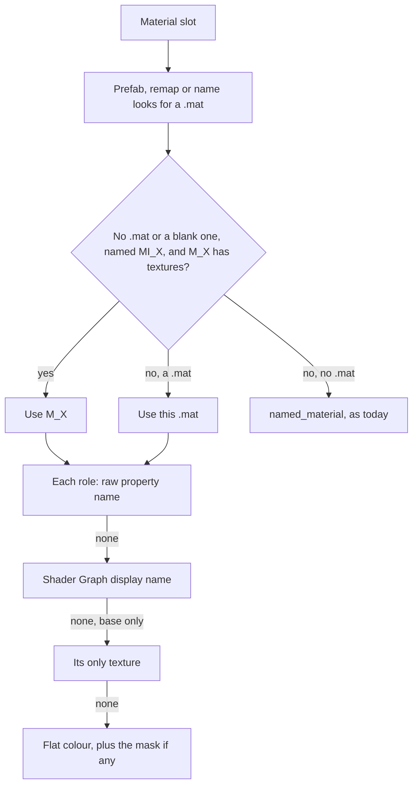

# Import fixes before the re-import

Fix what the import trial found, so the old libraries can be deleted and everything re-imported
through the Imports view. Four pieces, in order: the Unity GLB converter, the import dialog and
pack metadata, small preview fixes, then LOD grouping.

Status: decisions settled with the owner over three interview rounds. Every finding below was
checked in the code or measured on real packs, in a throwaway profile, at commit 63efa51. The
first gate held the deletion, and [After the first gate](#after-the-first-gate) records the owner's
answers of 2026-11-03 and the work that follows.

## Outcome

| Pack | GLBs | Now | Target (floor) |
|---|---|---|---|
| Stylized Village | 181 | 0 | 158 |
| Ancient Ruins | 184 | 157 | 176 |
| Spooky Cemetery Crypt | 100 | 99 | 99 |
| Stylized Elven Valley | 200 | 179 | 191 |
| Stylized Lost Cave | 208 | 198 | 198 |
| Stylized Wizard Room | 219 | 201 | 201 |
| Elven Long Bow | 2 | 1 | 1 |
| POLYGON Prototype (Synty) | 950 | 746 | 909 |
| The Big Castle Kit | 293 | 226 | 257 |
| Fantasy Adventure Environment | 36 | 26 | 26 |
| Medieval Houses Vol 1, after Piece 1 | 386 | 384 | 384 of 386 |
| Medieval Houses Vol 1, after Piece 2 | 193 | 192 of those | 193 of 193 |

"Fully textured" means every material a GLB's meshes use has a `baseColorTexture`, the trial's
audit. Targets are what a throwaway prototype of Piece 1 reached with the per-mesh LOD rule this
plan ships. No GLB lost a base, normal or ORM map.

Medieval Houses has one floor per stage, because Piece 2 changes what it imports. After Piece 1
both copies still land. After Piece 2 only the URP copy lands, so the gate uses 193 of 193. The
owner accepted "384, or half if variants land" in round 2 and chose the pipeline rule in round 3.
Both floors were measured: the prototype scored 384 of 386 on the doubled import and 193 of 193 on
the URP copy alone. That copy's one gap in the doubled import, `SM_Plane_01`, closes when it
converts alone, probably because by-name lookups no longer reach the Built-In copy. Piece 2's real
import must confirm it.

## Baseline

The first trial's folder, `~/.cache/opendam-import-trial`, disappeared during this planning
session. None of this session's commands removed it, and the cause is unknown. The trial was
repeated from its scripts in a fresh throwaway profile, with the 63efa51 debug binary. It gave
the same counts for all 7 packs: 157, 99, 179, 198, 0, 201 and 1. `~/Documents/Assets` was not
touched.

The baseline now lives at `~/.local/share/opendam-import-baseline-63efa51` (27 GB), outside
`~/.cache` because of that loss:

- `libs/`: all 11 packs built at version 4, with Medieval Houses as both copies.
- `data/` and `cache/`: its throwaway profile, with `libraries.root_paths` pointing at `libs/`.
- `h/`: the driver page, server, session scripts, app logs and run log.
- `tools/`: the throwaway prototype and audit scripts, for reference only. This plan is the spec.
- `proto/`, `proto-filewide/` and `proto-words/`: the prototype's GLBs.

It holds no app thumbnails. The driver page replaces the app's UI, so `modelThumbnailer` never ran
and model rows point at `_preview.glb` files.

## What held up and what did not

| # | Your candidate | Result in the code | Decision |
|---|---|---|---|
| 1 | Village has no textures | Confirmed: `Texture2D_...` names match nothing | Use Shader Graph display names, no filename rule |
| 2 | Foliage loses its cutout | Confirmed: the mask is only read inside the base-texture branch | Apply a mask with or without a base |
| 3 | Blank materials block the name fallback | Confirmed, but the fallback recovered nothing in any pack | Use an `MI_X` to `M_X` twin lookup instead |
| 4 | Poor pack covers | Confirmed: images beat models | Largest model before ordinary images |
| 5 | Wizard Room's LODs | Confirmed: 36 models, 6 levels each, 219 items | Group them, Piece 4 |
| 6 | Silent hoist | Confirmed. The proposed exclude can't help | Warn in the preview |
| 7 | Fab titles and publishers | Confirmed | Split CamelCase in title and folder |
| 8 | 10 failed previews | Three separate causes, one a real bug | See below |
| 9 | Progress ends short | Not lost work: a stale heartbeat in the DB | Write the final figures |
| 10 | Kenney offers | Confirmed trap: `fab` is offer 0 and is selected | Put `kenney` first when the zip's shape says it is Kenney's |

Details that changed a proposal:

- **Display names beat filenames.** A `.shadergraph` stores each property's display name beside
  its reference (`Texture2D_27f0...` is `A_BaseColor`). That resolves the same 383 of Village's
  441 untextured uses as the regex, and exact normals and ORM maps too (Village normals 0 to
  436). The filename rule added no base texture in any pack and made false cutouts: Ancient
  Ruins' stone bricks picked up `T_UniformClouds_Mask` as opacity.
- **Shader Graph files aren't conversion inputs.** `UNITY_EXTENSIONS` leaves them out of the
  work copy, so the script can't read them today.
- **`exclude` doesn't work as hoped.** The dialog has no exclude. `exclude` names one file, and
  added steps run after `flatten`, so it can't unblock one. Typing `Stylarts/WizardRoom/Art` as
  the hoist works in the code, though no test covers it. `TutorialInfo/` stays.
- **Item 8's three causes:**
  - **GLBs:** `SM_Bulidings.fbx` (116 MB) and `SM_Grass_Foliage.fbx` hold only `_LOD1` meshes.
    `LOD_RE` drops them all, the model reports success, and Blender writes a 132-byte GLB.
  - **PNGs:** `T_Beige.png` and `T_Brown.png` are 29027 x 29027, which hits the decoder's memory
    limit.
  - **`.hdr`:** real Radiance files that imageio has no backend for, in either case. `.exr`
    works through OpenEXR.
- **Item 9:** `list_import_runs` reads `progress_done`, which only the 30 s heartbeat writes, so
  the figure changes between runs (10/184 this time). All 184 GLBs exist. The live UI reads events.

Problems the trial didn't show:

- **A Rebuild keeps old thumbnails.** `watcher.rs` keeps a changed non-raster's preview, so a
  rebuilt GLB would show its grey thumbnail.
- **Exact object names are stripped.** Big Castle's meshes are really named `Plane.099`, and the
  `.meta` maps that exact name, but `base_name()` strips `.099` before the lookup.
- **One-texture materials.** Synty's `PolygonPrototype_Grid_01` keeps its only texture in `_Grid`,
  which matches no base rule.
- **Nested packages import twice.** Medieval Houses landed `Built-In` and `URP_HDRP` side by
  side: 4.1 GB, 518 duplicate GUIDs, 218 of 219 model and material names repeated.

## Decisions

| Topic | Decision |
|---|---|
| Texture source | Shader Graph display names only, with no filename rule |
| Blank materials | Twin lookup, `MI_X` uses `M_X`. Flat colours stay flat, read `BaseColor Value` and are written linear |
| One-texture materials | Its only texture is its base, narrowly |
| Exact names | Try the raw object and mesh name first |
| Layered materials | First layer by name (A), no tints |
| Empty GLBs | Keep each mesh's lowest LOD, and warn on a model left with no mesh |
| Rebuild thumbnails | Any changed model gets a fresh preview, as changed rasters do |
| Stale flag | None. A version bump means Rebuild, and this is documented |
| Covers | Largest model before ordinary images, for packs with no `Preview*` or `Sample*` |
| Hoist finding nothing | Warn in the dialog's preview, keep the no-op, add a nested-path test |
| Fab names | Split CamelCase for title and folder. Publisher is still typed |
| Nested packages | Choose a pipeline: keep loose files and that pipeline's nested packages, URP by default |
| Collider-only models | Leave them as grid items. Known gap |
| LOD groups | Same folder and stem, ending `_LOD<n>`, any case, in every library |
| LOD rename | New stem for all, each keeping its own `_LOD<n>` |
| LOD export | Only the main item exports, and metadata is shared across levels |
| Small fixes | Kenney offer first, `.hdr` in Rust, a clear too-large message, final progress |
| Gate before deleting old libraries | Pieces 1-3 merged, then the clean-profile runs below |
| Acceptance | Floors, not exact numbers. No GLB loses a texture, and every leftover is explained |
| Visual check | Contact sheets of the app's own thumbnails, reviewed by the owner |

## Piece 1: Unity GLB converter

Everything that changes GLB bytes goes in one version bump.

### Before changing the converter

Do these first, in order. Steps 4 and 5 must finish before the version bump.

1. **Check the baseline.** Confirm `~/.local/share/opendam-import-baseline-63efa51` exists and that
   an audit of its `libs/` gives this plan's Now column. If it is gone or differs, regenerate it
   (below).
2. **Commit the tools.** They are the first commit of this piece:
   - `packages/preview-engine/tools/glb_audit.py`, stdlib only. It writes a manifest with one row
     per GLB and material: pack, path, mesh, primitive and vertex counts, and each material's
     name, base, normal and ORM maps and alpha mode. Given two manifests and a pack map (see
     Matching against the baseline), it lists every lost map, every changed vertex or primitive
     count, every unmatched GLB on either side, and the matched GLBs per pack. Given floors, it
     checks them and lists leftovers by material and count.
   - `packages/preview-engine/tools/contact_sheet.py`, which builds a sheet from a library's PNG
     thumbnails for a list of paths, with Pillow. It reads the same pack map.
   - `apps/desktop/scripts/import-trial/`, the driver: the page, the server, the session script
     and the pack list, from the baseline's `h/`.
3. **Commit the manifest.** Write `docs/plans/import-material-fixes/baseline-v4.tsv` from the
   baseline, and `pack-map.tsv` beside it. From then on the no-regression check needs only those
   files.
4. **Capture the before thumbnails.** Build 63efa51 with its embedded frontend, as
   `docs/agents/running-the-app.md` does under "Checking the CSP". Copy the baseline's `libs/` and
   `data/` to a new folder, and point the copy's `libraries.root_paths` at that folder, so nothing
   writes to the baseline. Open the copy in a nested KWin, under `scripts/memory-cap.sh`, with
   `XDG_DATA_HOME` and `XDG_CACHE_HOME` there and the real UI. Wait until only failed models still
   have a `.glb` thumbnail, then build the before sheets. Keep this copy.
5. **Keep a version 4 build.** The Rebuild check runs on a second copy of step 4's folder,
   repointed the same way, so it starts with version 4 app thumbnails to replace. It rebuilds Ancient
   Ruins. In the prototype 157 of those 184 GLBs changed bytes and 27 stayed identical, so it
   exercises both paths. Never rebuild the baseline or step 4's copy.

To regenerate the baseline:

1. Make a worktree at 63efa51, run `mise install && make deps`, and build the debug binary.
2. Point `XDG_DATA_HOME` and `XDG_CACHE_HOME` at a new folder outside `~/.cache`, and set
   `OPENDAM_NO_KEYRING=1`, `OPENDAM_PYTHON` and `OPENDAM_WORKER` to that worktree's preview engine.
3. Launch once to create the master DB, then add libraries `unity`, `fab` and `kenney` to its
   `libraries` table, with roots under that folder.
4. Serve a page on port 1420 from a small local server, and run the binary under
   `scripts/memory-cap.sh` inside `dbus-run-session -- env -u DISPLAY kwin_wayland --virtual
   --no-lockscreen --width 1400 --height 900 --socket <name> --exit-with-session <script>`.
5. For each pack below, the page calls `scan_import` with `libraryId` and `originalPath`, takes the
   offer whose `layout` matches and its first candidate, and calls `start_import` with
   `libraryId`, `originalPath`, `target` (`<publisher>/<name>`), `publisher`, `preset`, and the
   ticked variant's `variant` and `subpath`. It polls `list_import_runs` until none is queued or
   running.

The packs, each with its library, offer and publisher:

| Original | Library, offer | Publisher |
|---|---|---|
| `~/Documents/AssetOriginals/Fab/StylizedWizardRoom.zip` | `fab`, `fab` | Stylarts |
| `.../Fab/StylizedVillage.zip` | `fab`, `fab` | Stylarts |
| `.../Fab/SpookyCemeteryCrypt.zip` | `fab`, `fab` | Stylarts |
| `.../Fab/StylizedElvenValley.zip` | `fab`, `fab` | Stylarts |
| `.../Fab/StylizedLostCave.zip` | `fab`, `fab` | Stylarts |
| `.../Fab/AncientRuins.zip` | `fab`, `fab` | Leartes Studios |
| Unity cache, `Elven Long Bow.unitypackage` | `unity`, `unity` | Manuel Wieser |
| Unity cache, `POLYGON - Prototype Pack - Art by Synty.unitypackage` | `unity`, `unity` | Synty Studios |
| Unity cache, `Fantasy Adventure Environment.unitypackage` | `unity`, `unity` | Staggart Creations |
| Unity cache, `The Big Castle Kit.unitypackage` | `unity`, `unity` | Triplebrick |
| Unity cache, `Medieval Houses Modular Vol 1.unitypackage` | `unity`, `unity` | GameAssetFactory |

The Unity cache is `~/.local/share/unity3d/Asset Store-5.x`. If a regenerated baseline's counts
differ from the Now column, stop and report it.

### Captured before thumbnails

Steps 4 and 5 ran on 2026-11-01, so this is where the later Piece 1 ticket and the gate find their
results. Everything is under `~/.local/share/opendam-import-before-63efa51` (47 GB, with a
`README.txt`):

| Path | What it is |
|---|---|
| `v4/` | 63efa51 from `git archive`, built with its embedded frontend. Binary: `apps/desktop/src-tauri/target/debug/opendam-desktop` |
| `before/` | Step 4's copy (`libs/`, `data/`, `cache/`), with version 4 app thumbnails. Never rebuild it |
| `rebuild/` | Step 5's copy, the same thumbnails repointed. The Rebuild check rebuilds Ancient Ruins here |
| `sheets/` | `<list>-before.png`, one sheet per path list |
| `h/` | The build, capture and sheet scripts, the logs, and the baseline's fingerprints |

The path lists are committed in `sheet-paths/`, one file per pack: 12 models each, 13 for Village
and all 2 of Elven Long Bow's. Each file's first line names its baseline pack, and the Stylarts and
Leartes packs are in the `Fab` library, the others in `Unity`. Lines hold baseline paths, so an
after sheet is the same command with its own library and `--side current`:

```sh
packages/preview-engine/.venv/bin/python packages/preview-engine/tools/contact_sheet.py \
  <after>/libs/Fab --pack Stylarts/StylizedVillage \
  --paths docs/plans/import-material-fixes/sheet-paths/stylized-village.txt --side current \
  --pack-map docs/plans/import-material-fixes/pack-map.tsv --out stylized-village-after.png
```

What the capture found:

- **No `.glb` thumbnail is left, not even a failed model's.** All 2,750 finished GLBs have a 512 px
  PNG. The 9 failed models are the 132-byte empty GLBs, and they end `error` with no thumbnail at
  all, so the app has nothing to retry.
- **Two Village tiles say "no PNG thumbnail" on purpose.** `SM_Bulidings` and `SM_Grass_Foliage` are
  two of those 9, and Piece 1 should fill them in.
- **24 Big Castle thumbnails are fully transparent.** 22 use a `Material.00x`-style slot with
  `alphaMode: MASK` and no texture, the misnamed slots of "Evidence so far", so they are version 4's
  output. `roof_inside_large_beam` is on the sheet as one of them. The other 2,
  `window_c_inside_variant_b` and `_c`, have no material and weren't traced, so their cause is
  unknown.
- **It ran under the cap, and no cap kill happened.** The app's scope,
  `opendam-capped-742933-20995.scope`, ran 3 min 31 s and peaked at 4 GB, by the user journal.
  systemd doesn't keep a finished scope's limits, so a later probe read them: the same
  `memory-cap.sh` in the same nested session gives `MemoryMax` 10 GiB, `MemorySwapMax` 0 and
  `OOMPolicy=kill`. `before/h/watch.log` reads `scope=0M` throughout because the watcher looked for
  a `MainPID`, which a scope doesn't have. Its other columns are sound, and `h/watch.sh` is fixed.
- **Medieval Houses' list holds only URP paths.** A Built-In path would stop its after sheet once
  Piece 2 sets the map's prefix. It builds with that prefix in the map.
- **Some packs lack a category.** Wizard Room has no foliage, Lost Cave no roofs, and Fantasy
  Adventure no walls or roofs, so those lists show what the pack has instead.

### How a slot finds its texture



Raw names stay first, so a texture found today is still found the same way. Normal, ORM and
opacity take the first two steps only. The base colour alone also takes the only-texture step.

### Changes

`apps/desktop/src-tauri/src/import/unity_glb.py`:

1. **Display names.** Read the `.shadergraph` the material's `m_Shader` GUID names, as a stream of
   JSON objects, and map each property's reference to its display name, cached per file. An
   unreadable or older graph gives an empty map. Keep the display names sorted, so `A_BaseColor`
   wins over `B_BaseColor`.
2. **Role words.** Base uses the existing `BASE_HINTS` and `NOT_BASE`. For the others, split a
   display name into words on separators and case changes, so `Material 01 ORM` gives `Material`,
   `01` and `ORM`, and `ORMMap` gives `ORM` and `Map`. Normal needs the word `normal` or `normals`,
   and no word `detail` or `second`. ORM needs the word `orm`. Opacity needs `opacity` or `alpha`,
   never bare `mask`, because `GlitterMask` isn't opacity. Over the 131 texture display names in
   these packs, words change two results from plain substrings: `Detail Map Normal` no longer
   counts as a normal, and `MaskedColorMask` no longer counts as ORM.
3. **Only texture.** A material with exactly one bound texture uses it as its base, with three
   exceptions: a generated `_SampleTexture...` slot, a generated `Texture2D_...` name with no
   display name, and a raw name or display name holding a `NOT_BASE` word. So a lone `Texture2D_x`
   shown as `OpacityMap` is a mask, never a base, and with a missing, unreadable or older graph it
   stays unresolved, as it does today. Both materials this rule fired on in the prototype use the
   raw name `_Grid`, so these exceptions move no floor.
4. **Mask with no base.** `build_material` wires the mask to alpha whether or not there is a base,
   over the flat colour. Blender 5.2.3 exports that as `alphaMode: MASK` with a `baseColorTexture`
   holding the mask, so the audit counts it as textured though its RGB is flat.
5. **Flat colours.** Display names apply to colours too, and `basecolorvalue` comes first in
   `COLOR_PROPS`, so `M_BasicFill` is black, as its file says.
6. **Twin lookup.** A slot is blank when it finds no `.mat`, or a `.mat` with no bound textures,
   whether or not that `.mat` holds colours. A blank slot named `MI_X` resolves through `by_name` to
   `M_X` when that material has textures. Otherwise a `.mat` with colours keeps them, so a true flat
   colour stays flat, and `named_material` stays as today's last resort. The prototype used this
   reading, and the floors depend on it: all 6 of Village's 26 twin slots that have a `.mat` hold
   colours.
7. **Lowest LOD per mesh.** Group mesh objects by name, without Blender's numeric suffix and the
   `_LOD<n>` suffix. No suffix and `_LOD0` are both level 0. Keep each group's lowest level, and
   every object at that level: `Wall` beside `Wall_LOD1` keeps `Wall`, and a group of only
   `_LOD1` meshes keeps them all. A file that is itself a LOD keeps all, as today.
8. **Raw names first.** Look up `obj.name` and `obj.data.name` as they are, before `base_name()`.
9. Bump `VERSION` to `opendam-unity-glb/5`. Update the docstring's list of what differs from the
   original script.

`apps/desktop/src-tauri/src/import/unity_glb.rs`:

- Add `shadergraph` to `UNITY_EXTENSIONS`, which `inputs_hash` then covers by source path and
  sha256.
- Bump `UNITY_GLB_VERSION` with the script. A test keeps the two equal.
- **No-mesh warning.** `Conversion::run` reports a model left with no mesh, because the script only
  sees uncached models. After placing the GLBs, `run` reads each one's JSON chunk, new or from the
  cache, and warns when its `meshes` list is empty. So an empty GLB warns on every run, including
  a Rebuild with unchanged inputs and a retry after another model failed the step. A model whose
  file name is a collider's stays silent, as the known collider gap: Rust keeps the same terms as
  `COLLISION_RE`, and a test keeps the two equal.
- Carry that warning into the run's warnings. Today `warnings` is a list of skipped archive
  entries, under a heading saying entries were skipped, so it needs a reason of its own and a
  heading that fits both.

`apps/desktop/src-tauri/src/watcher.rs`:

- A changed model gets `pending` and a fresh preview, through the same path as a changed raster,
  and keeps its old thumbnail until then. Queue rules stay in `preview.rs`.

Docs: record the new rules in `CLAUDE.md`'s `src/import` notes and in the pack-import plan's
deviations.

### Rebuild and the version bump

- `VERSION` and `UNITY_GLB_VERSION` move together, and every GLB's cache key holds the version.
- After the bump, a Rebuild of any built pack misses the cache and reconverts every model. A
  Rebuild with no other change is already allowed, and the button is always in Preparation.
- A staged GLB whose bytes changed keeps its asset row, id, tags and path, and takes a new mtime.
  With the watcher change above, it gets a fresh preview. A byte-identical GLB keeps its mtime and
  queues nothing.
- Expect most GLBs to change. In the prototype 157 of Ancient Ruins' 184 changed bytes though only
  19 gained a texture, so a Rebuild after a bump requeues most of a pack's previews. The other
  bytes are image names: Blender names each glTF image after its scratch file, which `Scratch`
  numbers by a counter, so a model's GLB changes when an earlier model uses more or fewer textures.
  Its binary chunk stays the same, and so does its render.
- In-app renames and excludes are recipe steps, so they survive. Kept files carry as before.
- Nothing flags a pack as built by an older converter. A version bump means you Rebuild. Old
  cache entries stay until Clear in Settings' Import tools.

## Piece 2: Import dialog and pack metadata

Comes after Piece 1. Its code doesn't touch the converter, but its Medieval Houses check needs
Piece 1 merged: with version 4 the URP copy stays at 192 of 193. Its other checks need no new GLBs.

- **Covers (`structure.rs`).** `PackFiles::cover` becomes preview, sample, largest model, image,
  visible file. The largest is the biggest visible model item by size, ties by path, so `derive`
  stays pure: `pack_files` takes the sizes `derive` already has. This applies to every library,
  to packs with no `Preview*` or `Sample*`. The `datapackage.json` `image` and your own cover
  still win.
- **Cover render (`commands/folder.rs`).** `Cover` carries the model's bundled preview, so a
  pictured model doesn't show an icon. Verify a card updates when its model's thumbnail arrives.
- **Hoist warning.** `place_listed` reports a hoist whose folder is missing, and `Tree` gains
  `warnings`, which the dialog shows. `refreshTree` in `store/imports.ts` also builds a `Tree`.
  The no-op stays. Add a test for `Stylarts/WizardRoom/Art`.
- **Fab names (`scan.rs`).** Split CamelCase in `fab()` and `unreal()` names: `StylizedVillage`
  becomes `Stylized Village`, for the title and target. A name that already has a space stays.
  The `zip` offer and `.unitypackage` names don't change.
- **Kenney offer first (`scan.rs`).** `kenney()` matches any zip with a `license*.txt` file, so that
  match alone can't decide. Put `kenney` at offer 0 only when the zip holds no `.uproject`, every
  `.unitypackage` sits inside a license folder other than the root, and there are more license
  folders than `.unitypackage` files. Any other zip keeps today's order: `fab`, `unreal`, `kenney`,
  `zip`. This reads names only, as a scan does. The All-in-1 passes, with 246 license folders, 7
  packages and no project, and all 8 Fab zips keep their order.
- **Pipeline choice for cached packages (`scan.rs`, `unitypackage.rs`, `engine.rs`, dialog).** When
  a `.unitypackage` holds nested packages of two or more pipelines, offer a pipeline, URP by
  default, using `pipeline()`. The build keeps loose files, keeps nested packages of that
  pipeline and those naming no pipeline, and skips the others. The choice is stored in the
  extract step, so a Rebuild repeats it. Fab zips don't change.
  - Medieval Houses keeps its URP copy, about half of 4.1 GB.
  - Nature Package keeps its base content, `URP` and both URP shader sets, and skips the HDRP
    overlays and the 1.8 GB Built-In package.
- **Pack map.** Update `pack-map.tsv` for the new Fab targets and Medieval's prefix (see Matching
  against the baseline).

## Piece 3: Small preview fixes

- **`.hdr` in Rust.** Add the `image` crate's `hdr` feature, decode it natively, and remove the
  worker's `.hdr` branch. `.exr` stays in the worker.
- **Too large to preview.** Read a raster's size from its header first. One past the decoder's
  limit stays without a preview and says so. Store the reason in a bookkeeping column
  (`db::add_preview_columns`), never in `metadata`, and show it in the detail panel, which today
  always says "No preview available".
- **Final progress.** When a run ends, write its latest progress and phase in the same update
  that sets its status, so no run ends on a stale heartbeat.

## Piece 4: LOD grouping

Structure is derived, so this needs no rebuild and can land after the re-import.

- **Rule.** In `format_groups`, strip a final `_LOD<n>` (any case, same folder) from the key, and
  rank by level, then `format_rank`. The main item has no suffix, else `_LOD0`, else the lowest
  level. A name with no separator stays apart. A file on its own stays on its own.
- **Stem matching.** `model_previews` and `bundled_previews` also match by stem, and need the same
  treatment.
- **Rename (`commands/asset.rs`).** Give every member the new stem and keep its own `_LOD<n>`.
  Today all members take one stem, which would collide. An imported pack records each as a step,
  as before.
- **Group rules that follow unchanged:** one grid item, shared metadata (`apply_unions`), delete
  reaching every member, the preview queue skipping members, and export resolving to the main
  item, so LOD1+ files stop being separate export items.
- **Docs.** Update "One grid item per group" in `CLAUDE.md`.

Across the 11 packs measured, only Wizard Room changes: 219 items to 39.

## Fixture tests

Real Asset Store content can't be committed. Add
`apps/desktop/src-tauri/tests/fixtures/unity-glb/`, made by a stdlib `make_fixtures.py` and
committed with its output, as the pack-import fixtures are: text `.mat`, `.meta`, `.prefab`, `.mtl`
and `.shadergraph` files, a small OBJ per case and tiny PNGs. An OBJ's `usemtl` and `.mtl` give it
a named material slot. A `.prefab` and the `.meta`'s `fileIDToRecycleName` map its meshes.

Blender-backed Rust tests run the script over it and read each GLB's JSON. They find Blender
through `OPENDAM_BLENDER`, which CI's test job sets up.

| Case | Input | Expected |
|---|---|---|
| Generated names | `Texture2D_a` shown as `A_BaseColor`, with normal and ORM | All three maps bound |
| Layers | `A_BaseColor` and `B_BaseColor` | Layer A |
| ORM word | `UniformClouds` and `MaskedColorMask` beside a base | No ORM map |
| Detail normal | `Detail Map Normal` and `Macro Normal` | `Macro Normal` |
| Mask only | `OpacityMap` and a colour | `MASK`, texture, and colour as factor |
| Helper mask | `GlitterMask` beside a base | Stays opaque |
| Blank twin | Blank `MI_X`, textured `M_X` | `M_X`'s texture |
| Twin with no .mat | Slot `MI_X` with no `.mat`, textured `M_X` | `M_X`'s texture |
| Twin over colours | `MI_X` with colours only, textured `M_X` | `M_X`'s texture |
| True flat colour | `MI_Y` with colours only, `M_Y` missing or untextured | `MI_Y`'s colour, no texture |
| Flat colour | `BaseColor Value` only | That colour, no texture |
| HDR colour | A graph's HDR colour, and a colour past 1 | As stored, not converted |
| Empty slot | A slot no face uses, then the used one, and a prefab listing one material | That material on the used slot |
| Only texture | `_Grid` alone | Base texture |
| Generated slot | `_SampleTexture2D_..._Texture_1` alone | No base |
| Lone mask | Lone `Texture2D_x` shown as `OpacityMap` | Cutout over the flat colour, not a base |
| Lone normal | Lone `Texture2D_x` shown as `NormalMap` | Normal map, not a base |
| Lone, graph missing | Lone `Texture2D_x` with its `.shadergraph` left out | No base, same GLB as with today's rules |
| LOD only | Only `_LOD1` meshes | Mesh kept, no warning |
| Mixed LODs | A with `_LOD0` and `_LOD1`, B with `_LOD1` | A's `_LOD0`, B's `_LOD1` |
| No suffix | `Wall` beside `Wall_LOD1` | `Wall` only |
| Several at one level | `X_LOD1.001` and `X_LOD1.002` only | Both kept |
| LOD file | File `X_LOD1.obj` holding `X_LOD1` | Kept |
| No mesh | Only collision meshes in a model not named as a collider | Warning |
| No mesh, cache hit | The same model and inputs, run twice, the second from the cache | Warning on both runs |
| Collider file | `rock_collider.obj` | No warning, on either run |
| Exact name | Objects `Plane.099` and `Plane.100`, each mapped in the `.meta`, with different material lists in the `.prefab`, so the single-list fallback can't apply | Each gets its own prefab material |
| Graph missing | `.shadergraph` left out | Same GLB as with today's rules |

Add unit tests beside the code for `is_input`, the version match, the collider terms matching
`COLLISION_RE`, the cover order, the hoist warning, CamelCase splitting, pipeline filtering, the
changed-model preview, the final progress write and LOD grouping and renames.

The offer-order test covers a Fab zip with a license file at its root and one in a folder, a Fab
zip wrapped in one licensed folder, two licensed variants, and an Unreal zip with plugin licenses,
all keeping today's order, and a Kenney-shaped zip with nested packages, which opens on `kenney`.

Test `glb_audit.py`'s join on small manifests: a renamed pack, a changed prefix, an expected
absence, an unexpected absence, an extra GLB and a matched count that falls short.

## Acceptance

### Matching against the baseline

`baseline-v4.tsv` holds version 4 pack names and both Medieval copies, and Piece 2 changes both.
So every comparison goes through `docs/plans/import-material-fixes/pack-map.tsv`, which
`glb_audit.py` and `contact_sheet.py` both read. One row per pack gives its baseline pack and path
prefix, its current pack and path prefix, and how many GLBs must match.

From Piece 2 on, the map reads:

| Baseline pack | Baseline prefix | Current pack | Current prefix | GLBs |
|---|---|---|---|---|
| `Stylarts/StylizedVillage` | none | `Stylarts/Stylized Village` | none | 181 |
| `Leartes Studios/AncientRuins` | none | `Leartes Studios/Ancient Ruins` | none | 184 |
| `Stylarts/SpookyCemeteryCrypt` | none | `Stylarts/Spooky Cemetery Crypt` | none | 100 |
| `Stylarts/StylizedElvenValley` | none | `Stylarts/Stylized Elven Valley` | none | 200 |
| `Stylarts/StylizedLostCave` | none | `Stylarts/Stylized Lost Cave` | none | 208 |
| `Stylarts/StylizedWizardRoom` | none | `Stylarts/Stylized Wizard Room` | none | 219 |
| `Manuel Wieser/Elven Long Bow` | none | same | none | 2 |
| `Synty Studios/POLYGON - Prototype Pack - Art by Synty` | none | same | none | 950 |
| `Triplebrick/The Big Castle Kit` | none | same | none | 293 |
| `Staggart Creations/Fantasy Adventure Environment` | none | same | none | 36 |
| `GameAssetFactory/Medieval Houses Modular Vol 1` | `Medieval_Houses_Vol1_URP_HDRP/` | same | from Piece 2's real import | 193 |

Before Piece 2 the map has the same pack on both sides, no prefixes, and 386 GLBs for Medieval
Houses. Piece 2 fills in Medieval's current prefix from its first real import, because `flatten`
may remove that folder once only one copy lands.

The rules:

- **Join key.** A GLB matches on its mapped pack plus its path after the prefix.
- **Expected absences.** Only the 193 baseline GLBs under `Medieval_Houses_Vol1_Built-In/`.
- **Everything else must match.** Any other unmatched GLB on either side fails, as does a pack whose
  matched count differs from its GLBs column. So a wrong name or prefix fails loudly, and can't
  pass by comparing nothing.
- **Default steps.** The gate imports every pack with its default steps and no typed hoist, so
  Wizard Room's paths stay as in the baseline.

### Each piece

- **Piece 1:** the fixture tests pass, and all 11 packs reach their Piece 1 floors in a clean
  throwaway profile, with Medieval Houses at 384 of 386. Run `glb_audit.py` against
  `baseline-v4.tsv`:
  - Every pack matches its GLB count, with no unmatched GLB.
  - No GLB loses a base, normal or ORM map.
  - Every GLB whose vertex or primitive count changed is listed and explained. The expected list
    is exactly `SM_Bulidings.glb` (0 to 2,116,110 vertices, 0 to 176 primitives) and
    `SM_Grass_Foliage.glb` (0 to 3,610 vertices, 0 to 1 primitive). Any other increase may be
    doubled geometry from a LOD group that didn't match, and blocks the merge until explained.
  - From [After the first gate](#after-the-first-gate)'s item 2 on, the list also holds Fantasy
    Adventure's 15 trees under `Models/Trees/`, each losing its `_Billboard` mesh: 2 meshes to 1,
    one primitive fewer, and the billboard's vertices. 11 of them also lose the base and normal
    map of their billboard's own material, which `glb_audit.py compare` lists as lost maps
    (`base: 3 to 2 materials`, `normal: 2 to 1 materials`). Those 22 losses are expected, and no
    other. The other 4 billboards had no texture (the "4 billboards" leftovers of
    [Piece 1 result](#piece-1-result)), so those 4 GLBs become fully textured and the pack's
    count rises from 26 to 30 of 36. Before is `baseline-v4.tsv`, which version 5 matched:

    | GLB | Vertices | Primitives | Lost with the billboard |
    |---|---|---|---|
    | `FAE_Birch_A.glb` | 1,518 to 1,502 | 3 to 2 | Base and normal of `FAE_Birch_A_Billboard` |
    | `FAE_Birch_B.glb` | 722 to 706 | 3 to 2 | Base and normal of `FAE_Birch_B_Billboard` |
    | `FAE_Birch_C.glb` | 1,073 to 1,057 | 3 to 2 | Base and normal of `FAE_Birch_C_Billboard` |
    | `FAE_Palm_A.glb` | 1,054 to 1,038 | 3 to 2 | Base and normal of `FAE_Palm_A_Billboard` |
    | `FAE_Palm_B.glb` | 2,754 to 2,730 | 3 to 2 | None, its billboard was untextured |
    | `FAE_Palm_C.glb` | 3,666 to 3,642 | 3 to 2 | None, its billboard was untextured |
    | `FAE_Pine_A.glb` | 1,562 to 1,546 | 3 to 2 | Base and normal of `FAE_Pine_A_Billboard` |
    | `FAE_Spruce_A.glb` | 1,713 to 1,697 | 3 to 2 | Base and normal of `FAE_Spruce_A_Billboard` |
    | `FAE_Spruce_B.glb` | 1,481 to 1,465 | 3 to 2 | Base and normal of `FAE_Spruce_B_Billboard` |
    | `FAE_Spruce_C.glb` | 1,426 to 1,410 | 3 to 2 | Base and normal of `FAE_Spruce_C_Billboard` |
    | `FAE_Tree_A.glb` | 4,573 to 4,557 | 3 to 2 | Base and normal of `FAE_Tree_A_Billboard` |
    | `FAE_Tree_B.glb` | 3,609 to 3,593 | 3 to 2 | Base and normal of `FAE_Tree_B_Billboard` |
    | `FAE_Tree_C.glb` | 4,401 to 4,385 | 3 to 2 | Base and normal of `FAE_Tree_C_Billboard` |
    | `FAE_Willow_A.glb` | 8,049 to 8,025 | 3 to 2 | None, its billboard was untextured |
    | `FAE_Willow_B.glb` | 10,704 to 10,680 | 3 to 2 | None, its billboard was untextured |
  - Rebuilding Ancient Ruins in step 5's copy replaces each changed GLB's version 4 thumbnail,
    keeps a tag and a rename, and leaves byte-identical GLBs and their thumbnails alone.
- **Piece 2:** the 6 Fab packs get a model cover, not a texture. Wizard Room's dialog warns about
  `hoist Art`, and `Stylarts/WizardRoom/Art` hoists. `StylizedVillage` becomes `Stylized Village`.
  The Kenney zip opens on `kenney` with 241 packs ticked, and all 8 Fab zips keep their offer order.
  Nature Package and Medieval Houses each build one pipeline. With Piece 1 merged, Medieval Houses
  reaches 193 of 193 GLBs and matches its 193 URP baseline GLBs through the map. The bench checks
  U10 and U11 still pass.
- **Piece 3:** the 7 `.hdr` files seen across both libraries get previews. `T_Beige.png` and
  `T_Brown.png` say too large. A finished run's row shows its final figures.
- **Piece 4:** Wizard Room shows 39 items. A rename keeps each `_LOD<n>`. U11 and U12 still pass.

### Piece 1 result

`opendam-unity-glb/5` was measured on 2026-11-02 in a clean throwaway profile
(`apps/desktop/scripts/import-trial/run.sh`, folder `~/.local/share/opendam-import-v5-trial-2`):

- **Runs.** All 11 ended `done`, with no error and no warning.
- **`glb_audit.py compare`.** It passed. Every pack matches its GLB count with no unmatched GLB, no
  map is lost, 389 GLBs gained full textures, and the only geometry changes are `SM_Bulidings.glb`
  and `SM_Grass_Foliage.glb`, with the expected figures.
- **Floors.** Every pack landed on its floor, with Medieval Houses at 384 of 386, except The Big
  Castle Kit, which passed its floor of 257 with 263. The floors stay as they are.
- **Rebuild.** Ancient Ruins in `rebuild-2/`, a fresh copy of `before/`, with the real UI, after
  tagging and renaming one changed and one identical GLB. Rows, ids, tags and both renames
  survived. All 171 changed GLBs took a new thumbnail file and their old one is gone. The 13
  identical GLBs kept theirs and their mtime. It is 171, not the prototype's 157, because the
  renames move models in the conversion's order, which renumbers later models' image names.
  `rebuild/` holds a Rebuild from before the two fixes below, so don't reuse it.

Review of that Rebuild's sheet found two converter bugs, which version 5 fixes, and neither changes
a map's count:

- **Flat colours were too pale.** `SM_Tree_1_Leaves` went near-white once rule 5 read its real
  `BaseColor Value`. Unity stores a colour as sRGB, and the script wrote it straight into glTF's
  linear factor. Colours are now converted, unless HDR, which Unity keeps linear. The audit can't
  see this: both the pale GLB and the fixed one count as textured.
- **A prefab's material could land on an empty slot.** The owner chose on 2026-11-02 to fix this
  in version 5 rather than in a later version. The list counts Unity's submeshes, so it now skips
  a slot no face uses. Six Big Castle GLBs gained their texture, and five `wall_outer_*_deco` GLBs
  moved from the wrong map to `wall_outer_deco`. No other pack's slots changed.

Each GLB under its pack's full count, by the list below. A GLB can use several of these materials,
so a pack's lines can add up to more than its leftover GLBs:

| Pack | GLBs | Reason | Materials, GLBs |
|---|---|---|---|
| Medieval Houses | 2 | Doubled import, see below | `M_Medieval_Environment_Default_01` 2 |
| Ancient Ruins | 8 | Water | `M_Fountain_Water`, `M_Fountain_Water_Ripple`, `M_Fountain_Water_Splash`, `M_Water_Exterior`, 1 each |
| | | Flat colour | `M_Tiny_Rocks` 3, `M_Grass` 1 |
| Elven Long Bow | 1 | OBJ with no `.mtl` or prefab | `Arrow`, no material |
| Fantasy Adventure | 10 | Slot no Unity file resolves | `lambert1` 3, 4 billboards 1 each, `VegetationAtlas1` 1 |
| | | Water | `FAE_WaterCreek` 1 |
| | | Collider-only | `FAE_Tree_Colliders` 1 |
| Spooky Cemetery Crypt | 1 | Flat colour | `M_Grass_A` 1 |
| Stylized Elven Valley | 9 | Flames and water | `M_Flame_01` 4, `MI_VFX_Water_Splash`, `M_Fountain_Water_Ripple`, `M_Water`, 1 each |
| | | Flat colour | `M_LanternEmissive` 1 |
| | | Slot no Unity file resolves | `M_Seagull` 1: no `.meta` in the pack holds its `_Base_Color` GUID |
| Stylized Lost Cave | 10 | Flames, water and foam | `M_Flame_a` 1, `M_Flame_b` 2, `M_Flame_c` 2, `M_Water` 2, `M_FoamVolumetric`, `M_WaterfallFoam`, `M_WaterfallTop`, 1 each |
| Stylized Village | 23 | Flat colour | `M_Emissive` 16, `MI_Emissive` 3, `M_Jug_Glass` 1 |
| | | Clouds and water | 5 `M_Cloud_*` 1 each, `M_Water_03` 1 |
| Stylized Wizard Room | 18 | OBJ with no `.mtl` or prefab | `SM_Walls2`, `SM_Books3_2` and their LODs, 12 |
| | | Flat colour | `M_BasicFill` 6 |
| POLYGON Prototype | 41 | Flat colour | `Generic_Glass_Opaque` 11, `Generic_Mountains` 3, `FX_GlowRing_01` 2, `Glass_01` 1 |
| | | Clouds and water | `Generic_Cloud` 4, `Waterflow_01` 3, `Water_01` 2 |
| | | Collider-only | 6 `*_Collision` models |
| | | Hashed mesh IDs, see below | `SM_Bld_Base_Wall_Window_*`, 4 GLBs, 15 materials |
| | | Slot no Unity file resolves | `lambert1683`, `lambert1997`, `lambert3` (particle meshes), `standardSurface1`, `Texture_01`, 1 each |
| The Big Castle Kit | 30 | Flat colour | `showcase_plane` 1 |
| | | Collider-only | 13 `*_collider` models, no material |
| | | Slot no Unity file resolves | `Material.001` 2, `Material.002` 2, and 12 GLBs with a mesh that has no material and that no prefab fills, or whose prefab names a `.mat` the pack lacks |

The list below doesn't cover two of these. The owner accepted them as recorded on 2026-11-02, with
`M_Seagull`:

- **Medieval Houses' 2.** Both copies' `SM_Plane_01` use one GUID, whose first file by path is
  the Built-In `.mat`: generated names on the Standard shader, so no graph. The Outcome table
  expects this until Piece 2 lands only the URP copy.
- **Four Synty window walls have a Unity file.** Their prefabs list each mesh's materials, by file
  IDs Unity hashes from the mesh's name. The `.meta` doesn't name them, and the one-list fallback
  can't apply to two meshes with two lists.

**Big Castle's ivy background planes and `grassPlane` have no material in any file.** On 2026-11-03 the owner
accepted `ivy_a` and `grassPlane` if no file held their materials (decision 6), and Work item 5
searched on 2026-11-04. The search found the same gap in 4 more ivy GLBs, which the owner's
decision doesn't name: they are recorded here on the strength of that finding. All 6 are among the
12 GLBs above:

- **The ivy.** One or two planes have no material in each of these GLBs: `ivy_a`'s `Plane.052`
  (whose mesh is `Plane.081`), `ivy_a_lod`'s `Plane.056`, `ivy_b`'s `Plane.053`, `ivy_b_lod`'s
  `Plane.057`, and `ivy_c`'s `Plane.060` and `Plane.061`. No FBX gives them a material:
  `ivy_a` and `ivy_a_lod` give their one material, `leavePlane`, only to the leaf cards, and
  `ivy_b`, `ivy_b_lod` and `ivy_c` have none. The `ivy_a`, `ivy_b` and `ivy_c` prefabs,
  checked by each `m_Mesh` file ID against the FBX `.meta` files, place each model's bark and leaf
  cards and none of these planes. So in Unity the ivy has no background card at all.
  `ivy_c_lod` isn't a leftover: it has no such plane, and `ivy_c.prefab` places all four of its
  meshes, which its GLB textures with bark and `leafes_plane`.
- **`grassPlane`.** Its FBX has no material, and no prefab or scene places it.

Where the search looked:

- **Package.** The whole `.unitypackage`: every file in it is in the built pack.
- **`.meta` files.** All 952. The importers of the six ivy FBX files (`ivy_a`, `ivy_b` and
  `ivy_c`, each with its `_lod`) and of `grassPlane.fbx` (`importMaterials: 0`, no
  `externalObjects`) remap no material.
- **Prefabs and scenes.** All 260 prefabs and 5 scenes. No scene places any of those seven FBX
  files directly: only the `ivy_a`, `ivy_b` and `ivy_c` prefabs refer to the ivy ones, and
  nothing refers to `grassPlane.fbx`. The scenes' material overrides on the three ivy prefabs
  change only the bark's renderers.
- **The other assets.** The two binary terrain assets, read through `unity_text.py`, use
  `grass_basecolor.png` and `plant_dry_basecolor.png` as detail textures and `tree_b` as a tree.
- **Materials and textures.** `grass.mat`, `ivy_a_bg_plane_basecolor.png` and
  `ivy_b_bg_plane_basecolor.png` look like the missing materials, but no file names their GUIDs.
  Linking them would be the filename rule this plan dropped.

So the converter doesn't change.

### Pipeline choice result

Measured on 2026-11-02 in a clean throwaway profile (`apps/desktop/scripts/import-trial/run.sh`,
folder `~/.local/share/opendam-import-pipeline-trial-2`), with default steps:

- **Runs.** Both ended `done`, with no error and no warning. Each extract step stores
  `{"pipeline":"urp"}`.
- **Medieval Houses.** It keeps its URP copy, 2.0 GB, with no `Built-In` file. `flatten` removes
  `Medieval_Houses_Vol1_URP_HDRP/`, so the map's current prefix is empty. `SM_Plane_01` is textured
  and the pack reaches 193 of 193.
- **Nature Package.** It keeps its base content, `URP/` and both URP shader sets, 2.1 GB and 38 GLBs,
  and skips `HDRP/`, the HDRP shader sets and the Built-In package. Its loose manuals stay, the HDRP
  one included, because they are loose files. It has no baseline or floor: 24 of its 38 are fully
  textured, and the others are mostly `billboards_All`.
- **`glb_audit.py compare`.** It passed with this Medieval Houses over the 10 other packs of
  `opendam-import-v5-trial-2`: every pack matches its count, no GLB is unmatched, the only absences
  are the 193 Built-In GLBs, no map is lost, and the only geometry changes are the two expected.

Where this differs from the plan as written:

- **A package with no URP ticks nothing.** Two pipelines without URP open with none ticked and no
  tree, and Import asks for one, as a Fab pack's variants do.
- **The filter doesn't use `pipeline()` itself.** `pipeline()` gives one answer and takes any
  `Standard` as Built-in. That only labels a Fab variant, but a filter on it would leave out content:
  HDRP would drop `X_URP_HDRP`, and URP would drop `Standard Assets`. So `package_pipelines` reads
  every pipeline a nested package's name lists, and takes `Standard` and `Universal` only as a
  name's last word or before `Render`, `RP` or `Pipeline`. Medieval Houses therefore offers URP,
  Built-in and HDRP, with URP and HDRP keeping the same files.
- **A choice must leave something out.** The offer appears when choosing among the named pipelines
  would leave a package out, so a lone `X_URP_HDRP` has no choice, though it names two.
- **The scan reads a package once.** Each choice's tree filters the whole listing by source path
  (`for_pipeline`), because Medieval Houses takes a full read of 2.9 GB per listing. A test keeps
  it equal to a listing for that pipeline and to what the extraction writes.

### Leftovers

Every GLB under its pack's full count must be explained by one of these:

- Water, flames, foam and clouds built from shaders, which are out of scope.
- A true flat colour, such as `M_Emissive`, `M_BasicFill`, `M_Grass_A` and `M_Tiny_Rocks`.
- A collider-only file.
- An OBJ with no `.mtl` and no prefab: Wizard Room's `SM_Walls2` and `SM_Books3_2` with their LODs,
  and Elven Long Bow's `Arrow`.
- A slot no Unity file resolves: Big Castle's `Material.00x`, and Fantasy Adventure's `lambert1`
  and billboards.

Each must be listed by material and count, so anything else stands out.

### Visual check

The audit reads JSON and proves nothing about how a GLB looks. For each pack, build a contact
sheet of about 12 models with `contact_sheet.py`, before and after, covering foliage, walls, roofs,
props and flat colours, and register it as evidence. **The owner reviews the sheets.** The before
sheets come from Piece 1's first steps, and the after sheets from the gate's run, with one path list
per pack joined through `pack-map.tsv`, so each pair shows the same model. Use the app's three.js
thumbnails, not Blender: `SM_Leaves01` renders almost black in Cycles both before and after, though
its GLB's colour is right, and that needs judging on what the app shows.

### Before deleting the old libraries

With Pieces 1-3 merged, run these in one clean throwaway profile, with the real UI, so thumbnails
render. Each needs its pass result recorded in one gate report for the owner.

| Run | Passes when |
|---|---|
| All 11 packs | Every run ends `done` with no error. Every pack reaches its floor, with Medieval Houses at 193 of 193. `glb_audit.py`, through `pack-map.tsv`, matches every pack's GLB count with only the 193 Built-In GLBs absent, and shows no lost map, the expected geometry list only, and leftovers all explained. The owner has reviewed the sheets |
| `LostRuins.zip`, Unreal route | The run ends `done` with no error and no failed model. Its GLB count is above 0 and at most the scan's estimate. `glb_audit.py` reports its textured count and leftovers. The owner has reviewed a sheet of about 12 models |
| `Waterways.zip`, Unreal route | As LostRuins, after the memory check, and with no cap kill in the app log, including a session the run recovered from |
| Kenney build | The zip opens on `kenney` with 241 packs ticked. Every ticked pack ends built, with no failed run. Each pack's file count matches its scan tree, and skipped entries are listed. Time and disk use are recorded |

The memory check for Waterways: `import.unrealMemoryMax` keeps its default of 20G, `MemAvailable`
is at least 24 GB before the run starts, no benchmark or other Unreal run is going, and the disk
has at least 20 GB free. Record the scope's peak memory. If 24 GB can't be freed, stop and ask.

Unreal packs have no floors, because this work never ran them. These first runs set their numbers.

The gate's results are in [gate-report.md](gate-report.md), and what follows from them in
[After the first gate](#after-the-first-gate).

**Any failed run, cap kill, missed floor, lost map, unmatched GLB other than the expected absences,
unexplained leftover or unexplained geometry change holds the deletion until the owner decides.**
Never raise a cap or lower a floor to pass. The owner deletes the old libraries by hand after
reading the gate report. Piece 4 can land before or after.

## After the first gate

The first gate ([gate-report.md](gate-report.md), measured at `39c679d`) held the deletion: the
owner's review rejected models in 5 packs, LostRuins lost a mesh with no warning, and the report
listed 9 decisions and 6 other findings. The owner answered them on 2026-11-03, over four
interview rounds. This section records those answers, the work they make, and the second gate
run. Two more answers, on 2026-11-04, settled handoffs the plan's review found. The old
libraries stay until the second gate passes and the owner has reviewed its sheets.

### Decisions on the gate report

The report's table, row for row:

| # | Item | Decision |
|---|---|---|
| 1 | `SM_column04`, a LostRuins mesh the asset registry misses | Fix: find meshes on disk, and warn on any left out |
| 2 | POLYGON's lost tint, 162 GLBs white, were yellow | Fix: multiply the colour over a base the only-texture rule found, and only there |
| 3 | Fantasy Adventure's billboards, 15 GLBs | Fix: drop a billboard mesh beside a real mesh |
| 4 | Branch cutouts, 3 Fantasy Adventure materials | Fix: a cutout rule that also reads the shader |
| 5 | Big Castle `tree_b`'s slots | Fix, in one ticket that first proves the cause and measures its reach |
| 6 | Big Castle `ivy_a` and `grassPlane` | Look for their slots' materials, and accept the gap if no file holds them |
| 7 | Wizard Room `SM_Books3_2` and `SM_Walls2`, 12 GLBs | Accepted: they stay plain white, and no name rule is added |
| 8 | Waterways ferns, 4 GLBs | Investigate `MI_Fern_02`'s graph, and fix it if the cause is found |
| 9 | `SM_Frame`, `SM_Grass_A` and `SM_Plane_01`'s colour changes | Confirmed as intended. No ticket |

And the rest:

| Topic | Decision |
|---|---|
| Other findings | All six become tickets: Waterways' false hoist warning, a camera for flat models, the engine's grid in the audit, the app's memory peak, Kenney's preview errors and the sheets' other oddities |
| Unity version | One ticket per fix with no bump, then one ticket bumps to `opendam-unity-glb/6`, as Piece 1 did |
| Unreal version | Each Unreal export fix bumps `UNREAL_GLB_VERSION` itself |
| Engine grid | Counted as untextured in `glb_audit.py` only. The export doesn't change |
| Investigations | Report the cause, and fix it in the same ticket only when the fix is small and not in a converter |
| A converter cause found later | It waits for a later bump, version 7, and doesn't hold the deletion |
| Kenney's errors | A preview where one can be made, else a clear reason, not a bare error |
| Hoist warning | An estimate's preview says the hoist is checked when the export runs, and that build warns on a hoist that was a no-op. Only a build whose preview was an estimate warns, so Wizard Room's default `hoist Art` doesn't (narrowed 2026-11-04) |
| Camera | It changes only previews made after it. Nothing requeues existing thumbnails |
| `tree_b` with no fix | If the `tree_b` ticket (Work item 4) stops without a fix, the bump (Work item 6) goes ahead and the fix waits for version 7 (decided 2026-11-04) |
| Second gate | All four runs again in a new clean profile, once the converter, Unreal, hoist, camera and audit work has merged |
| Floors | The second gate runs against today's `floors.tsv`, which may not fall. Its report proposes the measured counts as new floors, for the owner to accept. `floors.tsv` holds the 11 Unity and Fab packs only, so the Unreal packs have no floor to miss |
| Issue #261 | The second gate's pull request says "Part of #261", and the owner closes the issue after the review |

### Work

Each item below is one ticket. The order they can land in is under [Order](#order).

**Unity converter.** Items 1 to 5 change `unity_glb.py` and don't bump its version. Each lands with
fixture tests in `tests/fixtures/unity-glb/`, and the cache key still holds `opendam-unity-glb/5`.
So nothing reconverts until item 6, except that item 3 adds `.shader` files as inputs, which
changes the cache key of every pack that ships one: those packs reconvert at version 5 once item 3
merges, with whichever fixes have merged by then. Item 6's bump reconverts everything anyway. Each
ticket that can measure its change on real packs does so with a prototype run in a throwaway
profile, as Piece 1 did, and reports the GLBs it changes.

1. **Tint over an only-texture base.** When the base texture came from the only-texture rule (rule
   3 of Piece 1), the material's base colour becomes the glTF `baseColorFactor` over it, written
   linear as rule 5's colours are. A base found by raw name or display name keeps today's white
   factor. POLYGON's 162 `PolygonPrototype_Grid_01` GLBs come out yellow with their grid, and only
   a material whose base came from that rule changes colour. Fixture: a material whose one texture
   is `_Grid`, with a yellow `_Base_Color`, and one whose base is found by name, with a colour that
   stays unapplied. Result: a prototype run of the old and new script over the 11 packs' built
   copies in the first gate's profile changed 163 of 2,566 GLBs, all in POLYGON, and only their
   `baseColorFactor`: the 162 `PolygonPrototype_Grid_01` GLBs, to `[1, 0.4831, 0, 1]`, and
   `SM_Buildings_WindowGlass_01`, whose `PolygonPrototype_Glass_01` is on the same grid shader
   with `_Grid` its only texture, to its cyan `[0.0051, 0.6596, 0.8714, 1]`. No model failed, and
   no texture, alpha mode or geometry changed.
2. **Drop a billboard beside a real mesh.** In a file with other meshes, a mesh object whose name,
   without Blender's numeric suffix, ends `_Billboard` in any case is dropped, as a higher LOD is.
   A file whose only mesh is a billboard keeps it. Fantasy Adventure's 15 GLBs lose their crossed
   cards. The ticket adds those 15 GLBs, with their before and after vertex and primitive counts, to
   the expected geometry list (Piece 1 under [Each piece](#each-piece)), and, if one loses a map
   with its billboard, names it there as expected. Measured on 2026-11-04 by a prototype run of
   the script, before and after, over the first gate's Fantasy Adventure files, all 36 models:
   exactly those 15 GLBs changed, and 11 of them lost their billboard's base and normal map,
   the list's figures. A billboard that is a file's only mesh is in none of the 11 packs, so
   only the fixtures cover it. The second gate's leftover check
   (`gate_plan_check.py`) will find 4 fewer Fantasy Adventure leftovers than Piece 1 result's
   table, the 4 untextured billboards.
3. **A cutout read from the shader.** First check that `FAE_TreeBranch` clips on alpha in its shader
   file. Then a material on a shader that clips, and with no `_ALPHATEST_ON` or
   `TransparentCutout`, gets its base texture's alpha as a `MASK`. A `.shader` file becomes a
   conversion input, as `.shadergraph` is, in `UNITY_EXTENSIONS`. `FAE_WillowBranch`,
   `FAE_PalmBranch` and `FAE_PineBranch` gain their cutout. The ticket lists every material in the
   11 packs whose `alphaMode` changes, and each must be explained, because the filename rule this
   plan dropped made false cutouts.
4. **`tree_b`'s slot order.** First prove the cause: compare Unity's submesh order for
   `tree_b`'s mesh with Blender's slot order, and count every GLB in the 11 packs whose prefab list
   the same mismatch reaches. Then match a prefab's material list to Unity's submesh order. The leaf
   map lands on the 48 cards and the bark on the tree. The ticket lists every GLB whose slots
   change. If the cause turns out to be something else, the ticket reports it and stops, and the fix
   is shaped afresh for version 7. Item 6 then goes ahead without it, `tree_b` goes under
   [Known gaps](#known-gaps), and it doesn't hold the deletion.
5. **`ivy_a` and `grassPlane`'s materials.** Search Big Castle's prefabs, scenes and `.meta` files
   for the materials of `Plane.081` and `grassPlane`'s mesh. If a file holds them, the converter
   learns to read it, with a fixture. If none does, the ticket records them as accepted leftovers
   in [Piece 1 result](#piece-1-result), and the converter doesn't change. Searched on
   2026-11-04: no file holds them, so they are recorded there as accepted. The 4 other ivy GLBs
   with the same unplaced planes are recorded with them, as this search's finding: the owner's
   decision names only `ivy_a` and `grassPlane`.
6. **Bump to `opendam-unity-glb/6`.** Once items 1 to 5 have merged: `VERSION` and
   `UNITY_GLB_VERSION` move together, the docstring lists what changed, and `CLAUDE.md`'s
   `src/import` notes record the new rules. Every built Unity pack needs a Rebuild, as
   [Rebuild and the version bump](#rebuild-and-the-version-bump) describes.

**Unreal export.** Each item bumps `UNREAL_GLB_VERSION` itself when it changes the export.

7. **Find meshes on disk, and warn on any left out.** `unreal_glb.py` lists the work copy's
   `.uasset` packages under `Content/` from disk and compares them with `get_assets_by_path`. Assets
   the registry lists export as today. Only a package the registry misses is loaded by path, and
   exported when its own class is an export type. An `ObjectRedirector` is skipped, and needs no
   GLB. Any package of an export type that ends with no GLB and isn't recorded as failed becomes a
   warning in the run's warnings, naming it, so a mesh lost this way can't read as complete again.
   Bump `UNREAL_GLB_VERSION`. Rust tests with the stub editor cover a package the registry doesn't
   list and one left without a GLB. In the real editor, a LostRuins run gives 102 GLBs,
   `SM_column04` among them, and a Waterways run, after the plan's memory check, gives 161 GLBs, no
   GLB or warning for the redirectors `SM_Cylinder` and `Cylinder1`, and the editor's peak memory
   against its 20 GB cap. Both are recorded in the pull request.
8. **Waterways' ferns.** Read `MI_Fern_02`'s material graph in the editor and find why the bake
   keeps so little of its mask (the baked base is 96% opaque). If the cause is in the export, fix it
   there, bump `UNREAL_GLB_VERSION`, and run Waterways again. If it isn't, or isn't found, record
   what was learned under [Known gaps](#known-gaps) and change nothing.

   Result (2026-11-04): the cause is in the export, but it isn't the mask. The export writes each
   Nanite mesh's fallback geometry, and no small change fixes that, so this item landed as a
   record under [Known gaps](#known-gaps) ("Unreal Nanite meshes export their fallback mesh"),
   with no code change and no version bump. That departs from the route above. Its fix is a later
   Unreal export ticket that bumps `UNREAL_GLB_VERSION`. The owner shapes it first, so it has no
   number in this list or under [Order](#order) yet, and it doesn't hold the second gate: the
   ferns stay as they are in it.

**Import dialog.**

9. **Hoist warning on an estimate.** An Unreal pack's tree is an estimate (`Project::estimate`),
   which gives every `.uasset` a GLB, Waterways' root-level redirector `Content/Cylinder1.uasset`
   among them, so `flatten` keeps `Waterways/` and `hoist Meshes` finds nothing. For an estimate
   tree, the preview notes that the hoist is checked once the export runs, rather than warning.
   The scan still reads no file body. A build whose preview was an estimate, and whose hoist step
   finds no folder, then adds a warning to its run, so a hoist that really does nothing is still
   reported. Any other build warns as today, not at all, because its preview already showed the
   warning: Wizard Room's default `hoist Art` moves nothing, and its build must not warn, or the
   gate fails it. Waterways' dialog no longer warns, and its build doesn't either. Tests: an
   estimate tree's preview gives the note and no warning, a build of an estimate with a missing
   hoist folder warns, and a build of an exact tree with one doesn't.

**Previews.**

10. **A camera for flat models.** `modelThumbnailer` faces a flat model's largest side, where today
    its fixed camera can look at it edge on, so `grassPlane` and `SM_Waterblock_01` show as planes,
    not slivers. "Flat" is judged from the model's bounding box. Only previews made after the change
    use it, and nothing requeues existing thumbnails. As built (`preview/camera.ts`), and confirmed
    by the owner on 2026-11-04:
    - **The box is oriented** (the vertices' principal axes), since neither model is flat by an
      axis-aligned one.
    - **A card counts as flat** when its faces mostly point one way. `grassPlane` is a bent card
      whose faces point away from the fixed camera, and no box calls it flat.
    - **A flat model keeps today's view** when that view sees its front at 20° or more, as it
      sees floors and walls, or when facing it wouldn't show 1.5 times the drawn faces.
    - **The result:** 109 of the gate's 7,803 GLBs get the new view, and `SM_Waterblock_01`
      isn't one of them (see [Known gaps](#known-gaps)).
11. **Kenney's 36 preview errors.** Find why the 10 `.ai` files fail, though `.ai` already renders
    through pdfium, and preview what can be. The 26 `.fbx` animations Assimp can't load, in the
    Animated Characters packs, and any `.ai` that can't be previewed, end with a reason the UI
    shows (`preview_reason`), such as "Animation, no mesh", not a bare error.

    Result (2026-11-04): the `.ai` branch used PIL's `Image` without importing it, and another
    branch's `from PIL import Image` makes it a local name of `model_meta`, so every page that
    rendered past 1440 px failed with `UnboundLocalError`, all 10 of Kenney's among them. With
    the import, all 10 render, and a page now renders at the thumbnail's size rather than at 3x
    and shrunk (Kenney's 4500 pt backgrounds were a 13,500 px bitmap). The 26 animations hold a
    58-bone skeleton and two takes and no mesh, so Assimp refuses them with an empty message:
    the worker reads the node tree on a failed FBX and answers "Animation, no mesh" (or "No
    mesh"), and an `.ai` pdfium can't open "No PDF content to preview". Run over the gate's 36
    files, the worker gives 10 thumbnails and 26 reasons. The gate's library keeps its 36
    `error` rows until each is regenerated, since nothing requeues them.

**Audit.**

12. **The engine's grid isn't a texture.** `glb_audit.py` counts a base texture baked from
    `WorldGridMaterial` (an image named `WorldGridMaterial_BaseColor`) as untextured. With a test in
    `test_glb_audit.py`. Waterways' fully textured count becomes 111 of 161, for
    `SM_Butterfly_Plane`, `SM_CavernHull` and `SM_Vine_05`. This lowers no floor: `floors.tsv`
    has no row for Waterways or LostRuins, and the drop from the first gate's 114 is the audit's
    new reading, not a lost texture.

**Investigations.** Neither holds the second gate or the deletion. Each reports its cause in its
pull request and in this plan. It fixes the cause in the same ticket only when the fix is small and
not in a converter. A Unity converter cause becomes a ticket for a later bump, version 7, and an
Unreal one a ticket that bumps `UNREAL_GLB_VERSION`.

13. **The app's memory peak.** The app's scope peaked at 9.8 GB of its 10 GB cap in the 11-pack
    stage, and the scope's figure doesn't split file cache from the app's own memory. Measure an
    11-pack import under the cap with the scope's `memory.stat` (anonymous memory against file
    cache) and say whether a larger import could be killed.
14. **The sheets' other oddities.** Find why Waterways' `SK_Snake` draws as a thin straight line
    and `SM_RockWall_01` as a dark scrap with a vine, and why Village's `SM_Tree_01` has a pale patch
    in its leaves.

    Result (2026-11-04), read from the first gate's GLBs and sources, and each tile reproduced by
    rendering its preview GLB through `modelThumbnailer`'s own scene and `camera.ts` in headless
    Chrome:
    - **`SK_Snake` is a straight stick in its source.** Its mesh is `Snake.fbx`'s `pCylinder1`,
      0.66 by 0.02 m, skinned to 5 joints whose bind pose is straight, with
      `MI_Potion_Color_03`'s lilac on its one slot. Waterways ships no animation for it, only
      `SKEL_Snake` and `PHYS_Snake`, and `L_Showcase` places it as a `SkeletalMeshActor` with no
      animation to play and no physics. The GLB matches its source, so nothing changes.
    - **`SM_RockWall_01` was seen from behind.** It is a one-sided mossy wall with a culvert
      through it, whose faces face about -Z. The usual view, from +X+Z, sees its culled back: the
      culvert's inside and the wall's rim. The camera now walks the usual view round a model
      whose faces face one way along the ground, as a wall's do (their normals sum to at least a
      quarter of their area there), to the quarter turn that shows the most drawn faces, when
      that shows at least 1.5 times what the usual view does. Over the gate's 7,887 preview GLBs,
      10 turn, and all 10 look better: `SM_RockWall_01`, `SM_Cave` and `SM_RockPart_03` in
      Waterways, `SM_grass02` in LostRuins, Lost Cave's 3 `SM_WallGrassClump`s, Elven Valley's
      `SM_Folliage03a` and `SM_Folliage03b`, and Kenney's `terrain_sideCorner`. The next model
      faces one way by 0.045 of its area. Without that test, 143 would turn, mostly closed
      Kenney track and fence pieces whose other side only has a bigger outline. The wall is also
      Nanite, so it exports its fallback, 3,813 of its source's 119,122 triangles (see
      [Known gaps](#known-gaps)), but that only coarsens it.
    - **`SM_Tree_01`'s patch is the sun's highlight.** Its leaf cards' vertex normals point out
      from the crown's center (a mean dot of 0.83), whatever way each card faces, so the crown
      shades like one ball. Its base is the white `Opacity Mask` texture under the graph's dark
      `Color` (`0.031, 0.047, 0`), and its roughness is 0.5, so the directional light's specular
      highlight shows as one pale patch. At roughness 0.8 it goes. The 0.5 is Blender's default:
      `build_material` sets roughness only from an ORM map, and reads no smoothness, though this
      graph's `Glosinnes` (0.2 on `M_Tree_01`) reaches its Smoothness output. That is a converter
      cause, so its fix waits for version 7 (see [Known gaps](#known-gaps)).

**The second gate.**

15. **Run the gate again.** With items 6, 7, 8, 9, 10 and 12 merged, run all four runs in a new
    clean throwaway profile, through the same driver and checks as the first gate
    (`apps/desktop/scripts/import-trial/`). They pass on the terms of
    [Before deleting the old libraries](#before-deleting-the-old-libraries), against today's
    `floors.tsv` and the expected geometry list as item 2 grew it, and also when:
    - POLYGON's 162 grid GLBs carry their yellow factor.
    - Fantasy Adventure's 15 GLBs have no billboard mesh, and the 3 branch materials are `MASK`.
    - If item 4 shipped a fix, `tree_b`'s leaf map is on its cards, and every other slot change it
      listed is there. It did: [slot-order.tsv](slot-order.tsv) lists 79 GLBs.
    - LostRuins has 102 GLBs, and no package of an export type is left without one or a warning.
    - Waterways' dialog shows no hoist warning, and its textured count is read with item 12's audit.
      LostRuins and Waterways still have no row in `floors.tsv`, so they pass on the Unreal rows'
      terms, not by a floor. Waterways' expected count under that audit is 111 of 161, and a lower
      one must be explained. The report proposes their first floors with the others'.
    - No pack's build warns about a hoist, Wizard Room's included.

    Its results go in `gate-report-2.md` beside the first report, with after sheets from the same
    path lists, registered as evidence, and a proposed floor per pack from the measured counts.
    Floors change only when the owner accepts them. The pull request says "Part of #261" and lists
    the owner's review under Known gaps. Nothing deletes the old libraries: the owner does that by
    hand, and closes #261, after the review.

### Order

| Item | Blocked by |
|---|---|
| 1 to 5, 7 to 14 | Nothing |
| 6, the Unity bump | 1 to 5 |
| 15, the second gate | 6, 7, 8, 9, 10 and 12 |

Items 11, 13 and 14 can land before or after the second gate.

### Slot order result

Item 4 found the cause it expected, measured on 2026-11-04 against the first gate's pack folders
(`~/.local/share/opendam-import-gate/libs`):

- **`tree_b`.** Its FBX's one mesh, `tree.002`, lists `branch.001` (48 faces) at index 0 and
  `Apple1.001` (3,196 faces) at index 1, and its first face is an `Apple1.001` one. The prefab
  lists `bark`, then `tree_b_branch`. Version 5 counted submeshes by slot index, so the 48 cards
  got the bark. Unity orders a mesh's submeshes by each slot's first face, so its first submesh is
  the 3,196-face tree, which takes the bark.
- **Unity's rule.** No Unity runs here, so the rule was read from the packs' own prefabs. Of the
  meshes with two or more used slots whose two orders differ, 106 get a prefab list. In the 89
  Medieval Houses ones, whose FBX material names are the `.mat` names, every list follows
  first-face order, and none follows slot index order. The 17 Big Castle ones use generic names
  (`Material.001`), and renders of `tree_b`, `column` and `window_a_inside`, before and after,
  look right only in first-face order.
- **Reach.** Converting every model of the 11 packs before and after the fix (2,566 GLBs, the pack
  map's total) changes the slots of 79 GLBs, the same 79 a static read of the FBX files finds: 62
  in Medieval Houses, each a pair of `M_MH_01_Atlas_*` materials on each other's faces, and 17 in
  Big Castle. [slot-order.tsv](slot-order.tsv) lists each changed primitive, with its material before
  and after. No other pack changes: their slot orders agree, or no prefab list reaches the mesh.
  The 15 ASCII FBX files, which go through `assimp`, already list their faces grouped by slot.
- **No count moves.** Every pack's fully textured count is the gate's, and no base, normal or ORM
  map is gained or lost. No vertex, primitive or mesh count changes. So `floors.tsv` stands.

The fix orders a slot by its first face in Blender's import, which keeps the file's face order.
It lands at version 5, and item 6's bump reconverts it. It was measured at `32a54e1`, before items
1 to 3 merged. None of them changes which material a slot takes: they change a factor, an
`alphaMode` and which meshes stay, and the billboards are in Fantasy Adventure, which no slot
change reaches.

## Evidence so far

- **Prototype:** a throwaway copy of `unity_glb.py`, never in the repository, ran on 10 packs
  under `scripts/memory-cap.sh`, plus the Medieval URP copy alone, with the per-mesh LOD rule and
  the only-texture check on both names. No GLB lost a base, normal or ORM map, and no model failed.
  Elven Long Bow wasn't rerun, and keeps 1.
- **Geometry:** across those 2,757 GLBs, only `SM_Bulidings.glb` and `SM_Grass_Foliage.glb` changed
  vertex, primitive or mesh count, and those are the two fixed models. So slot changes such as the
  twin lookup and exact names moved no primitive count, and the rule left no doubled levels in
  these packs.
- **Role words:** the whole-word rule was run over all 131 display names, and the skip of `detail`
  was rerun through the prototype on Lost Cave, the only pack it affects. Four of its materials
  changed normal map, such as `M_Tunnel` from `T_Rock_Tiles_N` to its own `T_Tunnel_A_N`. Its floor
  held, with no lost map and no geometry change.
- **Kenney offer rule:** checked against the names in the All-in-1 and all 8 Fab zips, and against
  five made-up zip shapes. It was not run through a real scan.
- **Filename rule:** tried and dropped after the false cutouts above.
- **Big Castle's cutouts:** MASK uses fell from 58 to 23. That isn't a loss: the 42 lost uses were
  misnamed `Material.00x` slots that now resolve to real materials such as `wood_a_beams`, and
  `leafes_plane` gained its cutout.
- **Renders:** 15 sample GLBs before and after. The campfire, flower, lantern, walls, shop, pine,
  bush and frame look right. This was Cycles, not the app, so it doesn't replace the visual check.
- **Census:** a read-only look at all the cached Unity packages found no other pack with
  generated material names at scale. Materials with no base by property name are mostly water and
  skyboxes, and binary `.mat` packs already convert.

## Known gaps

- **Layered materials show layer A with no tints.** Every `M_Wall_*` shows the same brick, and
  `M_Plank_Brown` matches `M_Plank_Master`.
- **Shader-built water, flames, foam and clouds stay flat.**
- **Collider-only models stay as grid items.** They make empty GLBs and failed previews (7 in the
  Synty and Fantasy Adventure samples).
- **Models with no `.mtl` and no prefab stay untextured**, as do slots no Unity file resolves.
  The owner rejected Wizard Room's `SM_Books3_2` in the first gate's review, and on 2026-11-03
  accepted it and `SM_Walls2` as they are, with no name rule.
- **A colour applies over a base texture only when the only-texture rule found it.** Unity's Lit
  shaders multiply `_BaseColor` over every base map, so other textured materials with a tint lose
  it, as at version 4.
- **A new thumbnail camera reaches only new previews.** Existing thumbnails keep their old view
  until they are regenerated. That holds for Work item 14's quarter turn too.
- **Unity materials keep Blender's default roughness** (Work item 14, 2026-11-04). A material
  with no ORM map exports at roughness 0.5, because `unity_glb.py` reads no `_Smoothness`,
  `_Glossiness` or graph smoothness input. In the first gate, 1,854 material uses in 1,522 of
  the converted Unity GLBs have exactly 0.5. On a dark base it shows as a highlight, as on
  `SM_Tree_01`'s leaves. A fix is a converter change for version 7.
- **`SM_Waterblock_01` stays a sliver** (Work item 10, 2026-11-04). Its box is flat and today's
  view sees it edge on, but its GLB is narrow ribbons that show as lines from every side, and its
  water is 17% opaque. Facing its box would show only 1.27 times the drawn faces today's view
  does, under the 1.5 the camera needs to move, so it keeps today's view.
- **Hashed mesh IDs aren't read.** Four Synty window walls stay untextured though their prefabs
  list their materials (Piece 1 result).
- **Conversions aren't byte-stable.** A GLB's image names follow a counter, so a rename or a
  texture change in one model changes later models' bytes and requeues their previews.
- **Mask-only foliage has flat RGB.** It counts as textured but has no colour detail.
- **The audit can't see a wrong map.** It counts maps, so a role bound to the wrong texture only
  shows in the visual check.
- **The 16 cached packages not sampled** run no acceptance pass, though the census found no
  sign of trouble.
- **Nothing flags a stale pack** after a future version bump.
- **An ASCII FBX keeps its slot order.** It reaches Blender through `assimp`, which groups its
  faces by slot, so the first-face rule can't see the original's order. The 15 in the 11 packs
  already group their faces so.
- **Unity 5's material layout isn't read.** Big Castle's `wall_b_x2.mat` lists its properties as
  `- first: name: _MainTex`, which `UnityMaterial` doesn't parse, so it reads as empty, and
  `window_a_inside`'s wall slot takes `window_a`'s texture by name. It is the only such `.mat` in
  the 11 packs. A fix is a converter change for version 7.
- **Unreal Nanite meshes export their fallback mesh** (Work item 8, traced on 2026-11-04 in the UE
  5.8 editor on a work copy of Waterways). The ferns' mask isn't lost: `MI_Fern_02`'s parent
  `MM_Plants` takes its opacity mask from `T_Fern_O`'s red channel, and that texture is itself 99.3%
  at or above the 0.3333 cutoff, because the fern's leaflets are geometry and the mask only trims
  specks. A `SIMPLE` bake matches the texture to a mean absolute difference of 0.0013. The blocky
  leaf ends come from the geometry: the exporter writes render data, and a Nanite mesh's LOD 0 there
  is its fallback (relative error 1.0 here), so `SM_Fern_01` exports 5,621 of its 148,520 triangles,
  `SM_Fern_02` 2,826 of 78,152 and `SM_Fern_04` 1,047 of 17,728. `SM_Fern_03` isn't Nanite and
  exports all 148,520, the same count as `SM_Fern_01`'s source, as the editor reports both. All 112
  of Waterways' 146 static meshes that are Nanite export exactly their fallback's count, 111 of them
  reduced: 352,417 triangles in all, against 18,559,387 in their sources. No one-line change fixes
  it:
  - `export_source_model` alone writes the source geometry, but `MM_Plants` reads vertex colour
    (its AO is `AO * VertexColor.R`), so `USE_MESH_DATA` bakes every input in the lightmap UV,
    channel 1, which only the render data has. The GLB's base colour points at a `TEXCOORD_1` the
    mesh lacks, and the fern turns flat yellow-brown.
  - The source model with a `SIMPLE` bake gives `SM_Fern_01` its rounded leaflets and its colour.
    But `SIMPLE` everywhere would break materials that really need mesh data, such as
    `MM_MasterWorldAligned`'s.
  - Exporting every source whole is too big: `SM_SmallStone_04` is 8,472,778 triangles, a 243 MB
    GLB, against 662 in its fallback.

  A fix is an Unreal export ticket that bumps `UNREAL_GLB_VERSION`, shaped first: which Nanite
  meshes take their source model (a triangle cap, say), and how a mesh-data bake is kept on a
  channel the exported mesh has. LostRuins wasn't checked for Nanite meshes.
