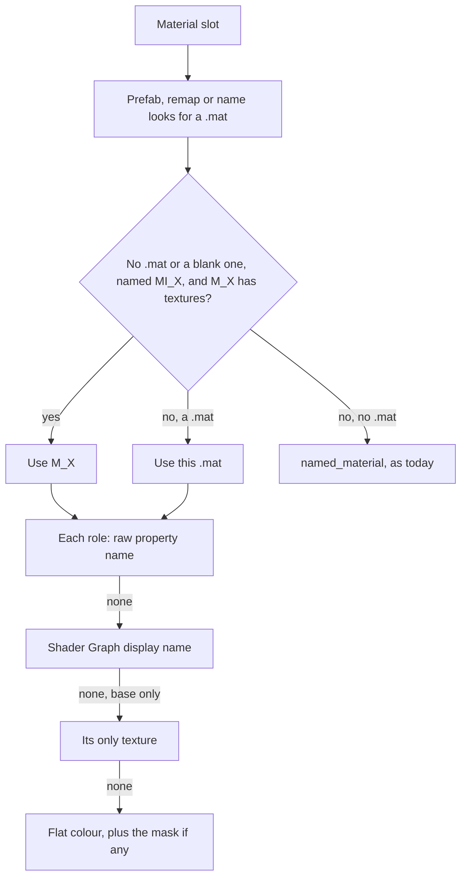

# Import fixes before the re-import

Fix what the import trial found, so the old libraries can be deleted and everything re-imported
through the Imports view. Four pieces, in order: the Unity GLB converter, the import dialog and
pack metadata, small preview fixes, then LOD grouping.

Status: decisions settled with the owner over three interview rounds. Every finding below was
checked in the code or measured on real packs, in a throwaway profile, at commit 63efa51.

## Outcome

| Pack | GLBs | Now | Target (floor) |
|---|---|---|---|
| Stylized Village | 181 | 0 | 158 |
| Ancient Ruins | 184 | 157 | 176 |
| Spooky Cemetery Crypt | 100 | 99 | 99 |
| Stylized Elven Valley | 200 | 179 | 191 |
| Stylized Lost Cave | 208 | 198 | 198 |
| Stylized Wizard Room | 219 | 201 | 201 |
| Elven Long Bow | 2 | 1 | 1 |
| POLYGON Prototype (Synty) | 950 | 746 | 909 |
| The Big Castle Kit | 293 | 226 | 257 |
| Fantasy Adventure Environment | 36 | 26 | 26 |
| Medieval Houses Vol 1 | 386 | 384 | 192 of the URP copy's 193 |

"Fully textured" means every material a GLB's meshes use has a `baseColorTexture`, the trial's
audit. Targets are what a throwaway prototype of Piece 1 reached, with no GLB losing a texture.
The prototype used the file-wide LOD rule, so Piece 1 must measure the per-mesh rule again.

Medieval Houses' target assumes Piece 2. Before Piece 2 it stays 384 of 386. Each copy holds 193
GLBs with one gap, `SM_Plane_01`.

## Baseline

The first trial's folder, `~/.cache/opendam-import-trial`, disappeared during this planning
session. None of this session's commands removed it, and the cause is unknown. The trial was
repeated from its scripts in a fresh throwaway profile, with the 63efa51 debug binary. It gave
the same counts for all 7 packs: 157, 99, 179, 198, 0, 201 and 1. `~/Documents/Assets` was not
touched.

## What held up and what did not

| # | Your candidate | Result in the code | Decision |
|---|---|---|---|
| 1 | Village has no textures | Confirmed: `Texture2D_...` names match nothing | Use Shader Graph display names, no filename rule |
| 2 | Foliage loses its cutout | Confirmed: the mask is only read inside the base-texture branch | Apply a mask with or without a base |
| 3 | Blank materials block the name fallback | Confirmed, but the fallback recovered nothing in any pack | Use an `MI_X` to `M_X` twin lookup instead |
| 4 | Poor pack covers | Confirmed: images beat models | Largest model before ordinary images |
| 5 | Wizard Room's LODs | Confirmed: 36 models, 6 levels each, 219 items | Group them, Piece 4 |
| 6 | Silent hoist | Confirmed. The proposed exclude can't help | Warn in the preview |
| 7 | Fab titles and publishers | Confirmed | Split CamelCase in title and folder |
| 8 | 10 failed previews | Three separate causes, one a real bug | See below |
| 9 | Progress ends short | Not lost work: a stale heartbeat in the DB | Write the final figures |
| 10 | Kenney offers | Confirmed trap: `fab` is offer 0 and is selected | Put `kenney` first |

Details that changed a proposal:

- **Display names beat filenames.** A `.shadergraph` stores each property's display name beside
  its reference (`Texture2D_27f0...` is `A_BaseColor`). That resolves the same 383 of Village's
  441 untextured uses as the regex, and exact normals and ORM maps too (Village normals 0 to
  436). The filename rule added no base texture in any pack and made false cutouts: Ancient
  Ruins' stone bricks picked up `T_UniformClouds_Mask` as opacity.
- **Shader Graph files aren't conversion inputs.** `UNITY_EXTENSIONS` leaves them out of the
  work copy, so the script can't read them today.
- **`exclude` doesn't work as hoped.** The dialog has no exclude. `exclude` names one file, and
  added steps run after `flatten`, so it can't unblock one. Typing `Stylarts/WizardRoom/Art` as
  the hoist works in the code, though no test covers it. `TutorialInfo/` stays.
- **Item 8's three causes:**
  - **GLBs:** `SM_Bulidings.fbx` (116 MB) and `SM_Grass_Foliage.fbx` hold only `_LOD1` meshes.
    `LOD_RE` drops them all, the model reports success, and Blender writes a 132-byte GLB.
  - **PNGs:** `T_Beige.png` and `T_Brown.png` are 29027 x 29027, which hits the decoder's memory
    limit.
  - **`.hdr`:** real Radiance files that imageio has no backend for, in either case. `.exr`
    works through OpenEXR.
- **Item 9:** `list_import_runs` reads `progress_done`, which only the 30 s heartbeat writes, so
  the figure changes between runs (10/184 this time). All 184 GLBs exist. The live UI reads events.

Problems the trial didn't show:

- **A Rebuild keeps old thumbnails.** `watcher.rs` keeps a changed non-raster's preview, so a
  rebuilt GLB would show its grey thumbnail.
- **Exact object names are stripped.** Big Castle's meshes are really named `Plane.099`, and the
  `.meta` maps that exact name, but `base_name()` strips `.099` before the lookup.
- **One-texture materials.** Synty's `PolygonPrototype_Grid_01` keeps its only texture in `_Grid`,
  which matches no base rule.
- **Nested packages import twice.** Medieval Houses landed `Built-In` and `URP_HDRP` side by
  side: 4.1 GB, 518 duplicate GUIDs, 218 of 219 model and material names repeated.

## Decisions

| Topic | Decision |
|---|---|
| Texture source | Shader Graph display names only, with no filename rule |
| Blank materials | Twin lookup, `MI_X` uses `M_X`. Flat colours stay flat and read `BaseColor Value` |
| One-texture materials | Its only texture is its base, narrowly |
| Exact names | Try the raw object and mesh name first |
| Layered materials | First layer by name (A), no tints |
| Empty GLBs | Keep each mesh's lowest LOD, and warn on a model left with no mesh |
| Rebuild thumbnails | Any changed model gets a fresh preview, as changed rasters do |
| Stale flag | None. A version bump means Rebuild, and this is documented |
| Covers | Largest model before ordinary images, for packs with no `Preview*` or `Sample*` |
| Hoist finding nothing | Warn in the dialog's preview, keep the no-op, add a nested-path test |
| Fab names | Split CamelCase for title and folder. Publisher is still typed |
| Nested packages | Choose a pipeline: keep loose files and that pipeline's nested packages, URP by default |
| Collider-only models | Leave them as grid items. Known gap |
| LOD groups | Same folder and stem, ending `_LOD<n>`, any case, in every library |
| LOD rename | New stem for all, each keeping its own `_LOD<n>` |
| LOD export | Only the main item exports, and metadata is shared across levels |
| Small fixes | Kenney offer first, `.hdr` in Rust, a clear too-large message, final progress |
| Gate before deleting old libraries | Pieces 1-3 merged, then the clean-profile runs below |
| Acceptance | Floors, not exact numbers. No GLB loses a texture, and every leftover is explained |
| Visual check | Contact sheets of the app's own thumbnails, reviewed by the owner |

## Piece 1: Unity GLB converter

Everything that changes GLB bytes goes in one version bump.

### How a slot finds its texture

Raw names stay first, so a texture found today is still found the same way. Normal, ORM and
opacity take the first two steps only. The base colour alone also takes the only-texture step.

### Changes

`apps/desktop/src-tauri/src/import/unity_glb.py`:

1. **Display names.** Read the `.shadergraph` the material's `m_Shader` GUID names, as a stream of
   JSON objects, and map each property's reference to its display name, cached per file. An
   unreadable or older graph gives an empty map. Keep the display names sorted, so `A_BaseColor`
   wins over `B_BaseColor`.
2. **Role words.** Base uses the existing `BASE_HINTS` and `NOT_BASE`. Normal needs `normal`. ORM
   needs `orm` without `normal`. Opacity needs `opacity` or `alpha`, never bare `mask`, because
   `GlitterMask` isn't opacity.
3. **Only texture.** A material with exactly one bound texture uses it as its base, unless the
   property is a generated `_SampleTexture...` slot or holds a `NOT_BASE` word.
4. **Mask with no base.** `build_material` wires the mask to alpha whether or not there is a base,
   over the flat colour. Blender 5.2.3 exports that as `alphaMode: MASK` with a `baseColorTexture`
   holding the mask, so the audit counts it as textured though its RGB is flat.
5. **Flat colours.** Display names apply to colours too, and `basecolorvalue` comes first in
   `COLOR_PROPS`, so `M_BasicFill` is black, as its file says.
6. **Twin lookup.** For a slot with no `.mat` or a blank one, `MI_X` resolves through `by_name` to
   `M_X` when that material has textures. `named_material` stays as today's last resort.
7. **Lowest LOD per mesh.** Group objects by name without the numeric suffix and the LOD suffix,
   and keep each group's lowest level, so a `_LOD1`-only file keeps its mesh. A LOD file keeps
   all, as today.
8. **Raw names first.** Look up `obj.name` and `obj.data.name` as they are, before `base_name()`.
9. **No-mesh warning.** Report a model left with no mesh, unless its file name matches
   `COLLISION_RE`, whose empty GLBs are the known collider gap.
10. Bump `VERSION` to `opendam-unity-glb/5`. Update the docstring's list of what differs from the
    original script.

`apps/desktop/src-tauri/src/import/unity_glb.rs`:

- Add `shadergraph` to `UNITY_EXTENSIONS`, which `inputs_hash` then covers by source path and
  sha256.
- Bump `UNITY_GLB_VERSION` with the script. A test keeps the two equal.
- Carry the no-mesh warning into the run's warnings. Today `warnings` is a list of skipped
  archive entries, under a heading saying entries were skipped, so it needs a reason of its own
  and a heading that fits both.

`apps/desktop/src-tauri/src/watcher.rs`:

- A changed model gets `pending` and a fresh preview, through the same path as a changed raster,
  and keeps its old thumbnail until then. Queue rules stay in `preview.rs`.

Docs: record the new rules in `CLAUDE.md`'s `src/import` notes and in the pack-import plan's
deviations.

### Rebuild and the version bump

- `VERSION` and `UNITY_GLB_VERSION` move together, and every GLB's cache key holds the version.
- After the bump, a Rebuild of any built pack misses the cache and reconverts every model. A
  Rebuild with no other change is already allowed, and the button is always in Preparation.
- A staged GLB whose bytes changed keeps its asset row, id, tags and path, and takes a new mtime.
  With the watcher change above, it gets a fresh preview. An unchanged GLB keeps its mtime and
  queues nothing.
- In-app renames and excludes are recipe steps, so they survive. Kept files carry as before.
- Nothing flags a pack as built by an older converter. A version bump means you Rebuild. Old
  cache entries stay until Clear in Settings' Import tools.

## Piece 2: Import dialog and pack metadata

Needs no new GLBs, and doesn't depend on Piece 1.

- **Covers (`structure.rs`).** `PackFiles::cover` becomes preview, sample, largest model, image,
  visible file. The largest is the biggest visible model item by size, ties by path, so `derive`
  stays pure: `pack_files` takes the sizes `derive` already has. This applies to every library,
  to packs with no `Preview*` or `Sample*`. The `datapackage.json` `image` and your own cover
  still win.
- **Cover render (`commands/folder.rs`).** `Cover` carries the model's bundled preview, so a
  pictured model doesn't show an icon. Verify a card updates when its model's thumbnail arrives.
- **Hoist warning.** `place_listed` reports a hoist whose folder is missing, and `Tree` gains
  `warnings`, which the dialog shows. `refreshTree` in `store/imports.ts` also builds a `Tree`.
  The no-op stays. Add a test for `Stylarts/WizardRoom/Art`.
- **Fab names (`scan.rs`).** Split CamelCase in `fab()` and `unreal()` names: `StylizedVillage`
  becomes `Stylized Village`, for the title and target. A name that already has a space stays.
  The `zip` offer and `.unitypackage` names don't change.
- **Kenney offer first (`scan.rs`).** Push `kenney` before `fab` and `unreal`, so it is offer 0. A
  zip that isn't Kenney's keeps its order.
- **Pipeline choice for cached packages (`scan.rs`, `unitypackage.rs`, `engine.rs`, dialog).** When
  a `.unitypackage` holds nested packages of two or more pipelines, offer a pipeline, URP by
  default, using `pipeline()`. The build keeps loose files, keeps nested packages of that
  pipeline and those naming no pipeline, and skips the others. The choice is stored in the
  extract step, so a Rebuild repeats it. Fab zips don't change.
  - Medieval Houses keeps its URP copy, about half of 4.1 GB.
  - Nature Package keeps its base content, `URP` and both URP shader sets, and skips the HDRP
    overlays and the 1.8 GB Built-In package.

## Piece 3: Small preview fixes

- **`.hdr` in Rust.** Add the `image` crate's `hdr` feature, decode it natively, and remove the
  worker's `.hdr` branch. `.exr` stays in the worker.
- **Too large to preview.** Read a raster's size from its header first. One past the decoder's
  limit stays without a preview and says so. Store the reason in a bookkeeping column
  (`db::add_preview_columns`), never in `metadata`, and show it in the detail panel, which today
  always says "No preview available".
- **Final progress.** When a run ends, write its latest progress and phase in the same update
  that sets its status, so no run ends on a stale heartbeat.

## Piece 4: LOD grouping

Structure is derived, so this needs no rebuild and can land after the re-import.

- **Rule.** In `format_groups`, strip a final `_LOD<n>` (any case, same folder) from the key, and
  rank by level, then `format_rank`. The main item has no suffix, else `_LOD0`, else the lowest
  level. A name with no separator stays apart. A file on its own stays on its own.
- **Stem matching.** `model_previews` and `bundled_previews` also match by stem, and need the same
  treatment.
- **Rename (`commands/asset.rs`).** Give every member the new stem and keep its own `_LOD<n>`.
  Today all members take one stem, which would collide. An imported pack records each as a step,
  as before.
- **Group rules that follow unchanged:** one grid item, shared metadata (`apply_unions`), delete
  reaching every member, the preview queue skipping members, and export resolving to the main
  item, so LOD1+ files stop being separate export items.
- **Docs.** Update "One grid item per group" in `CLAUDE.md`.

Across the 11 packs measured, only Wizard Room changes: 219 items to 39.

## Fixture tests

Real Asset Store content can't be committed. Add
`apps/desktop/src-tauri/tests/fixtures/unity-glb/`, made by a stdlib `make_fixtures.py` and
committed with its output, as the pack-import fixtures are: text `.mat`, `.meta` and
`.shadergraph` files, a small OBJ per case and tiny PNGs.

Blender-backed Rust tests run the script over it and read each GLB's JSON. They find Blender
through `OPENDAM_BLENDER`, which CI's test job sets up.

| Case | Input | Expected |
|---|---|---|
| Generated names | `Texture2D_a` shown as `A_BaseColor`, with normal and ORM | All three maps bound |
| Layers | `A_BaseColor` and `B_BaseColor` | Layer A |
| Mask only | `OpacityMap` and a colour | `MASK`, texture, and colour as factor |
| Helper mask | `GlitterMask` beside a base | Stays opaque |
| Blank twin | Blank `MI_X`, textured `M_X` | `M_X`'s texture |
| Twin with no .mat | Slot `MI_X` with no `.mat`, textured `M_X` | `M_X`'s texture |
| Flat colour | `BaseColor Value` only | That colour, no texture |
| Only texture | `_Grid` alone | Base texture |
| Generated slot | `_SampleTexture2D_..._Texture_1` alone | No base |
| LOD only | Only `_LOD1` meshes | Mesh kept, no warning |
| Mixed LODs | A with `_LOD0` and `_LOD1`, B with `_LOD1` | A's `_LOD0`, B's `_LOD1` |
| No mesh | Only collision meshes in a model not named as a collider | Warning |
| Collider file | `rock_collider.obj` | No warning |
| Exact name | Object `Plane.099` mapped in the `.meta` | Prefab's material |
| Graph missing | `.shadergraph` left out | Same GLB as with today's rules |

Add unit tests beside the code for `is_input`, the version match, the cover order, the hoist
warning, CamelCase splitting, offer order, pipeline filtering, the changed-model preview, the
final progress write and LOD grouping and renames.

## Acceptance

### Each piece

- **Piece 1:** the fixture tests pass, and all 11 packs reach their floors in a clean throwaway
  profile. Compared GLB by GLB with the baseline, none loses a base texture, normal or ORM map.
  `SM_Bulidings.glb` and `SM_Grass_Foliage.glb` have meshes. Rebuilding one built pack from
  version 4 gives new GLBs and new thumbnails, keeps a tag and a rename, and leaves unchanged
  GLBs alone.
- **Piece 2:** the 6 Fab packs get a model cover, not a texture. Wizard Room's dialog warns about
  `hoist Art`, and `Stylarts/WizardRoom/Art` hoists. `StylizedVillage` becomes `Stylized Village`.
  The Kenney zip opens on `kenney` with 241 packs ticked. Medieval Houses and Nature Package
  build one pipeline. The bench checks U10 and U11 still pass.
- **Piece 3:** the 7 `.hdr` files seen across both libraries get previews. `T_Beige.png` and
  `T_Brown.png` say too large. A finished run's row shows its final figures.
- **Piece 4:** Wizard Room shows 39 items. A rename keeps each `_LOD<n>`. U11 and U12 still pass.

### Leftovers

Every GLB under its pack's full count must be explained by one of these:

- Water, flames, foam and clouds built from shaders, which are out of scope.
- A true flat colour, such as `M_Emissive`, `M_BasicFill`, `M_Grass_A` and `M_Tiny_Rocks`.
- A collider-only file.
- An OBJ with no `.mtl` and no prefab: Wizard Room's `SM_Walls2` and `SM_Books3_2` with their LODs,
  and Elven Long Bow's `Arrow`.
- A slot no Unity file resolves: Big Castle's `Material.00x`, and Fantasy Adventure's `lambert1`
  and billboards.

Each must be listed by material and count, so anything else stands out.

### Visual check

The audit reads JSON and proves nothing about how a GLB looks. For each pack, render a contact
sheet of about 12 models from the app's own thumbnails, before and after, covering foliage,
walls, roofs, props and flat colours, and register it as evidence. **The owner reviews the
sheets.** Use the app's three.js thumbnails, not Blender: `SM_Leaves01` renders almost black in
Cycles both before and after, though its GLB's colour is right, and that needs judging on what
the app shows.

### Before deleting the old libraries

With Pieces 1-3 merged, run these in a clean throwaway profile:

1. All 11 packs, audited against the floors, with the contact sheets reviewed.
2. `LostRuins.zip` through the Unreal route. The editor is at `~/Applications/UnrealEngine`.
3. `Waterways.zip`, after a memory check, under `import.unrealMemoryMax`. A kill at the cap is a
   finding, not a reason to raise it.
4. The Kenney build, for time and disk use. It has no conversion step.

Only then delete the old libraries. Piece 4 can land before or after.

## Evidence so far

- **Prototype:** a throwaway copy of `unity_glb.py`, never in the repository, ran on 10 packs
  under `scripts/memory-cap.sh` with no regressions. Elven Long Bow wasn't rerun, and keeps 1.
- **Filename rule:** tried and dropped after the false cutouts above.
- **Big Castle's cutouts:** MASK uses fell from 58 to 23. That isn't a loss: the 42 lost uses were
  misnamed `Material.00x` slots that now resolve to real materials such as `wood_a_beams`, and
  `leafes_plane` gained its cutout.
- **Renders:** 15 sample GLBs before and after. The campfire, flower, lantern, walls, shop, pine,
  bush and frame look right. This was Cycles, not the app, so it doesn't replace the visual check.
- **Census:** a read-only look at all the cached Unity packages found no other pack with
  generated material names at scale. Materials with no base by property name are mostly water and
  skyboxes, and binary `.mat` packs already convert.

## Known gaps

- **Layered materials show layer A with no tints.** Every `M_Wall_*` shows the same brick, and
  `M_Plank_Brown` matches `M_Plank_Master`.
- **Shader-built water, flames, foam and clouds stay flat.**
- **Collider-only models stay as grid items.** They make empty GLBs and failed previews (7 in the
  Synty and Fantasy Adventure samples).
- **Models with no `.mtl` and no prefab stay untextured**, as do slots no Unity file resolves.
- **Mask-only foliage has flat RGB.** It counts as textured but has no colour detail.
- **The 16 cached packages not sampled** run no acceptance pass, though the census found no
  sign of trouble.
- **Nothing flags a stale pack** after a future version bump.
