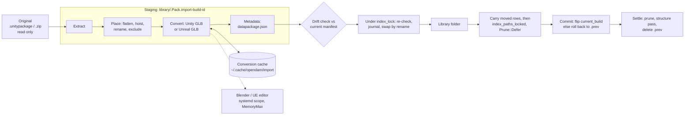

# Pack import: prepare packs from their originals, recorded and reversible

Status: shaped 2026-10-22 in a four-round interview (D1-D30 below), approved at final review
(revision 1).

Revised 2026-10-22 (revision 2) after the workflow's Plan Feasibility review. These are design
repairs within the decisions. One decision is narrowed: D29's committed binary `.mat` fixture
isn't possible, as R6 explains.

- **R1 - Hidden Unity `.mat`.** The structure pass can't see `.mat.meta`, since `.meta` files
  aren't indexed. The rule now reads the import's output manifest, a DB table the pass already
  reads like `pack_overrides`, so `structure::derive` stays pure (Unity-only files).
- **R2 - The swap's commit point.** A build id, a swap journal in the DB, one commit transaction,
  rollback when indexing fails, recovery for each crash point, `_locked` variants of the index and
  structure passes so the held lock doesn't deadlock, and no lost edits during a long run
  (Flow, Runs, A11).
- **R3 - Edits to generated files.** `rename` and `exclude` steps name extracted files by their
  path in the original. A generated GLB follows its source model, and `datapackage.json` is
  edited through the metadata step, never by a step of its own (Edits after an import, A5).
- **R4 - Absolute original paths.** These are now an explicit exception to the relative-paths
  invariant (Changes to the invariants).
- **R5 - Layouts.** The Kenney layout is checked against the extracted bundle (246 packs, each
  `<Category>/<Pack>/License*.txt`). The Fab Unity layout is unverified on this machine, so
  detection no longer assumes one, and A16 checks a real download by hand. The Unreal preview's
  content is now defined.
- **R6 - Fixtures and goldens.** A committed generator builds them, and the goldens come from
  running your scripts once (Fixtures and goldens, A3, A7, A8).
  - **D29 is narrowed.** The synthetic package can't hold a binary `.mat`: a real one would be
    Asset Store content, which can't be committed, and nothing available writes the format. The
    binary path is tested by an env-gated worker test and by hand instead (A17, Known gaps).

Revised again 2026-10-22 (revision 3) after the review's second round. One decision was added
(D31, carry moved files' rows), asked while repairing R8:

- **R7 - The structure pass reads only the committed build.** No structure pass runs before the
  commit, and the pass always reads `current_build`'s manifest, so a rollback or recovery can
  never derive Unity roles from a failed build. The recovery table now covers every folder state,
  including a first build swapped but not committed, and a later build that crashed between the
  journal and the first rename. The in-run rollback handles a first build with no previous
  folder (Flow, A11, A14).
- **R8 - Asset rows survive rollbacks and moves.** Indexing before the commit prunes no row, and
  rows of files missing from disk are pruned only after the commit. A rollback therefore restores
  the previous build's files to the rows, tags, ratings and collections they never lost. Repairing
  this exposed a loss on a *committed* rebuild that moves files (a hoist toggled off, say), so you
  decided (D31) that a rebuild carries each moved file's row to its new path. The move is matched
  by `source_path`, journaled in `import_moves`, and reversed by a rollback (Flow, A4, A11).
- **R9 - Escaping paths are skipped and reported.** An archive entry that would land outside the
  target is skipped, as `extract_unity.py` does, and listed as a warning on the run. It never
  fails the build, so `synthetic.unitypackage` serves A2, A3 and A8 alike (Steps, A2).

Revised again 2026-10-23 (revision 4) after the review's third round. No decision changed:

- **R10 - A late crash in a rollback can't touch the restored build.** Rollback step 4 clears
  `swap_state` and deletes the failed build's records in one transaction, before it deletes
  `.failed-B`. A leftover `.failed-*` with `swap_state` `NULL` is plain garbage. The first-build
  recovery row now requires `current_build IS NULL` as a condition (R33 replaces it with
  `swap_prev`), and a state matching no row changes nothing on disk (Flow, A11).
- **R11 - Reversing a move can't collide.** Step 5 journals every row its index inserts. A
  rollback deletes those rows first, then reverses the moves newest first, so each row's old path
  is free again when it moves back (Flow, Records, A11). Revision 9 replaces the newest-first
  order with two passes (R22).
- **R12 - A source path is unique, nested packages included.** A file's `source_path` is the
  chain of pathnames from the original down through each nested package, stored as a JSON array.
  The manifest holds it unique per build. `rename`, `exclude`, the D31 carry and the GLB cache key
  all use it (Steps, Records, A5).
- **R13 - Unsafe entries don't change the layout.** They are dropped before the shared top folder
  is found. `extract_unity.py` instead lets an escaping entry block that rule, so this port
  deliberately differs there, and the escaping entry moves to its own fixture (Steps, Fixtures,
  A2).

Revised again 2026-10-23 (revision 5) after the review's fourth round. No decision changed:

- **R14 - No pruning index reaches a pack mid-swap.**
  - **Cancel** takes effect only before step 1. After that the build always finishes in-process,
    by committing or by rolling back.
  - **Library open.** Swap recovery runs when a library opens, in `connect_library_sqlite`, before
    its structure pass and before the library can be indexed.
  - **Every index run.** Every locking `index_paths` and `rebuild_library` also recovers any pack
    still marked `swapping` before it touches a row.

  So a dropped run task, a crash or a late-opening library can't let a pruning index delete
  previous-only rows (Flow, Runs, A11).

- **R15 - `.meta` files have their own source path.** A `.meta` file's source path is its asset's,
  with `.meta` appended to the last element, so `(source_path, origin)` stays unique when a
  pack keeps its `.meta` files (Steps, A2).

Revised again 2026-10-23 (revision 6) after the review's fifth round. No decision changed:

- **R16 - Each recovery table has its own trigger.**
  - **The `swapping` table** runs when a library opens and at the start of every locking index
    run.
  - **The `swap_state NULL` table** (staging, `.failed-*`, `.prev-*` leftovers) runs only when a
    library opens. It skips every pack whose run is queued or running, so a refresh, or a library
    reconnecting mid-session, never deletes the staging folder of a build still in progress.
  - **Lock-free entry points.** Recovery at library open uses lock-free cores, since nothing else
    holds the pool yet (Flow, A11).

Revised again 2026-10-23 (revision 7) after the review's sixth round. No decision changed:

- **R17 - Recovery at library open takes the build's lock.** It runs after `connect_library_sqlite`
  and before `register_library`, holding `Database::index_lock` for the library id, which exists
  before the pool and outlives it. A build in steps 1-7 holds that lock, so a library reconnecting
  mid-session waits for it to finish and never rolls back a live swap (Flow, A11).
- **R18 - The swap excludes other machines too.**
  - **The build holds the advisory lock.** It holds the cross-machine `.opendam/index.lock` from
    step 1 to the end of step 7 or of its rollback, with a heartbeat that keeps the lock from
    going stale.
  - **Recovery needs both locks.** Every `swapping` recovery, `rebuild_library`'s included, runs
    only while holding both locks, and otherwise skips.
  - **What other machines do.** Another machine's refresh yields, as `index_paths` already does.
    Its rename or pack edit runs only the structure pass, which prunes nothing (Flow, A11, Known
    gaps).

Revised again 2026-10-23 (revision 8) after the review's seventh round. No decision changed:

- **R19 - Every holder keeps the advisory lock fresh.** The token and the 30 s heartbeat move
  into `watcher::IndexLock`, so every holder refreshes the lock for its whole hold: another
  machine's `index_paths`, every recovery, Remove and the build. A holder releases the lock only
  while the file still holds its own token. An index run that finds its token gone prunes nothing
  (The advisory lock, A11).
- **R20 - A run belongs to the process that runs it.** `import_runs` records its owner (machine
  id, process id and start time) and a heartbeat.
  - **Startup.** A starting process marks `interrupted` only runs whose owner is gone: a dead
    process on this machine, or another machine's run whose heartbeat stopped 10 minutes ago.
    So another machine's startup leaves a live staging build alone.
  - **Staging is checked.** Step 2's re-check now also confirms the staging folder still holds
    exactly the build's files.
  - **A missing staging folder.** A staging folder that vanished anyway is handled in-run and by
    a new recovery row (Flow, Runs, A11).
- **R21 - The structure pass at open waits for the locks.** It moves out of
  `connect_library_sqlite` into the open path, after the locks and recovery. A structure pass
  runs only while holding both locks, so none runs between a swap and its commit, on any machine
  (Flow, A11).

Revised again 2026-10-23 (revision 9) after GitHub Inspector's review of PR #199. No decision
changed:

- **R22 - A carry moves every row aside first.** It used to skip a move whose new path still
  held a row, even when that row was itself about to move away. A swap of two names then lost one
  file's metadata. Each carried row now moves to a holding path first, and is then placed. A move
  is skipped only when its new path holds a row that isn't moving, and a rollback reverses the
  moves the same way (Flow, A4, A11, Known gaps).
- **R23 - The GLB cache key covers what Blender reads.** It adds a hash of the conversion's
  input files, each by source path and sha256. So an excluded texture or `.mat`, or a kept,
  changed texture, makes a fresh GLB, and a hoist still reuses every one (Unity conversion, A8).
- **R24 - The store-page answer is outside the recipe.** It is kept in `import_packs.store_page`,
  not in the metadata step's options, so writing it bumps no `recipe_rev` and fails no run (Pack
  metadata, Records, A7).

Revised again 2026-10-23 (revision 10) after GitHub Inspector's second review of PR #199. No
decision changed:

- **R25 - Pack targets never nest.** A target that is an ancestor or a descendant of another
  pack's target is refused, in the dialog and when a target is edited. One pack's rebuild or
  Remove could otherwise move or delete another pack's files (Presets, invariants, A18).
- **R26 - The GLB cache key covers file names.** `unity_gltf.py` falls back to matching
  materials and textures by file name, so the inputs hash adds each input's final file name.
  Where two inputs share a name, the script keeps the first by path, so the hash also records
  their order. A `rename` of a texture now reconverts, and a hoist, which changes folders and not
  names, still reuses every GLB unless it reorders same-named files (Unity conversion, A8).

Revised again 2026-10-23 (revision 12) after GitHub Inspector's third review of PR #199. No
decision changed:

- **R27 - An unchanged file keeps its mtime.** A staged file whose source path, origin, size and
  sha256 match the previous build's row gets that row's mtime. The index then sees it unchanged
  and requeues no preview, and the export Check's `file_hashes` memo stays valid for files whose
  path didn't change (R34 narrows this). A toggled hoist no longer sends the whole pack back to
  the preview queue (Steps, A4).
- **R28 - One GLB per model stem.** When a folder holds `X.fbx` and `X.obj`, `unity_glb` converts
  one of them, chosen in format-group order (FBX before OBJ), instead of failing the build on two
  `X.glb` (Steps, A8).
- **R29 - A carry is never skipped.** Every file in the new build has its own path, so a row
  already at a carried file's new path belongs to a file the new build doesn't have there. Step 7
  would prune that row anyway. The aside pass now moves it aside too, and the carried row takes
  the path, so no file's tags land on another file (Flow, A4, A11, Known gaps).

Revised again 2026-10-23 (revision 13) after GitHub Inspector's fourth review of PR #199. No
decision changed:

- **R30 - In-app edits move the `.meta` on disk.** `.meta` files aren't indexed, so `rename_asset`,
  `delete_asset` and `delete_assets` don't touch them today. Inside an imported pack they now
  rename or delete each file's `.meta` beside it, in the same operation and put back with the
  rest when a step fails. So the folder stays importable into Unity, the hidden-`.mat` rule reads
  a sidecar that exists, and the next drift check shows nothing (Edits after an import, A5).

Revised again 2026-10-23 (revision 14) after GitHub Inspector's fifth review of PR #199. No
decision changed:

- **R31 - A dead process's lock is stale at once.** The lock's token names its machine, process id
  and process start time. A lock whose token names this machine and a process that is gone is
  stale at once, whatever its mtime, so an app restarted within 120 s of being killed recovers and
  indexes the library right away (The advisory lock, A11).
- **R32 - The recovery table covers step 4's failure path.** A crash after step 4 put the previous
  folder back, or after the journal with the staging folder already gone, leaves B's journal with
  nothing of B on disk. The row that called this impossible now names it, and a new row covers
  the first-build version, where no folder exists at all (Flow, A11). Revision 15 makes both rows
  branch on `swap_prev` instead of `current_build` (R33).

Revised again 2026-10-23 (revision 15) after GitHub Inspector's sixth review of PR #199. No
decision changed:

- **R33 - The journal records whether a live folder was moved aside.** A later build can find no
  live folder, when you deleted the pack folder outside OpenDAM and chose "restore" at drift.
  Step 4 now decides the first rename by whether the live folder exists, not by whether this is a
  first build, and step 3 journals that fact in `import_packs.swap_prev`. The recovery rows that
  branched on `current_build` branch on `swap_prev`, so such a build, swapped and not committed,
  is rolled back with its carried rows reversed, never taken for a build that left nothing on
  disk. A failed first rename is covered too (Flow, Records, A11).
- **R34 - The `file_hashes` memo stays valid only where the path did.** `file_hashes` is keyed by
  path and only the export Check writes it, so a carried file has no memo row at its new path,
  and its next Check hashes it again. The old path's row stays as a harmless orphan, as for any
  file that goes away. R27 and A4 now claim the memo only for files whose path didn't change
  (Steps, A4).
- **R35 - Only regular files and folders are written.** A tar can hold hardlinks, devices, FIFOs
  and other special entries, and a hardlink's target can point anywhere. Extraction now writes
  regular files and directories only, and skips and reports every other entry type like an
  unsafe entry, as `extract_unity.py` reads only `member.isfile()` entries. The
  `escape.unitypackage` fixture gains a hardlink (Steps, Fixtures, A2).

Revised again 2026-10-23 (revision 16) after GitHub Inspector's seventh review of PR #199. No
decision changed:

- **R36 - An index over the pack reads and prunes only the pack.** Today `index_paths` loads
  every asset row of the library (`watcher.rs:177-187`) and deletes every row whose path it
  didn't walk (`watcher.rs:312-329`). Every caller passes the library root, so that is right
  today, but a run over one pack folder would delete every row outside it. A scoped run now
  loads and prunes only rows under the paths it walks, matched on whole path components, and a
  new case checks that a tagged asset outside the pack survives every build, rollback, recovery
  and Remove (Flow, invariants, A11, A13).
- **R37 - A rollback with no previous folder prunes nothing.** When `swap_prev` is false, the
  pack folder is gone again after the rollback, so a pruning index would delete the rows the
  rollback just put back. That rollback runs only the structure pass, and its rows wait, as they
  did before the build, for the next refresh (Flow, A11).

Revised again 2026-10-23 (revision 17) after GitHub Inspector's eighth review of PR #199. No
decision changed:

- **R38 - A Remove is journaled and always finished.** A Remove interrupted midway failed its
  own drift re-check on resume, and one interrupted after deleting the import's records had lost
  its target and manifest. It now journals `swap_state = 'removing'` before it deletes anything,
  deletes the records last, after the scoped prune, and recovery finishes a `removing` pack
  without a re-check, from the records it kept (Remove import, Flow, A13).
- **R39 - Drift choices depend on the file's origin.** A generated GLB, `datapackage.json` and a
  kept file can't take an `exclude` step, and keeping a changed generated GLB would clash with
  the convert phase. The dialog now offers only the choices each origin can honour (Edits after
  an import, A6).

Revised again 2026-10-23 (revision 18) after GitHub Inspector's ninth review of PR #199. No
decision changed:

- **R40 - In-app edits reach kept files.** A kept file that replaced a recipe file now keeps that
  file's `source_path`, so an in-app rename or delete of it records a `rename` or `exclude`
  against it, and the recipe's copy can't come back at the old name. A kept file added outside
  OpenDAM has no step: a rename moves it in the kept files and a delete drops it (Edits after an
  import, Records, A5).
- **R41 - A skipped structure pass is never lost.** `rebuild_library` used to skip its pass while
  another holder had the advisory lock, with nothing to run it later. It now waits up to 5 s,
  then marks the pass pending in `library_meta` and leaves a task that runs it once the lock
  frees. Every holder also runs a pending pass before it releases the lock. The weaker guarantee
  is stated in the invariants and the Known gaps (Flow, A11).

Revised again 2026-10-23 (revision 19) after GitHub Inspector's tenth review of PR #199. No
decision changed:

- **R42 - A file kept at drift is still the same file.** The carry joined builds on
  `(source_path, origin)`, so a file whose origin changed from `extracted` to `kept` ("keep
  yours") in a rebuild that also moved it found no match, and step 7 pruned its row with its
  tags. The carry now joins on the **file key**, `source_path` plus whether the file is
  generated, so `extracted` and `kept` count as the same file and only a generated GLB stays apart
  from its model. The manifest's uniqueness uses the same key (Flow, Steps, Records, A2, A4).

Revised again 2026-10-23 (revision 20) while building the `unity_glb` step (ticket 8), whose
reviews found the plan's cache key blind to things Blender reads. No decision changed. These are
the step's deviations from `unity_gltf.py` and from this plan as written:

- **R43 - No importer reads the pack by path.** Blender's FBX and OBJ importers find a texture,
  and an OBJ its `.mtl`, by path relative to the model, which the key, blind to folders, can't
  see. So a hoist could reuse a GLB a fresh conversion would no longer make. Now:
  - **Copies.** Blender imports each model from a copy under its own name, in a scratch folder
    of its own, assimp's binary copy of an ASCII FBX included, with the FBX image search off.
  - **Textures by name.** Every texture an importer loaded is bound to the pack's file of that
    name, through the same name map the script's name fallback uses, or dropped when the pack
    has no file of that name. Textures embedded in an FBX are kept.
  - **Libraries by name.** An OBJ's `mtllib` lines name the pack's `.mtl` of that name.
  - **The cost.** A material left as the importer built it is opaque, since the importer never
    sees the texture to wire its alpha. A pack of per-model folders with generic file names
    (`Chair/model.mtl`, `Table/model.mtl`) gives every model the first folder's files.
- **R44 - Every first-wins lookup is ordered and keyed.** The script's GUID index now reads the
  `.meta` files sorted by path and keeps the first, where `unity_gltf.py` kept whichever `rglob`
  found last. Names match as the script compares them: lowercased, letters and digits only. The
  inputs hash records the order, by final path lowercased, of every set the script tells apart
  only by path: same-named inputs, `.meta` files of one GUID, all prefabs and all scenes.
  - **Scratch files.** JPEG copies and import copies go to the job's scratch folder, named by a
    counter, not to `~/.cache/unity-gltf` by Python's per-process `hash()`.
- **R45 - Which models, inputs and options.**
  - **Per stem.** "None where the folder ships a `.glb`" is per stem, ignoring case, as the
    script and the dialog's count do: `Tree.obj` still gets a GLB beside a shipped `Rock.glb`.
  - **Options.** `force` converts again despite the cache, since overwriting a shipped GLB would
    clash with the extracted file. A pack runs at most one enabled `unity_glb` step.
  - **Failures.** A model Blender fails on fails the step, naming the model, where the script
    went on. Excluding the model lets the pack build.
  - **Inputs.** An OBJ's `.mtl` is an input. The texture extensions are one list, in Rust, sent
    in the job. `.exr`, `.hdr` and `.gif` aren't in it, so they are dropped (Known gaps).
- **R46 - Tools and settings.**
  - **The cap's setting.** It is `import.blenderMemoryMax`, named like `export.blenderPath`.
  - **The scope.** It also gets `OOMPolicy=kill` where systemd accepts it for scopes, as
    `scripts/memory-cap.sh` does, and a SIGKILL under the cap counts as a cap kill, like 137.
  - **Without Blender.** A Unity import adds `unity_glb` turned off, and `get_import_steps`
    gives the reason (`unavailable`). A build with it on fails with that reason.
  - **assimp.** It is `assimp` on `PATH`, with no setting yet (R51 adds `import.assimpPath`).

Revised again 2026-10-23 (revision 21) while building the `export_unreal` step (ticket 9). No
decision changed. These are the step's deviations from `ue_gltf_export.sh/.py` and from this
plan as written:

- **R47 - Settings and the request.**
  - **Names.** The cap is `import.unrealMemoryMax` (default `20G`), named like
    `import.blenderMemoryMax` (R46), and the editor's folder `import.unrealEditorRoot` (default
    `~/Applications/UnrealEngine`, an absolute path). The editor's version, which the cache
    key holds, is read from `Engine/Build/Build.version` below it.
  - **The import.** An Import pack request asks for the Unreal build with `unreal: true`; the
    scan offers it as the `unreal` layout, with the `.uproject`'s path and a tree marked as an
    estimate. A zip with two `.uproject` files is refused.
  - **Without the editor.** `export_unreal` is a pack's only extract step, so it stays on: the
    scan and the pack's steps give the reason (`unavailable`), and the build fails with it.
- **R48 - The cache.**
  - **The key.** A GLB's key leaves out `batch`, which changes how many sessions make the GLBs,
    not what they hold.
  - **A record per original.** `<cache>/unreal/<key>.json` (the key without the asset) lists
    the GLBs exported so far, the assets that failed, and whether a session reported nothing
    left. It is rewritten after every session. Its GLBs are put where the script looks first,
    so a rerun exports only the rest, and a rebuild after a finished export, with every GLB
    still cached, unzips nothing and runs no editor.
- **R49 - When a session counts as progress.**
  - **A failed asset.** The exporter failing on an asset doesn't fail the step, as in the
    script. The asset gets no GLB and becomes a run warning (`notExported`, by its `/Game`
    path). A session whose attempts all failed still made progress, since later sessions skip
    those assets.
  - **A cap kill.** Every session's finished GLBs are cached however it ends, killed by the
    cap or cancelled included. A session the cap kills after exporting something is followed
    by a fresh one, whose memory starts over; one it kills before fails the step, naming the
    cap. The script also quits the editor in a `finally` block.
  - **Exit status.** Otherwise the editor's exit status is ignored, as the wrapper does: only
    progress and `.gltf-remaining` count.
- **R50 - What the pack gets, and what is checked.**
  - **Docs.** `txt`, `md`, `pdf` and `rtf` files at the project's root keep their names, and
    those below `Content/` their paths below it, beside the GLBs. Nothing comes from `Config/`,
    `Saved/` or elsewhere. Two docs landing at one path are refused.
  - **Free space.** There is no check before the unzip: one that runs out of space fails the
    step with the system's "No space left on device".
  - **The project's own code.** The editor opens the project as you, with its Python plugin on.
    So besides a root `Source/`, a project that ships compiled code is refused: any file below a
    `Binaries/` folder, or below a plugin's `Source/`. Before the editor starts, the work copy
    loses the startup hooks the editor would run with Python on: every `Python/` folder
    directly below a `Content/` folder (an `init_unreal.py` runs at startup), and in every
    `.ini` file the Python plugin's settings sections (`StartupScripts`, `AdditionalPaths`)
    and the editor utility subsystem's (`StartupObjects`), with any stray `StartupScripts`
    entry. This disarms the known hooks; it is no sandbox. The editor still loads the
    project's assets and its startup map, whose Blueprints run as in any editor that opens the
    project, so a project you don't trust shouldn't be imported.
  - **The fixtures.** `unreal.zip` holds `Feif/Feif.uproject` (named unlike the zip) with three
    meshes, a texture, a level and docs, so the batches and the hoist can be tested;
    `unreal-source.zip` adds `Source/`.

Revised again 2026-10-24 (revision 22) while building Settings' Import tools section (ticket
22). No decision changed. These are the section's deviations from this plan as written:

- **R51 - The section, assimp and Clear.**
  - **assimp's setting.** It is `import.assimpPath`, an absolute path, unset for `assimp` on
    `PATH` (replacing R46's "no setting yet"). `unity_glb` runs the saved program.
  - **A missing assimp disables nothing.** Only an ASCII or pre-7.1 FBX needs it, and that
    model's conversion already fails naming assimp. Settings shows where assimp is, its version,
    or why it can't be used, but `unity_glb` stays available without it, so packs that never
    need it still convert.
  - **Blender.** Its path stays the export's `export.blenderPath`, set under Game export. The
    section shows the same status, from one check both sections share.
  - **UnityPy.** The queue keeps the `unitypy` answer of the worker's `engine_info` beside its
    version (`AppState::engine_unitypy`), so Settings reads it without asking the worker again.
    It shows "not known yet" until a worker has answered.
  - **The tools are checked as typed.** `get_import_tools` checks assimp and the Unreal Editor
    at the paths in the form, saved or not, as Game export checks Blender.
  - **Clear.** `get_import_cache` gives the cache folder's size (every file below it, following
    no symlink), and `clear_import_cache` deletes everything below the folder, keeping it, and
    returns the size after. Clear is refused while a run of this process executes: each run
    holds the engine's `cache_use` lock shared, and Clear takes it exclusively without waiting.
    An entry it can't delete fails the clear, naming it, after the rest are deleted.
  - **Known gap: one process.** Clear sees only its own process's runs. Another OpenDAM
    process on the same machine shares `~/.cache/opendam/import`, so clearing in one can remove
    files a build in the other is reading.
  - **Missing tools, as built before.** The import dialog and the step editor already show a
    step whose tool is missing with the reason: `unity_glb` off and locked off (R46), and
    `export_unreal` locked on, its build failing with the reason (R47).

## Problem

Packs reach the libraries through scripts in `~/Documents/Assets`, run by hand, in this order:

| Script | What it does | What it loses |
|---|---|---|
| `extract_unity.py` | `.unitypackage` (a tar.gz of GUID folders) to `<Publisher>/<Pack>/`: drops `Assets/` and a top folder every file shares, unpacks nested packages in place, skips Unity-only files (`.mat`, `.prefab`, `.meta`, `.cs` and others) unless `--keep-all` | The skipped files, which the GLB conversion and Unity both need |
| `flatten_pack.py` | Merges wrapper folders (the root's only folder, beside nothing but docs and `.meta`) into the pack root, then `--hoist Art` / `Meshes` | Moves files in place, with no record and no undo |
| `gen_datapackage.py`, `gen_kenney_datapackage.py` | Write `datapackage.json`: Unity EULA or Fab license, publisher from the parent folder; for Kenney, title and version from the license header, CC0, and the store page found by HEAD requests to kenney.nl | `--force` overwrites hand edits, such as Ancient Ruins' publisher, Leartes Studios |
| `unity_gltf.py` (Blender), `unity_cache_gltf.py`, `unity_binary_to_text.py` (UnityPy) | A textured `X.glb` beside each `X.fbx`/`X.obj`, from the pack's prefabs, `.mat` and `.meta` (in a temporary full re-extraction for packs extracted without them) | Adds files to the library that nothing records |
| `ue_gltf_export.sh/.py` | Unreal project to GLB through the UE editor (baked PNG materials, flipped normals), one editor session per 30 assets | Edits the project's `.uproject` in place (keeping a `.bak`) |

The result is three libraries (`Kenney/` 3.3 GB, `Stylarts/` 11 GB, `Unity/` 29 GB) whose folders
can't be traced back to their originals, and a process only you can repeat. You'll delete them
and re-import everything once OpenDAM does this itself (D6).

Facts that shape the design:

- **The originals.**
  - 21 `.unitypackage` files sit in `~/.local/share/unity3d/Asset Store-5.x/<Publisher>/<Category>/`.
  - Fab downloads are zips holding a Unity package or an Unreal project. The Unity zips' inner
    layout is unverified (below).
  - The Kenney All-in-1 is a zip from itch.io. Its extracted copy in `~/Documents/Assets/Kenney`
    holds 246 packs, each a folder directly holding a `License*.txt`, all exactly two levels
    down: `<Category>/<Pack>/License.txt`. The categories are `2D assets` (151), `3D assets`
    (54), `Audio` (16), `UI assets` (10), `Icons` (8), `Archive` (3), `Early access` (2) and
    `Other` (2). Whether the zip wraps them in one more top folder is unknown, so detection
    strips a top folder that every entry shares, as `extract_unity.py` does.
  - **No Fab Unity download is on this machine.** AGENTS.md says a Fab zip holds a
    `.unitypackage` that `extract_unity.py --package` extracts, and the Stylarts packs came "in
    their Unity Built-in version", which suggests a download per render pipeline. The extracted
    Spooky Cemetery Crypt shows `Built-In/Built-In_SpookyCemeteryCyrpt/`, which suggests pipeline
    folders inside a package. Neither layout is confirmed, so detection handles both (Presets),
    and A16 checks a real download.
  - `~/Downloads/Waterways.zip` is a Fab Unreal original: 3 GB, a content-only project with
    `Feif.uproject` at its root (named unlike the pack), 874 `.uasset` files, plus levels and
    blueprints.
- **Asset rows survive a same-path rewrite.** `watcher.rs` updates an existing row by path
  (`UPDATE ... WHERE id`), so a rebuild that reproduces a path keeps the asset's id, tags,
  rating and collections.
- **No live file watcher.** Indexing runs only when asked (`watcher::index_paths`), and it skips
  dot folders (`watcher.rs:199`), so a staging folder named `.<pack>...`
  beside the target is never indexed.
- **Indexing prunes.** After upserting the files it walked, `index_paths` deletes the rows of
  indexed paths it didn't see (`watcher.rs:312-330`, "Detect and remove deleted files"). Their
  tags, collections and other metadata go with them.
- **`.mat` is indexed** as a Material (`SUPPORTED_EXTENSIONS`), but `.meta`, `.prefab`, `.unity`
  and `.cs` are not.
- **The structure pass reads DB state as inputs.** `structure::derive` (`structure.rs:492`) is
  pure: it takes the indexed paths and sizes plus `Overrides`, read from `pack_overrides` by
  `read_overrides` (`structure.rs:319`), and reads no file on a rerun.
- **`index_lock` isn't re-entrant.** It is a `tokio::sync::Mutex` per library (`db.rs:670`).
  `watcher::index_paths` takes it (`watcher.rs:164`), and so does `structure::rebuild_library`
  (`structure.rs:2307`). A caller that already holds it and calls either one deadlocks.
- **Reusable pieces:**
  - `export/bundle.rs`: `stage`, `swap` and `recover`, which stage beside a folder and swap it
    in by rename. `swap` deletes the old folder.
  - `export/blender.rs`: finds and gates Blender 5.2, runs an embedded, versioned script
    (`normalize.py`, `NORMALIZE_VERSION`) with `kill_on_drop` and a timeout, and `publish`es
    files by rename. Its `run_script` is private and hard-wired to `normalize.py`, and it applies
    no memory cap.
  - `export/unity.rs`: line-based `.meta` GUID, `externalObjects` and `.mat` texture readers.
  - `structure::parse_package` reads `datapackage.json`, and `pack_overrides` holds your pack
    edits.
  - The autotag engine has durable runs (statuses, cancel, restart recovery, events), the
    model for import runs. There is no generic job framework.

## Decisions

| # | Question | Answer |
|---|---|---|
| D1 | Non-destructive model | **A recipe over untouched originals.** Each pack records its original and an ordered list of steps. The pack's library folder is the recipe's output, and changing the recipe rebuilds it from the original. |
| D2 | Where originals live | **Referenced where they are**, by absolute path, size, mtime and sha256. Never copied. |
| D3 | Original kinds | `.unitypackage` (Unity cache), Fab zips (`.unitypackage` variants or an Unreal project), the Kenney All-in-1 zip, Unreal project zips. |
| D4 | Steps in v1 | All of them: extract `.unitypackage` (with nested packages) and zips, flatten and hoist, pack metadata (Unity, Fab, Kenney presets, with the store-page lookup), Unity-to-GLB, Unreal-to-GLB. |
| D5 | Unity-only files | **Kept on disk, hidden** as support files, so a pack stays importable into Unity and convertible. |
| D6 | Existing libraries | **Not migrated.** You delete them and re-import from scratch. Nothing is saved. |
| D7 | Entry point | An **Import pack** action: pick an original, a target library and a publisher. |
| D8 | What one import covers | **One original produces one or more packs.** The import lists candidate packs, you tick them, and each has its own steps, defaulted from the preset. |
| D9 | How you undo | A pack's **Preparation** panel lists its steps. You can turn a step off, edit its options, or remove the whole import, then **Rebuild**. The previous output stays until the rebuild succeeds. |
| D10 | Edits made after an import | In-app renames and deletes inside an imported pack **become recorded `rename` / `exclude` steps**. Changes made outside OpenDAM are detected against the output manifest and shown before a Rebuild, and you keep or discard each. |
| D11 | Metadata vs pack edits | The metadata step **writes `datapackage.json`** from the preset plus the fields you set at import (title, publisher, license, version). Later in-app pack edits stay in `pack_overrides`, which win as today. |
| D12 | Where records live | **The library DB**, with paths relative to the library root and originals by absolute path + sha256. |
| D13 | Generated GLBs | **Beside the source model** as `X.glb`, marked generated in the output manifest, so the format group picks the GLB. |
| D14 | Library layout | One library per source (Kenney, Unity, Fab). The default target is `<Publisher>/<Pack>` in Unity and Fab, and `<Category>/<Pack>` in Kenney (D25). Editable per import. |
| D15 | Default render-pipeline variant | **URP**, editable per import. |
| D16 | Unreal original | A **zip** of a content-only project (`~/Downloads/Waterways.zip`). |
| D17 | External tools | UnityPy goes into the preview engine's uv project and runs in the worker. assimp, Blender and the Unreal Editor are set in Settings. A step whose tool is missing is disabled, with the reason shown. |
| D18 | Step cache | **Only conversion outputs** (Unity and Unreal GLBs) are cached, keyed by their inputs. Extraction always reruns from the original. |
| D19 | Running | **Durable background runs, one at a time,** with progress events and Cancel. On quit or crash the staged work is discarded and the run marked interrupted. A Rebuild reuses cached conversions. |
| D20 | Memory | Blender and the Unreal Editor run in a **systemd user scope with `MemoryMax`** (defaults 12G and 20G, editable in Settings). A capped kill fails the step with a clear message. |
| D21 | Unreal pack contents | **Only the exported GLBs** (baked PNG textures), docs and `datapackage.json`. The `.uasset` project stays in the zip. |
| D22 | kenney.nl lookup | **Opt-in per import** ("Look up store page", on by default for Kenney), and added to the zero-telemetry invariant's list of outbound calls. |
| D23 | Preview before running | **Yes:** the detected packs, each one's suggested steps, and the resulting folder tree with counts, before anything is written. |
| D24 | Nested `.unitypackage` | **Folders inside the same pack**, named after each nested package, as today. |
| D25 | Kenney layout | **Keep the category:** `<Category>/<Pack>` for packs found under a category folder. |
| D26 | UI | A new **Imports view** (each import's original, status, progress, errors and packs, plus the Import pack button) and a **Preparation** section in a pack's details that opens the same step editor. |
| D27 | Removing an import | **Delete exactly the files the recipe produced** (after confirming, and listing any outside changes it would lose) and drop the record. Your tags and ratings go with the assets, as on delete. |
| D28 | Porting the scripts | File work (tar/zip extraction, flatten, hoist, `datapackage.json`) **in Rust**. `unity_gltf.py` and `ue_gltf_export.py` **embedded as versioned scripts** like `normalize.py`, with their heuristics kept as they are. `unity_binary_to_text` in the preview worker. |
| D29 | Testing | Small committed fixtures (a synthetic `.unitypackage` with nested and binary files, a Fab-style zip, a Kenney-style zip); the Unity GLB step under CI's Blender; the Unreal step with a stub editor in CI, plus a manual run on `Waterways.zip` as an acceptance item. Revision 2 narrows this: the binary files can't be a committed fixture (R6). |
| D30 | The scripts in `~/Documents/Assets` | **Untouched** by this work. You retire them after your re-import. |
| D31 | Moved files' metadata (asked in review round 2) | **A rebuild carries a moved file's asset row** (id, tags, rating, collections) to the file's new path, matched by `source_path`. A rollback moves it back. |

## Design

### Concepts

- **Original:** a file outside the library that OpenDAM reads and never writes: a
  `.unitypackage` or a `.zip`. It is recorded by absolute path, size, mtime (ns) and sha256.
- **Import:** one original brought into one library. It holds one or more **packs**.
- **Pack recipe:** for one pack, a *source* inside the original (the whole `.unitypackage`, a
  variant `.unitypackage` inside a zip, a sub-folder of a zip, or the Unreal project), a
  *target* folder relative to the library root, and an ordered list of **steps**.
- **Output manifest:** every file the committed build wrote into the target: its path,
  size, mtime, sha256, its **origin** (`extracted`, `generated` or `kept`), and for an
  extracted or generated file, its **source path** (Steps).
- **Run:** one import or rebuild of one or more packs, executed in the background.

### Flow

A build never writes into the live pack folder. Each build has a new **build id**. It builds
the whole pack in a staging folder (`.<Pack>.import-<build id>`) beside the target, on the same
filesystem, so the swap is a rename. It writes the staged files' manifest rows under that build
id while staging, in 200-row transactions. Those rows mean nothing until the commit, because
`import_packs.current_build` still names the previous build. Then:

1. **Lock.** It takes the library's `Database::index_lock` (in-process), then the cross-machine
   advisory `.opendam/index.lock` (`watcher::IndexLock`, `watcher.rs:21`). It holds both through
   step 7, or through the end of its rollback. The advisory lock carries a token and a heartbeat
   for every holder (The advisory lock, below).
   - **Another machine holds it.** The build waits for it, up to a limit, then fails the run
     ("another machine is indexing this library") before step 3. Nothing has changed at that point.
     A long index on the other machine keeps its lock fresh, so the build waits for all of it.

   With both locks held, no index run, structure pass or recovery in this process can touch the
   library. On another machine, a locking index run yields to the advisory lock, as `index_paths`
   already does, and the structure-only entry points run neither a recovery nor a pass (below).
   OpenDAM has no live file watcher.

2. **Re-check under the lock.** It compares:
   - the pack's `recipe_rev` with the one the run started from;
   - the live folder with the current manifest plus the drift choices the run was queued with;
   - the staging folder with the files the build wrote there, which it holds in memory (paths
     and sizes), and the build's manifest rows with the same list.

   On any difference it stops: it deletes the staging folder and its rows, and fails the run with
   "the pack changed during the build; Rebuild again". Cached conversions make the retry cheap.

3. **Journal.** In one transaction it sets `import_packs.swap_state = 'swapping'`, `swap_build`
   to the build id, and `swap_prev` to whether the live folder exists now. A first build has no
   live folder, and neither has a later build whose pack folder you deleted outside OpenDAM and
   chose to restore at drift. Recovery reads `swap_prev`, never `current_build`, to know whether
   a previous folder was moved aside.
4. **Swap.** When `swap_prev` is set, it renames the live folder to `.<Pack>.prev-<build id>`;
   otherwise it skips that rename. Then it renames the staging folder to the live name.
   - **The first rename fails.** Nothing has moved: it deletes the build's rows, clears
     `swap_state` and fails the run.
   - **The second rename fails** (the staging folder vanished after the re-check). It renames
     `.prev-<build id>` back to the live name when `swap_prev` is set, deletes the build's rows,
     clears `swap_state` and fails the run.
5. **Carry moved rows, then index without pruning.**
   - **Carry.** It joins the previous build's manifest with the new one on the **file key**:
     `source_path` plus whether the file is generated (`origin = 'generated'`). So a GLB follows its
     own row, not its model's, while an `extracted` file and the `kept` copy that replaces it at
     drift count as the same file, whichever build holds which. A kept file added outside OpenDAM
     has no `source_path` and is never carried: it keeps its path. A file the new build
     places at another path has its asset row moved there in place, with its id and metadata. The
     move uses the update `rename_asset` uses (`file_name`, `file_path`, `extension`;
     `commands/asset.rs:1734`), so the FTS update trigger follows it. It runs in two passes, so
     the order of the moves never matters, even when two files swap names:
     - **Aside.** Every row that moves goes first to a holding path,
       `<pack>/.opendam-carry/<asset id>`, which no file has and no index walks (a dot folder).
     - **Place.** Then each goes from its holding path to its new path.
   - **Journal.** Each move is written to `import_moves` in the same transaction as its aside,
     200 at a time, before any row is placed.
   - **No collision.** Every file in the new build has its own path (`UNIQUE (pack_id, build_id,
     path)`), so a row that sits at a carried file's new path belongs to a file the new build
     doesn't have there: a previous-only file, or a file added outside OpenDAM that you discarded
     at drift. Step 7 would prune that row anyway. The aside pass moves it aside as well, journaled
     as `moved` to its holding path, and the carried row takes the path. Step 7 deletes the
     displaced row with the other pruned rows, and a rollback puts it back. So no carry is skipped,
     and no file ever takes over another file's row.
   - **Index.** It then runs `watcher::index_paths_locked` over the pack folder with
     `Prune::Defer(B)`. That adds or updates a row for every file now on disk, deletes no row, and
     runs no structure pass. Each row it *inserts* is journaled in `import_moves` as `inserted`, in
     the same transaction as the insert. Rows of paths only the previous build had stay exactly as
     they were.
6. **Commit.** In one transaction it sets `current_build` to the new build id, `status = 'built'`
   and `swap_state = NULL`. This is the **commit point**.
7. **Settle.** Still holding the lock, it runs `index_paths_locked` over the pack with
   `Prune::Now`. That deletes the rows of files no longer on disk, the paths only the previous
   build had, then runs the structure pass (`rebuild_library_locked`). It deletes the previous
   folder, the old build's manifest rows and the new build's `import_moves`, releases the lock,
   and emits `library:updated`.

**A scoped index.** Today `index_paths` loads every asset row of the library into `existing_map`
(`watcher.rs:177-187`) and, after its walk, deletes every row whose path it didn't see
(`watcher.rs:312-329`). Every caller passes the library root, so that is right today. Every run
in this plan passes one pack folder, so the index core changes for every caller: it loads, and
so may prune, only the rows whose `file_path` lies under one of the walked paths, compared on
whole path components (`Pub/Pack` holds `Pub/Pack/Rock.fbx` but not `Pub/Package/Rock.fbx`). A
run over the library root keeps every row in scope, as today. Rows elsewhere in the library are
never read or deleted by a run over a pack, whether it settles a build (step 7), rolls one back,
recovers one or runs a Remove.

`index_paths_locked` and `rebuild_library_locked` are new variants of `index_paths` and
`rebuild_library`. They take both held guards as proof instead of locking: the
`&tokio::sync::MutexGuard<'_, ()>` and the advisory `IndexLock`. So they never try to take the
advisory lock again and yield to their own build. The existing functions take the lock and call them with `Prune::Now`, so every other
caller behaves as today. Between steps 5 and 7 the pack's rows cover both builds' paths, with the
old structure. The lock keeps every other index run and structure pass out, and the UI refreshes
once, on step 7's `library:updated`.

**The advisory lock.** Today `watcher::IndexLock` (`watcher.rs:21`) is written once, counts as
stale after 120 s by its mtime (`stale_after`, `watcher.rs:26-60`, `169`), and is deleted on drop
whoever holds it (`watcher.rs:74-75`). This plan changes it for every holder (`index_paths`,
every recovery, the library open, Remove and the build):

- **Token.** Acquiring writes a unique token (machine id, process id, the process's start time and
  a random part) with the timestamp, waits a moment and re-reads the file. If another holder's
  token is there, it lost the race and lets go.
- **A dead holder on this machine.** A lock whose token names this machine and a process that is
  gone (no process with that pid, or one with a different start time, the check Live runs uses)
  is stale at once, whatever its mtime. So an app killed mid-swap and restarted within 120 s
  takes the lock, recovers and indexes right away. A lock from another machine is still judged by
  its mtime.
- **Heartbeat.** While the guard lives, a task rewrites the timestamp every 30 s, so a hold of
  any length never looks stale.
- **A lost lock.** A heartbeat that finds another token in the file marks the guard lost and
  logs it. A holder checks the guard before it changes anything: an index run before it prunes
  (`watcher.rs:312-330`), so it prunes nothing, and a build before step 3, so it fails with
  nothing changed. A build past step 3 finishes, which the Known gaps cover.
- **Release.** Before it lets go, a holder that still holds its token runs a structure pass if
  `structure_pending` is set (`rebuild_library`, below). Dropping the guard stops the heartbeat
  and deletes the file only while it still holds the guard's token.

**The structure pass reads only the committed build.** It reads the Unity material set
(Unity-only files) from the rows of `current_build`, and from no other build. No structure pass
runs between the swap and the commit. So no pass, whether in a build, a rollback or recovery, can
derive roles from a build that never committed.

**Rollback.** Step 5 failing, or recovery finding a swap that wasn't committed, rolls back while
holding the lock:

1. Rename the live folder to `.<Pack>.failed-<build id>`.
2. If a `.prev-<build id>` folder exists, rename it back to the live name. A build journaled
   without `swap_prev` has none, so its pack folder is simply gone, as it was before the build.
3. Undo the failed build's rows:
   - **Inserted rows.** Delete every asset row journaled as `inserted`. They were made by step 5
     for the failed build's files, during the locked window, and hold no metadata of yours.
   - **Moved rows.** Reverse every `moved` entry in the same two passes, by `asset_id`: move each
     row aside to its holding path, wherever the build or a crash left it, then place each back
     at its `from_path`. Each `from_path` is free by then: the move vacated it, any row inserted
     there was deleted above, and every moved row, displaced rows included, is aside. If one is
     still occupied anyway, the reversal leaves that row aside and logs the conflict. It never
     fails the rollback.

   Then, when `swap_prev` is set, it runs `index_paths_locked` over the pack with `Prune::Now`.
   Rows of the previous build's paths were moved back or never touched, and never pruned, so
   they match the restored files with their ids and metadata intact. When `swap_prev` is false,
   the pack folder is gone again, as it was before the build, and a pruning index would delete
   the rows just moved back. So it runs no index, only `rebuild_library_locked`: the previous
   build's rows wait, exactly as before the build, and the next refresh prunes them as it would
   for any deleted folder. Either structure pass reads `current_build`, which is still the
   previous build, or `NULL` for a first build.

4. In **one transaction**, clear `swap_state` and delete the failed build's manifest rows and
   its `import_moves`. Only then delete the `.failed-<build id>` folder, and fail the run. A crash
   between the two leaves a `.failed-*` folder with `swap_state` `NULL`, which recovery deletes as
   garbage. It can never be mistaken for a swap in progress.

So a rollback loses nothing of the previous build, including paths it alone had.

**Swap recovery** has two tables, below: one for packs whose `swap_state` is `'swapping'`, and
one for leftovers of packs whose `swap_state` is `NULL`. Each has its own triggers:

| Trigger | `swapping` table | `swap_state NULL` table |
|---|---|---|
| A library opens: startup, or an offline library coming back online | yes, holding both locks | yes, holding both locks, skipping every pack with a live run (below) |
| A locking `index_paths` or `rebuild_library` starts | yes, only while holding both locks | **never** |

**The safety argument.** A build holds both the in-process `index_lock` and the advisory
`.opendam/index.lock` from step 1 to the end of step 7 or of its rollback. It sets and clears
`swap_state` only inside that window. Every other holder of the advisory lock keeps it fresh too,
so no holder on any machine can lose it to staleness while it runs. So any caller that holds both
locks and finds a pack `swapping` knows that pack's build is gone, on this machine or any other.
Every `swapping` recovery and every structure pass holds both locks, and a caller that can't take
them skips both.

- **Live runs.** `import_runs` lives in the library DB, which every machine sharing the library
  reads, so each run records its owner: `owner_machine` (`/etc/machine-id`), `owner_pid` and
  `owner_started` (the process's start time, from `/proc/<pid>/stat`). The run's own task
  rewrites `heartbeat_at` every 30 s while it is `running`. A run is **live** when it is `queued`
  or `running` and its owner is alive:
  - **On this machine,** the owner is alive while a process with that pid and start time exists.
    This holds for a second OpenDAM process on the same machine too.
  - **On another machine,** the owner is alive while `heartbeat_at` is less than 10 minutes old.
- **When a library opens.** Recovery runs in the library-open path (`open_library` and the
  startup open), right after `connect_library_sqlite` returns and before `register_library`.
  - **The in-process lock.** It first takes `db.index_lock(library_id)`. That lock is keyed by the
    library id in `Database` (`db.rs:670`), so it exists before the pool is registered and
    outlives any earlier pool of the same library. A build in steps 1-7 holds it. A library
    reconnecting mid-session therefore waits for that build to commit or roll back, and then
    finds its `swap_state` `NULL`.
  - **The advisory lock.** It then takes the cross-machine `.opendam/index.lock`, as
    `index_paths` does (`watcher.rs:169`). If another holder has it, the open skips recovery and
    the structure pass. The next locking index run handles any `swapping` pack and derives the
    structure, and the next open handles leftovers. Skipping is safe, because nothing is pruned
    meanwhile.
  - **Lock-free cores.** The library isn't registered yet, so the `_locked` variants, which look up
    its handle, can't run. Holding both guards, recovery calls the lock-free cores with the new
    pool: `watcher::index_pool(pool, root, paths, prune)` (the body of `index_paths` after its
    library lookup and locks, split out) and `structure::rebuild(&pool, root)`
    (`structure.rs:2121`). The `_locked` variants and the locking functions are thin wrappers
    over the same two cores.
  - **The structure pass at open.** `connect_library_sqlite` runs it today without a lock
    (`db.rs:412-422`). It moves out of `connect_library_sqlite` into the open path, after
    recovery and still holding both guards, so it can never run between a swap and its commit,
    not even on a library reconnecting during step 5.
  - **Which runs it skips.** The `swap_state NULL` table skips every pack with a live run, and so
    leaves the staging folder of a build in progress alone, whichever process or machine runs it.
    The `swapping` table needs no skip: a staging build has `swap_state` `NULL`, and a build past
    step 1 holds the locks this recovery took.
- **At the start of every locking index or structure entry point.** Each one runs only the
  `swapping` table, never the `swap_state NULL` one, and only while holding both locks:
  - **`index_paths`** already takes `index_lock`, then the advisory lock, and yields when another
    holder has it. With both locks held, it recovers any pack still marked `swapping` or
    `removing`, then indexes.
  - **`rebuild_library`** takes `index_lock` and, newly, the advisory lock, waiting for it up to
    5 s. If it gets it, it recovers any `swapping` or `removing` pack, then runs its structure
    pass. If another holder still has it, it runs neither now. So a rename or pack edit on a
    second machine neither prunes nor regroups a pack mid-swap. The pass isn't dropped, though:
    - **Pending.** It sets `structure_pending` in the library's `library_meta` table, and its
      command returns.
    - **A follow-up task.** It leaves a background task that waits for both locks, then
      runs the pass and emits `library:updated`, so this machine's view catches up on its own.
    - **At every release.** Every holder of the advisory lock, before it releases it, runs a
      structure pass if `structure_pending` is set. Each pass clears the flag as it starts, so a
      command that sets it during a pass is still caught at the release.
    - **At the next taker.** If both processes die first, the next library open or index run,
      which each end with a pass, clears it.
  - **Staging builds are safe.** A build still staging, before step 1 and without either lock, has
    `swap_state` `NULL`, so these entry points never touch its staging folder or rows. Only the
    build itself, and the recovery these entry points run under their guards, call the `_locked`
    variants, which skip this check.
- **Leftovers of a dead task.** If a build task dies mid-session after its commit (in step 7),
  its `.prev-*` folder and journal stay until the library next opens. Its previous-only rows were
  committed away anyway, and any refresh prunes them as usual. If a task dies while staging, its
  run stays `running` until its process exits, and its staging folder is removed at the next open
  after that. A dead task's advisory lock stops its heartbeat, so the lock goes stale after 120 s
  and other machines can recover the pack.

With `swap_state = 'swapping'` and build id B, recovery checks these rows in order, by what is on
disk. "Live" is the pack folder.

| Staging `.import-B` | `.prev-B` | Live | `.failed-B` | Meaning | Recovery |
|---|---|---|---|---|---|
| present | absent | any | absent | Crashed after the journal, before any rename, or after a failed first rename. With a live folder, a later build; without one, a first build or a deleted pack folder. | Delete the staging folder and B's rows. |
| present | present | absent | absent | Crashed between the two renames | Rename `.prev-B` back to live. Delete the staging folder and B's rows. |
| absent | present | absent | absent | Crashed after the first rename, with the staging folder gone (removed outside the build) | Rename `.prev-B` back to live. Delete B's rows. |
| absent | present | present | absent | A later build swapped, not committed | Roll back (steps 1-4). |
| absent | absent | present | absent | **and `swap_prev` is false**: B swapped in where no live folder was (a first build, or a later build restoring a deleted pack folder), not committed | Roll back (steps 1, 3, 4: no `.prev` to restore). Carried rows are reversed and inserted rows deleted. |
| absent | present | absent | present | Crashed in a rollback, between its renames | Rename `.prev-B` back to live, then finish the rollback (steps 3-4). |
| absent | absent | any | present | Crashed in a rollback, after its renames | Finish the rollback (steps 3-4). |
| absent | absent | present | absent | **and `swap_prev` is true**: nothing of B is on disk, since swapping B in always leaves `.prev-B`. Step 4's second rename failed and the previous folder was renamed back, or the staging folder was gone before the first rename, then the app crashed before `swap_state` was cleared. No row was carried yet. | Change nothing on disk. Clear `swap_state`, delete B's manifest and journal rows, run a `Prune::Now` index of the pack, and log it. |
| absent | absent | absent | absent | **and `swap_prev` is false**: the same where no live folder was, a first build or a deleted pack folder | Change nothing on disk. Delete B's manifest and journal rows, clear `swap_state`, and log it. |
| any | any | any | any | Any other combination, not produced by any step | Change nothing on disk. Leave `swap_state` set, mark the pack `failed` with the state found, and block its runs until you act. |

With `swap_state` `NULL`:

| Found | Meaning | Recovery |
|---|---|---|
| An `.import-*` staging folder | Crashed while staging | Delete the folder and that build's rows. |
| A `.failed-*` folder | A rollback finished its transaction, then crashed before deleting it | Delete the folder. |
| A `.prev-*` folder | Committed, not settled | Run step 7: prune by `Prune::Now`, run the structure pass, delete `.prev`, rows of builds other than `current_build`, and their `import_moves`. |

With `swap_state = 'removing'`, whatever is on disk, recovery finishes the Remove from its
step 4 (Remove import), with no re-check. The `swapping` table's triggers and locks apply to it.

Then, except in the last row of the first table, it clears `swap_state` and marks the run
`interrupted`. Recovery never rolls a build forward: an uncommitted build is always discarded,
and the cached conversions make its rerun cheap. A journaled Remove is the one thing recovery
finishes, since every step of it can be repeated. The swap,
staging and recovery code moves out of `export/bundle.rs` into a shared `fs_swap` module that both
features use, with a flag that keeps the old folder until the caller commits.

### Steps

Steps run in a fixed phase order (extract, place, convert, metadata). Within the place phase
they run in recipe order. Each step has `enabled` and JSON `options`.

| Step | Phase | Options | Behavior (ported from) |
|---|---|---|---|
| `extract_unitypackage` | extract | `variant` (the inner path of the chosen `.unitypackage` in a zip), `subpath` (a pipeline folder inside the package, else all of it) | Unpacks the tar.gz by GUID, rebuilds `pathname`s, drops `Assets/` and a top folder every file shares, skips and reports a path that would escape the target (below), **keeps every file and each `.meta`**, and unpacks nested packages into a folder named after each (`extract_unity.py`). |
| `extract_zip` | extract | `subpath` | Copies one sub-folder of a zip, or all of it. Writes regular files and folders only, and skips and reports absolute and `..` entries, symlinks and every other entry type (below). |
| `export_unreal` | extract | `batch` (30) | The Unreal pack's producer (below). Its GLBs are the extracted files. |
| `flatten` | place | none | Merges the root's only folder into the root while nothing else there is an asset (docs, `.meta` and `datapackage.json` don't count), repeatedly. Moves each `.meta` with its file, and stops the build on a name clash (`flatten_pack.py`). |
| `hoist` | place | `folder` | Moves one folder's contents up to the pack root, with the same clash rule. |
| `rename` | place | `source` (the file's source path), `name` (the new file name) | Recorded by an in-app rename (D10). Renames the extracted file wherever earlier steps put it, and its `.meta` with it. |
| `exclude` | place | `source` (the file's source path) | Recorded by an in-app delete (D10). Drops the extracted file and its `.meta`. |
| `unity_glb` | convert | `max_texture` (1024), `force` | Runs the embedded `unity_glb.py` (ported `unity_gltf.py`) in Blender on a work copy, then writes one `X.glb` per model stem, ignoring case, unless the folder already ships an `X.glb` (D13, R45). When the folder holds both `X.fbx` and `X.obj`, it converts the FBX, as the format group would pick it, and the OBJ gets no GLB. |
| `metadata` | metadata | `preset` (`unity`, `fab`, `kenney`, `none`), `title`, `version`, `publisher`, `authors`, `license`, `sources`, `lookup_store_page` | Writes `datapackage.json` at the pack root (`gen_datapackage.py`, `gen_kenney_datapackage.py`). Its `resources` names the first model in the final tree. |

- **Unsafe entries are skipped and reported.** Extraction writes only regular files and
  directories, each as a new file it creates and fills from the entry's bytes. It never asks the
  archive library to extract an entry as it is, so no link is ever created. Every other entry is
  skipped, as `extract_unity.py` skips them (it reads only `member.isfile()` entries), and listed
  as a warning on the run and in the Preparation panel (path and reason). The build goes on, and
  the manifest doesn't hold the entry.
  - **What is skipped.** An entry that is absolute, climbs out with `..` or resolves outside the
    target, and any entry that isn't a regular file or a directory: a symlink, a hardlink (whose
    link name can point anywhere), a character or block device, a FIFO, or any other tar or zip
    type.
  - **Dropped before the layout is decided.** Unsafe entries are removed *before* the shared top
    folder is found, so a skipped entry never changes the layout.
  - **A deliberate difference from the script.** `extract_unity.py` decides the shared top folder
    from every pathname, `../escape.txt` included. That entry's `..` counts as a second top, so
    the script keeps the shared folder.
- **Source paths are unique.** A file's **source path** is the chain of names that leads to it in
  the original, outermost first, stored as a JSON array:
  - a top-level file of a `.unitypackage`: `["Assets/Pack/Models/Rock.fbx"]`, its raw `pathname`
    with `Assets/` kept;
  - a file of a nested package: `["Assets/Pack/Houses.unitypackage", "Assets/Roof/Roof.fbx"]`,
    and so on for deeper nesting;
  - a zip entry: `["Kenney/3D assets/Car Kit/car.glb"]`, its path in the zip;
  - an Unreal export: `["/Game/Waterways/Meshes/SM_Rock"]`.

  Within one package each `pathname` is unique, so the chain is unique across nesting, even when a
  nested package repeats the outer package's paths. A second entry with the same `pathname` in one
  package (a malformed package) is skipped and reported like an unsafe entry.

  - **A `.meta` file.** A package stores an asset's `.meta` as a second entry (`<guid>/asset.meta`)
    under the same `pathname`. Its source path is the asset's chain with `.meta` appended to the
    last element, for example `["Assets/Pack/Models/Rock.fbx.meta"]`. Unity never stores a
    `.meta` as an asset of its own, and an entry whose `pathname` already ends in `.meta` would
    collide with one. Such an entry is skipped and reported as a duplicate.
  - **Zip entries.** A `.meta` in a zip is just another entry, with its own path.

  A generated GLB has its source model's source path with origin `generated`. So the **file
  key**, `source_path` plus whether the file is generated, is unique within a build, and the
  manifest enforces it. A kept copy that replaces an extracted file takes that file's key, and
  the extracted file isn't in the build.

- **Clashes stop the build.** These fail the build with the step and path named:
  - a step that would overwrite a file;
  - a `rename` or `exclude` whose `source` the extract step no longer produces, for example
    after you change the variant.

  The live folder is untouched, and you edit or turn off the step.

- **Unchanged files keep their mtime.** `index_paths` skips a file only while its size and mtime
  (ms) match its row (`watcher.rs:250-253`), and otherwise requeues its preview. A rebuild writes
  every file afresh, so while staging, the build gives each staged file whose source path,
  origin, size and sha256 match a row of the previous build's manifest that row's `mtime_ns`. The
  index then sees an unchanged file, at its old path or carried to a new one, as unchanged. Any
  other extracted file gets its archive entry's mtime, a generated file its write time, and a kept
  file keeps its own.
- **Paths through placement.** Every staged file keeps its source path, and the manifest records
  it. A conversion's cache key, a `rename`, an `exclude` and the D31 carry name the file by it, so
  they don't depend on where flatten and hoist put the file.
- **Only extracted files get `rename` and `exclude` steps.** Files made by a later phase never
  get a step of their own (Edits after an import):
  - generated GLBs (convert phase) follow their source model;
  - `datapackage.json` (metadata phase) is edited through the metadata step.

  So a place-phase step never names a file that doesn't exist yet.

### Presets and candidate detection

The import dialog scans the original without writing anything, proposes candidate packs, and
gives each a preset:

| Original | Candidates | Default target | Default steps |
|---|---|---|---|
| `.unitypackage` from the Unity cache | One pack, named after the file. The publisher comes from `<Publisher>/<Category>/`. | `<Publisher>/<Pack>` | `extract_unitypackage`, `flatten`, `unity_glb`, `metadata(unity)` |
| Zip holding one or more `.unitypackage` files, at any depth (Fab) | One pack, named after the zip. Every `.unitypackage` in it is a variant, and so is each top folder inside a package whose name names a pipeline (`URP`/`Universal`, `Built-In`/`BiRP`/`Standard`, `HDRP`), whichever layout the download has. A URP match is ticked (D15). With no URP match, a lone variant is ticked; otherwise none is, and Import waits for you to tick one. | `<Publisher>/<Pack>` (the publisher is typed, defaulting to the last one used in this library) | `extract_unitypackage(variant, subpath)`, `flatten`, `hoist Art`, `unity_glb`, `metadata(fab)` |
| Zip holding a `.uproject`, at any depth (Fab Unreal) | One Unreal pack, named after the zip (`Waterways`, not `Feif`) | `<Publisher>/<Pack>` | `export_unreal`, `flatten`, `hoist Meshes`, `metadata(fab)` |
| Zip whose folders hold `License*.txt` files (the Kenney All-in-1) | One per folder directly holding a `License*.txt` (246 in today's bundle). Its category is the folder above it, after a top folder every entry shares is stripped (D25). Packs under `Archive` and `Early access` are listed unticked. |  `<Category>/<Pack>` | `extract_zip(subpath)`, `metadata(kenney, lookup_store_page)` |
| Any other zip | One pack | `<Pack>` | `extract_zip`, `flatten`, `metadata(none)` |

A zip that matches more than one row is offered as each match, and you pick one. Before
**Import**, the dialog shows each ticked pack's step list and its resulting tree, with file
counts per folder and the conversion count (D23).

- **Unity and zip packs.** The dialog runs the extract and place steps over the archive's
  index in memory: the tar or zip entry list and the `pathname` entries, with no file bodies
  read. It runs no conversion, and counts one GLB per `.fbx` and `.obj` with no `.glb` beside
  it.
- **Unreal packs.** Only the Unreal Editor knows which `.uasset` is a mesh or an animation, so
  the dialog can't run `export_unreal`. It shows the `.uproject`'s name, the refusal when a
  `Source/` folder exists, and the folder tree of `Content/`. In that tree, each `.uasset`
  counts as an **upper bound** of GLBs ("at most N models"). The place steps are applied to that
  tree (`Content/Waterways/Meshes/` under `hoist Meshes`), and the tree is labeled as an
  estimate.

Every option can be edited there or later. Two rules guard the target, in the dialog and
whenever a target is edited:

- **It must not exist yet.** A target that already exists in the library and isn't this
  import's output is refused.
- **Targets never nest.** A target that is an ancestor or a descendant of another pack's target
  in `import_packs`, of this import or any other, is refused, comparing whole path components
  (`Pub/Pack` holds `Pub/Pack/Sub` but not `Pub/Package`). Otherwise one pack's rebuild would
  see the other's files as drift and rename them away with its folder at the swap, and its
  Remove would delete them. Kenney packs, all at `<Category>/<Pack>`, never nest among
  themselves, but a Kenney category can't land under another pack's `<Pack>` target.

### Unity conversion

- **The script.** `unity_gltf.py` is embedded as `import/unity_glb.py` with a `VERSION`
  constant, and a test keeps it equal to the Rust `UNITY_GLB_VERSION`. Its material sources,
  property tables, LOD and collision dropping, and 1024 px JPEG/PNG embedding are kept as they
  are (D28). It finds every file by name, never by its path from the model, and reads its
  first-wins lookups in path order (R43, R44).
- **The work folder.** The step makes a work folder in the cache directory holding the staged
  pack's Unity files (`.meta`, `.mat`, `.prefab`, `.unity`), models and textures.
- **Binary Unity files.** Binary `.mat`, `.prefab` and `.unity` files are rewritten to text in
  that work folder only, by a new preview-worker request, `unity_binary_to_text`, with UnityPy
  added to `packages/preview-engine` (D17). The files in the library keep their original bytes.
- **ASCII FBX.** Converted with assimp into the work folder, as the script does today.
- **The cache key.** Each GLB is cached at `~/.cache/opendam/import/glb/<key>.glb`. The key is
  the sha256 of: the original's sha256, the model's source path, the step options,
  `UNITY_GLB_VERSION`, the Blender version, and the **inputs hash**.
  - **The inputs hash** covers every file the step copies into the work folder: Unity files,
    models, `.mtl` files and textures. Each is listed by its source path (a kept file by its path
    in the pack), its final file name in the pack and its sha256, which the staged manifest
    already holds, sorted, then hashed. It also orders the GUID, prefab and scene sets (R44).
  - **Why file names count.** `unity_gltf.py` resolves materials and textures by GUID through
    the `.meta` files first, then falls back to file names (`by_name`, its `images` map by stem,
    `named_material`). It never matches by folder, but when two files share a name it keeps the
    first by path (`setdefault` over a path-sorted list, `unity_gltf.py:458-464`). So a `rename`
    can change what Blender produces, and so can a folder change that reorders same-named files.
  - **Same-named inputs.** For each name that more than one input has, the inputs hash also lists
    those inputs' source paths in the order of their final paths in the pack.
  - **What changes it.** An `exclude` or `rename` of a texture or `.mat`, or a kept, changed
    texture, changes what Blender reads, so the key changes and Blender runs again. Such a change
    reconverts every model of the pack, not just the ones that used the file.
  - **What doesn't.** A hoist or flatten moves files between folders without changing their
    source paths, names or bytes, so a rebuild that only toggled a hoist reuses every GLB (D18),
    unless it changes which of two same-named files comes first.

  Settings shows the cache's size, with a Clear button.

### Unreal conversion

- **The work folder.** The zip is unzipped into a work folder in the cache directory, which
  needs the project's size free. A project with a `Source/` folder is refused (the prebuilt
  editor can't compile it). Its `.uproject` is found at any name (`Feif.uproject`), and the
  `PythonScriptPlugin` and `GLTFExporter` plugins are enabled in the work copy only.
- **The export.** `ue_gltf_export.py` is embedded as a versioned script (`UNREAL_GLB_VERSION`).
  The editor runs headless one session per `batch` assets, restarted until nothing is left or a
  session makes no progress. Each GLB is cached by: the original's sha256, its `/Game` path,
  the script version and the editor version (not `batch`, R48), as soon as its session ends,
  however it ends (R49). An interrupted run resumes from those cached files, and a per-original
  record lets a rebuild after a finished export skip the editor (R48). A failed asset becomes a
  warning, and a session the cap kills after exporting something is followed by another (R49).
- **What the pack gets.** GLBs at the project's `/Game/...` layout, the docs found in the
  project (R50), and `datapackage.json` (D21). The work folder is deleted when the step ends.

### Pack metadata

- **The file.** The metadata step writes the `datapackage.json` the scripts write today, from
  the preset and the fields you set at import. A field you set (such as Leartes Studios as the
  publisher) is a step option, so every rebuild writes it again.
- **Your edits.** In-app pack edits after the import stay in `pack_overrides` and win as today
  (D11).
- **The Kenney preset.** It reads the title and version from the license header, and writes
  CC0 only when the text names it.
- **Store-page lookup.** With "Look up store page" ticked, it sends one or two HEAD requests to
  `https://kenney.nl/assets/<slug>`, and writes the URL only on a 200. This becomes the third
  kind of outbound call in the zero-telemetry invariant (D22).
  - **The answer is kept outside the recipe,** in `import_packs.store_page` (the URL, or a miss),
    not in the step's options. Writing it is no change to the pack's steps, so it bumps no
    `recipe_rev`, and neither this run's re-check nor another queued run fails over it.
  - **A rebuild reuses it** and makes no request. Clearing it in the metadata step's editor
    looks the page up again at the next build.

### Unity-only files

- **Kept on disk.** They stay on disk (D5).
- **Not indexed.** `.meta`, `.prefab`, `.unity`, `.cs` and the rest are not indexed.
- **A hidden `.mat`.** A Unity material is an indexed `.mat` whose `.mat.meta` is in the current
  build's output manifest (`import_outputs`).
  - **Inputs.** The pass reads that set (`structure::read_unity_materials`, one query) before
    `derive`, as it reads `pack_overrides`, and passes it to `derive` as one more input. `derive`
    stays pure and reads no file.
  - **The role.** `derive` gives each such `.mat` a new support role, `unity`
    (`SupportRole::Unity`), so the grid hides it unless `showHidden` is on.
  - **Scope.** The rule applies to imported packs only. A `.mat` in a folder that wasn't imported
    keeps its kind, so a non-Unity material never hides. Your libraries will all be re-imported
    (D6), so every Unity pack is covered.
  - **Which build.** The pass reads `current_build`'s rows, and nothing else. No structure pass
    runs between a swap and its commit, and a rollback's pass runs while `current_build` still
    names the restored build (Flow). So the roles always match the committed files on disk.

### Records (library DB)

New tables, created by `db.rs` like the other library tables (`CREATE TABLE IF NOT EXISTS` on
open):

- `imports`: `id`, `original_path` (absolute), `original_size`, `original_mtime_ns`,
  `original_sha256`, `kind` (`unitypackage`, `zip`), `created_at`.
- `import_packs`: `id`, `import_id`, `source` (variant path, sub-path or project), `target`
  (relative to the library root, unique), `preset`, `built_at`, `status` (`built`, `failed`,
  `never_built`), `current_build` (the committed build id, `NULL` before the first),
  `recipe_rev` (incremented by every change to the pack's steps, in the same transaction),
  `store_page` (the Kenney lookup's answer, outside the recipe; Pack metadata), and
  `swap_state` (`NULL`; `'swapping'` with `swap_build` and `swap_prev`, whether step 4 moved a
  live folder aside; or `'removing'`, Remove import).
- `import_steps`: `pack_id`, `position`, `kind`, `enabled`, `options` (JSON).
- `import_outputs`: `pack_id`, `build_id`, `path` (relative to the library root), `size`,
  `mtime_ns`, `sha256`, `origin` (`extracted`, `generated`, `kept`), `source_path` (Steps:
  a JSON array; for a generated file, its source model's; for a kept file that replaced a recipe
  file, that file's; `NULL` for a kept file added outside OpenDAM). It is
  unique on `(pack_id, build_id, source_path, origin = 'generated')`, the file key (a unique
  index on that expression), and on `(pack_id, build_id, path)`. A pack's manifest is its rows
  with `build_id = current_build`.
- `import_moves`: `pack_id`, `build_id`, `seq`, `kind` (`moved` or `inserted`), `asset_id`,
  `from_path` (`NULL` for `inserted`) and `to_path`. These are the asset rows a build carried to
  new paths, and the rows its index inserted (Flow, step 5). A rollback deletes the inserted rows
  and reverses the moves by `asset_id`, wherever each row is, and step 7 deletes the journal.
- `import_runs`: `id`, `kind` (`import`, `rebuild`, `remove`), pack ids, the `recipe_rev` each
  pack was queued at, the drift choices you made (JSON), `status` (`queued`, `running`, `done`,
  `failed`, `cancelled`, `interrupted`), `phase`, `progress`, `error`, `started_at`,
  `finished_at`, and its owner and heartbeat: `owner_machine`, `owner_pid`, `owner_started` and
  `heartbeat_at` (Flow, Live runs).

`import_outputs` is written in 200-row transactions under the new build id. They take effect
only at the commit (Flow, step 6), so a crash mid-write leaves rows recovery deletes, never a
half manifest.

### The original's state

- **The check.** At startup and when the Imports view opens, each import's original is checked
  by size and mtime, and hashed again only when either changed.
- **Missing or changed.** A missing original or a changed sha256 marks the import **Original
  missing** or **Original changed**. Its packs keep working, and Rebuild is disabled with the
  reason.
- **Locate original.** It re-points the import at a file with the same sha256. A file with a
  different sha256 is accepted only through an explicit **Use this file** that names it as a new
  original, and the next build then rebuilds every pack from it.

### Edits after an import

- **In-app rename and delete.** `rename_asset`, `delete_asset` and `delete_assets` look up each
  path they touch in the current manifest. Inside an imported pack, in the same transaction as
  their own change, they record steps, bump `recipe_rev`, and update the manifest rows. Each kind
  of file is handled differently:
  - **Extracted file:** a `rename` (by `source` and new name) or an `exclude` (by `source`). The
    step covers its `.meta` too, and the command moves or deletes that `.meta` on disk in the same
    operation: the `.meta` joins the files the command renames or deletes (`item_files` in
    `commands/asset.rs`), and the manifest rows of both are updated in the command's
    transaction. When a step of the rename fails, the `.meta` is put back with the other files,
    as a rename already does for a group's files today. `.meta` files stay unindexed.
  - **Generated GLB:** no step of its own. It is always in a format group with its source model
    (same stem, same folder), and rename and delete reach every member, so the source model's
    step covers it. The convert phase names each GLB after its source model's final name and
    makes none for an excluded model.
  - **Kept file that replaced a recipe file** ("keep yours" at drift): its manifest row keeps the
    replaced file's `source_path`, and the build puts the kept copy wherever the steps put the
    file with that source path. So a rename records a `rename` against that source path, and a
    delete an `exclude`, exactly as for the extracted file. The recipe's copy never comes back
    at the old name, and a deleted one doesn't come back at all.
  - **Kept file added outside OpenDAM:** no step. A rename renames it on disk and moves its
    manifest row, so the build carries it under the new name, and a delete deletes it and drops
    it from the kept files.
  - **`datapackage.json`:** whatever its origin, a rename inside an imported pack is refused
    ("edit the pack's metadata step instead"). A delete turns the metadata step off
    (`enabled = false`), so a rebuild doesn't write the file back.

  A rebuild then reproduces your rename and your delete, for every member of a group.

- **No edits during a run.** While a run for a pack is queued or running, rename and delete
  inside it are refused ("an import run is building this pack"). Editing its steps is refused
  too. Changes made outside OpenDAM during a run are caught by the re-check under the lock
  (Flow, step 2).
- **Outside changes (drift).** Before a Rebuild or a Remove, the live pack folder is compared
  with its manifest by size and mtime, hashing only on a mismatch. The dialog lists the
  differences, and offers each file only the choices its origin can honour:

  | Difference | Extracted file | Generated GLB | `datapackage.json` | Kept file |
  |---|---|---|---|---|
  | *Changed* | **keep yours** (carried over as `kept`, replacing the recipe's file) or **use the recipe's** | **use the recipe's** only: the convert phase writes that path again, so a kept copy would clash | **keep yours** (turns the metadata step off and carries the file as `kept`, so no step writes that path) or **use the recipe's** | **keep yours** only (the new bytes are kept) |
  | *Missing* | **record as `exclude`** or **restore** | **restore** only. No step can drop one GLB: delete its model in the app, or turn `unity_glb` off | **turn the metadata step off** (as an in-app delete does) or **restore** | **forget** only (dropped from the kept files) |

  - *Added* (a file the manifest doesn't hold): **keep** (carried into the new output as
    `kept`) or **discard**. A file added at a path the build itself writes (a generated GLB's
    or `datapackage.json` while the metadata step is on) is offered **discard** only, and the
    build's file takes the path.

  Kept files are listed in the Preparation panel as "not from the original", since a later
  rebuild can carry them but can't recreate them.

### Runs

- **The engine.** The import engine (`import/engine.rs`), modeled on the autotag engine, runs
  one run at a time from a queue in `import_runs` (D19). A run's owner is the process that
  queued it, and an engine claims only its own runs. It also adopts the queued runs of a dead
  process on its own machine, never another machine's.
- **Progress.** It emits `import:progress` (run id, pack, step, done/total) and `import:updated`.
- **Cancel.** Cancel takes effect only **before Flow step 1** (while extracting, placing,
  converting or writing metadata in staging). It kills child processes (`kill_on_drop`) and deletes
  the staging and work folders. The live folder hasn't changed at that point.
  - **After step 1** the build holds the lock and finishes in-process: it commits, or any failure
    rolls it back. The Cancel button then reads "Finishing, can't cancel now". A `remove` run
    likewise can't be cancelled once it holds the lock.
  - **A dropped task.** The build's steps 1-7 and its rollback run in one task that holds the
    guard and never awaits a cancellation signal. If that task dies anyway (a panic), the pack
    stays `swapping`, and the next library open or locking index run recovers it first (Flow).
- **Startup.** Runs found `running` whose owner is gone become `interrupted` first: a dead
  process on this machine, or another machine's run whose heartbeat is 10 minutes old (Flow,
  Live runs). Another machine's live run is left `running`. Then swap recovery runs as each
  library opens (Flow), the `swap_state NULL` table skipping every pack with a live run.
- **Capped processes.** A shared `capped_command` helper runs Blender and the UE editor through
  `systemd-run --user --scope -p MemoryMax=<cap> -p MemorySwapMax=0`, mirroring
  `scripts/memory-cap.sh`. It warns and runs uncapped when `systemd-run --user` is unavailable,
  and reports exit 137 as `killed by the memory cap (<cap>)` (D20). The caps are settings
  (`import.blenderMemoryMax`, default `12G`, R46; `import.unrealMemoryMax`, default `20G`, R47).

### Settings

- **Import tools section.** It holds Blender (the existing setting and status), the assimp
  path (`import.assimpPath`, R51, default `assimp` on `PATH`), the Unreal Editor root
  (`import.unrealEditorRoot`, R47, default `~/Applications/UnrealEngine`, checked for
  `Engine/Binaries/Linux/UnrealEditor`), the two memory caps, and the conversion cache's size
  with Clear, refused while an import run executes (R51).
- **UnityPy.** It ships in the preview engine, and the worker's `engine_info` reports whether
  it imports.
- **Missing tools.** A step whose tool is missing is shown disabled, with the reason (D17).
  assimp is the exception: only some FBX files need it, so it disables no step (R51).

### UI

- **Imports view** (sidebar entry):
  - one row per import: the original's file name and path, its state (OK, Original missing,
    Original changed), its packs with their status, and the active run's progress, errors and
    Cancel;
  - the **Import pack** button: pick a `.unitypackage` or `.zip`, then a target library;
  - then the candidate list, steps and tree preview described above, and **Import**.
- **Pack details > Preparation** (shown for a pack folder that is an import's target):
  - the original and its state;
  - the steps in order, each with an on/off toggle and an options editor;
  - files kept from outside changes;
  - **Rebuild**, which opens the drift dialog when there is drift;
  - **Remove import** (D27).

  The same editor opens from the Imports view.

### Remove import

The confirmation lists the pack's files and any drift that removing would lose. Kept files are
deleted too, and the confirmation names them. Removing runs as a `remove` run, journaled like a
swap so that a crash at any point is finished, never left half done:

1. **Lock.** It takes the library's `index_lock` and the advisory `.opendam/index.lock`, and
   keeps them, as a build does (Flow, step 1).
2. **Re-check.** It compares the live folder with the current manifest plus the drift choices,
   as a build does (Flow, step 2), and fails with nothing changed on a difference. This runs
   only on the first attempt.
3. **Journal.** It sets `import_packs.swap_state = 'removing'`. From here on the pack's runs and
   in-app edits are refused, and the records, its `target` and its current manifest included,
   stay until step 6.
4. **Delete files.** It deletes exactly the current manifest's files and the folders left empty.
   A file already gone is not an error.
5. **Prune.** It runs `index_paths_locked` over the target with `Prune::Now`, scoped to the pack
   (A scoped index), which deletes the removed files' rows and ends with the structure pass.
6. **Records.** In one transaction it deletes the pack's records (its row, steps, manifest rows
   and journal), and the import's row when no other pack is left. This is the end of the Remove.

Every step from 4 on can be repeated. A Remove interrupted after step 3 is marked `interrupted`,
and recovery, which finds the pack `removing` when the library opens or at the next locking index
run, holding both locks, runs steps 4-6 again with no re-check: the folder no longer matches the
manifest by then, and the records still name the target and the files. Asset rows of deleted
files go with their tags, ratings and collections, as on any delete (D27).

## Changes to the invariants (CLAUDE.md)

- **Relative paths, one exception.** Every path in `.opendam/library.sqlite` stays relative to
  the library root, except `imports.original_path`. An original lives outside every library, so
  it is stored by absolute path, size, mtime and sha256 (D2, D12). Moving the library doesn't
  touch it, and moving the original marks the import Original missing until **Locate original**
  re-points it at a file with the same sha256.
- **Originals are read-only.** Nothing writes to an import's original or to the directory it
  sits in. Unreal projects and binary Unity files are changed only in work copies under
  `~/.cache/opendam/import`.
- **An imported pack changes on disk only by a swap.** A build stages the whole pack beside it
  and swaps it in by rename, under the library's `index_lock`. It commits by flipping
  `import_packs.current_build`, and an uncommitted swap is always rolled back. Only in-app rename
  and delete change it otherwise, and they record a step in the same transaction. They are
  refused while a run for the pack is queued or running.
- **Locked variants.** `watcher::index_paths_locked` and `structure::rebuild_library_locked`
  take a held `index_lock` guard and the held advisory `IndexLock` guard. Code that holds the locks
  calls these, never the locking functions.
- **An index reads and prunes only what it walks.** Every index run loads, and may delete, only
  the rows under the paths it walks, on whole path components. A run over the library root
  covers every row, as today.
- **Pruning waits for the commit.** `index_paths_locked` with `Prune::Defer` deletes no row,
  runs no structure pass, and journals each row it inserts. Only an import build uses it,
  between its swap and its commit. Every
  other index run prunes as today.
- **Rows follow their files.** A rebuild carries each moved file's asset row to the file's new
  path, matched by its file key (`source_path` and whether it is generated), and journals the
  move in `import_moves`, along
  with every row its index inserts. A rollback deletes the inserted rows, then reverses the moves,
  so neither a rebuild nor its rollback loses metadata (D31).
- **No pruning index reaches a pack mid-swap.** Cancel takes effect only before a build takes the
  lock.
  - **The build's locks.** From step 1 to the end of step 7 or of its rollback, a build holds both
    the in-process `index_lock` and the advisory `.opendam/index.lock`.
  - **Every holder keeps the advisory lock.** `IndexLock` carries a token and a 30 s heartbeat
    for every holder, releases only its own token, and an index run whose lock was taken prunes
    nothing.
  - **Recovery's locks.** Every `swapping` recovery and every structure pass holds both locks,
    and skips when it can't take them. That covers library open (after `connect_library_sqlite`,
    which no longer runs a pass, and before `register_library`), `index_paths` and
    `rebuild_library`.
  - **Leftovers.** The leftovers table (`swap_state NULL`) runs only when a library opens,
    skipping packs with a live run, judged by the run's owner and heartbeat, not by its status
    alone. So no refresh or startup, on any machine, ever deletes a live build's staging folder
    or rolls back a live swap, within the limits the Known gaps state.
- **A command's structure pass can be late, never lost.** `delete_asset`, `delete_assets`,
  `rename_asset` and `set_pack_override` still call `rebuild_library` before they return, but
  while another machine holds the advisory lock for more than 5 s, the pass runs later: from the
  command's follow-up task, at that holder's release, or at the next open or index run, whichever
  comes first. Until then `group_id`, `folders` and support roles can lag the indexed paths.
- **Pack targets never nest.** No pack's target is an ancestor or a descendant of another's, so
  every build, swap and Remove touches only its own pack's files.
- **A rollback clears its journal before its folder.** `swap_state` and the failed build's
  records go in one transaction, before `.failed-*` is deleted. Recovery acts only on the states
  the tables list, and changes nothing on disk for any other.
- **Zero telemetry.** The list of outbound calls gains the Kenney store-page HEAD requests, made
  only for an import with "Look up store page" ticked.
- **Layout.** CLAUDE.md gains `src/import/` (engine, steps, presets, embedded scripts).

## Fixtures and goldens

- **The generator.** Fixtures live in `apps/desktop/src-tauri/tests/fixtures/pack-import/`,
  written by a committed `make_fixtures.py`. It uses only the Python standard library (`tarfile`,
  `zipfile`) and writes byte for byte, so a rerun gives the same bytes. Its output is committed,
  like `tests/fixtures/game-export/`. It writes:
  - `synthetic.unitypackage`:
    - GUID folders with `pathname`, `asset` and `asset.meta` entries, under `Assets/` and one
      shared top folder;
    - three wrapper levels (`Pack/Built-In/Built-In_Pack/Pack/`) and an `Art/` folder;
    - a nested `.unitypackage` whose inner pathnames repeat outer ones
      (`Assets/Pack/Textures/T_Rock.png` in both), to test that source paths stay unique;
    - text-format `.mat`, `.prefab` and `.meta` files written by the script;
    - `Models/SM_Log.fbx`, copied from `tests/fixtures/game-export/library/Unity Moss/`, with a
      PNG base color its `.mat` names by GUID;
    - no unsafe entry, so its golden from `extract_unity.py` is exact.
  - `escape.unitypackage`: a shared top folder plus `../escape.txt`, an absolute pathname, a
    duplicate `pathname`, and a hardlink entry whose link name points outside the target. It is
    used only by A2's unsafe-entry checks, against no golden, because the script and this port
    differ there by design (R13).
  - `fab-unity.zip`: two `.unitypackage` variants, `URP` and `Built-In`.
  - `fab-unity-folders.zip`: one package with `URP/` and `Built-In/` folders inside.
  - `kenney.zip`: a shared top folder, then `<Category>/<Pack>/License.txt` with a Kenney header
    and CC0 text, including one pack under `Archive/`.
  - `unreal.zip`: a `.uproject` and `Content/Meshes/SM_A.uasset`. `unreal-source.zip` adds a
    `Source/` folder.
- **The goldens.** Expected outputs in `expected/` come from running your scripts once on these
  fixtures:
  - `extract_unity.py --package ... --keep-all`, then `flatten_pack.py --hoist Art`, written as
    sorted file lists (A2, A3);
  - `gen_datapackage.py` and `gen_kenney_datapackage.py`, written as the `datapackage.json`
    files (A7).

  `expected/README.md` names each script with its sha256 and the command. The scripts
  themselves are not copied into the repo (D30). The Kenney fixture's pack title has no
  kenney.nl page, so the golden has no `sources`. A7's lookup test injects the HTTP answer
  instead.

- **Binary Unity files.** No binary `.mat` can be committed: it would be Asset Store content,
  and nothing here writes the format. The worker's `unity_binary_to_text` test reads a sample
  named by `OPENDAM_UNITY_BINARY_SAMPLE`, and skips with a message without it, in CI too. A17
  checks it by hand on a cached Unity 4 or 5 package.

## Acceptance criteria

- **A1 - Originals untouched.** Importing and rebuilding each fixture original leaves its bytes
  and mtime unchanged (checked by test).
- **A2 - Unity extraction.**
  - `synthetic.unitypackage` extracts exactly as its golden: `Assets/` and the shared top folder
    dropped, nested packages as folders, and every `.meta`, `.mat` and `.prefab` present.
  - Its two `T_Rock.png` files (outer and nested) get distinct source paths.
  - Every `.meta` row in the manifest has a source path distinct from its asset's: the asset's
    with `.meta` appended. The build inserts the manifest with
    its file-key uniqueness in force and doesn't fail.
  - On `escape.unitypackage`:
    - the escaping, absolute, duplicate and hardlink entries are skipped, no link is created, and
      nothing is written outside the target;
    - the build succeeds, and the run lists one warning per skipped entry, naming it;
    - the shared top folder is still dropped.
- **A3 - Flatten and hoist.** On `synthetic.unitypackage`, `extract_unitypackage`, `flatten` and
  `hoist Art` give exactly the golden file list from `extract_unity.py --keep-all` and
  `flatten_pack.py --hoist Art`. A clash fails the build naming the path, and the live folder is
  unchanged.
- **A4 - Reversible steps.** Turning `hoist` off and rebuilding restores the unhoisted tree, and
  turning it back on restores the hoisted one. Asset ids for paths present in both builds are
  unchanged, so a tag on such an asset survives. Moved files keep their rows too (D31):
  - Tag `Art/Rock.fbx` and its generated `Art/Rock.glb`, then turn `hoist Art` off. `Rock.fbx`
    and `Rock.glb` have the same asset ids and tags.
  - Turn `hoist` back on. `Art/Rock.fbx` and `Art/Rock.glb` have them again.
  - `import_moves` is empty after each commit.
  - Two `rename` steps that swap two files' names: each file keeps its asset id and tags under
    its new name, whichever move is processed first.
  - When the new path holds the row of a previous-only file (here, an excluded file at that
    path), that row is moved aside and deleted at step 7, and the carried file keeps its own id
    and tags at the path. No tag of the excluded file appears on it.
  - Tag `Art/T_Rock.png`, change it outside OpenDAM, and Rebuild with **keep yours** chosen while
    also turning `hoist Art` off. The kept copy lands at `T_Rock.png` with the same asset id and
    tag, and nothing is pruned at step 7 for it. The same holds when the move is a `rename`
    step instead of the hoist.
  - A rebuild that only toggles `hoist` leaves every file's `preview_status` and thumbnail as they
    were: no preview job is queued for an unchanged file, moved or not. Files whose path didn't
    change keep their `file_hashes` row valid; a moved file is hashed again at the next Check.
- **A5 - In-app edits recorded.**
  - An in-app rename and a delete inside an imported pack append `rename` and `exclude` steps.
    A rebuild keeps the new name and doesn't bring the file back.
  - Renaming the group of `SM_Log.fbx` and its generated `SM_Log.glb` records one `rename` for
    the FBX, and a rebuild produces both files under the new stem, with the `.meta`.
  - Deleting that group records one `exclude`, and a rebuild produces neither file.
  - Deleting `datapackage.json` turns the metadata step off, and a rebuild doesn't write it.
    Renaming it is refused.
  - While a run for the pack is queued, rename and delete inside it are refused.
  - Renaming the nested package's `T_Rock.png` records a `rename` whose `source` is its
    two-element source path. A rebuild renames that file only, and the outer `T_Rock.png` keeps
    its name.
  - Right after an in-app rename of `SM_Log.fbx`, its `.meta` sits beside it under the new name
    and the old `.meta` is gone. Right after an in-app delete of a `.mat`, its `.meta` is gone
    too. The drift check run then reports no difference, and a rename whose second file fails to
    move leaves both files and both `.meta` files under their old names.
  - Keep a changed copy of `T_Rock.png` at drift (keep yours), then rename it in the app: a
    `rename` against its source path is recorded, and a rebuild produces only the kept bytes
    under the new name, with nothing at the old one. Deleting it instead records an `exclude`,
    and a rebuild produces neither copy.
  - A file added outside OpenDAM and kept at drift: renaming it records no step, and a rebuild
    carries it under the new name only. Deleting it drops it from the kept files, and a rebuild
    doesn't bring it back.
- **A6 - Drift.** A file added, changed and removed outside OpenDAM is listed before Rebuild, and
  each choice (keep or discard, keep yours or use the recipe's, exclude or restore) has the
  stated effect. By origin:
  - a missing `SM_Log.glb` offers only **restore**, and the rebuild writes it again; a changed
    one offers only **use the recipe's**;
  - a missing `datapackage.json` with **turn the metadata step off** gives a rebuild without it,
    as an in-app delete does; a changed one with **keep yours** turns the step off, carries the
    file as `kept`, and the rebuild succeeds with no clash;
  - a missing kept file offers only **forget**;
  - with the metadata step off, a `datapackage.json` added outside OpenDAM, then the step turned
    back on: the added file offers only **discard**, and the rebuild writes the recipe's.
- **A7 - Metadata.** For the Unity, Fab and Kenney fixtures, `datapackage.json` equals the golden
  written by `gen_datapackage.py` and `gen_kenney_datapackage.py`. A publisher set at import
  survives a rebuild. With the HTTP answer injected as 200, the Kenney file gains the
  `sources` entry the script would write. That first build commits (storing the answer bumps no
  `recipe_rev`), and so does a second run queued meanwhile, and a rebuild makes no request. With
  "Look up store page" off, no network request is made (tested with the HTTP call injected).
- **A8 - Unity GLB.** Under CI's Blender, `synthetic.unitypackage`'s `SM_Log.fbx` gets a textured
  `SM_Log.glb` beside it, whose material carries the fixture's PNG. A rebuild after toggling
  `hoist` reuses the cached GLB, with no Blender run. A rebuild after an `exclude` of that PNG,
  and one after keeping a changed copy of it (drift, keep yours), each run Blender again, and
  the new GLB carries no PNG or the changed one. A rebuild after a `rename` of that PNG also runs
  Blender again, and its GLB matches a conversion made from scratch with the PNG under its new
  name. With two same-named PNGs in different folders, a hoist that changes which comes first by
  path also reconverts. A folder holding `Crate.fbx` and `Crate.obj` builds, with one `Crate.glb`
  converted from the FBX.
- **A9 - Unreal, stub editor.** With a stub editor script that writes GLBs in batches and once
  makes no progress, the step loops, resumes from cache, and fails the step with the
  no-progress message. The work copy's `.uproject` has the plugins enabled, and the zip is
  untouched.
- **A10 - Unreal, manual.** Importing `~/Downloads/Waterways.zip` into the Fab library produces
  `<Publisher>/Waterways/` holding GLBs, docs and `datapackage.json`, under the 20G cap, and
  the pack browses with textured models. This item is checked by hand.
- **A11 - Interruption, rollback and the commit point.** Each case runs with crash points
  injected (as autotag undo's tests do), and with a failing `index_paths_locked`. Each row of both
  recovery tables has its own case:
  - **Killed while staging:** the live folder is as it was. On restart the run is `interrupted`,
    and no staging folder or uncommitted manifest row remains.
  - **Killed after the journal, before the first rename,** for a later build (live folder
    present) and for a first build (none): staging and B's rows are deleted, and the live
    folder, if any, is untouched.
  - **Killed between the two renames:** `.prev` is renamed back.
  - **Killed after the swap, before the commit:**
    - A later build is rolled back. The previous build's files and manifest are current again.
    - A first build is rolled back too: its folder and rows are gone, and `current_build` stays
      `NULL`.
  - **Killed inside a rollback,** between its renames and after them: recovery finishes it.
  - **Killed after the commit, before settling:** step 7 runs when the library next opens, from
    the `swap_state NULL` table. The rows of paths only the previous build had are pruned, `.prev`,
    the old rows and the build's `import_moves` are deleted, and the new build stays.
  - **Indexing fails,** for a later build and for a first build: the swap is rolled back, and the
    run fails.
  - **What a rollback keeps.** Tag three files:
    - `Art/Rock.fbx`, which the new build moves to `Rock.fbx` (so step 5 carries its row);
    - `Old.png`, a path only the previous build has, because the test turns on an `exclude`
      step for it;
    - `Readme.txt`, a path both builds have.

    Make the new build's indexing fail, or kill it after step 5. After the rollback, all three
    rows exist at their old paths, with their original ids and tags. No row of a path only the
    failed build had remains, and `import_moves` is empty.

  - **A name swap, then a rollback.** Two `rename` steps swap `Rock.fbx` and `Pebble.fbx`, and
    both rows are carried. Then indexing is made to fail, or the app is killed after step 5, and
    separately killed between the carry's aside and place passes. The rollback (or recovery)
    moves both rows back by `asset_id`. Each keeps its id and tags at its old path, no row is left
    at a holding path, and the pack ends with `swap_state` `NULL`.
  - **A displaced row, then a rollback.** The setup is A4's previous-only case: file A is carried
    to `Old.png`, and the excluded file C's row there is moved aside. Then indexing is made to
    fail. The rollback puts A's and C's rows back at their old paths by `asset_id`, and both keep
    their ids and tags.
  - **Killed late in a rollback:** for a later build, after step 4's transaction and before
    `.failed-B` is deleted. On restart, library-open recovery deletes `.failed-B`, and the restored previous
    build's folder, rows and tags are untouched. Recovery is also given the state with only the
    live folder (`swapping`, `swap_prev` true), and changes nothing on disk.
  - **Cancel during step 5.** Tag `Old.png`, a path only the previous build has. Press Cancel while
    step 5 runs: the build is not interrupted, and finishes by committing. A second case makes
    its index fail, so it rolls back instead. After the rollback, `Old.png`'s row has its id and
    tag. Cancel pressed before step 1 deletes the staging folder and leaves the live folder and
    every row untouched.
  - **A refresh after a crash mid-swap.** Tag `Old.png`, kill the app between the swap and the
    commit, restart within 120 s, and trigger a library refresh at once. The dead process's lock
    is taken at once (its token names this machine and a process that is gone), so recovery runs
    when the library opens, before the refresh can prune, with no wait for the lock to go stale.
    `Old.png`'s row keeps its id and tag. A lock from a live process on this machine, or a fresh
    one from another machine, is still respected.
  - **A dropped run task.** Release the guard during step 5 without a rollback (simulated
    panic), then run `index_paths` on the library. It recovers the pack before indexing, and
    `Old.png`'s row keeps its tag.
  - **A library that opens late** with a pack left `swapping` (an offline library reconnecting)
    is recovered as it opens.
  - **A refresh during staging.** While a build stages (before step 1, without the lock), trigger
    a library refresh, and separately a simulated reconnect that reopens its pool. The staging
    folder and its manifest rows are untouched each time, and the build then commits normally.
  - **Leftovers at the next open.** Leave a `.prev-*`, a `.failed-*` and an `.import-*` folder
    behind with `swap_state` `NULL` and no live run. A refresh leaves all three in
    place. The next library open removes them: it settles the `.prev`, and deletes the other two
    with their rows.
  - **A reconnect during the swap.** While the build is in step 5, simulate a library reconnect
    that reopens its pool. The open waits on `index_lock`: neither its recovery nor its structure
    pass runs before the build ends (a test hook records any pass during steps 3-7, and finds
    none). The swap is untouched, the build commits normally, and the open then finds the pack's
    `swap_state` `NULL`.
  - **A second machine during the swap.** A second `Database` instance on the same library folder
    stands for another machine. While this machine's build is in step 5:
    - its `index_paths` yields, because the advisory lock is held;
    - its `rename_asset` runs `rebuild_library`, which waits 5 s, then skips recovery and its
      structure pass and sets `structure_pending`;
    - its library open skips recovery and the structure pass.

    The swap is untouched, a tagged previous-only row keeps its tag through the commit, and the
    build commits. Once the build releases the lock, the rename's pass has run (in the build's
    step 7 or at its release, then again from the second instance's follow-up task, which emits
    `library:updated`), and `structure_pending` is clear. With the follow-up task killed, the
    build's release alone runs it. A deleted group main item leaves no member's `group_id`
    pointing at a deleted row once the lock is released.

  - **The heartbeat.** With a test clock, step 5 lasts longer than 120 s. The advisory lock stays
    fresh, and the second instance still yields. After a simulated dead task stops the heartbeat,
    the lock goes stale, and the second instance's `index_paths` recovers the pack.
  - **A long index on the other machine.** With a test clock, the second instance's `index_paths`
    runs longer than 120 s. Its heartbeat keeps the lock fresh, so this instance's build waits,
    then fails before step 3 at its limit, with the live folder and every row untouched. A guard
    dropped while the file holds another token leaves the file. A guard whose lock was taken
    (a token written over it) prunes nothing at the end of its run.
  - **Another machine starts during staging.** While this instance's build stages, the second
    instance runs its startup and opens the library. The run stays `running`, and the staging
    folder and its rows are untouched; the build commits normally. Then, with the build's process
    simulated dead and its heartbeat 10 minutes old (test clock), the second instance's startup
    marks the run `interrupted` and its open deletes the staging folder and rows.
  - **Staging changed before the swap.** Delete the staging folder, or one file in it, before
    step 1: the re-check fails the run, and the live folder and every row are untouched. Make the
    second rename of step 4 fail: the build renames `.prev-B` back and fails. Kill the app after
    the first rename with the staging folder gone: recovery renames `.prev-B` back and deletes
    B's rows.
  - **Killed in step 4's failure path.** Make the second rename fail, and kill the app after
    `.prev-B` is renamed back and before `swap_state` is cleared, for a later build and for a
    first build (where no folder exists). Separately, delete the staging folder after the journal
    and kill the app before the first rename, and make the first rename fail. On restart each
    state matches its row: B's rows are deleted, `swap_state` is cleared, the live folder (if
    any) and every previous row are untouched, and the pack's runs aren't blocked.
  - **A deleted pack folder, restored.** Tag a file of a built pack, delete the whole pack folder
    outside OpenDAM, and Rebuild with "restore" chosen for every missing file. Step 3 journals
    `swap_prev` false and step 4 skips the first rename. With a hoist toggled too, step 5 carries
    the tagged row. The build commits, and the file keeps its id and tag. Then repeat it and kill
    the app after step 5: recovery rolls back, the carried row is back at its old path with its
    tag, inserted rows are gone, `current_build` still names the previous build, and the pack
    folder is absent again, as before the build. The rollback ran no pruning index, and a library
    refresh afterwards prunes those rows, as for any deleted folder.
  - **Rows outside the pack.** Tag `Other/Tree.png`, a file in another folder of the same library,
    and a file of a second imported pack. Run a build that commits and settles, one that rolls
    back, a recovery of each `swapping` row that runs an index, a `swap_state NULL` settle, and a
    Remove of the first pack. After each, both rows exist with their ids and tags. A pack at
    `Pub/Pack` beside `Pub/Package` leaves `Pub/Package`'s rows alone.
  - **A mid-run change:** a file changed outside OpenDAM, or a step edited, while the build
    stages. The re-check under the lock fails the run, and the live folder is unchanged.
  - **No deadlock:** no call path takes `index_lock` while holding it. A test runs a whole build
    with a timeout, which a deadlock would hit.

- **A12 - Memory cap.** A capped process killed with status 137 fails its step with "killed by
  the memory cap".
- **A13 - Remove import.** Removing deletes exactly the manifest's files and empty folders, and
  the confirmation lists any drift first. A tagged asset outside the pack keeps its row and tag
  (A11, rows outside the pack). Kill the Remove midway through deleting files, and separately
  after the prune and before the records are deleted. On restart, recovery finishes each: every
  manifest file and its row is gone, the pack's and the import's records are gone, no re-check
  fails it, and rows outside the pack are untouched. A Remove whose re-check finds drift fails
  before the journal, with nothing deleted.
- **A14 - Unity-only files hidden.** In an imported pack, a `.mat` whose `.mat.meta` is in the
  current manifest is a hidden `unity` support file, and shows with `showHidden`. A `.mat` in a
  folder that wasn't imported keeps its kind and stays visible. `derive` reads no file for this,
  which a test with the file system unavailable checks. After a rollback, and after recovery
  of each row in A11, the roles match the restored build's manifest. A test gives the failed
  build a `.mat.meta` that the previous build lacks, and the restored `.mat` stays visible.
- **A15 - Original state.** A moved original marks its import Original missing and disables
  Rebuild. Locating it again by matching sha256 re-enables Rebuild.
- **A16 - A real Fab Unity download, by hand.** Importing a Fab Unity download you choose
  detects its variants, whichever layout it has (several `.unitypackage` files, or pipeline
  folders inside one), ticks URP when present, and produces a pack that browses with textured
  GLBs. Record the layout found in this plan's Known gaps.
- **A17 - Binary Unity files, by hand.** Importing a cached Unity 4 or 5 package whose `.mat`
  files are binary gives textured GLBs, and the library keeps the `.mat` files' original bytes.
  This sample also feeds the env-gated worker test.
- **A18 - Nested targets refused.** With pack P built at `Pub/Pack`:
  - importing pack Q to `Pub/Pack/Sub` (which doesn't exist yet), or to `Pub`, is refused in the
    dialog, naming P;
  - editing an existing pack's target to either path is refused the same way;
  - a Kenney pack at `<Category>/<Pack>` is refused when an "Any other zip" pack already has
    `<Category>` as its target;
  - `Pub/Package` is allowed.

  Nothing is written for a refused import, and P's next rebuild and Remove touch only P's files.

## Known gaps

- **A new source path isn't carried.** A file that changes its path in the original itself, as in
  a new version of a pack, has a new `source_path`, so its row isn't carried, and it starts with
  a fresh row (D31).
- **Cross-machine exclusion is advisory.** Recovery and the swap exclude other machines through
  `.opendam/index.lock`. Its staleness is judged from the file's mtime against each machine's
  clock. A 30 s heartbeat against a 120 s limit tolerates up to about 90 s of clock skew between
  machines; more than that could let another machine take a live build's lock. A share without
  reliable mtimes, or two machines writing their tokens within the confirmation wait, weakens it
  the same way.
  - **Unwritable lock.** `IndexLock` proceeds without a lock when it can't write the file (a
    read-only share, `watcher.rs:59-63`), and then excludes nothing.
  - **Older versions.** A machine running an OpenDAM older than this plan writes the lock once,
    without a heartbeat or token, and deletes it on drop whoever holds it. Every machine sharing
    a library must run this version.
  - **Run liveness.** Another machine's run counts as live while its heartbeat is under
    10 minutes old, by this machine's clock. A machine whose clock runs more than 10 minutes
    ahead could take a live remote run as dead and delete its staging. That build then fails at
    its re-check, before step 3, with nothing lost.

  On one machine, `index_lock` and the process check keep the guarantee.

- **Structure can lag on a shared library.** A rename or delete made while another machine holds
  the advisory lock (a refresh or a build there) leaves `group_id`, folder counts and support
  roles stale until that lock frees and the pending pass runs, a few seconds for a refresh and
  as long as a build's swap for a build. A machine running an older OpenDAM never runs a
  pending pass.
- **Kept files can't be recreated.** Files kept from outside changes are carried by rebuilds,
  but nothing can recreate them if they're lost.
- **The Unreal step's real run is manual.** The Unreal Editor isn't in CI, so only the stub
  covers the step there (A9, A10).
- **The Fab Unity layout is unverified** until A16 runs. Detection accepts both plausible
  layouts, and asks you to tick a variant when it can't tell.
- **Binary Unity files aren't tested in CI.** No binary sample can be committed, so their
  conversion is checked by the env-gated test and by hand (A17).
- **The hidden `.mat` covers imported packs only** (R1). A Unity `.mat` in a folder you didn't
  import through OpenDAM stays visible.
- **The Unreal preview is an estimate.** It counts every `.uasset` as a possible GLB.
- **Unreal sessions have limits.** A session has no timeout: an editor that hangs holds the run
  until you cancel it. The editor still reads a downloaded project's assets as you, a trust no
  refusal removes (R50). A work folder left by a crash is never swept, as for Unity (R48, R49).
- **Some textures are dropped.** `.exr`, `.hdr` and `.gif` textures aren't copied into the work
  copy, so a `.mat` naming one by GUID gets none, where `unity_gltf.py` loaded it (R45).
- **Unity GLB leftovers.** A work folder left by a crash is never swept, the GLB cache is never
  evicted, and a cancelled conversion's systemd scope isn't reset. The key doesn't hold
  assimp's version, and a build needs Blender even when every GLB is cached, since the key
  holds Blender's.
- **Name lookups have limits.** Paths that differ only by case are ordered as the file system
  lists them, which the key can't capture. Generic per-model file names share the first
  folder's files (R43).
- **Conversion heuristics are unchanged.** Smoothness maps (`_MetallicGlossMap`, HDRP
  `_MaskMap`) still aren't converted. HDRP-only packs convert less well than URP and Built-in.
- **No bulk import.** There's no Unity-cache scan and no watched inbox. Each original is
  imported through the dialog (D7). Re-importing 21 cached packages means 21 dialog passes.
- **Levels aren't exported.** Unreal levels, landscapes, foliage, blueprints and particles
  aren't exported, as today.
- **Your existing libraries are not migrated** (D6).

## Out of scope

- Copying originals into an archive (D2).
- Opening, extracting or rebuilding a pack inside the Unity Editor.
- Editing the scripts in `~/Documents/Assets` (D30).
