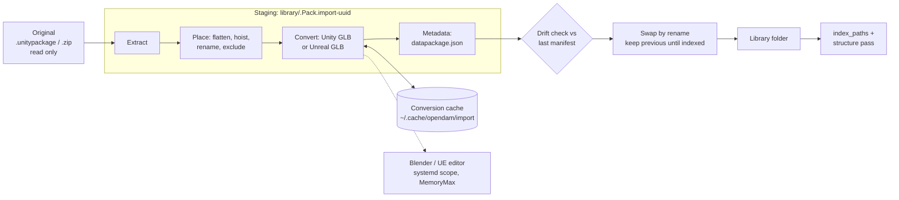

# Pack import: prepare packs from their originals, recorded and reversible

Status: shaped 2026-10-22 in a four-round interview (D1-D30 below). Awaiting final review.

## Problem

Packs reach the libraries through scripts in `~/Documents/Assets`, run by hand, in this order:

| Script | What it does | What it loses |
|---|---|---|
| `extract_unity.py` | `.unitypackage` (a tar.gz of GUID folders) to `<Publisher>/<Pack>/`: drops `Assets/` and a top folder every file shares, unpacks nested packages in place, skips Unity-only files (`.mat`, `.prefab`, `.meta`, `.cs` and others) unless `--keep-all` | The skipped files, which the GLB conversion and Unity both need |
| `flatten_pack.py` | Merges wrapper folders (the root's only folder, beside nothing but docs and `.meta`) into the pack root, then `--hoist Art` / `Meshes` | Moves files in place, with no record and no undo |
| `gen_datapackage.py`, `gen_kenney_datapackage.py` | Write `datapackage.json`: Unity EULA or Fab license, publisher from the parent folder; for Kenney, title and version from the license header, CC0, and the store page found by HEAD requests to kenney.nl | `--force` overwrites hand edits, such as Ancient Ruins' publisher, Leartes Studios |
| `unity_gltf.py` (Blender), `unity_cache_gltf.py`, `unity_binary_to_text.py` (UnityPy) | A textured `X.glb` beside each `X.fbx`/`X.obj`, from the pack's prefabs, `.mat` and `.meta` (in a temporary full re-extraction for packs extracted without them) | Adds files to the library that nothing records |
| `ue_gltf_export.sh/.py` | Unreal project to GLB through the UE editor (baked PNG materials, flipped normals), one editor session per 30 assets | Edits the project's `.uproject` in place (keeping a `.bak`) |

The result is three libraries (`Kenney/` 3.3 GB, `Stylarts/` 11 GB, `Unity/` 29 GB) whose folders
can't be traced back to their originals, and a process only you can repeat. You'll delete them
and re-import everything once OpenDAM does this itself (D6).

Facts that shape the design:

- **The originals.**
  - 21 `.unitypackage` files sit in `~/.local/share/unity3d/Asset Store-5.x/<Publisher>/<Category>/`.
  - Fab downloads are zips holding one `.unitypackage` per render pipeline, or an Unreal project.
  - The Kenney All-in-1 is a zip from itch.io: about 200 packs, under category folders
    (`2D assets`, `3D assets`, `Audio`, `UI assets`), each holding a `License*.txt`.
  - `~/Downloads/Waterways.zip` is a Fab Unreal original: 3 GB, a content-only project with
    `Feif.uproject` at its root (named unlike the pack), 874 `.uasset` files, plus levels and
    blueprints.
- **Asset rows survive a same-path rewrite.** `watcher.rs` updates an existing row by path
  (`UPDATE ... WHERE id`), so a rebuild that reproduces a path keeps the asset's id, tags,
  rating and collections.
- **No live file watcher.** Indexing runs only when asked (`watcher::index_paths`), and it skips
  dot folders (`watcher.rs:199`), so a staging folder named `.<pack>...`
  beside the target is never indexed.
- **`.mat` is indexed** as a Material (`SUPPORTED_EXTENSIONS`), but `.meta`, `.prefab`, `.unity`
  and `.cs` are not.
- **Reusable pieces:**
  - `export/bundle.rs`: `stage`, `swap` and `recover`, which stage beside a folder and swap it
    in by rename. `swap` deletes the old folder.
  - `export/blender.rs`: finds and gates Blender 5.2, runs an embedded, versioned script
    (`normalize.py`, `NORMALIZE_VERSION`) with `kill_on_drop` and a timeout, and `publish`es
    files by rename. Its `run_script` is private and hard-wired to `normalize.py`, and it applies
    no memory cap.
  - `export/unity.rs`: line-based `.meta` GUID, `externalObjects` and `.mat` texture readers.
  - `structure::parse_package` reads `datapackage.json`, and `pack_overrides` holds your pack
    edits.
  - The autotag engine has durable runs (statuses, cancel, restart recovery, events), the
    model for import runs. There is no generic job framework.

## Decisions

| # | Question | Answer |
|---|---|---|
| D1 | Non-destructive model | **A recipe over untouched originals.** Each pack records its original and an ordered list of steps. The pack's library folder is the recipe's output, and changing the recipe rebuilds it from the original. |
| D2 | Where originals live | **Referenced where they are**, by absolute path, size, mtime and sha256. Never copied. |
| D3 | Original kinds | `.unitypackage` (Unity cache), Fab zips (`.unitypackage` variants or an Unreal project), the Kenney All-in-1 zip, Unreal project zips. |
| D4 | Steps in v1 | All of them: extract `.unitypackage` (with nested packages) and zips, flatten and hoist, pack metadata (Unity, Fab, Kenney presets, with the store-page lookup), Unity-to-GLB, Unreal-to-GLB. |
| D5 | Unity-only files | **Kept on disk, hidden** as support files, so a pack stays importable into Unity and convertible. |
| D6 | Existing libraries | **Not migrated.** You delete them and re-import from scratch. Nothing is saved. |
| D7 | Entry point | An **Import pack** action: pick an original, a target library and a publisher. |
| D8 | What one import covers | **One original produces one or more packs.** The import lists candidate packs, you tick them, and each has its own steps, defaulted from the preset. |
| D9 | How you undo | A pack's **Preparation** panel lists its steps. You can turn a step off, edit its options, or remove the whole import, then **Rebuild**. The previous output stays until the rebuild succeeds. |
| D10 | Edits made after an import | In-app renames and deletes inside an imported pack **become recorded `rename` / `exclude` steps**. Changes made outside OpenDAM are detected against the output manifest and shown before a Rebuild, and you keep or discard each. |
| D11 | Metadata vs pack edits | The metadata step **writes `datapackage.json`** from the preset plus the fields you set at import (title, publisher, license, version). Later in-app pack edits stay in `pack_overrides`, which win as today. |
| D12 | Where records live | **The library DB**, with paths relative to the library root and originals by absolute path + sha256. |
| D13 | Generated GLBs | **Beside the source model** as `X.glb`, marked generated in the output manifest, so the format group picks the GLB. |
| D14 | Library layout | One library per source (Kenney, Unity, Fab). The default target is `<Publisher>/<Pack>` in Unity and Fab, and `<Category>/<Pack>` in Kenney (D25). Editable per import. |
| D15 | Default render-pipeline variant | **URP**, editable per import. |
| D16 | Unreal original | A **zip** of a content-only project (`~/Downloads/Waterways.zip`). |
| D17 | External tools | UnityPy goes into the preview engine's uv project and runs in the worker. assimp, Blender and the Unreal Editor are set in Settings. A step whose tool is missing is disabled, with the reason shown. |
| D18 | Step cache | **Only conversion outputs** (Unity and Unreal GLBs) are cached, keyed by their inputs. Extraction always reruns from the original. |
| D19 | Running | **Durable background runs, one at a time,** with progress events and Cancel. On quit or crash the staged work is discarded and the run marked interrupted. A Rebuild reuses cached conversions. |
| D20 | Memory | Blender and the Unreal Editor run in a **systemd user scope with `MemoryMax`** (defaults 12G and 20G, editable in Settings). A capped kill fails the step with a clear message. |
| D21 | Unreal pack contents | **Only the exported GLBs** (baked PNG textures), docs and `datapackage.json`. The `.uasset` project stays in the zip. |
| D22 | kenney.nl lookup | **Opt-in per import** ("Look up store page", on by default for Kenney), and added to the zero-telemetry invariant's list of outbound calls. |
| D23 | Preview before running | **Yes:** the detected packs, each one's suggested steps, and the resulting folder tree with counts, before anything is written. |
| D24 | Nested `.unitypackage` | **Folders inside the same pack**, named after each nested package, as today. |
| D25 | Kenney layout | **Keep the category:** `<Category>/<Pack>` for packs found under a category folder. |
| D26 | UI | A new **Imports view** (each import's original, status, progress, errors and packs, plus the Import pack button) and a **Preparation** section in a pack's details that opens the same step editor. |
| D27 | Removing an import | **Delete exactly the files the recipe produced** (after confirming, and listing any outside changes it would lose) and drop the record. Your tags and ratings go with the assets, as on delete. |
| D28 | Porting the scripts | File work (tar/zip extraction, flatten, hoist, `datapackage.json`) **in Rust**. `unity_gltf.py` and `ue_gltf_export.py` **embedded as versioned scripts** like `normalize.py`, with their heuristics kept as they are. `unity_binary_to_text` in the preview worker. |
| D29 | Testing | Small committed fixtures (a synthetic `.unitypackage` with nested and binary files, a Fab-style zip, a Kenney-style zip); the Unity GLB step under CI's Blender; the Unreal step with a stub editor in CI, plus a manual run on `Waterways.zip` as an acceptance item. |
| D30 | The scripts in `~/Documents/Assets` | **Untouched** by this work. You retire them after your re-import. |

## Design

### Concepts

- **Original:** a file outside the library that OpenDAM reads and never writes: a
  `.unitypackage` or a `.zip`. It is recorded by absolute path, size, mtime (ns) and sha256.
- **Import:** one original brought into one library. It holds one or more **packs**.
- **Pack recipe:** for one pack, a *source* inside the original (the whole `.unitypackage`, a
  variant `.unitypackage` inside a zip, a sub-folder of a zip, or the Unreal project), a
  *target* folder relative to the library root, and an ordered list of **steps**.
- **Output manifest:** every file the last successful build wrote into the target: its path,
  size, mtime, sha256, its **origin** (`extracted`, `generated` or `kept`), and for an
  extracted or generated file, its path in the original.
- **Run:** one import or rebuild of one or more packs, executed in the background.

### Flow

A build never writes into the live pack folder. It builds the whole pack in a staging folder
beside the target, on the same filesystem, so the swap is a rename. Then:

1. It checks the live folder against the last manifest (drift, below).
2. It takes the library's `Database::index_lock`, so no refresh indexes the moment between the
   two renames (OpenDAM has no live file watcher; indexing is always an explicit run), and it
   holds the lock through step 4.
3. It renames the live folder to `.<Pack>.prev-<uuid>` and the staged folder into place.
4. It runs `watcher::index_paths` over the pack and the structure pass, under the library's
   index lock.
5. It deletes the previous folder only after indexing succeeds.

Startup recovery handles a crash mid-swap as `bundle::recover` does: leftover staging is
deleted, and a `.prev` folder without its successor is restored. The swap, staging and recovery
code moves out of `export/bundle.rs` into a shared `fs_swap` module that both features use, with
a flag that keeps the old folder.

### Steps

Steps run in a fixed phase order (extract, place, convert, metadata). Within the place phase
they run in recipe order. Each step has `enabled` and JSON `options`.

| Step | Phase | Options | Behavior (ported from) |
|---|---|---|---|
| `extract_unitypackage` | extract | `variant` (the inner path of the chosen `.unitypackage` in a zip) | Unpacks the tar.gz by GUID, rebuilds `pathname`s, drops `Assets/` and a top folder every file shares, refuses paths that escape the target, **keeps every file and each `.meta`**, and unpacks nested packages into a folder named after each (`extract_unity.py`). |
| `extract_zip` | extract | `subpath` | Copies one sub-folder of a zip, or all of it. Refuses absolute and `..` entries and symlinks. |
| `export_unreal` | extract | `batch` (30) | The Unreal pack's producer (below). Its GLBs are the extracted files. |
| `flatten` | place | none | Merges the root's only folder into the root while nothing else there is an asset (docs, `.meta` and `datapackage.json` don't count), repeatedly. Moves each `.meta` with its file, and stops the build on a name clash (`flatten_pack.py`). |
| `hoist` | place | `folder` | Moves one folder's contents up to the pack root, with the same clash rule. |
| `rename` | place | `from`, `to` | Recorded by an in-app rename (D10). |
| `exclude` | place | `path` | Recorded by an in-app delete (D10). Drops the file and its `.meta`. |
| `unity_glb` | convert | `max_texture` (1024), `force` | Runs the embedded `unity_glb.py` (ported `unity_gltf.py`) in Blender on a work copy, then writes `X.glb` beside each `X.fbx`/`X.obj` that doesn't already ship a `.glb` (D13). |
| `metadata` | metadata | `preset` (`unity`, `fab`, `kenney`, `none`), `title`, `version`, `publisher`, `authors`, `license`, `sources`, `lookup_store_page` | Writes `datapackage.json` at the pack root (`gen_datapackage.py`, `gen_kenney_datapackage.py`). Its `resources` names the first model in the final tree. |

- **Clashes stop the build.** A step that would overwrite a file, or a `rename` whose `from` no
  longer exists after an earlier step changed, fails the build with the step and path named.
  The live folder is untouched, and you edit or turn off the step.
- **Paths through placement.** Every staged file keeps its path in the original, and the
  manifest records it, so a conversion's cache key and a `rename` or `exclude` don't depend on
  where flatten and hoist put the file.

### Presets and candidate detection

The import dialog scans the original without writing anything, proposes candidate packs, and
gives each a preset:

| Original | Candidates | Default target | Default steps |
|---|---|---|---|
| `.unitypackage` from the Unity cache | One pack, named after the file. The publisher comes from `<Publisher>/<Category>/`. | `<Publisher>/<Pack>` | `extract_unitypackage`, `flatten`, `unity_glb`, `metadata(unity)` |
| Fab zip with `.unitypackage` files | One pack. Its variants are found by name (`URP`, `Built-in`/`BiRP`/`Standard`, `HDRP`), and URP is ticked (D15). | `<Publisher>/<Pack>` (the publisher is typed, defaulting to the last one used in this library) | `extract_unitypackage(variant)`, `flatten`, `hoist Art`, `unity_glb`, `metadata(fab)` |
| Fab zip with a `.uproject` | One Unreal pack, named after the zip | `<Publisher>/<Pack>` | `export_unreal`, `flatten`, `hoist Meshes`, `metadata(fab)` |
| Kenney All-in-1 zip | One per folder holding a `License*.txt`. Its category is its top folder (D25). | `<Category>/<Pack>` | `extract_zip(subpath)`, `metadata(kenney, lookup_store_page)` |
| Any other zip | One pack | `<Pack>` | `extract_zip`, `flatten`, `metadata(none)` |

Before **Import**, the dialog shows each ticked pack's step list and its resulting tree, with
file counts per folder and the conversion count. To build that preview, it runs the extract and
place steps over the archive's index in memory, and runs no conversion (D23). Every option can
be edited there or later. A target that already exists in the library and isn't this import's
output is refused.

### Unity conversion

- **The script.** `unity_gltf.py` is embedded as `import/unity_glb.py` with a `VERSION`
  constant, and a test keeps it equal to the Rust `UNITY_GLB_VERSION`. Its material sources,
  property tables, LOD and collision dropping, and 1024 px JPEG/PNG embedding are kept as they
  are (D28).
- **The work folder.** The step makes a work folder in the cache directory holding the staged
  pack's Unity files (`.meta`, `.mat`, `.prefab`, `.unity`), models and textures.
- **Binary Unity files.** Binary `.mat`, `.prefab` and `.unity` files are rewritten to text in
  that work folder only, by a new preview-worker request, `unity_binary_to_text`, with UnityPy
  added to `packages/preview-engine` (D17). The files in the library keep their original bytes.
- **ASCII FBX.** Converted with assimp into the work folder, as the script does today.
- **The cache key.** Each GLB is cached at `~/.cache/opendam/import/glb/<key>.glb`. The key is
  the sha256 of: the original's sha256, the model's path in the original, the step options,
  `UNITY_GLB_VERSION` and the Blender version. A rebuild that only toggled a hoist reuses every
  GLB (D18). Settings shows the cache's size, with a Clear button.

### Unreal conversion

- **The work folder.** The zip is unzipped into a work folder in the cache directory, which
  needs the project's size free. A project with a `Source/` folder is refused (the prebuilt
  editor can't compile it). Its `.uproject` is found at any name (`Feif.uproject`), and the
  `PythonScriptPlugin` and `GLTFExporter` plugins are enabled in the work copy only.
- **The export.** `ue_gltf_export.py` is embedded as a versioned script (`UNREAL_GLB_VERSION`).
  The editor runs headless one session per `batch` assets, restarted until nothing is left or a
  session makes no progress. Each GLB is cached by: the original's sha256, its `/Game` path,
  the options, the script version and the editor version. An interrupted run resumes from those
  cached files.
- **What the pack gets.** GLBs at the project's `/Game/...` layout, the docs found in the
  project, and `datapackage.json` (D21). The work folder is deleted when the step ends.

### Pack metadata

- **The file.** The metadata step writes the `datapackage.json` the scripts write today, from
  the preset and the fields you set at import. A field you set (such as Leartes Studios as the
  publisher) is a step option, so every rebuild writes it again.
- **Your edits.** In-app pack edits after the import stay in `pack_overrides` and win as today
  (D11).
- **The Kenney preset.** It reads the title and version from the license header, and writes
  CC0 only when the text names it.
- **Store-page lookup.** With "Look up store page" ticked, it sends one or two HEAD requests to
  `https://kenney.nl/assets/<slug>`, and writes the URL only on a 200. The answer is cached in
  the step's options after the first build, so a rebuild makes no request. This becomes the
  third kind of outbound call in the zero-telemetry invariant (D22).

### Unity-only files

- **Kept on disk.** They stay on disk (D5).
- **Not indexed.** `.meta`, `.prefab`, `.unity`, `.cs` and the rest are not indexed.
- **A hidden `.mat`.** An indexed `.mat` with a `.mat.meta` beside it is a Unity material, which
  the structure pass gives a new support role, `unity` (`SupportRole::Unity`), so the grid hides
  it unless `showHidden` is on. This rule applies in any library, imported or not.

### Records (library DB)

New tables, created by `db.rs` like the other library tables (`CREATE TABLE IF NOT EXISTS` on
open):

- `imports`: `id`, `original_path` (absolute), `original_size`, `original_mtime_ns`,
  `original_sha256`, `kind` (`unitypackage`, `zip`), `created_at`.
- `import_packs`: `id`, `import_id`, `source` (variant path, sub-path or project), `target`
  (relative to the library root, unique), `preset`, `built_at`, `status` (`built`, `failed`,
  `never_built`).
- `import_steps`: `pack_id`, `position`, `kind`, `enabled`, `options` (JSON).
- `import_outputs`: `pack_id`, `path` (relative to the library root), `size`, `mtime_ns`,
  `sha256`, `origin` (`extracted`, `generated`, `kept`), `source_path` (in the original, or
  `NULL` for `kept`).
- `import_runs`: `id`, `kind` (`import`, `rebuild`, `remove`), pack ids, `status` (`queued`,
  `running`, `done`, `failed`, `cancelled`, `interrupted`), `phase`, `progress`, `error`,
  `started_at`, `finished_at`.

`import_outputs` is written in 200-row transactions.

### The original's state

- **The check.** At startup and when the Imports view opens, each import's original is checked
  by size and mtime, and hashed again only when either changed.
- **Missing or changed.** A missing original or a changed sha256 marks the import **Original
  missing** or **Original changed**. Its packs keep working, and Rebuild is disabled with the
  reason.
- **Locate original.** It re-points the import at a file with the same sha256. A file with a
  different sha256 is accepted only through an explicit **Use this file** that names it as a new
  original, and the next build then rebuilds every pack from it.

### Edits after an import

- **In-app rename and delete.** `rename_asset`, `delete_asset` and `delete_assets` look up each
  path they touch in `import_outputs`. Inside an imported pack, in the same transaction as their
  own change, they append a `rename` or `exclude` step per file (every group member and its
  `.meta` included) and update the manifest row. A rebuild then reproduces your rename and your
  delete.
- **Outside changes (drift).** Before a Rebuild or a Remove, the live pack folder is compared
  with its manifest by size and mtime, hashing only on a mismatch. The dialog lists the
  differences:
  - *Added* (a file the manifest doesn't hold): **keep** (carried into the new output as
    `kept`) or **discard**.
  - *Changed*: **keep yours** (carried over as `kept`, replacing the recipe's file) or **use the
    recipe's**.
  - *Missing*: **record as `exclude`** or **restore**.

  Kept files are listed in the Preparation panel as "not from the original", since a later
  rebuild can carry them but can't recreate them.

### Runs

- **The engine.** The import engine (`import/engine.rs`), modeled on the autotag engine, runs
  one run at a time from a queue in `import_runs` (D19).
- **Progress.** It emits `import:progress` (run id, pack, step, done/total) and `import:updated`.
- **Cancel.** Cancel kills child processes (`kill_on_drop`) and deletes the staging and work
  folders. The live folder never changed.
- **Startup.** Runs found `running` become `interrupted`, and swap recovery runs for each
  imported pack.
- **Capped processes.** A shared `capped_command` helper runs Blender and the UE editor through
  `systemd-run --user --scope -p MemoryMax=<cap> -p MemorySwapMax=0`, mirroring
  `scripts/memory-cap.sh`. It warns and runs uncapped when `systemd-run --user` is unavailable,
  and reports exit 137 as `killed by the memory cap (<cap>)` (D20). The caps are settings
  (`import.blender_memory_max`, default `12G`; `import.unreal_memory_max`, default `20G`).

### Settings

- **Import tools section.** It holds Blender (the existing setting and status), the assimp
  path (default `assimp` on `PATH`), the Unreal Editor root (default
  `~/Applications/UnrealEngine`, checked for `Engine/Binaries/Linux/UnrealEditor`), the two
  memory caps, and the conversion cache's size with Clear.
- **UnityPy.** It ships in the preview engine, and the worker's `engine_info` reports whether
  it imports.
- **Missing tools.** A step whose tool is missing is shown disabled, with the reason (D17).

### UI

- **Imports view** (sidebar entry):
  - one row per import: the original's file name and path, its state (OK, Original missing,
    Original changed), its packs with their status, and the active run's progress, errors and
    Cancel;
  - the **Import pack** button: pick a `.unitypackage` or `.zip`, then a target library;
  - then the candidate list, steps and tree preview described above, and **Import**.
- **Pack details > Preparation** (shown for a pack folder that is an import's target):
  - the original and its state;
  - the steps in order, each with an on/off toggle and an options editor;
  - files kept from outside changes;
  - **Rebuild**, which opens the drift dialog when there is drift;
  - **Remove import** (D27).

  The same editor opens from the Imports view.

### Remove import

The confirmation lists the pack's files and any drift that removing would lose. Removing
deletes exactly the manifest's files and the folders left empty, then the import's records,
then runs `structure::rebuild_library`. Asset rows of deleted files go with their tags,
ratings and collections, as on any delete (D27). Kept files are deleted too, and the
confirmation names them.

## Changes to the invariants (CLAUDE.md)

- **Originals are read-only.** Nothing writes to an import's original or to the directory it
  sits in. Unreal projects and binary Unity files are changed only in work copies under
  `~/.cache/opendam/import`.
- **An imported pack changes on disk only by a swap.** A build stages the whole pack beside it
  and swaps it in by rename. Only in-app rename and delete change it otherwise, and they record
  a step in the same transaction.
- **Zero telemetry.** The list of outbound calls gains the Kenney store-page HEAD requests, made
  only for an import with "Look up store page" ticked.
- **Layout.** CLAUDE.md gains `src/import/` (engine, steps, presets, embedded scripts).

## Acceptance criteria

- **A1 - Originals untouched.** Importing and rebuilding each fixture original leaves its bytes
  and mtime unchanged (checked by test).
- **A2 - Unity extraction.** The synthetic `.unitypackage` fixture extracts with `Assets/` and
  the shared top folder dropped, nested packages as folders, and every `.meta`, `.mat` and
  `.prefab` present. A path escaping the target is refused.
- **A3 - Flatten and hoist.** They produce the same tree as `flatten_pack.py` on a fixture with
  three wrapper levels and an `Art` hoist. A clash fails the build naming the path, and the live
  folder is unchanged.
- **A4 - Reversible steps.** Turning `hoist` off and rebuilding restores the unhoisted tree, and
  turning it back on restores the hoisted one. Asset ids for paths present in both builds are
  unchanged, so a tag on such an asset survives.
- **A5 - In-app edits recorded.** An in-app rename and a delete inside an imported pack append
  `rename` and `exclude` steps, and a rebuild keeps the new name and doesn't bring the file back.
- **A6 - Drift.** A file added, changed and removed outside OpenDAM is listed before Rebuild, and
  each choice (keep or discard, keep yours or use the recipe's, exclude or restore) has the
  stated effect.
- **A7 - Metadata.** For the Unity, Fab and Kenney fixtures, `datapackage.json` equals what the
  scripts write. A publisher set at import survives a rebuild. With "Look up store page" off, no
  network request is made (tested with the HTTP call injected).
- **A8 - Unity GLB.** Under CI's Blender, the fixture's FBX gets a textured `X.glb` beside it. A
  rebuild after toggling `hoist` reuses the cached GLB, with no Blender run. Binary `.mat`
  fixtures convert, and the library keeps their original bytes.
- **A9 - Unreal, stub editor.** With a stub editor script that writes GLBs in batches and once
  makes no progress, the step loops, resumes from cache, and fails the step with the
  no-progress message. The work copy's `.uproject` has the plugins enabled, and the zip is
  untouched.
- **A10 - Unreal, manual.** Importing `~/Downloads/Waterways.zip` into the Fab library produces
  `<Publisher>/Waterways/` holding GLBs, docs and `datapackage.json`, under the 20G cap, and
  the pack browses with textured models. This item is checked by hand.
- **A11 - Interruption.** Killing the app mid-build leaves the live folder as it was. On
  restart, the run is `interrupted` and no staging folder remains. A swap interrupted between
  its two renames is recovered.
- **A12 - Memory cap.** A capped process killed with status 137 fails its step with "killed by
  the memory cap".
- **A13 - Remove import.** Removing deletes exactly the manifest's files and empty folders, and
  the confirmation lists any drift first.
- **A14 - Unity-only files hidden.** A `.mat` with a `.mat.meta` is a hidden `unity` support
  file, and shows with `showHidden`.
- **A15 - Original state.** A moved original marks its import Original missing and disables
  Rebuild. Locating it again by matching sha256 re-enables Rebuild.

## Known gaps

- **Kept files can't be recreated.** Files kept from outside changes are carried by rebuilds,
  but nothing can recreate them if they're lost.
- **The Unreal step's real run is manual.** The Unreal Editor isn't in CI, so only the stub
  covers the step there (A9, A10).
- **Conversion heuristics are unchanged.** Smoothness maps (`_MetallicGlossMap`, HDRP
  `_MaskMap`) still aren't converted. HDRP-only packs convert less well than URP and Built-in.
- **No bulk import.** There's no Unity-cache scan and no watched inbox. Each original is
  imported through the dialog (D7). Re-importing 21 cached packages means 21 dialog passes.
- **Levels aren't exported.** Unreal levels, landscapes, foliage, blueprints and particles
  aren't exported, as today.
- **Your existing libraries are not migrated** (D6).

## Out of scope

- Copying originals into an archive (D2).
- Opening, extracting or rebuilding a pack inside the Unity Editor.
- Editing the scripts in `~/Documents/Assets` (D30).
