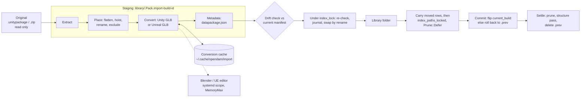

# Pack import: prepare packs from their originals, recorded and reversible

Status: shaped 2026-10-22 in a four-round interview (D1-D30 below), approved at final review
(revision 1).

Revised 2026-10-22 (revision 2) after the workflow's Plan Feasibility review. These are design
repairs within the decisions. One decision is narrowed: D29's committed binary `.mat` fixture
isn't possible, as R6 explains.

- **R1 - Hidden Unity `.mat`.** The structure pass can't see `.mat.meta`, since `.meta` files
  aren't indexed. The rule now reads the import's output manifest, a DB table the pass already
  reads like `pack_overrides`, so `structure::derive` stays pure (Unity-only files).
- **R2 - The swap's commit point.** A build id, a swap journal in the DB, one commit transaction,
  rollback when indexing fails, recovery for each crash point, `_locked` variants of the index and
  structure passes so the held lock doesn't deadlock, and no lost edits during a long run
  (Flow, Runs, A11).
- **R3 - Edits to generated files.** `rename` and `exclude` steps name extracted files by their
  path in the original. A generated GLB follows its source model, and `datapackage.json` is
  edited through the metadata step, never by a step of its own (Edits after an import, A5).
- **R4 - Absolute original paths.** These are now an explicit exception to the relative-paths
  invariant (Changes to the invariants).
- **R5 - Layouts.** The Kenney layout is checked against the extracted bundle (246 packs, each
  `<Category>/<Pack>/License*.txt`). The Fab Unity layout is unverified on this machine, so
  detection no longer assumes one, and A16 checks a real download by hand. The Unreal preview's
  content is now defined.
- **R6 - Fixtures and goldens.** A committed generator builds them, and the goldens come from
  running your scripts once (Fixtures and goldens, A3, A7, A8).
  - **D29 is narrowed.** The synthetic package can't hold a binary `.mat`: a real one would be
    Asset Store content, which can't be committed, and nothing available writes the format. The
    binary path is tested by an env-gated worker test and by hand instead (A17, Known gaps).

Revised again 2026-10-22 (revision 3) after the review's second round. One decision was added
(D31, carry moved files' rows), asked while repairing R8:

- **R7 - The structure pass reads only the committed build.** No structure pass runs before the
  commit, and the pass always reads `current_build`'s manifest, so a rollback or recovery can
  never derive Unity roles from a failed build. The recovery table now covers every folder state,
  including a first build swapped but not committed, and a later build that crashed between the
  journal and the first rename. The in-run rollback handles a first build with no previous
  folder (Flow, A11, A14).
- **R8 - Asset rows survive rollbacks and moves.** Indexing before the commit prunes no row, and
  rows of files missing from disk are pruned only after the commit. A rollback therefore restores
  the previous build's files to the rows, tags, ratings and collections they never lost. Repairing
  this exposed a loss on a *committed* rebuild that moves files (a hoist toggled off, say), so you
  decided (D31) that a rebuild carries each moved file's row to its new path. The move is matched
  by `source_path`, journaled in `import_moves`, and reversed by a rollback (Flow, A4, A11).
- **R9 - Escaping paths are skipped and reported.** An archive entry that would land outside the
  target is skipped, as `extract_unity.py` does, and listed as a warning on the run. It never
  fails the build, so `synthetic.unitypackage` serves A2, A3 and A8 alike (Steps, A2).

Revised again 2026-10-23 (revision 4) after the review's third round. No decision changed:

- **R10 - A late crash in a rollback can't touch the restored build.** Rollback step 4 clears
  `swap_state` and deletes the failed build's records in one transaction, before it deletes
  `.failed-B`. A leftover `.failed-*` with `swap_state` `NULL` is plain garbage. The first-build
  recovery row now requires `current_build IS NULL` as a condition, and a state matching no row
  changes nothing on disk (Flow, A11).
- **R11 - Reversing a move can't collide.** Step 5 journals every row its index inserts. A
  rollback deletes those rows first, then reverses the moves newest first, so each row's old path
  is free again when it moves back (Flow, Records, A11).
- **R12 - A source path is unique, nested packages included.** A file's `source_path` is the
  chain of pathnames from the original down through each nested package, stored as a JSON array.
  The manifest holds it unique per build. `rename`, `exclude`, the D31 carry and the GLB cache key
  all use it (Steps, Records, A5).
- **R13 - Unsafe entries don't change the layout.** They are dropped before the shared top folder
  is found. `extract_unity.py` instead lets an escaping entry block that rule, so this port
  deliberately differs there, and the escaping entry moves to its own fixture (Steps, Fixtures,
  A2).

Revised again 2026-10-23 (revision 5) after the review's fourth round. No decision changed:

- **R14 - No pruning index reaches a pack mid-swap.**
  - **Cancel** takes effect only before step 1. After that the build always finishes in-process,
    by committing or by rolling back.
  - **Library open.** Swap recovery runs when a library opens, in `connect_library_sqlite`, before
    its structure pass and before the library can be indexed.
  - **Every index run.** Every locking `index_paths` and `rebuild_library` also recovers any pack
    still marked `swapping` before it touches a row.

  So a dropped run task, a crash or a late-opening library can't let a pruning index delete
  previous-only rows (Flow, Runs, A11).

- **R15 - `.meta` files have their own source path.** A `.meta` file's source path is its asset's,
  with `.meta` appended to the last element, so `(source_path, origin)` stays unique when a
  pack keeps its `.meta` files (Steps, A2).

Revised again 2026-10-23 (revision 6) after the review's fifth round. No decision changed:

- **R16 - Each recovery table has its own trigger.**
  - **The `swapping` table** runs when a library opens and at the start of every locking index
    run.
  - **The `swap_state NULL` table** (staging, `.failed-*`, `.prev-*` leftovers) runs only when a
    library opens. It skips every pack whose run is queued or running, so a refresh, or a library
    reconnecting mid-session, never deletes the staging folder of a build still in progress.
  - **Lock-free entry points.** Recovery at library open uses lock-free cores, since nothing else
    holds the pool yet (Flow, A11).

## Problem

Packs reach the libraries through scripts in `~/Documents/Assets`, run by hand, in this order:

| Script | What it does | What it loses |
|---|---|---|
| `extract_unity.py` | `.unitypackage` (a tar.gz of GUID folders) to `<Publisher>/<Pack>/`: drops `Assets/` and a top folder every file shares, unpacks nested packages in place, skips Unity-only files (`.mat`, `.prefab`, `.meta`, `.cs` and others) unless `--keep-all` | The skipped files, which the GLB conversion and Unity both need |
| `flatten_pack.py` | Merges wrapper folders (the root's only folder, beside nothing but docs and `.meta`) into the pack root, then `--hoist Art` / `Meshes` | Moves files in place, with no record and no undo |
| `gen_datapackage.py`, `gen_kenney_datapackage.py` | Write `datapackage.json`: Unity EULA or Fab license, publisher from the parent folder; for Kenney, title and version from the license header, CC0, and the store page found by HEAD requests to kenney.nl | `--force` overwrites hand edits, such as Ancient Ruins' publisher, Leartes Studios |
| `unity_gltf.py` (Blender), `unity_cache_gltf.py`, `unity_binary_to_text.py` (UnityPy) | A textured `X.glb` beside each `X.fbx`/`X.obj`, from the pack's prefabs, `.mat` and `.meta` (in a temporary full re-extraction for packs extracted without them) | Adds files to the library that nothing records |
| `ue_gltf_export.sh/.py` | Unreal project to GLB through the UE editor (baked PNG materials, flipped normals), one editor session per 30 assets | Edits the project's `.uproject` in place (keeping a `.bak`) |

The result is three libraries (`Kenney/` 3.3 GB, `Stylarts/` 11 GB, `Unity/` 29 GB) whose folders
can't be traced back to their originals, and a process only you can repeat. You'll delete them
and re-import everything once OpenDAM does this itself (D6).

Facts that shape the design:

- **The originals.**
  - 21 `.unitypackage` files sit in `~/.local/share/unity3d/Asset Store-5.x/<Publisher>/<Category>/`.
  - Fab downloads are zips holding a Unity package or an Unreal project. The Unity zips' inner
    layout is unverified (below).
  - The Kenney All-in-1 is a zip from itch.io. Its extracted copy in `~/Documents/Assets/Kenney`
    holds 246 packs, each a folder directly holding a `License*.txt`, all exactly two levels
    down: `<Category>/<Pack>/License.txt`. The categories are `2D assets` (151), `3D assets`
    (54), `Audio` (16), `UI assets` (10), `Icons` (8), `Archive` (3), `Early access` (2) and
    `Other` (2). Whether the zip wraps them in one more top folder is unknown, so detection
    strips a top folder that every entry shares, as `extract_unity.py` does.
  - **No Fab Unity download is on this machine.** AGENTS.md says a Fab zip holds a
    `.unitypackage` that `extract_unity.py --package` extracts, and the Stylarts packs came "in
    their Unity Built-in version", which suggests a download per render pipeline. The extracted
    Spooky Cemetery Crypt shows `Built-In/Built-In_SpookyCemeteryCyrpt/`, which suggests pipeline
    folders inside a package. Neither layout is confirmed, so detection handles both (Presets),
    and A16 checks a real download.
  - `~/Downloads/Waterways.zip` is a Fab Unreal original: 3 GB, a content-only project with
    `Feif.uproject` at its root (named unlike the pack), 874 `.uasset` files, plus levels and
    blueprints.
- **Asset rows survive a same-path rewrite.** `watcher.rs` updates an existing row by path
  (`UPDATE ... WHERE id`), so a rebuild that reproduces a path keeps the asset's id, tags,
  rating and collections.
- **No live file watcher.** Indexing runs only when asked (`watcher::index_paths`), and it skips
  dot folders (`watcher.rs:199`), so a staging folder named `.<pack>...`
  beside the target is never indexed.
- **Indexing prunes.** After upserting the files it walked, `index_paths` deletes the rows of
  indexed paths it didn't see (`watcher.rs:312-330`, "Detect and remove deleted files"). Their
  tags, collections and other metadata go with them.
- **`.mat` is indexed** as a Material (`SUPPORTED_EXTENSIONS`), but `.meta`, `.prefab`, `.unity`
  and `.cs` are not.
- **The structure pass reads DB state as inputs.** `structure::derive` (`structure.rs:492`) is
  pure: it takes the indexed paths and sizes plus `Overrides`, read from `pack_overrides` by
  `read_overrides` (`structure.rs:319`), and reads no file on a rerun.
- **`index_lock` isn't re-entrant.** It is a `tokio::sync::Mutex` per library (`db.rs:670`).
  `watcher::index_paths` takes it (`watcher.rs:164`), and so does `structure::rebuild_library`
  (`structure.rs:2307`). A caller that already holds it and calls either one deadlocks.
- **Reusable pieces:**
  - `export/bundle.rs`: `stage`, `swap` and `recover`, which stage beside a folder and swap it
    in by rename. `swap` deletes the old folder.
  - `export/blender.rs`: finds and gates Blender 5.2, runs an embedded, versioned script
    (`normalize.py`, `NORMALIZE_VERSION`) with `kill_on_drop` and a timeout, and `publish`es
    files by rename. Its `run_script` is private and hard-wired to `normalize.py`, and it applies
    no memory cap.
  - `export/unity.rs`: line-based `.meta` GUID, `externalObjects` and `.mat` texture readers.
  - `structure::parse_package` reads `datapackage.json`, and `pack_overrides` holds your pack
    edits.
  - The autotag engine has durable runs (statuses, cancel, restart recovery, events), the
    model for import runs. There is no generic job framework.

## Decisions

| # | Question | Answer |
|---|---|---|
| D1 | Non-destructive model | **A recipe over untouched originals.** Each pack records its original and an ordered list of steps. The pack's library folder is the recipe's output, and changing the recipe rebuilds it from the original. |
| D2 | Where originals live | **Referenced where they are**, by absolute path, size, mtime and sha256. Never copied. |
| D3 | Original kinds | `.unitypackage` (Unity cache), Fab zips (`.unitypackage` variants or an Unreal project), the Kenney All-in-1 zip, Unreal project zips. |
| D4 | Steps in v1 | All of them: extract `.unitypackage` (with nested packages) and zips, flatten and hoist, pack metadata (Unity, Fab, Kenney presets, with the store-page lookup), Unity-to-GLB, Unreal-to-GLB. |
| D5 | Unity-only files | **Kept on disk, hidden** as support files, so a pack stays importable into Unity and convertible. |
| D6 | Existing libraries | **Not migrated.** You delete them and re-import from scratch. Nothing is saved. |
| D7 | Entry point | An **Import pack** action: pick an original, a target library and a publisher. |
| D8 | What one import covers | **One original produces one or more packs.** The import lists candidate packs, you tick them, and each has its own steps, defaulted from the preset. |
| D9 | How you undo | A pack's **Preparation** panel lists its steps. You can turn a step off, edit its options, or remove the whole import, then **Rebuild**. The previous output stays until the rebuild succeeds. |
| D10 | Edits made after an import | In-app renames and deletes inside an imported pack **become recorded `rename` / `exclude` steps**. Changes made outside OpenDAM are detected against the output manifest and shown before a Rebuild, and you keep or discard each. |
| D11 | Metadata vs pack edits | The metadata step **writes `datapackage.json`** from the preset plus the fields you set at import (title, publisher, license, version). Later in-app pack edits stay in `pack_overrides`, which win as today. |
| D12 | Where records live | **The library DB**, with paths relative to the library root and originals by absolute path + sha256. |
| D13 | Generated GLBs | **Beside the source model** as `X.glb`, marked generated in the output manifest, so the format group picks the GLB. |
| D14 | Library layout | One library per source (Kenney, Unity, Fab). The default target is `<Publisher>/<Pack>` in Unity and Fab, and `<Category>/<Pack>` in Kenney (D25). Editable per import. |
| D15 | Default render-pipeline variant | **URP**, editable per import. |
| D16 | Unreal original | A **zip** of a content-only project (`~/Downloads/Waterways.zip`). |
| D17 | External tools | UnityPy goes into the preview engine's uv project and runs in the worker. assimp, Blender and the Unreal Editor are set in Settings. A step whose tool is missing is disabled, with the reason shown. |
| D18 | Step cache | **Only conversion outputs** (Unity and Unreal GLBs) are cached, keyed by their inputs. Extraction always reruns from the original. |
| D19 | Running | **Durable background runs, one at a time,** with progress events and Cancel. On quit or crash the staged work is discarded and the run marked interrupted. A Rebuild reuses cached conversions. |
| D20 | Memory | Blender and the Unreal Editor run in a **systemd user scope with `MemoryMax`** (defaults 12G and 20G, editable in Settings). A capped kill fails the step with a clear message. |
| D21 | Unreal pack contents | **Only the exported GLBs** (baked PNG textures), docs and `datapackage.json`. The `.uasset` project stays in the zip. |
| D22 | kenney.nl lookup | **Opt-in per import** ("Look up store page", on by default for Kenney), and added to the zero-telemetry invariant's list of outbound calls. |
| D23 | Preview before running | **Yes:** the detected packs, each one's suggested steps, and the resulting folder tree with counts, before anything is written. |
| D24 | Nested `.unitypackage` | **Folders inside the same pack**, named after each nested package, as today. |
| D25 | Kenney layout | **Keep the category:** `<Category>/<Pack>` for packs found under a category folder. |
| D26 | UI | A new **Imports view** (each import's original, status, progress, errors and packs, plus the Import pack button) and a **Preparation** section in a pack's details that opens the same step editor. |
| D27 | Removing an import | **Delete exactly the files the recipe produced** (after confirming, and listing any outside changes it would lose) and drop the record. Your tags and ratings go with the assets, as on delete. |
| D28 | Porting the scripts | File work (tar/zip extraction, flatten, hoist, `datapackage.json`) **in Rust**. `unity_gltf.py` and `ue_gltf_export.py` **embedded as versioned scripts** like `normalize.py`, with their heuristics kept as they are. `unity_binary_to_text` in the preview worker. |
| D29 | Testing | Small committed fixtures (a synthetic `.unitypackage` with nested and binary files, a Fab-style zip, a Kenney-style zip); the Unity GLB step under CI's Blender; the Unreal step with a stub editor in CI, plus a manual run on `Waterways.zip` as an acceptance item. Revision 2 narrows this: the binary files can't be a committed fixture (R6). |
| D30 | The scripts in `~/Documents/Assets` | **Untouched** by this work. You retire them after your re-import. |
| D31 | Moved files' metadata (asked in review round 2) | **A rebuild carries a moved file's asset row** (id, tags, rating, collections) to the file's new path, matched by `source_path`. A rollback moves it back. |

## Design

### Concepts

- **Original:** a file outside the library that OpenDAM reads and never writes: a
  `.unitypackage` or a `.zip`. It is recorded by absolute path, size, mtime (ns) and sha256.
- **Import:** one original brought into one library. It holds one or more **packs**.
- **Pack recipe:** for one pack, a *source* inside the original (the whole `.unitypackage`, a
  variant `.unitypackage` inside a zip, a sub-folder of a zip, or the Unreal project), a
  *target* folder relative to the library root, and an ordered list of **steps**.
- **Output manifest:** every file the committed build wrote into the target: its path,
  size, mtime, sha256, its **origin** (`extracted`, `generated` or `kept`), and for an
  extracted or generated file, its **source path** (Steps).
- **Run:** one import or rebuild of one or more packs, executed in the background.

### Flow

A build never writes into the live pack folder. Each build has a new **build id**. It builds
the whole pack in a staging folder (`.<Pack>.import-<build id>`) beside the target, on the same
filesystem, so the swap is a rename. It writes the staged files' manifest rows under that build
id while staging, in 200-row transactions. Those rows mean nothing until the commit, because
`import_packs.current_build` still names the previous build. Then:

1. **Lock.** It takes the library's `Database::index_lock` and holds the guard through step 7.
   OpenDAM has no live file watcher, so no other index run or structure pass can touch the
   library meanwhile.
2. **Re-check under the lock.** It compares the pack's `recipe_rev` with the one the run started
   from, and the live folder with the current manifest plus the drift choices the run was queued
   with. On any difference it stops: it deletes the staging folder and its rows, and fails the
   run with "the pack changed during the build; Rebuild again". Cached conversions make the
   retry cheap.
3. **Journal.** It sets `import_packs.swap_state = 'swapping'` and `swap_build` to the build id,
   in one transaction.
4. **Swap.** It renames the live folder to `.<Pack>.prev-<build id>`, then the staging folder to
   the live name. A pack's first build has no live folder and skips the first rename.
5. **Carry moved rows, then index without pruning.**
   - **Carry.** It joins the previous build's manifest with the new one on `(source_path, origin)`.
     Matching by `origin` too means a GLB follows its own row, not its model's. A file the new build
     places at another path has its asset row moved there in place, with its id and metadata. The
     move uses the update `rename_asset` uses (`file_name`, `file_path`, `extension`;
     `commands/asset.rs:1734`), so the FTS update trigger follows it.
   - **Journal.** Each move is written to `import_moves` in the same transaction, 200 at a time.
   - **Collision.** A move is skipped when the new path already has a row, because a different
     file took that path. The moved file then gets a fresh row.
   - **Index.** It then runs `watcher::index_paths_locked` over the pack folder with
     `Prune::Defer(B)`. That adds or updates a row for every file now on disk, deletes no row, and
     runs no structure pass. Each row it *inserts* is journaled in `import_moves` as `inserted`, in
     the same transaction as the insert. Rows of paths only the previous build had stay exactly as
     they were.
6. **Commit.** In one transaction it sets `current_build` to the new build id, `status = 'built'`
   and `swap_state = NULL`. This is the **commit point**.
7. **Settle.** Still holding the lock, it runs `index_paths_locked` over the pack with
   `Prune::Now`. That deletes the rows of files no longer on disk, the paths only the previous
   build had, then runs the structure pass (`rebuild_library_locked`). It deletes the previous
   folder, the old build's manifest rows and the new build's `import_moves`, releases the lock,
   and emits `library:updated`.

`index_paths_locked` and `rebuild_library_locked` are new variants of `index_paths` and
`rebuild_library`. They take the held guard (`&tokio::sync::MutexGuard<'_, ()>`) as proof instead
of locking. The existing functions take the lock and call them with `Prune::Now`, so every other
caller behaves as today. Between steps 5 and 7 the pack's rows cover both builds' paths, with the
old structure. The lock keeps every other index run and structure pass out, and the UI refreshes
once, on step 7's `library:updated`.

**The structure pass reads only the committed build.** It reads the Unity material set
(Unity-only files) from the rows of `current_build`, and from no other build. No structure pass
runs between the swap and the commit. So no pass, whether in a build, a rollback or recovery, can
derive roles from a build that never committed.

**Rollback.** Step 5 failing, or recovery finding a swap that wasn't committed, rolls back while
holding the lock:

1. Rename the live folder to `.<Pack>.failed-<build id>`.
2. If a `.prev-<build id>` folder exists, rename it back to the live name. A first build has none,
   so its pack folder is simply gone.
3. Undo the failed build's rows:
   - **Inserted rows.** Delete every asset row journaled as `inserted`. They were made by step 5
     for the failed build's files, during the locked window, and hold no metadata of yours.
   - **Moved rows.** Reverse every `moved` entry, newest first, moving each row back to its
     `from_path`. Each `from_path` is free by then: the move vacated it, any row inserted there was
     deleted above, and any later move into it was reversed first. If one is still occupied
     anyway, the reversal leaves that row where it is and logs the conflict. It never fails the
     rollback.

   Then it runs `index_paths_locked` over the pack with `Prune::Now`. Rows of the previous build's
   paths were moved back or never touched, and never pruned, so they match the restored files
   with their ids and metadata intact. The structure pass that ends this run reads
   `current_build`, which is still the previous build, or `NULL` for a first build.

4. In **one transaction**, clear `swap_state` and delete the failed build's manifest rows and
   its `import_moves`. Only then delete the `.failed-<build id>` folder, and fail the run. A crash
   between the two leaves a `.failed-*` folder with `swap_state` `NULL`, which recovery deletes as
   garbage. It can never be mistaken for a swap in progress.

So a rollback loses nothing of the previous build, including paths it alone had.

**Swap recovery** has two tables, below: one for packs whose `swap_state` is `'swapping'`, and
one for leftovers of packs whose `swap_state` is `NULL`. Each has its own triggers:

| Trigger | `swapping` table | `swap_state NULL` table |
|---|---|---|
| A library opens: startup, or an offline library coming back online | yes | yes, skipping every pack whose run is `queued` or `running` |
| A locking `index_paths` or `rebuild_library` starts | yes | **never** |

- **When a library opens.** Recovery runs in `connect_library_sqlite`, before the structure pass
  it runs today (`db.rs:412-422`). At that point nothing else holds the new pool, and the library
  isn't registered for index runs yet. That covers startup and a library that comes online later.
  - **Lock-free cores.** There is no `index_lock` guard to hand to the `_locked` variants here, so
    recovery calls the lock-free cores directly, as today's pass calls `structure::rebuild(&pool,
    root)` (`structure.rs:2121`): `watcher::index_pool(pool, root, paths, prune)` (the body of
    `index_paths` after its library lookup and locks, split out) and `structure::rebuild`. The
    `_locked` variants and the locking functions are thin wrappers over the same two cores.
  - **The advisory lock.** Recovery also takes the cross-machine `.opendam/index.lock`, as
    `index_paths` does (`watcher.rs:169`). If another machine holds it, the open skips recovery.
    The next locking index run handles any `swapping` pack, and the next open handles leftovers.
    Skipping is safe, because nothing is pruned meanwhile.
  - **Which runs it skips.** At startup the engine first marks runs found `running` as
    `interrupted`, before any library opens. So at startup no build is in progress, and every
    leftover is recovered. A library reconnecting mid-session can have a build staging for one of
    its packs. The `swap_state NULL` table skips every pack with a run `queued` or `running`.
- **At the start of every locking index or structure entry point.** `index_paths` and
  `rebuild_library`, after taking `index_lock`, first recover any pack still marked `swapping`.
  They run only the `swapping` table, never the `swap_state NULL` one. A build sets and clears
  `swap_state` only while it holds the lock, from step 1 through step 7 or the end of its
  rollback. So a locking caller that gets the lock and finds a pack `swapping` knows its build is
  gone, for example because the run task panicked and released the guard. A build still staging,
  before step 1 and without the lock, has `swap_state` `NULL`, so these entry points never touch
  its staging folder or rows. Only the build itself, and the recovery these entry points run
  under their guard, call the `_locked` variants, which skip this check.
- **Leftovers of a dead task.** If a build task dies mid-session after its commit (in step 7),
  its `.prev-*` folder and journal stay until the library next opens. Its previous-only rows were
  committed away anyway, and any refresh prunes them as usual. If a task dies while staging, its
  run stays `running` until the app restarts, and its staging folder is removed at the next
  startup.

With `swap_state = 'swapping'` and build id B, recovery checks these rows in order, by what is on
disk. "Live" is the pack folder.

| Staging `.import-B` | `.prev-B` | Live | `.failed-B` | Meaning | Recovery |
|---|---|---|---|---|---|
| present | absent | any | absent | Crashed after the journal, before any rename. With a live folder, a later build; without one, a first build. | Delete the staging folder and B's rows. |
| present | present | absent | absent | Crashed between the two renames | Rename `.prev-B` back to live. Delete the staging folder and B's rows. |
| absent | present | present | absent | A later build swapped, not committed | Roll back (steps 1-4). |
| absent | absent | present | absent | **and `current_build IS NULL`**: a first build swapped, not committed | Roll back (steps 1, 3, 4: no `.prev` to restore). |
| absent | present | absent | present | Crashed in a rollback, between its renames | Rename `.prev-B` back to live, then finish the rollback (steps 3-4). |
| absent | absent | any | present | Crashed in a rollback, after its renames | Finish the rollback (steps 3-4). |
| absent | absent | present | absent | **and `current_build` is not `NULL`**: can't arise, since a later build always has `.prev-B` or `.failed-B` until step 4's transaction clears `swap_state` | Change nothing on disk. Clear `swap_state`, delete B's manifest and journal rows, run a `Prune::Now` index of the pack, and log it. |
| any | any | any | any | Any other combination, not produced by any step | Change nothing on disk. Leave `swap_state` set, mark the pack `failed` with the state found, and block its runs until you act. |

With `swap_state` `NULL`:

| Found | Meaning | Recovery |
|---|---|---|
| An `.import-*` staging folder | Crashed while staging | Delete the folder and that build's rows. |
| A `.failed-*` folder | A rollback finished its transaction, then crashed before deleting it | Delete the folder. |
| A `.prev-*` folder | Committed, not settled | Run step 7: prune by `Prune::Now`, run the structure pass, delete `.prev`, rows of builds other than `current_build`, and their `import_moves`. |

Then, except in the last row of the first table, it clears `swap_state` and marks the run
`interrupted`. Recovery never rolls forward: an
uncommitted build is always discarded, and the cached conversions make its rerun cheap. The swap,
staging and recovery code moves out of `export/bundle.rs` into a shared `fs_swap` module that both
features use, with a flag that keeps the old folder until the caller commits.

### Steps

Steps run in a fixed phase order (extract, place, convert, metadata). Within the place phase
they run in recipe order. Each step has `enabled` and JSON `options`.

| Step | Phase | Options | Behavior (ported from) |
|---|---|---|---|
| `extract_unitypackage` | extract | `variant` (the inner path of the chosen `.unitypackage` in a zip), `subpath` (a pipeline folder inside the package, else all of it) | Unpacks the tar.gz by GUID, rebuilds `pathname`s, drops `Assets/` and a top folder every file shares, skips and reports a path that would escape the target (below), **keeps every file and each `.meta`**, and unpacks nested packages into a folder named after each (`extract_unity.py`). |
| `extract_zip` | extract | `subpath` | Copies one sub-folder of a zip, or all of it. Skips and reports absolute and `..` entries and symlinks (below). |
| `export_unreal` | extract | `batch` (30) | The Unreal pack's producer (below). Its GLBs are the extracted files. |
| `flatten` | place | none | Merges the root's only folder into the root while nothing else there is an asset (docs, `.meta` and `datapackage.json` don't count), repeatedly. Moves each `.meta` with its file, and stops the build on a name clash (`flatten_pack.py`). |
| `hoist` | place | `folder` | Moves one folder's contents up to the pack root, with the same clash rule. |
| `rename` | place | `source` (the file's source path), `name` (the new file name) | Recorded by an in-app rename (D10). Renames the extracted file wherever earlier steps put it, and its `.meta` with it. |
| `exclude` | place | `source` (the file's source path) | Recorded by an in-app delete (D10). Drops the extracted file and its `.meta`. |
| `unity_glb` | convert | `max_texture` (1024), `force` | Runs the embedded `unity_glb.py` (ported `unity_gltf.py`) in Blender on a work copy, then writes `X.glb` beside each `X.fbx`/`X.obj` that doesn't already ship a `.glb` (D13). |
| `metadata` | metadata | `preset` (`unity`, `fab`, `kenney`, `none`), `title`, `version`, `publisher`, `authors`, `license`, `sources`, `lookup_store_page` | Writes `datapackage.json` at the pack root (`gen_datapackage.py`, `gen_kenney_datapackage.py`). Its `resources` names the first model in the final tree. |

- **Unsafe entries are skipped and reported.** An archive entry that is absolute, climbs out with
  `..`, resolves outside the target, or is a symlink is never written. It is skipped, as
  `extract_unity.py` skips it, and listed as a warning on the run and in the Preparation panel
  (path and reason). The build goes on, and the manifest doesn't hold the entry.
  - **Dropped before the layout is decided.** Unsafe entries are removed *before* the shared top
    folder is found, so a skipped entry never changes the layout.
  - **A deliberate difference from the script.** `extract_unity.py` decides the shared top folder
    from every pathname, `../escape.txt` included. That entry's `..` counts as a second top, so
    the script keeps the shared folder.
- **Source paths are unique.** A file's **source path** is the chain of names that leads to it in
  the original, outermost first, stored as a JSON array:
  - a top-level file of a `.unitypackage`: `["Assets/Pack/Models/Rock.fbx"]`, its raw `pathname`
    with `Assets/` kept;
  - a file of a nested package: `["Assets/Pack/Houses.unitypackage", "Assets/Roof/Roof.fbx"]`,
    and so on for deeper nesting;
  - a zip entry: `["Kenney/3D assets/Car Kit/car.glb"]`, its path in the zip;
  - an Unreal export: `["/Game/Waterways/Meshes/SM_Rock"]`.

  Within one package each `pathname` is unique, so the chain is unique across nesting, even when a
  nested package repeats the outer package's paths. A second entry with the same `pathname` in one
  package (a malformed package) is skipped and reported like an unsafe entry.

  - **A `.meta` file.** A package stores an asset's `.meta` as a second entry (`<guid>/asset.meta`)
    under the same `pathname`. Its source path is the asset's chain with `.meta` appended to the
    last element, for example `["Assets/Pack/Models/Rock.fbx.meta"]`. Unity never stores a
    `.meta` as an asset of its own, and an entry whose `pathname` already ends in `.meta` would
    collide with one. Such an entry is skipped and reported as a duplicate.
  - **Zip entries.** A `.meta` in a zip is just another entry, with its own path.

  A generated GLB has its source model's source path with origin `generated`. So
  `(source_path, origin)` is unique within a build, and the manifest enforces it.

- **Clashes stop the build.** These fail the build with the step and path named:
  - a step that would overwrite a file;
  - a `rename` or `exclude` whose `source` the extract step no longer produces, for example
    after you change the variant.

  The live folder is untouched, and you edit or turn off the step.

- **Paths through placement.** Every staged file keeps its source path, and the manifest records
  it. A conversion's cache key, a `rename`, an `exclude` and the D31 carry name the file by it, so
  they don't depend on where flatten and hoist put the file.
- **Only extracted files get `rename` and `exclude` steps.** Files made by a later phase never
  get a step of their own (Edits after an import):
  - generated GLBs (convert phase) follow their source model;
  - `datapackage.json` (metadata phase) is edited through the metadata step.

  So a place-phase step never names a file that doesn't exist yet.

### Presets and candidate detection

The import dialog scans the original without writing anything, proposes candidate packs, and
gives each a preset:

| Original | Candidates | Default target | Default steps |
|---|---|---|---|
| `.unitypackage` from the Unity cache | One pack, named after the file. The publisher comes from `<Publisher>/<Category>/`. | `<Publisher>/<Pack>` | `extract_unitypackage`, `flatten`, `unity_glb`, `metadata(unity)` |
| Zip holding one or more `.unitypackage` files, at any depth (Fab) | One pack, named after the zip. Every `.unitypackage` in it is a variant, and so is each top folder inside a package whose name names a pipeline (`URP`/`Universal`, `Built-In`/`BiRP`/`Standard`, `HDRP`), whichever layout the download has. A URP match is ticked (D15). With no URP match, a lone variant is ticked; otherwise none is, and Import waits for you to tick one. | `<Publisher>/<Pack>` (the publisher is typed, defaulting to the last one used in this library) | `extract_unitypackage(variant, subpath)`, `flatten`, `hoist Art`, `unity_glb`, `metadata(fab)` |
| Zip holding a `.uproject`, at any depth (Fab Unreal) | One Unreal pack, named after the zip (`Waterways`, not `Feif`) | `<Publisher>/<Pack>` | `export_unreal`, `flatten`, `hoist Meshes`, `metadata(fab)` |
| Zip whose folders hold `License*.txt` files (the Kenney All-in-1) | One per folder directly holding a `License*.txt` (246 in today's bundle). Its category is the folder above it, after a top folder every entry shares is stripped (D25). Packs under `Archive` and `Early access` are listed unticked. |  `<Category>/<Pack>` | `extract_zip(subpath)`, `metadata(kenney, lookup_store_page)` |
| Any other zip | One pack | `<Pack>` | `extract_zip`, `flatten`, `metadata(none)` |

A zip that matches more than one row is offered as each match, and you pick one. Before
**Import**, the dialog shows each ticked pack's step list and its resulting tree, with file
counts per folder and the conversion count (D23).

- **Unity and zip packs.** The dialog runs the extract and place steps over the archive's
  index in memory: the tar or zip entry list and the `pathname` entries, with no file bodies
  read. It runs no conversion, and counts one GLB per `.fbx` and `.obj` with no `.glb` beside
  it.
- **Unreal packs.** Only the Unreal Editor knows which `.uasset` is a mesh or an animation, so
  the dialog can't run `export_unreal`. It shows the `.uproject`'s name, the refusal when a
  `Source/` folder exists, and the folder tree of `Content/`. In that tree, each `.uasset`
  counts as an **upper bound** of GLBs ("at most N models"). The place steps are applied to that
  tree (`Content/Waterways/Meshes/` under `hoist Meshes`), and the tree is labeled as an
  estimate.

Every option can be edited there or later. A target that already exists in the library and
isn't this import's output is refused.

### Unity conversion

- **The script.** `unity_gltf.py` is embedded as `import/unity_glb.py` with a `VERSION`
  constant, and a test keeps it equal to the Rust `UNITY_GLB_VERSION`. Its material sources,
  property tables, LOD and collision dropping, and 1024 px JPEG/PNG embedding are kept as they
  are (D28).
- **The work folder.** The step makes a work folder in the cache directory holding the staged
  pack's Unity files (`.meta`, `.mat`, `.prefab`, `.unity`), models and textures.
- **Binary Unity files.** Binary `.mat`, `.prefab` and `.unity` files are rewritten to text in
  that work folder only, by a new preview-worker request, `unity_binary_to_text`, with UnityPy
  added to `packages/preview-engine` (D17). The files in the library keep their original bytes.
- **ASCII FBX.** Converted with assimp into the work folder, as the script does today.
- **The cache key.** Each GLB is cached at `~/.cache/opendam/import/glb/<key>.glb`. The key is
  the sha256 of: the original's sha256, the model's source path, the step options,
  `UNITY_GLB_VERSION` and the Blender version. A rebuild that only toggled a hoist reuses every
  GLB (D18). Settings shows the cache's size, with a Clear button.

### Unreal conversion

- **The work folder.** The zip is unzipped into a work folder in the cache directory, which
  needs the project's size free. A project with a `Source/` folder is refused (the prebuilt
  editor can't compile it). Its `.uproject` is found at any name (`Feif.uproject`), and the
  `PythonScriptPlugin` and `GLTFExporter` plugins are enabled in the work copy only.
- **The export.** `ue_gltf_export.py` is embedded as a versioned script (`UNREAL_GLB_VERSION`).
  The editor runs headless one session per `batch` assets, restarted until nothing is left or a
  session makes no progress. Each GLB is cached by: the original's sha256, its `/Game` path,
  the options, the script version and the editor version. An interrupted run resumes from those
  cached files.
- **What the pack gets.** GLBs at the project's `/Game/...` layout, the docs found in the
  project, and `datapackage.json` (D21). The work folder is deleted when the step ends.

### Pack metadata

- **The file.** The metadata step writes the `datapackage.json` the scripts write today, from
  the preset and the fields you set at import. A field you set (such as Leartes Studios as the
  publisher) is a step option, so every rebuild writes it again.
- **Your edits.** In-app pack edits after the import stay in `pack_overrides` and win as today
  (D11).
- **The Kenney preset.** It reads the title and version from the license header, and writes
  CC0 only when the text names it.
- **Store-page lookup.** With "Look up store page" ticked, it sends one or two HEAD requests to
  `https://kenney.nl/assets/<slug>`, and writes the URL only on a 200. The answer is cached in
  the step's options after the first build, so a rebuild makes no request. This becomes the
  third kind of outbound call in the zero-telemetry invariant (D22).

### Unity-only files

- **Kept on disk.** They stay on disk (D5).
- **Not indexed.** `.meta`, `.prefab`, `.unity`, `.cs` and the rest are not indexed.
- **A hidden `.mat`.** A Unity material is an indexed `.mat` whose `.mat.meta` is in the current
  build's output manifest (`import_outputs`).
  - **Inputs.** The pass reads that set (`structure::read_unity_materials`, one query) before
    `derive`, as it reads `pack_overrides`, and passes it to `derive` as one more input. `derive`
    stays pure and reads no file.
  - **The role.** `derive` gives each such `.mat` a new support role, `unity`
    (`SupportRole::Unity`), so the grid hides it unless `showHidden` is on.
  - **Scope.** The rule applies to imported packs only. A `.mat` in a folder that wasn't imported
    keeps its kind, so a non-Unity material never hides. Your libraries will all be re-imported
    (D6), so every Unity pack is covered.
  - **Which build.** The pass reads `current_build`'s rows, and nothing else. No structure pass
    runs between a swap and its commit, and a rollback's pass runs while `current_build` still
    names the restored build (Flow). So the roles always match the committed files on disk.

### Records (library DB)

New tables, created by `db.rs` like the other library tables (`CREATE TABLE IF NOT EXISTS` on
open):

- `imports`: `id`, `original_path` (absolute), `original_size`, `original_mtime_ns`,
  `original_sha256`, `kind` (`unitypackage`, `zip`), `created_at`.
- `import_packs`: `id`, `import_id`, `source` (variant path, sub-path or project), `target`
  (relative to the library root, unique), `preset`, `built_at`, `status` (`built`, `failed`,
  `never_built`), `current_build` (the committed build id, `NULL` before the first),
  `recipe_rev` (incremented by every change to the pack's steps, in the same transaction), and
  `swap_state` (`NULL`, or `'swapping'` with `swap_build`).
- `import_steps`: `pack_id`, `position`, `kind`, `enabled`, `options` (JSON).
- `import_outputs`: `pack_id`, `build_id`, `path` (relative to the library root), `size`,
  `mtime_ns`, `sha256`, `origin` (`extracted`, `generated`, `kept`), `source_path` (Steps:
  a JSON array; for a generated file, its source model's; `NULL` for `kept`). It is
  `UNIQUE (pack_id, build_id, source_path, origin)` and `UNIQUE (pack_id, build_id, path)`. A
  pack's manifest is its rows with `build_id = current_build`.
- `import_moves`: `pack_id`, `build_id`, `seq`, `kind` (`moved` or `inserted`), `asset_id`,
  `from_path` (`NULL` for `inserted`) and `to_path`. These are the asset rows a build carried to
  new paths, and the rows its index inserted (Flow, step 5). A rollback deletes the inserted rows
  and reverses the moves, and step 7 deletes the journal.
- `import_runs`: `id`, `kind` (`import`, `rebuild`, `remove`), pack ids, the `recipe_rev` each
  pack was queued at, the drift choices you made (JSON), `status` (`queued`, `running`, `done`,
  `failed`, `cancelled`, `interrupted`), `phase`, `progress`, `error`, `started_at`,
  `finished_at`.

`import_outputs` is written in 200-row transactions under the new build id. They take effect
only at the commit (Flow, step 6), so a crash mid-write leaves rows recovery deletes, never a
half manifest.

### The original's state

- **The check.** At startup and when the Imports view opens, each import's original is checked
  by size and mtime, and hashed again only when either changed.
- **Missing or changed.** A missing original or a changed sha256 marks the import **Original
  missing** or **Original changed**. Its packs keep working, and Rebuild is disabled with the
  reason.
- **Locate original.** It re-points the import at a file with the same sha256. A file with a
  different sha256 is accepted only through an explicit **Use this file** that names it as a new
  original, and the next build then rebuilds every pack from it.

### Edits after an import

- **In-app rename and delete.** `rename_asset`, `delete_asset` and `delete_assets` look up each
  path they touch in the current manifest. Inside an imported pack, in the same transaction as
  their own change, they record steps, bump `recipe_rev`, and update the manifest rows. Each kind
  of file is handled differently:
  - **Extracted file:** a `rename` (by `source` and new name) or an `exclude` (by `source`). Its
    `.meta` moves or goes with it, and the step covers that too.
  - **Generated GLB:** no step of its own. It is always in a format group with its source model
    (same stem, same folder), and rename and delete reach every member, so the source model's
    step covers it. The convert phase names each GLB after its source model's final name and
    makes none for an excluded model.
  - **`datapackage.json`:** a rename inside an imported pack is refused ("edit the pack's
    metadata step instead"). A delete turns the metadata step off (`enabled = false`), so a
    rebuild doesn't write the file back.

  A rebuild then reproduces your rename and your delete, for every member of a group.

- **No edits during a run.** While a run for a pack is queued or running, rename and delete
  inside it are refused ("an import run is building this pack"). Editing its steps is refused
  too. Changes made outside OpenDAM during a run are caught by the re-check under the lock
  (Flow, step 2).
- **Outside changes (drift).** Before a Rebuild or a Remove, the live pack folder is compared
  with its manifest by size and mtime, hashing only on a mismatch. The dialog lists the
  differences:
  - *Added* (a file the manifest doesn't hold): **keep** (carried into the new output as
    `kept`) or **discard**.
  - *Changed*: **keep yours** (carried over as `kept`, replacing the recipe's file) or **use the
    recipe's**.
  - *Missing*: **record as `exclude`** or **restore**.

  Kept files are listed in the Preparation panel as "not from the original", since a later
  rebuild can carry them but can't recreate them.

### Runs

- **The engine.** The import engine (`import/engine.rs`), modeled on the autotag engine, runs
  one run at a time from a queue in `import_runs` (D19).
- **Progress.** It emits `import:progress` (run id, pack, step, done/total) and `import:updated`.
- **Cancel.** Cancel takes effect only **before Flow step 1** (while extracting, placing,
  converting or writing metadata in staging). It kills child processes (`kill_on_drop`) and deletes
  the staging and work folders. The live folder hasn't changed at that point.
  - **After step 1** the build holds the lock and finishes in-process: it commits, or any failure
    rolls it back. The Cancel button then reads "Finishing, can't cancel now". A `remove` run
    likewise can't be cancelled once it holds the lock.
  - **A dropped task.** The build's steps 1-7 and its rollback run in one task that holds the
    guard and never awaits a cancellation signal. If that task dies anyway (a panic), the pack
    stays `swapping`, and the next library open or locking index run recovers it first (Flow).
- **Startup.** Runs found `running` become `interrupted` first. Then swap recovery runs as each
  library opens (Flow): both tables at startup, and the `swap_state NULL` table skipping packs with
  a run `queued` or `running` when a library reconnects mid-session.
- **Capped processes.** A shared `capped_command` helper runs Blender and the UE editor through
  `systemd-run --user --scope -p MemoryMax=<cap> -p MemorySwapMax=0`, mirroring
  `scripts/memory-cap.sh`. It warns and runs uncapped when `systemd-run --user` is unavailable,
  and reports exit 137 as `killed by the memory cap (<cap>)` (D20). The caps are settings
  (`import.blender_memory_max`, default `12G`; `import.unreal_memory_max`, default `20G`).

### Settings

- **Import tools section.** It holds Blender (the existing setting and status), the assimp
  path (default `assimp` on `PATH`), the Unreal Editor root (default
  `~/Applications/UnrealEngine`, checked for `Engine/Binaries/Linux/UnrealEditor`), the two
  memory caps, and the conversion cache's size with Clear.
- **UnityPy.** It ships in the preview engine, and the worker's `engine_info` reports whether
  it imports.
- **Missing tools.** A step whose tool is missing is shown disabled, with the reason (D17).

### UI

- **Imports view** (sidebar entry):
  - one row per import: the original's file name and path, its state (OK, Original missing,
    Original changed), its packs with their status, and the active run's progress, errors and
    Cancel;
  - the **Import pack** button: pick a `.unitypackage` or `.zip`, then a target library;
  - then the candidate list, steps and tree preview described above, and **Import**.
- **Pack details > Preparation** (shown for a pack folder that is an import's target):
  - the original and its state;
  - the steps in order, each with an on/off toggle and an options editor;
  - files kept from outside changes;
  - **Rebuild**, which opens the drift dialog when there is drift;
  - **Remove import** (D27).

  The same editor opens from the Imports view.

### Remove import

The confirmation lists the pack's files and any drift that removing would lose. Removing runs as
a `remove` run under the library's `index_lock`, after the same re-check as a build (Flow, step
2). It deletes exactly the current manifest's files and the folders left empty, then the
import's records, then runs `index_paths_locked` over the pack folder with `Prune::Now`, which deletes the
removed files' rows and ends with the structure pass. Removing is idempotent: a
remove interrupted by a crash is marked `interrupted` and finished at the next startup, since
deleting a file that is already gone is not an error. Asset rows of deleted files go with their tags,
ratings and collections, as on any delete (D27). Kept files are deleted too, and the
confirmation names them.

## Changes to the invariants (CLAUDE.md)

- **Relative paths, one exception.** Every path in `.opendam/library.sqlite` stays relative to
  the library root, except `imports.original_path`. An original lives outside every library, so
  it is stored by absolute path, size, mtime and sha256 (D2, D12). Moving the library doesn't
  touch it, and moving the original marks the import Original missing until **Locate original**
  re-points it at a file with the same sha256.
- **Originals are read-only.** Nothing writes to an import's original or to the directory it
  sits in. Unreal projects and binary Unity files are changed only in work copies under
  `~/.cache/opendam/import`.
- **An imported pack changes on disk only by a swap.** A build stages the whole pack beside it
  and swaps it in by rename, under the library's `index_lock`. It commits by flipping
  `import_packs.current_build`, and an uncommitted swap is always rolled back. Only in-app rename
  and delete change it otherwise, and they record a step in the same transaction. They are
  refused while a run for the pack is queued or running.
- **Locked variants.** `watcher::index_paths_locked` and `structure::rebuild_library_locked`
  take a held `index_lock` guard. Code that holds the lock calls these, never the locking
  functions.
- **Pruning waits for the commit.** `index_paths_locked` with `Prune::Defer` deletes no row,
  runs no structure pass, and journals each row it inserts. Only an import build uses it,
  between its swap and its commit. Every
  other index run prunes as today.
- **Rows follow their files.** A rebuild carries each moved file's asset row to the file's new
  path, matched by `source_path` and `origin`, and journals the move in `import_moves`, along
  with every row its index inserts. A rollback deletes the inserted rows, then reverses the moves,
  so neither a rebuild nor its rollback loses metadata (D31).
- **No pruning index reaches a pack mid-swap.** Cancel takes effect only before a build takes the
  lock. The `swapping` recovery runs when a library opens, before its structure pass, and at the
  start of every locking `index_paths` and `rebuild_library`. The leftovers table
  (`swap_state NULL`) runs only when a library opens, skipping packs with a run queued or running.
  So no refresh ever deletes a staging folder.
- **A rollback clears its journal before its folder.** `swap_state` and the failed build's
  records go in one transaction, before `.failed-*` is deleted. Recovery acts only on the states
  the tables list, and changes nothing on disk for any other.
- **Zero telemetry.** The list of outbound calls gains the Kenney store-page HEAD requests, made
  only for an import with "Look up store page" ticked.
- **Layout.** CLAUDE.md gains `src/import/` (engine, steps, presets, embedded scripts).

## Fixtures and goldens

- **The generator.** Fixtures live in `apps/desktop/src-tauri/tests/fixtures/pack-import/`,
  written by a committed `make_fixtures.py`. It uses only the Python standard library (`tarfile`,
  `zipfile`) and writes byte for byte, so a rerun gives the same bytes. Its output is committed,
  like `tests/fixtures/game-export/`. It writes:
  - `synthetic.unitypackage`:
    - GUID folders with `pathname`, `asset` and `asset.meta` entries, under `Assets/` and one
      shared top folder;
    - three wrapper levels (`Pack/Built-In/Built-In_Pack/Pack/`) and an `Art/` folder;
    - a nested `.unitypackage` whose inner pathnames repeat outer ones
      (`Assets/Pack/Textures/T_Rock.png` in both), to test that source paths stay unique;
    - text-format `.mat`, `.prefab` and `.meta` files written by the script;
    - `Models/SM_Log.fbx`, copied from `tests/fixtures/game-export/library/Unity Moss/`, with a
      PNG base color its `.mat` names by GUID;
    - no unsafe entry, so its golden from `extract_unity.py` is exact.
  - `escape.unitypackage`: a shared top folder plus `../escape.txt`, an absolute pathname and
    a duplicate `pathname`. It is used only by A2's unsafe-entry checks, against no golden,
    because the script and this port differ there by design (R13).
  - `fab-unity.zip`: two `.unitypackage` variants, `URP` and `Built-In`.
  - `fab-unity-folders.zip`: one package with `URP/` and `Built-In/` folders inside.
  - `kenney.zip`: a shared top folder, then `<Category>/<Pack>/License.txt` with a Kenney header
    and CC0 text, including one pack under `Archive/`.
  - `unreal.zip`: a `.uproject` and `Content/Meshes/SM_A.uasset`. `unreal-source.zip` adds a
    `Source/` folder.
- **The goldens.** Expected outputs in `expected/` come from running your scripts once on these
  fixtures:
  - `extract_unity.py --package ... --keep-all`, then `flatten_pack.py --hoist Art`, written as
    sorted file lists (A2, A3);
  - `gen_datapackage.py` and `gen_kenney_datapackage.py`, written as the `datapackage.json`
    files (A7).

  `expected/README.md` names each script with its sha256 and the command. The scripts
  themselves are not copied into the repo (D30). The Kenney fixture's pack title has no
  kenney.nl page, so the golden has no `sources`. A7's lookup test injects the HTTP answer
  instead.

- **Binary Unity files.** No binary `.mat` can be committed: it would be Asset Store content,
  and nothing here writes the format. The worker's `unity_binary_to_text` test reads a sample
  named by `OPENDAM_UNITY_BINARY_SAMPLE`, and skips with a message without it, in CI too. A17
  checks it by hand on a cached Unity 4 or 5 package.

## Acceptance criteria

- **A1 - Originals untouched.** Importing and rebuilding each fixture original leaves its bytes
  and mtime unchanged (checked by test).
- **A2 - Unity extraction.**
  - `synthetic.unitypackage` extracts exactly as its golden: `Assets/` and the shared top folder
    dropped, nested packages as folders, and every `.meta`, `.mat` and `.prefab` present.
  - Its two `T_Rock.png` files (outer and nested) get distinct source paths.
  - Every `.meta` row in the manifest has a source path distinct from its asset's: the asset's
    with `.meta` appended. The build inserts the manifest with
    `UNIQUE (pack_id, build_id, source_path, origin)` in force and doesn't fail.
  - On `escape.unitypackage`:
    - the escaping, absolute and duplicate entries are skipped, and nothing is written outside the
      target;
    - the build succeeds, and the run lists one warning per skipped entry, naming it;
    - the shared top folder is still dropped.
- **A3 - Flatten and hoist.** On `synthetic.unitypackage`, `extract_unitypackage`, `flatten` and
  `hoist Art` give exactly the golden file list from `extract_unity.py --keep-all` and
  `flatten_pack.py --hoist Art`. A clash fails the build naming the path, and the live folder is
  unchanged.
- **A4 - Reversible steps.** Turning `hoist` off and rebuilding restores the unhoisted tree, and
  turning it back on restores the hoisted one. Asset ids for paths present in both builds are
  unchanged, so a tag on such an asset survives. Moved files keep their rows too (D31):
  - Tag `Art/Rock.fbx` and its generated `Art/Rock.glb`, then turn `hoist Art` off. `Rock.fbx`
    and `Rock.glb` have the same asset ids and tags.
  - Turn `hoist` back on. `Art/Rock.fbx` and `Art/Rock.glb` have them again.
  - `import_moves` is empty after each commit.
  - When the new path already holds a different file's row, the carry is skipped: that row is
    untouched, and the moved file gets a fresh one.
- **A5 - In-app edits recorded.**
  - An in-app rename and a delete inside an imported pack append `rename` and `exclude` steps.
    A rebuild keeps the new name and doesn't bring the file back.
  - Renaming the group of `SM_Log.fbx` and its generated `SM_Log.glb` records one `rename` for
    the FBX, and a rebuild produces both files under the new stem, with the `.meta`.
  - Deleting that group records one `exclude`, and a rebuild produces neither file.
  - Deleting `datapackage.json` turns the metadata step off, and a rebuild doesn't write it.
    Renaming it is refused.
  - While a run for the pack is queued, rename and delete inside it are refused.
  - Renaming the nested package's `T_Rock.png` records a `rename` whose `source` is its
    two-element source path. A rebuild renames that file only, and the outer `T_Rock.png` keeps
    its name.
- **A6 - Drift.** A file added, changed and removed outside OpenDAM is listed before Rebuild, and
  each choice (keep or discard, keep yours or use the recipe's, exclude or restore) has the
  stated effect.
- **A7 - Metadata.** For the Unity, Fab and Kenney fixtures, `datapackage.json` equals the golden
  written by `gen_datapackage.py` and `gen_kenney_datapackage.py`. A publisher set at import
  survives a rebuild. With the HTTP answer injected as 200, the Kenney file gains the
  `sources` entry the script would write. With "Look up store page" off, no
  network request is made (tested with the HTTP call injected).
- **A8 - Unity GLB.** Under CI's Blender, `synthetic.unitypackage`'s `SM_Log.fbx` gets a textured
  `SM_Log.glb` beside it, whose material carries the fixture's PNG. A rebuild after toggling
  `hoist` reuses the cached GLB, with no Blender run.
- **A9 - Unreal, stub editor.** With a stub editor script that writes GLBs in batches and once
  makes no progress, the step loops, resumes from cache, and fails the step with the
  no-progress message. The work copy's `.uproject` has the plugins enabled, and the zip is
  untouched.
- **A10 - Unreal, manual.** Importing `~/Downloads/Waterways.zip` into the Fab library produces
  `<Publisher>/Waterways/` holding GLBs, docs and `datapackage.json`, under the 20G cap, and
  the pack browses with textured models. This item is checked by hand.
- **A11 - Interruption, rollback and the commit point.** Each case runs with crash points
  injected (as autotag undo's tests do), and with a failing `index_paths_locked`. Each row of both
  recovery tables has its own case:
  - **Killed while staging:** the live folder is as it was. On restart the run is `interrupted`,
    and no staging folder or uncommitted manifest row remains.
  - **Killed after the journal, before the first rename,** for a later build (live folder
    present) and for a first build (none): staging and B's rows are deleted, and the live
    folder, if any, is untouched.
  - **Killed between the two renames:** `.prev` is renamed back.
  - **Killed after the swap, before the commit:**
    - A later build is rolled back. The previous build's files and manifest are current again.
    - A first build is rolled back too: its folder and rows are gone, and `current_build` stays
      `NULL`.
  - **Killed inside a rollback,** between its renames and after them: recovery finishes it.
  - **Killed after the commit, before settling:** step 7 runs when the library next opens, from
    the `swap_state NULL` table. The rows of paths only the previous build had are pruned, `.prev`,
    the old rows and the build's `import_moves` are deleted, and the new build stays.
  - **Indexing fails,** for a later build and for a first build: the swap is rolled back, and the
    run fails.
  - **What a rollback keeps.** Tag three files:
    - `Art/Rock.fbx`, which the new build moves to `Rock.fbx` (so step 5 carries its row);
    - `Old.png`, a path only the previous build has, because the test turns on an `exclude`
      step for it;
    - `Readme.txt`, a path both builds have.

    Make the new build's indexing fail, or kill it after step 5. After the rollback, all three
    rows exist at their old paths, with their original ids and tags. No row of a path only the
    failed build had remains, and `import_moves` is empty.

  - **A carry collision, then a rollback.** The setup is A4's collision case: file A's carry to
    `Rock.fbx` is skipped because file B's row is still there, B is carried from `Rock.fbx` to
    `Pebble.fbx`, and the index inserts a fresh row for A at `Rock.fbx`. Then indexing is made to
    fail, or the app is killed after step 5. The rollback (or recovery) deletes A's inserted row,
    moves B's row back to `Rock.fbx`, and leaves A's old row untouched. Both keep their ids and
    tags, and the pack ends with `swap_state` `NULL`.
  - **Killed late in a rollback:** for a later build, after step 4's transaction and before
    `.failed-B` is deleted. On restart, library-open recovery deletes `.failed-B`, and the restored previous
    build's folder, rows and tags are untouched. Recovery is also given the impossible state
    (`swapping`, only the live folder, `current_build` set), and changes nothing on disk.
  - **Cancel during step 5.** Tag `Old.png`, a path only the previous build has. Press Cancel while
    step 5 runs: the build is not interrupted, and finishes by committing. A second case makes
    its index fail, so it rolls back instead. After the rollback, `Old.png`'s row has its id and
    tag. Cancel pressed before step 1 deletes the staging folder and leaves the live folder and
    every row untouched.
  - **A refresh after a crash mid-swap.** Tag `Old.png`, kill the app between the swap and the
    commit, restart, and trigger a library refresh at once. Recovery runs when the library opens,
    before the refresh can prune. `Old.png`'s row keeps its id and tag.
  - **A dropped run task.** Release the guard during step 5 without a rollback (simulated
    panic), then run `index_paths` on the library. It recovers the pack before indexing, and
    `Old.png`'s row keeps its tag.
  - **A library that opens late** with a pack left `swapping` (an offline library reconnecting)
    is recovered as it opens.
  - **A refresh during staging.** While a build stages (before step 1, without the lock), trigger
    a library refresh, and separately a simulated reconnect that reopens its pool. The staging
    folder and its manifest rows are untouched each time, and the build then commits normally.
  - **Leftovers at the next open.** Leave a `.prev-*`, a `.failed-*` and an `.import-*` folder
    behind with `swap_state` `NULL` and no run queued or running. A refresh leaves all three in
    place. The next library open removes them: it settles the `.prev`, and deletes the other two
    with their rows.
  - **A mid-run change:** a file changed outside OpenDAM, or a step edited, while the build
    stages. The re-check under the lock fails the run, and the live folder is unchanged.
  - **No deadlock:** no call path takes `index_lock` while holding it. A test runs a whole build
    with a timeout, which a deadlock would hit.

- **A12 - Memory cap.** A capped process killed with status 137 fails its step with "killed by
  the memory cap".
- **A13 - Remove import.** Removing deletes exactly the manifest's files and empty folders, and
  the confirmation lists any drift first.
- **A14 - Unity-only files hidden.** In an imported pack, a `.mat` whose `.mat.meta` is in the
  current manifest is a hidden `unity` support file, and shows with `showHidden`. A `.mat` in a
  folder that wasn't imported keeps its kind and stays visible. `derive` reads no file for this,
  which a test with the file system unavailable checks. After a rollback, and after recovery
  of each row in A11, the roles match the restored build's manifest. A test gives the failed
  build a `.mat.meta` that the previous build lacks, and the restored `.mat` stays visible.
- **A15 - Original state.** A moved original marks its import Original missing and disables
  Rebuild. Locating it again by matching sha256 re-enables Rebuild.
- **A16 - A real Fab Unity download, by hand.** Importing a Fab Unity download you choose
  detects its variants, whichever layout it has (several `.unitypackage` files, or pipeline
  folders inside one), ticks URP when present, and produces a pack that browses with textured
  GLBs. Record the layout found in this plan's Known gaps.
- **A17 - Binary Unity files, by hand.** Importing a cached Unity 4 or 5 package whose `.mat`
  files are binary gives textured GLBs, and the library keeps the `.mat` files' original bytes.
  This sample also feeds the env-gated worker test.

## Known gaps

- **A carry can collide.** When a rebuild moves a file onto a path that already holds a
  different file's row, that row wins and the moved file starts with a fresh row (D31, A4). A
  file that changes its path in the original itself, as in a new version of a pack, has a new
  `source_path`, so its row isn't carried either.
- **Kept files can't be recreated.** Files kept from outside changes are carried by rebuilds,
  but nothing can recreate them if they're lost.
- **The Unreal step's real run is manual.** The Unreal Editor isn't in CI, so only the stub
  covers the step there (A9, A10).
- **The Fab Unity layout is unverified** until A16 runs. Detection accepts both plausible
  layouts, and asks you to tick a variant when it can't tell.
- **Binary Unity files aren't tested in CI.** No binary sample can be committed, so their
  conversion is checked by the env-gated test and by hand (A17).
- **The hidden `.mat` covers imported packs only** (R1). A Unity `.mat` in a folder you didn't
  import through OpenDAM stays visible.
- **The Unreal preview is an estimate.** It counts every `.uasset` as a possible GLB.
- **Conversion heuristics are unchanged.** Smoothness maps (`_MetallicGlossMap`, HDRP
  `_MaskMap`) still aren't converted. HDRP-only packs convert less well than URP and Built-in.
- **No bulk import.** There's no Unity-cache scan and no watched inbox. Each original is
  imported through the dialog (D7). Re-importing 21 cached packages means 21 dialog passes.
- **Levels aren't exported.** Unreal levels, landscapes, foliage, blueprints and particles
  aren't exported, as today.
- **Your existing libraries are not migrated** (D6).

## Out of scope

- Copying originals into an archive (D2).
- Opening, extracting or rebuilding a pack inside the Unity Editor.
- Editing the scripts in `~/Documents/Assets` (D30).
