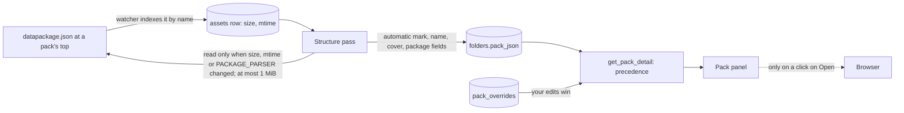

# Pack metadata files: read a pack's `datapackage.json`

Status: shaped 2026-10-19 in a two-round interview (D1-D22 below), and approved at final review
(revision 1).

Revised 2026-10-19 after GitHub Inspector's two rounds of review of PR #140. No decision changed:

- **"Open license" opens only an indexed document.** A license's file `path` now counts only when
  it names an indexed file in the pack whose extension is in `DOC_EXTENSIONS` (`txt`, `md`,
  `pdf`), the list `FileKind::is_license` already uses (C8). The button hands the file to the
  desktop's default handler, and a store's `datapackage.json` could name `install.sh`,
  `tool.desktop`, an AppImage, or an HTML page whose scripts would run in the browser. Any other
  path is ignored, and the button falls back to the pack's license file, as when there is no
  `path`. D7 and C9 point to the rule, and the Verification cases and A9 test it.
- Revision 2 allowed `rtf`, `html` and `htm` through a second list, `LICENSE_EXTENSIONS`.
  Revision 3 drops the extra extensions and the second list. HTML runs scripts, and one list keeps
  a license found by name and one named by the file under the same rule. A license in `.rtf` or
  `.html` now gets no button from the file (Known gaps).

## Problem

A pack's info comes from its license file and its folder name today (plan
`smarter-big-collections`, C9). The license file gives a license type, and only a Kenney header
gives a name, a version and an author. Packs from stores that ship no license file (Unity Asset
Store, Fab, itch.io) get none of that:

- Your Asset Store cache (`~/.local/share/unity3d/Asset Store-5.x/<Publisher>/<Category>/`)
  holds 21 `.unitypackage` files. **None holds a `License*`, `Preview*` or `Sample*` file, or a
  render folder.** Once extracted, they aren't even packs. Marked by hand, each shows its folder
  name, "No license file", and no publisher or author.
- A script will extract about 20 of them and write a
  [Frictionless Data Package](https://datapackage.org/standard/data-package/) file
  (`datapackage.json`) into each. It gives the pack's title, version, publisher and authors,
  source URL and license.

Facts that shape the design:

- **`.json` isn't indexed** (`SUPPORTED_EXTENSIONS` in `watcher.rs`), so the structure pass can't
  see the file today. The pass caches license reads against the file's asset row (size and
  mtime), so the file needs a row too.
- **Data Package v2 rules:**
  - `resources` is REQUIRED: at least 1, each with a `name` and a `path`.
  - A contributor's `roles` is an array, and consumers MUST fall back to the v1 string `role`.
  - `licenses[].name` is an Open Definition id, which in practice is the SPDX id. `path` is a
    URL or a path.
  - Paths are relative POSIX paths: no leading `/`, no `..` and no dot folders.
- **The cached packages share folders:**
  - All three Synty packs ship `Assets/Synty/PolygonGeneric` and `SyntyPackageHelper`.
  - `Ancient Ruins Pack` contains all of `Essential Terrain Pack`.
  - `Medieval Houses Modular Vol 1` holds only two nested `.unitypackage` files and a Readme.
- `LicenseKind` drives only the panel's license label. The panel's Source row comes only from
  your edit.

## Decisions

| # | Question | Answer |
|---|---|---|
| D1 | Does the file make its folder a pack? | Yes, like an automatic **"Mark as pack"**. Its folder is a pack, even inside another pack, and the packs below it stay packs. "Not a pack" wins. It joins after the sibling rule and doesn't count toward it, as your marks don't. |
| D2 | Hidden support file? | Yes, a hidden `doc`, wherever docs are hidden: in a pack's own folder, or in a marked folder inside a pack. |
| D3 | Name | `title` only. `name`, a lowercase slug, is ignored. |
| D4 | Publisher and authors | Only the `publisher` and `author` roles, from `roles`, else `role`, ignoring case. Publisher is the first `publisher` contributor, and Authors are every `author` one, in order. A contributor's name is its `title`, else `givenName familyName`. Other roles (`creator`, `maintainer`, `contributor`) and contributors with no role are ignored. |
| D5 | Source URL | The first http(s) `sources[].path`, else an http(s) `homepage`, in one Source row. |
| D6 | License label | The first `licenses` entry with a `name` or a `path`. A known id shows its kind label (CC0, CC-BY...), anything else its `title`, else the id as written. Later entries are ignored. |
| D7 | License button | The license's `path`. A file, which must be an indexed document (C8), opens with "Open license", and a URL opens in your browser only when you click Open, as Source does. With no `path`, the button opens the pack's license file. |
| D8 | `image` | It picks the cover, after the cover you chose and before `Preview*`. The image keeps its role and stays visible. A URL `image` is ignored. |
| D9 | Optional fields | None shown. `description`, `keywords`, `created`, `id`, `name` and `resources` are ignored. |
| D10 | New edit fields | None. To change publisher, authors or version, edit the file. |
| D11 | Where it shows | The detail panel only. The Packs view card is unchanged, and the name reaches it through `pack_json` already. |
| D12 | Size limit | 1 MiB, decided from the indexed size before opening the file. |
| D13 | Bad file | An oversized file, invalid JSON, or JSON that isn't an object is ignored, and its read is recorded, so it isn't read again until its size or mtime changes. The pack falls back to its license file and folder name. A field of the wrong type is skipped on its own. An I/O error records no read and keeps the previous metadata, so the next pass retries, like an unreadable license. |
| D14 | Surfacing | A warn line in the app log under the `structure` target, naming the file and the reason. No UI. |
| D15 | Parser version | A new `PACKAGE_PARSER = 1`, stored with each read. No `LICENSE_PARSER` bump. |
| D16 | The script's resources | One resource: the `image` file when set, else the first model by path. A package with no model, such as `Medieval Houses Modular Vol 1`, uses its first file by path. |
| D17 | Verification | Unit tests only, Rust and TypeScript. |
| D18 | Script layout | One folder per package, such as `Unity/POLYGON City Pack/`, holding that package's `Assets/...` tree, with the file at its top. Shared folders are copied into each pack that ships them. |
| D19 | Inheritance | None. Each pack reads only the files in its own folder. |
| D20 | File kind | `document`: `json` maps to Document in `AssetKind::from_extension`. |
| D21 | Fields the script always writes | `$schema` (v2), `name`, `title`, a `publisher` contributor, `licenses` and `resources`. It writes `version`, `sources`, `homepage`, `image` and `author` contributors only when known. |
| D22 | The script's license entry | `LicenseRef-Unity-Asset-Store-EULA`, titled "Standard Unity Asset Store EULA", with `path` `https://unity.com/legal/as-terms`. |

## Extends

This plan extends three contracts of `docs/plans/smarter-big-collections/plan.md`, which stays as
history, unedited:

- **C8 (the pack rule):** rule 4 gains an automatic "Mark as pack" for every folder that holds a
  `datapackage.json` (D1).
- **C9 (pack info):** the name, cover, license, version and author orders each gain a
  `datapackage.json` step, below your edits and above the license file (C9 below).
- **C18 (pack detail):** the panel gains Publisher and Authors rows. Its Version, License and
  Source rows read the file too.

## Behaviour

**C1. Indexing the file.**

- `watcher.rs` indexes a file named `datapackage.json`, ignoring ASCII case, in any folder,
  although `json` isn't in `SUPPORTED_EXTENSIONS`. No other JSON file is indexed.
- One name check, `structure::is_package_file`, serves both the watcher and the pass.
- `AssetKind::from_extension("json")` returns `Document` (D20).
- `preview::needs_preview` stays false for `json`, so the file never gets a preview job.

**C2. The automatic mark.** In `derive`, every folder that directly holds a `datapackage.json` is
a pack, unless you marked it "Not a pack" (D1). It joins `packs` with your "Mark as pack"
folders, after the sibling rule:

- It can be a pack inside another pack.
- The packs below it stay packs. That includes a folder that a `License*`, `Preview*` or
  `Sample*` file marks, as it would below a folder you marked as a pack. None of the 21 cached
  packages holds such a file.
- It doesn't count toward the sibling rule.
- A "Not a pack" folder isn't a pack, and its file isn't read.

**C3. Support role and kind.** `FileKind` treats a `datapackage.json` as a doc, so it follows the
doc rule (D2):

- In a pack's own folder, or in a marked folder inside a pack, it is a hidden `doc` support file.
  Show hidden files lists it, and it counts toward `hidden_count`.
- Elsewhere, such as in a "Not a pack" folder outside any pack, it is a visible Document.
- Its kind is `document`, so the pack's Files list counts it under Documents.
- Its stem is no marker stem and no license stem.

**C4. Which file a pack reads.** A pack reads the first `datapackage.json` by path directly in
its own folder. A file in a subfolder makes that subfolder its own pack (C2) and belongs to it.
Nothing is inherited (D19): every field of a pack comes from its own folder's files, its overrides
and its folder name.

**C5. Reading and caching.** The file is read as license files are:

- `rebuild` first derives with the reads already made, noting the package files whose read isn't
  current. It reads those off the runtime (`spawn_blocking`, as `read_license_files` does), then
  derives again.
- A read is current when its stored `(parser, size_bytes, modified_at)` equals
  `(PACKAGE_PARSER, size_bytes, modified_at)` of the file's row (`known_packages`, beside
  `known_licenses`).
- `PACKAGE_PARSER: u32 = 1` is new (D15). `LICENSE_PARSER` stays 1.
- `PACKAGE_BYTES` is 1 MiB, 1,048,576 bytes (D12):
  - A file whose indexed `size_bytes` is larger isn't opened.
  - The read takes at most `PACKAGE_BYTES + 1` bytes, so a file that grew past the limit after
    indexing is caught too.
- A leading UTF-8 byte order mark is skipped.

Each read ends one of three ways:

| Outcome | The pack gets | Read recorded | Log |
|---|---|---|---|
| Parsed | the file's fields (C6), with a wrong-typed field skipped on its own | yes | none |
| Ignored: over 1 MiB, not UTF-8, invalid JSON, or not a JSON object | nothing from the file, so every field falls back (C9) | yes, so it isn't read again until its size or mtime changes | warn, target `structure`: `Ignoring <path>: <reason>` |
| I/O error: open or read failed | what the last read said | no, so the next pass retries | debug, as for license files |

**C6. Field mapping.** `parse_package` reads the document as a `serde_json::Value` and takes each
field on its own. Strings are trimmed, and an empty string counts as absent.

| Data Package field | OpenDAM field | Rule |
|---|---|---|
| `title` | name | a string (D3) |
| `version` | version | a string |
| `contributors[]` with role `publisher` | publisher | the first one (D4) |
| `contributors[]` with role `author` | authors | all, in order (D4) |
| `sources[].path` | source URL | the first http(s) URL (D5) |
| `homepage` | source URL | when no `sources[].path` qualifies |
| `licenses[]` | license | the first entry with a `name` or a `path` (D6, D7) |
| `image` | cover | a relative path to an indexed image in the pack (D8) |

- **Contributors.** A contributor's roles are `roles` when that is an array of strings, else
  `role` when that is a string, compared ignoring case. A contributor with both roles counts as
  both. Its name is `title`, else `givenName` and `familyName` joined by a space. A contributor
  with no name is skipped. So is a contributor that isn't an object.
- **Ignored (D9):**
  - top-level `$schema`, `profile`, `id`, `name`, `description`, `keywords`, `created` and
    `resources`;
  - contributors' `path`, `email` and `organization`;
  - sources' `title`, `email` and `version`;
  - every license after the first, and any other property.
- **Wrong types (D13):** `"version": 3` gives no version and keeps every other field. So do
  `"contributors": {}` and a `roles` that isn't an array of strings (which falls back to `role`).

**C7. SPDX ids to `LicenseKind`.** A license's `name` is matched as a whole id, ignoring ASCII
case:

| Id | `LicenseKind` |
|---|---|
| `CC0-1.0` | CC0 |
| `CC-BY-` and a version digit, with any port suffix: `CC-BY-4.0`, `CC-BY-3.0-US` | CC-BY |
| `CC-BY-SA-` and a version digit, with any port suffix: `CC-BY-SA-4.0` | CC-BY-SA |
| `MIT` | MIT |
| `Apache-2.0` | Apache-2.0 |
| `OFL-1.0`, `OFL-1.1`, each with an optional `-RFN` or `-no-RFN` | OFL |
| Anything else: `CC-BY-NC-4.0`, `CC-BY-ND-4.0`, `CC-BY-NC-SA-4.0`, `MIT-0`, `GPL-3.0-only`, an expression such as `MIT OR Apache-2.0`, `LicenseRef-*` | unknown |

The label follows D6:

- A known kind shows its label, as a license file's does.
- An unknown one shows the entry's `title`, else its id as written. So
  `LicenseRef-Unity-Asset-Store-EULA` with its title shows "Standard Unity Asset Store EULA".
- An entry with only a `path` and no title shows "Unknown".

**C8. Paths and URLs.** No URL from the file is ever fetched. A URL is stored, and shown with an
Open button that opens it in your browser only when you click it.

- **Relative paths.** `image` and a license's relative `path` are POSIX paths relative to the
  file's folder. The pass ignores one that:
  - is empty or starts with `/`;
  - holds a `\`;
  - has a `..` segment, or a segment starting with `.`.

  It joins the rest to the pack's path, so a stored path is always relative to the library root
  and inside the pack.
- **`image`** counts only when it names an indexed image inside the pack: the rule
  `cover_allowed` and your chosen cover follow. A URL `image` is ignored.
- **A license's file `path`** counts only when it names an indexed file inside the pack whose
  extension, ignoring case, is in `DOC_EXTENSIONS` (`txt`, `md`, `pdf`), the list
  `FileKind::is_license` uses for a license found by name. `derive` checks it against the
  indexed paths, as it checks `image`. "Open license" hands the file to the desktop's default
  handler, and a pack from a store can name any file. So every other path is ignored, and the
  button falls back to the pack's license file (C9). That includes a script or launcher
  (`install.sh`, `tool.desktop`, an AppImage), an HTML page, whose scripts would run in the
  browser, any other indexed file (`rock.fbx`, `terms.svg`), a format OpenDAM doesn't index
  (`.rtf`), and a file that doesn't exist.
- **A license's URL `path`** must be http(s) (`is_web_url`). Any other scheme is ignored.
- **Source URLs** must be http(s) (`is_web_url`), as your edited source URL must be. Any other
  value is ignored.

**C9. Precedence.** Each field falls back on its own: a file with only a `title` still lets the
license file give the license.

| Field | Order, first present wins |
|---|---|
| Name | your name > `title` > license header name > folder name (> library name for a root pack, as today) |
| Version | `version` > license header version |
| Publisher | the first `publisher` contributor; no other source |
| Authors | the `author` contributors > license header author |
| Source URL | your source URL > first http(s) `sources[].path` > http(s) `homepage` |
| License label | your license > the file's license (C7) > the license file's kind > "No license file" |
| License button | the file's license `path` (an indexed document, C8: Open license; a URL: Open) > the pack's license file > none |
| Cover | your cover > `image` > first `Preview*` > first `Sample*` > first image > first visible file |

`derive` resolves the name and the cover into `PackInfo`, as it does today. `pack_holding`
resolves the rest into `PackDetail`.

**C10. `pack_json`.** `PackInfo` gains `package: Option<PackageFile>`. Paths in it are relative
to the library root:

```json
"package": {
  "path": "Unity/POLYGON City Pack/datapackage.json",
  "title": "POLYGON - City Pack - Art by Synty",
  "publisher": "Synty Studios",
  "license": {
    "kind": "unknown",
    "id": "LicenseRef-Unity-Asset-Store-EULA",
    "title": "Standard Unity Asset Store EULA",
    "url": "https://unity.com/legal/as-terms"
  },
  "parser": 1,
  "sizeBytes": 812,
  "modifiedAt": 1792468800000
}
```

This is the example file below. It has no `version`, `authors`, `sourceUrl` or `image`, so they
are left out.

- An ignored file stores its `path` and its read (`parser`, `sizeBytes`, `modifiedAt`) with no
  fields.
- A license holds a file path as `filePath`, or a URL as `url`.
- Absent fields aren't serialized, and every field has a serde default, so the `pack_json` of
  older passes still parses.
- A pack with no `datapackage.json` serializes exactly as today, so its row doesn't change.

**C11. What the backend sends.** `PackDetail` (`commands/folder.rs`, `types/index.ts`):

- **Gains** `version`, `publisher`, `authors` (a list) and `sourceUrl`, the detected source URL
  without your edit, each resolved by C9.
- **`license`** becomes `{ kind, name, filePath, url }`. `name` is the label for an unknown kind:
  the `title`, else the id. `filePath` is absolute. Only one of `filePath` and `url` is set, by
  C9's button order.
- **Loses** `header`. The header's version and author now arrive through `version` and
  `authors`.
- `edits` is unchanged (D10).

**C12. The panel.** `PackPanel` in `DetailPanel.tsx`:

- **Rows, in order:** Version, Publisher, Author (Authors when there are several, joined by
  `, `), License, Source, Items, Files, Size, Folder. A row with no value is left out, except
  License.
- **The License row** shows `licenseLabel(pack)`: your license, else the kind label, else `name`,
  else "Unknown". Beside it is "Open license" when there is a `filePath` and "Open" when there is
  a `url`. "Open" calls `api.openUrl`, as Source does.
- **The Source row** shows `edits.sourceUrl ?? sourceUrl`.
- **The edit form:** the Source URL field's placeholder shows the detected source URL, when there
  is one. The License placeholder shows the detected label.
- **New element ids:** `detail-pack-publisher` and `detail-open-license-url`.
  `detail-pack-author` now holds the authors.
- **Packs view cards** are unchanged (D11).

**C13. Existing libraries.**

- At the next launch, the startup index adds every `datapackage.json` as a new Document row.
  The pass at the end of that run makes each one's folder a pack and reads the file once. A
  rerun reads none and writes 0 rows.
- A pack with no file keeps a byte-identical `pack_json`, and no license file is read again
  (D15).
- Opening a library DB before that index changes nothing, since no file has a row yet.

**C14. Unchanged:**

- the `pack_overrides` schema and `set_pack_override`;
- `parse_license` and `LICENSE_PARSER`;
- format groups, 2D stacks and bundled previews;
- the preview queue, and the master DB.

No migration is needed: `pack_json` is JSON.

## The file the Unity script writes

**Where (D18):** at the top of the folder holding one package's extracted `Assets/...` tree, such
as `<library>/Unity/POLYGON City Pack/datapackage.json`. Each package gets its own folder, so the
folders that packages share are copied into each.

**Always (D21):**

| Field | Value |
|---|---|
| `$schema` | `https://datapackage.org/profiles/2.0/datapackage.json` |
| `name` | the title in lowercase, with each run of characters other than `a-z`, `0-9`, `.`, `_` and `-` replaced by one `-`, and leading and trailing `-` trimmed |
| `title` | the package's name, as its cache file is named: `POLYGON - City Pack - Art by Synty` |
| `contributors` | `[{"title": "<publisher>", "roles": ["publisher"]}]`, the publisher being the cache folder above the category: `Synty Studios` |
| `licenses` | the D22 entry |
| `resources` | one resource (D16). Its `path` is the `image` file when set, else the first model by path, ignoring case, else the first file by path. Its `name` is that file's name, by the `name` rule. |

**When known:**

- `version`;
- `sources`: `[{"title": "Unity Asset Store", "path": "<store page URL>"}]`;
- `homepage`;
- `image`, a relative path to an image inside the pack;
- `author` contributors: `{"title": "<name>", "roles": ["author"]}`.

**Rules:**

- Write UTF-8 JSON with `/` separators.
- Use relative paths only: no leading `/`, no `..` and no dot folders.
- Write v2 `roles` arrays.
- One resource keeps the file near 1 KB, far under the 1 MiB limit.

**Example**, for `POLYGON - City Pack - Art by Synty`, whose first model by path is
`Assets/Synty/PolygonCity/Models/Characters.fbx`:

```json
{
  "$schema": "https://datapackage.org/profiles/2.0/datapackage.json",
  "name": "polygon-city-pack-art-by-synty",
  "title": "POLYGON - City Pack - Art by Synty",
  "contributors": [
    { "title": "Synty Studios", "roles": ["publisher"] }
  ],
  "licenses": [
    {
      "name": "LicenseRef-Unity-Asset-Store-EULA",
      "title": "Standard Unity Asset Store EULA",
      "path": "https://unity.com/legal/as-terms"
    }
  ],
  "resources": [
    { "name": "characters.fbx", "path": "Assets/Synty/PolygonCity/Models/Characters.fbx" }
  ]
}
```

The panel then shows:

- the name `POLYGON - City Pack - Art by Synty`;
- Publisher `Synty Studios`;
- License `Standard Unity Asset Store EULA`, with Open;
- no Version, Author or Source row.

The cover is the pack's first image by path, as for any pack with no `Preview*` image.

## Flow



Before this change no JSON file was indexed. A pack's info came from its license file, your
edits and its folder name, and only your edit gave a source URL.

## Implementation (one pull request)

1. **Indexing** (C1):
   - in `watcher.rs`, index a file that `structure::is_package_file` names, whatever
     `is_supported` says of `json`;
   - in `models.rs`, map `json` to `Document`.
2. **Pass** (C2-C10), in `structure.rs`:
   - `is_package_file`, and `FileKind` treating the file as a doc;
   - the automatic mark beside your marks in `derive`;
   - `PackFiles::package`;
   - a `read_package` lookup in `derive`, used for the name and cover orders, and to keep a
     license file `path` only when it names an indexed `DOC_EXTENSIONS` file in the pack;
   - `PackageFile`, `PackageMeta`, `PackageLicense` and `PACKAGE_PARSER`;
   - the pure `parse_package` and `spdx_kind`, and `PACKAGE_BYTES`;
   - `known_packages` and `read_package_files`;
   - the read bookkeeping in `pass`, plus "package files read" and "package files ignored" in
     its info line;
   - the module doc.
3. **Detail** (C9, C11), in `commands/folder.rs`: `pack_holding` resolves version, publisher,
   authors, source URL and license. `PackDetail` and `PackLicense` change shape.
4. **Frontend** (C12):
   - `types/index.ts`;
   - `licenseLabel` and `authorsLabel` in `utils/packEdits.ts`, and the placeholders;
   - the rows and buttons of `PackPanel`.
5. **Docs:** in `AGENTS.md`:
   - "Structure is derived": the pass also reads a pack's `datapackage.json`, cached by size,
     mtime and `PACKAGE_PARSER`, and only a file named `datapackage.json` is indexed as JSON;
   - the pack edits bullet: the precedence order, with edits winning.
6. **Tests** (below).

## Verification

Unit tests only (D17), run by file or name.

**Rust** (`cargo nextest run <filter>`):

- **`structure::tests`, `parse_package`:**
  - the example above gives its title, publisher, license id, title and URL, and no version,
    authors or source;
  - a full file gives version, authors in order, a source URL from `sources`, a `homepage` used
    only without one, a license file path and an `image`;
  - a partial file with only `title` leaves every other field empty;
  - roles: `roles` beats `role`, the v1 `role` works alone, matching ignores case, and
    `creator`, `maintainer` and roleless contributors are ignored. A name falls back to
    `givenName familyName`;
  - wrong types: `"version": 3`, `"contributors": {}` and a non-array `roles` each drop only
    their own field;
  - invalid JSON, `[]`, `"text"` and invalid UTF-8 are ignored with a reason, and a file with a
    byte order mark parses;
  - SPDX: every row of C7, including case (`cc-by-4.0`), a port (`CC-BY-3.0-US`), `OFL-1.1-RFN`,
    `CC-BY-NC-4.0`, `MIT-0`, an expression and `LicenseRef-*`;
  - licenses: an entry with neither `name` nor `path` is skipped for the next one;
  - paths: `../x`, `/x`, `.hidden/x`, `a/../b` and `a\b` are rejected for `image` and a license
    `path`, and `ftp://` URLs are rejected.
- **`structure::tests`, `derive`:**
  - a folder of models with a `datapackage.json` is a pack named by `title`, with the file a
    hidden `doc` of kind `document`;
  - precedence: your name > `title` > Kenney header name > folder name, `version` beats the
    header's, and authors beat the header's author;
  - cover: `image` beats `Preview*` and your cover beats `image`. An `image` outside the pack,
    not indexed, or a URL is ignored, and the image itself stays visible;
  - license file `path`: an indexed `LICENSE.txt` or `License.PDF` in the pack is kept. An
    indexed non-document (`Models/rock.fbx`, `terms.svg`) is ignored, and so is a path that isn't
    indexed (`install.sh`, `tool.desktop`, `Tool.AppImage`, `terms.html`, `eula.rtf`, an
    extensionless `LICENSE`, a missing `gone.txt`);
  - a bundle: a file above two license-marked packs makes three packs, and the inner ones get
    nothing from the outer file;
  - a file inside a Kenney license pack makes a nested pack;
  - "Not a pack" on the file's folder gives no pack, and the lookup isn't called for it;
  - sibling rule: a parent with two `datapackage.json` packs and one plain folder doesn't make
    the plain folder a pack;
  - a pack with no file derives exactly as before.
- **`structure::tests`, passes on a temp library:**
  - the first pass reads the file once, and the second reads none and writes 0 rows;
  - a changed size or mtime reads exactly that file again;
  - a file over 1 MiB isn't opened, falls back to the license file, logs a warning and isn't
    read on the next pass;
  - a malformed file falls back, and isn't read again until its mtime changes;
  - an indexed file missing on disk records no read, keeps the previous fields, and is read on
    the next pass;
  - a `pack_json` written before this change, with no `package`, parses.
- **`watcher::tests`:** `datapackage.json` and `DataPackage.JSON` are indexed as documents with no
  preview job, and `other.json` isn't indexed.
- **`commands::folder::tests`:** `pack_holding` resolves version, publisher, authors, source URL
  and license by C9:
  - edits beat the file, and the file beats the license file;
  - a file license with no `path` keeps the license file's button;
  - a license `path` that isn't an indexed document, such as `install.sh` or `terms.html`, keeps
    the license file's button, or no button when the pack has no license file;
  - a URL `path` gives `url` and no `filePath`.

**TypeScript** (`bun test src/utils/packEdits.test.ts`):

- `licenseLabel` covers your license, each known kind, an unknown kind with and without a
  `name`, and no license at all;
- `authorsLabel` gives "Author" for one and "Authors" for several;
- the form's placeholders show the detected source URL and license label.

## Acceptance criteria

- **A1:** A folder that holds only models and a `datapackage.json` is a pack, named by its
  `title`. The file is hidden unless Show hidden files is on.
- **A2:** The example file shows Publisher `Synty Studios` and License `Standard Unity Asset
  Store EULA`, whose Open button opens the terms page only when clicked.
- **A3:** Field by field, your edits beat the file, the file beats the license file, and the
  license file beats the folder name.
- **A4:** A malformed, non-object or over 1 MiB file never fails the pass. Its pack falls back, a
  warn line names the file, and the next pass doesn't read it until it changes.
- **A5:** A second pass reads no `datapackage.json` and writes 0 rows. A changed file is read
  again once.
- **A6:** A `datapackage.json` above two license-marked packs gives three packs, and the inner
  ones show nothing from the outer file.
- **A7:** No code path fetches a URL from the file.
- **A8:** A pack with no `datapackage.json` keeps a byte-identical `pack_json`, and no license
  file is read again.
- **A9:** "Open license" only ever opens an indexed `txt`, `md` or `pdf` file in the pack. A
  `datapackage.json` whose license `path` names `install.sh` or `terms.html` leaves the button on
  the pack's license file, or shows none.

## Known gaps and trade-offs

- **Only the first license shows.** A dual-licensed pack shows its first entry (D6).
- **Shared Unity folders are duplicated** across packs (D18), so PolygonGeneric is indexed three
  times.
- **No edit fields for publisher, authors or version** (D10). Fixing one means editing the file.
- **`datapackage.json` packs don't count toward the sibling rule** (D1), so a stray folder beside
  them stays a plain folder.
- **A license in a format OpenDAM doesn't index** (`.rtf`, `.html`) gets no Open license button
  from the file (C8). Its label still shows, and a URL `path` still opens.
- **Only `datapackage.json` is read.** Other descriptor names and `datapackage.yaml` are not.
- **Unit tests only** (D17). No app run or screenshot checks the panel, and the Kenney golden
  snapshot has no `datapackage.json` for the bench to exercise.
