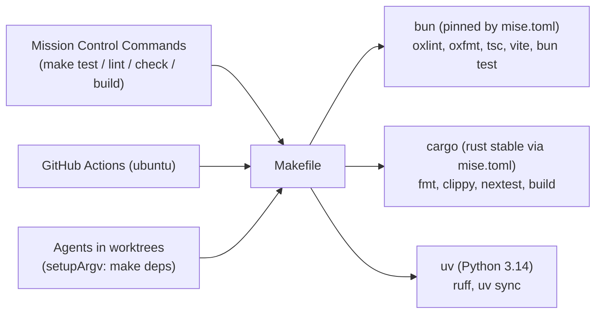
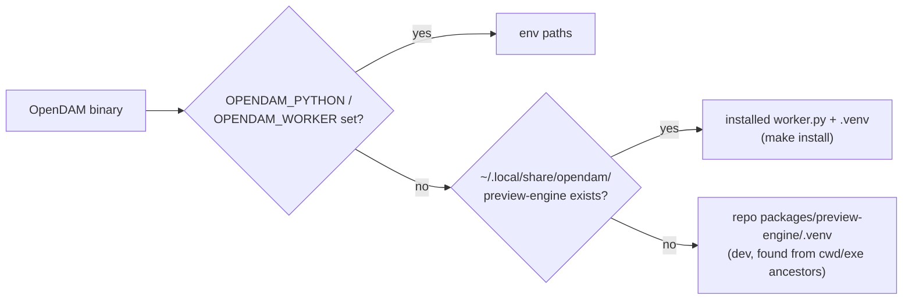
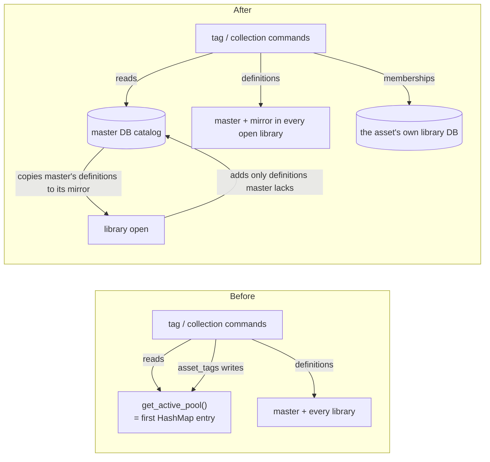

# Personal fork alignment: Linux-only, bun, Claude and Mission Control

Status: approved 2026-10-12. Shaped in a three-round interview and approved at review with two
additions (D22, D23). Follow-up: once this plan merges, Mission Control slices it into
dependency-linked tickets.

Revised 2026-10-12 after Plan Validation repair round 1. These are consistency repairs inside the
approved decisions, not new decisions:
- Fix #5 gets an automated regression test, so every fix #1-#6 really has one.
- Step 2 documents only the make targets that exist when it lands. Steps 3 and 5 add `make test`
  and `make install`/`make uninstall` to the docs.
- Step 1's "no Windows/pnpm references" exit check is now an exact command. Step 2 extends it to
  the README and `CONTRIBUTING.md`.

Revised again after repair round 2. These are validation repairs only, so every regression test
fails on `main` and every check can actually be carried out:
- **#2:** the regression test now reads `[profile.release]`. The test profile never aborts, so a
  decoder unit test would pass on `main`.
- **#6:** the test tags an asset in each library, seeds a divergent definition, and pins
  `foreign_keys` off in its fixture, so it fails on `main` whatever order the HashMap is in.
- **Step 3:** first probes what each runner's JUnit records for a test's file. bun's is verified;
  nextest's is listed as unverified.
- **#5:** the release-build check is visual, since D20 leaves no devtools console in release.

Revised after the GitHub Inspector review on PR #11:
- **Fix #6's library open is insert-only, master wins.** It adds definitions master lacks, as `main`'s
  sync already does. It then copies master's definitions down to the opened library's mirror, in
  a stable library order. The plan had said "upsert", which would revert renames made while a
  library was offline and would make master depend on open order.
- **The flow diagrams' labels now match their mermaid source word for word.** I checked this with a
  comparison script when the plan was written. That script isn't committed, so `plan.html` is a
  snapshot: if `plan.md` changes, re-render `plan.html` from it or delete it.
- **Fix #6's mirror overwrite is an `UPDATE`, never `REPLACE`** (Inspector round 2). REPLACE
  deletes the old row, and the schema's `ON DELETE CASCADE` foreign keys would wipe the library's
  memberships and child collections. A new test with foreign keys on proves they survive an open.

## Summary

`ramiro314/OpenDAM` is now a **hard fork**. It is a personal, **Linux-only** asset manager for
**game-dev assets**, built and maintained by agents that Mission Control dispatches. This plan does
six things, in this order:

1. Moves the toolchain to mise + bun + uv behind one Makefile.
2. Strips the Windows and upstream-community weight.
3. Gives agents a root instructions file.
4. Adds the first test runners.
5. Fixes all seven review findings. Fixes #1-#6 each get an automated regression test, and those
   tests guard #7's refactors.
6. Ships a `make install` that gives you a working release build in `~/.local`.

## Context

The upstream project (LawLaw09/OpenDAM) is a Windows-first AEC/archviz DAM: an NSIS installer,
CI on `windows-latest`, Explorer integration, and a Connecter-parity roadmap. The fork already
has merged PRs #1-#10 (preview fixes, 3D grid thumbnails, infinite scroll, Dependabot, pinned
Tauri crates with a committed `Cargo.lock`). You run it on Arch (KDE Plasma, Wayland, NVIDIA RTX
5080) against one library, `~/Documents/Kenney/Assets`.

## Decisions

Every decision below was made by you: D1-D21 in the shaping interview (rounds 1-3, 2026-10-12),
D22-D23 at plan review.

| # | Decision | Answer |
|---|---|---|
| D1 | Relationship to upstream | Hard fork: diverge freely, drop the `upstream` remote, port fixes by hand if ever. The repo stays in GitHub's fork network. |
| D2 | Primary use | Game-dev assets (glTF/FBX/OBJ models, PNG sprites/textures) |
| D3 | Name and identifier | Keep "OpenDAM" and `com.opendam.desktop` (no app-data migration) |
| D4 | Daily use | Release build installed to `~/.local` by one script (`make install`), no packaging format |
| D5 | Wayland/NVIDIA crash workaround | `main.rs` sets `WEBKIT_DISABLE_DMABUF_RENDERER=1` at startup when it is unset |
| D6 | Toolchain pinning | Repo `mise.toml` pins bun and rust stable |
| D7 | Python environment | uv: dependencies in `pyproject.toml` + `uv.lock`, pinned Python version |
| D8 | Review fixes in scope | All seven: #1-#7 (see [Review findings](#review-findings)) |
| D9 | Pruning | Delete community scaffolding, the upstream roadmap, dead code, and unused dependencies, and rewrite the README. **Keep** `docs/adr`, `docs/specs`, and the AEC format code. |
| D10 | Bun depth | bun replaces pnpm (installs, lockfile, scripts). Node still runs vite and the tauri CLI. |
| D11 | Workspace shape | Keep `apps/desktop` + `packages/preview-engine`, with a root `package.json` using bun workspaces |
| D12 | Agent instructions file | `AGENTS.md`, with `CLAUDE.md` as a symlink to it |
| D13 | Other agent setup | Project `.claude/settings.json` with a small allowlist, plus `docs/agents/running-the-app.md`. No `.agents/memory` seed: the first retro creates it. |
| D14 | Mission Control integration | A Makefile (`deps` stamp, `dev`, `lint`, `check`, `test`, `build`, `install`, `uninstall`). CI runs the same targets. You set the worktree-pool `setupArgv` to `make deps` by hand. Mission Control's "Set up testing" task runs after the test runners land. |
| D15 | Test runners | Rust: `cargo test` through cargo-nextest (JUnit). TypeScript: `bun test` (JUnit reporter). No Python tests yet. |
| D16 | Where the installed app finds the preview engine | `~/.local/share/opendam/preview-engine` (worker + uv venv), after the `OPENDAM_*` env overrides |
| D17 | Tag/collection data model (fix #6) | The master DB is the catalog. Each library DB keeps a mirror of the definitions plus its own membership rows. `get_active_pool` goes away. |
| D18 | TypeScript lint/format | oxlint + oxfmt (as in metalmind), replacing eslint, typescript-eslint, and prettier |
| D19 | Formatting | Enforced: one mechanical reformat commit per language, after which `make lint` checks formatting |
| D20 | Devtools | Dev builds only; the release build drops the `devtools` feature |
| D21 | Order | Foundation → agent docs → test runners → fixes #1-#6 → install → refactors (#7) |
| D22 | Commit attribution | Agents are never added as commit co-authors: no `Co-Authored-By` trailer naming an agent, in this plan's commit or any later one. `AGENTS.md` states the rule explicitly. |
| D23 | Writing style | Plain dashes only, never em dashes. `AGENTS.md` states the rule. |

Facts checked while shaping (not decisions):

- **Python.** Every preview-engine dependency has Python 3.14 wheels for Linux x86_64 (binary-only `uv pip compile`), so uv pins **3.14**. That matches the system Python.
- **Formatting debt.** `rustfmt --check` reports 299 diffs in `src-tauri`, and prettier flags 18 TS files. `worker.py` already passes `ruff format` and `ruff check`.
- **Libraries.** Only one library is registered in the master DB (`~/.local/share/com.opendam.desktop/opendam.sqlite`), so bug #1 is latent today.
- **Tauri version check.** `.github/scripts/check-tauri-versions.mjs` (PR #10) parses `pnpm-lock.yaml`, so the bun migration has to port it to `bun.lock`.
- **Screenshots.** The desktop is KDE Plasma, and `spectacle` is the available screenshot tool.
- **bun JUnit.** `bun test` 1.4.2's JUnit reporter writes `file="<path>"` and `line` on every `<testcase>`. I probed this with a throwaway test outside the repo. cargo-nextest isn't installed here, so its JUnit output is unverified (see step 3).

## Review findings

A read-only review of `origin/main` at `0af38c8`. Items marked ✔ were confirmed by reading the code
during shaping. The rest come from the review pass.

### Platform (Windows/macOS weight)

- **Windows-only files.**
  - `apps/desktop/src-tauri/installer.nsi`: a 934-line NSIS template.
  - `tauri.windows.conf.json`: C:/D:/E: asset scopes.
  - `icons/icon.ico`.
  - `icons/icon32.png`: a byte-identical copy of `32x32.png`, unreferenced.
  - `tools/cleanup/`: a Windows post-uninstall cleaner using `taskkill`, `reg delete`, and %APPDATA%. Nothing references it.
- **`tauri.conf.json`:** `bundle.targets: ["nsis"]` (:49), a missing `icons/icon.icns` (:54), `icon.ico` (:55), and the `bundle.windows.nsis` block.
- ✔ **Platform branches in Rust.**
  - `main.rs:2` `windows_subsystem`.
  - `commands/shell.rs`: Windows `explorer`/`raw_arg`/`CREATE_NO_WINDOW` blocks (:5-28, :52-61) and macOS blocks (:29-35, :62-68). The Linux `xdg-open` branches (:36-50, :69-76) work, but "reveal" only opens the parent folder.
  - `preview.rs:66-67` `cfg(windows)`, `:141-145` `venv\Scripts\python(w).exe` candidates, and the `:154` `pythonw` fallback.
- ✔ **Windows path handling.** `\`→`/` rewrites at `db.rs:336,338`, `watcher.rs:167`, and `asset.rs:379` would corrupt Linux filenames that contain a backslash. The rename validation at `asset.rs:760` rejects `: * ? " < > |`, which are all legal on Linux.
- ✔ **UI and CI.** The UI says "Reveal in Explorer" (`DetailPanel.tsx:273,449`, `api/index.ts:79`). CI's Rust job runs on `windows-latest`.

### Tooling

- **pnpm coupling.**
  - Root `package.json` scripts use `pnpm --filter` and `pnpm -r`, and set `packageManager: pnpm@12.11.2`.
  - `pnpm-workspace.yaml` and `.npmrc` hold build allowances for esbuild and **sharp**. sharp isn't in the lockfile.
  - `tauri.conf.json` calls `pnpm vite:dev` / `pnpm vite:build`.
  - Also coupled: the CI pnpm steps, Dependabot's `npm` ecosystem, and the Tauri version-check script.
- **No tests anywhere.**
  - Rust has no `#[test]` and the TypeScript side has no runner.
  - `packages/preview-engine/test_max.py` is a scratch CLI script that asserts nothing.
  - `pnpm -r test` runs nothing.
- **ESLint is broken.** There is no `eslint.config.*`, and eslint 9 rejects the `--ext` flag in `apps/desktop`'s `lint` script. `@typescript-eslint/*` and prettier are installed but never run in CI.
- **What CI actually checks:** `tsc -b && vite build`, `cargo clippy -D warnings`, and `ruff check packages/preview-engine`.

### Dead weight

- **Unused packages.**
  - `packages/dcc-bridge`: WebSocket protocol types. Nothing imports it, and nothing serves port 37520.
  - `plugins/blender`: posts to that same unserved port.
- **Unused code.** `migrations/001_initial.sql` is unused; only `002` is `include_str!`'d. `LibraryWatcher` (`watcher.rs:390-398`) is an empty placeholder held in `AppState`.
- **Unused JS deps:** `react-router-dom`, `react-virtual`, `@tauri-apps/plugin-fs`, `@tauri-apps/plugin-shell`. Only `plugin-dialog` is imported.
- ✔ **Unused Rust deps:** `notify`, `mime_guess`, `thiserror`, `dirs`, and sqlx's `migrate` feature. `tauri-plugin-fs` and `tauri-plugin-shell` are initialised (`lib.rs:31,33`) but never called; reveal and open use `std::process::Command`.
- **Upstream community material:** `CODE_OF_CONDUCT.md`, `CONTRIBUTING.md`, issue and PR templates, `opendam_implementation_plan.md` (the Connecter-parity AEC roadmap), and README marketing.
  - **Before deleting `CONTRIBUTING.md`:** it holds the only venv setup steps and the project's design rules. Those move to `AGENTS.md` first.

### Bugs (fixed by this plan)

1. ✔ **#1 An offline library wipes another library's assets.**
   - **Cause:** `Database::get_library_handle(Some(id))` falls back to `libs.values().next()` when `id` isn't open (`db.rs:291-299`). Libraries whose root is missing are never opened (`db.rs:168`), yet the startup re-index (`lib.rs:63-78`) and F5 still call `watcher::index_paths` for them.
   - **What happens:** `index_paths` (`watcher.rs:136-144`) receives *another* library's pool, walks the missing paths, finds nothing, and deletes every asset row in that other library (`watcher.rs:292-307`). Its tags, ratings, and collection memberships go with them.
   - **Trigger:** two or more libraries with one unmounted.
2. ✔ **#2 One malformed image kills the release app.** `panic = "abort"` (`Cargo.toml:40`) defeats the `catch_unwind` around image decoding (`preview.rs:323-327`).
3. ✔ **#3 Search errors on ordinary input.** Raw text goes into FTS5 `MATCH` as `"{text}*"` (`asset.rs:126-129`), so `low-poly` or `tree.glb` is a syntax error. The frontend store doesn't catch the error and the grid keeps stale results.
4. ✔ **#4 A failed trash becomes a permanent delete.** When `trash::delete` fails, `asset.rs:716-719` silently calls `std::fs::remove_file`.
5. **#5 Wide-open security surface.** The asset protocol scope is `**`, `$HOME/**`, and `$DESKTOP/**`. The capabilities include `fs:allow-read` on `**`, `csp` is `null` (`tauri.conf.json:28`), and release builds ship the `devtools` feature (`Cargo.toml:18`). There is no remote content or `innerHTML`, so it isn't exploitable today, but it is cheap to close.
6. ✔ **#6 The "active library" is whichever HashMap entry comes first.**
   - **How tags and collections work today:** their definitions are copied into every library DB and the master DB.
   - **Reads are arbitrary:** `list_tags`, the collection commands, and several fallbacks read through `get_active_pool()` (`db.rs:313`; `tag.rs`, `collection.rs`, `preview.rs:39`, `asset.rs:106,562,617,709,827`).
   - **Writes land in the wrong library:** `update_asset` also writes `asset_tags` into that pool even when the asset lives in another library (`asset.rs:617-618`), leaving orphan rows.
7. **#7 Oversized files.**
   - `Sidebar.tsx` is 1274 lines.
   - `search_assets` (`asset.rs:79`, about 450 lines) repeats the same `WITH RECURSIVE col_tree` CTE five times (`asset.rs:271-354`).

### Preview worker at runtime

- **How it runs:** the Python worker is spawned once as a JSON-over-stdio daemon for formats Rust can't decode (`model_meta`; `preview.rs:366+`).
- **Python lookup order:** `OPENDAM_PYTHON`, then `{cwd, exe dir, and up to 4 parents of each}/packages/preview-engine/venv/bin/python`, then `…/venv/bin/python`, then a bare `python` checked against the *cwd* rather than `PATH` (`preview.rs:108-176`). The script lookup uses `OPENDAM_WORKER` or the same roots.
- **Problems:**
  - Nothing is bundled, so a release build outside the repo has no 3D/CAD previews.
  - uv's default `.venv` is never searched.
  - The worker's stderr is discarded (`preview.rs:62`).

## Target state

- **Toolchain.** `mise install && make deps` sets up a fresh checkout or a Mission Control worktree with no shims failing. bun, rust, and uv's Python are pinned.
- **One command surface.** `make lint check test build` is what Mission Control's Commands, CI, and agents all run.
- **Linux only.** Nothing for Windows or macOS remains, and CI is ubuntu-only.
- **Agent context.** `AGENTS.md` gives an agent everything it needs: commands, layout, invariants, and how to run and screenshot the app.
- **Tests.** Rust and TypeScript tests run with JUnit output, ready for Mission Control's testing contract.
- **Bugs.** #1-#7 are fixed, and #1-#6 each have an automated regression test (for #2 and #5, a test of the shipped configuration).
- **Install.** `make install` puts a release OpenDAM in your app launcher, and it renders Python-backed previews.

## Flows that change

### Checks: Mission Control, CI and agents share one entry point



**Before:** CI calls `pnpm`, `cargo clippy` (on Windows), and the ruff action directly. Mission Control's default `make` Commands have no Makefile to run, and the mise shims for `cargo`/`pnpm` fail.

### Preview engine lookup



**Before:** only `venv/` folders under the cwd, the exe dir, and their ancestors (plus Windows `Scripts\` candidates). The installed binary never found the worker.

### Tags and collections (fix #6)



## Work, in order

Each step lists its scope and what done means. Ticket slicing (after this plan merges) turns these
into dependency-linked tasks. A step may become several tickets.

### Step 1: Foundation (toolchain, bun, uv, Makefile, CI, Linux-only, pruning, formatting)

**Toolchain**
- **`mise.toml`** at the repo root: `bun` (pinned to the version the lockfile is created with), `rust = "stable"`, and `cargo-nextest` if mise can provide it (otherwise `make deps` installs it). With this file the `cargo` shim works in every checkout and worktree.
- **`packages/preview-engine/pyproject.toml`** gets `[project]` with the dependencies from `requirements.txt`, `requires-python = ">=3.14"`, and ruff as a dev dependency. Commit `uv.lock` and `.python-version` (`3.14`), and delete `requirements.txt`. The dev venv is `packages/preview-engine/.venv`.

**bun**
- Root `package.json` gets `"workspaces": ["apps/desktop"]` and `"packageManager": "bun@<pinned>"`. Its scripts use `bun run --filter`.
- Delete `pnpm-lock.yaml`, `pnpm-workspace.yaml`, and `.npmrc`, and commit `bun.lock`. Add esbuild to `trustedDependencies` only if bun needs it.
- `tauri.conf.json` runs `bun run vite:dev` / `bun run vite:build`.
- Port `.github/scripts/check-tauri-versions.mjs` to read `bun.lock`.

**Makefile**
- **`deps`** is a stamp target that reruns `bun install --frozen-lockfile` when `package.json`/`bun.lock` change and `uv sync --frozen` when `pyproject.toml`/`uv.lock` change.
- **Other targets:**
  - `dev`: tauri dev.
  - `lint`: oxlint, oxfmt check, `cargo fmt --check`, `cargo clippy --locked --all-targets -D warnings`, `ruff check`, and `ruff format --check`.
  - `check`: `tsc` and `cargo check --locked`.
  - `build`: vite build plus `tauri build --no-bundle`.
- **Later targets:** `test` arrives in step 3, and `install`/`uninstall` in step 5.

**CI and Dependabot**
- **CI:** all jobs run on `ubuntu-latest` and call `make` targets. The Rust job installs Tauri's documented Debian prerequisites (webkit2gtk-4.1, etc.). Setup uses `oven-sh/setup-bun` (reads `packageManager`) and `astral-sh/setup-uv`. The Tauri version check stays.
- **Dependabot:** `npm` → `bun`, `pip` → `uv`, `cargo` unchanged.

**Lint and format**
- Replace eslint, `@typescript-eslint/*`, and prettier with oxlint + oxfmt. Carry `.prettierrc`'s options (single quotes, width 100, es5 trailing commas) into oxfmt's config, then delete `.prettierrc`.
- Three mechanical reformat commits, one each for `cargo fmt`, oxfmt, and ruff format, with no other change in them. Python is already clean, so it may produce no commit.

**Linux-only cleanup**
- **Delete:** `installer.nsi`, `tauri.windows.conf.json`, `icons/icon.ico`, `icons/icon32.png`, and `tools/cleanup/`.
- **`tauri.conf.json`:** no bundling (`bundle.active: false`). Drop the icns/ico/nsis entries.
- **`main.rs`:** remove `windows_subsystem`. At the top of `main`, before Tauri starts, set `WEBKIT_DISABLE_DMABUF_RENDERER=1` if it is unset (D5).
- **Reveal and open:** replace `commands/shell.rs` with `tauri-plugin-opener` (`reveal_item_in_dir`, `open_path`). If opener's Linux reveal can't select the file, keep `xdg-open` on the parent folder. Rename the command and UI strings to "Reveal in file manager".
- **`preview.rs`:** remove `cfg(windows)`, the `Scripts\` candidates, and `pythonw`. The dev lookup searches `packages/preview-engine/.venv/bin/python`.
- **Paths:** remove the `\`→`/` rewrites (`db.rs:336,338`, `watcher.rs:167`, `asset.rs:379`). Rename validation rejects only `/`, NUL, empty, `.`, and `..`.

**Pruning (D9)**
- **Delete:** `CODE_OF_CONDUCT.md`, `.github/ISSUE_TEMPLATE/`, `.github/PULL_REQUEST_TEMPLATE.md`, `opendam_implementation_plan.md`, `packages/dcc-bridge/`, `plugins/blender/`, `packages/preview-engine/test_max.py`, `migrations/001_initial.sql`, and `LibraryWatcher` (with its `AppState.watcher` field).
- **Unused dependencies:**
  - JS: `react-router-dom`, `react-virtual`, `@tauri-apps/plugin-fs`, `@tauri-apps/plugin-shell`.
  - Rust: `notify`, `mime_guess`, `thiserror`, `dirs`, sqlx `migrate`, `tauri-plugin-fs`, `tauri-plugin-shell`.
  - Also remove their capability entries (`fs:*`, `shell:*`) and the `plugins.shell` config.
- **`.gitignore`:** drop the pnpm and Windows-only entries.
- **Keep:** `docs/adr`, `docs/specs`, and the AEC format code.

**Done when**
- On a fresh clone or a new worktree, `mise install && make deps && make lint check build` passes.
- CI is green on ubuntu-only jobs that call `make`.
- None of the paths listed under **Delete** above exist.
- No Windows, macOS or pnpm reference remains. This command prints nothing:
  ```sh
  git grep -n -P '\bpnpm\b|\bnsis\b|\bNSIS\b|pythonw|[Ee]xplorer|cfg\(windows\)|target_os = "(windows|macos)"|windows_subsystem|windows-latest|tauri\.windows|"Scripts"|CREATE_NO_WINDOW|creation_flags|raw_arg|icon\.(ico|icns)\b' \
    -- . ':!docs/plans' ':!docs/adr' ':!README.md' ':!CONTRIBUTING.md' ':!*.lock'
  ```
  - **Exact patterns, not bare words.** A bare word like `windows` or `nsis` matches things that legitimately stay: Tauri's `"windows"` key for app windows (`tauri.conf.json`, the capabilities file), a "tall windows" code comment, and "consistent" in `db.rs`.
  - **Exclusions:**
    - `*.lock`: `Cargo.lock` lists transitive `windows-*` crates.
    - `docs/plans` and `docs/adr`: kept as history (D9).
    - `README.md` and `CONTRIBUTING.md`: step 2 rewrites or deletes them and carries this check over to them.
  - **`docs/specs`** stays in scope. It has no matches today.
- `make dev` launches the app on your machine without exporting `WEBKIT_DISABLE_DMABUF_RENDERER`.
- Reveal works from the detail panel.

### Step 2: Agent docs

- **`AGENTS.md`** (`CLAUDE.md` → symlink) stays well under Mission Control's 24 KB standards-bundle cap. Sections:
  - what this fork is (D1, D2)
  - commands: only the make targets that exist when step 2 lands (`deps`, `dev`, `lint`, `check`, `build`). Step 3 adds `make test`, and step 5 adds `make install`/`make uninstall`, the same way the D17 rule is deferred to step 4.
  - repository layout
  - architecture invariants carried over from `CONTRIBUTING.md`: relative paths in library DBs, `DELETE` journaling on library DBs, batched writes, Rust-native raster decoding, the persistent Python worker, zero telemetry
  - the tag/collection rule from D17, written when step 4 lands
  - working rules: conventional commits, `feat/`/`fix/`/`chore/` branches, never merge, tests run by file
  - commit attribution (D22): never add an agent as a commit co-author. No `Co-Authored-By` trailer naming Claude or any other agent, whatever a harness's default attribution says.
  - writing style (D23): plain dashes only, never em dashes, in code, docs, commit messages, and PR text
- **`docs/agents/running-the-app.md`:**
  - `make dev`
  - where the app data and library DBs live
  - read-only sqlite inspection while the app holds the DB (`sqlite3 -readonly -cmd ".timeout 20000"`)
  - capturing the window for workflow evidence on KDE with `spectacle -b -n -a -o <file>.png`, into a gitignored path
- **`.claude/settings.json`:** a small allowlist with `make lint/check/build`, read-only `git`/`bun`/`cargo`/`uv` queries, and `gh pr checks`/`gh pr view`. Step 3 adds `make test`. `.gitignore` gets `.claude/settings.local.json` and `.claude/worktrees/`.
- **README:** a short personal README covering:
  - what it is
  - how to set it up and run it from a checkout on Linux (`mise install && make deps && make dev`)
  - credit to LawLaw09/OpenDAM, with the MIT notice

  Step 5 adds the install section. Then delete `CONTRIBUTING.md`.

**Done when**
- `AGENTS.md` and `CLAUDE.md` resolve to the same content.
- `AGENTS.md` states the no-agent-co-author rule (D22) and the plain-dashes rule (D23), and contains no em dashes.
- Every command in `AGENTS.md`, the README and the running-the-app doc runs as written. None of them names a make target that doesn't exist yet.
- The running-the-app doc's screenshot command produces a PNG of the app window.
- `CONTRIBUTING.md` is gone, and step 1's reference check passes without the `':!README.md' ':!CONTRIBUTING.md'` exclusions.

### Step 3: Test runners

- **JUnit file probe (do this first):** once each runner works, run it on a seed test and inspect the XML for the attribute that identifies the test's source file. Mission Control's testing contract needs this to rerun a failed file.
  - **bun:** already verified to write `file` on each `<testcase>`.
  - **nextest:** identifies tests by binary and module path, and Rust unit tests live inside source modules, so its XML may not name a source file.
  - **Fallback:** if it doesn't, record which attributes identify a Rust test (for example the binary in `classname` and the module path in `name`) and how that maps to a file.
- **Rust:** cargo-nextest with a `ci` profile that writes JUnit (`apps/desktop/src-tauri/.config/nextest.toml`). Seed it with unit tests for pure helpers (`resolve_path`, `make_relative_path`) and one in-memory SQLite test (`sqlite::memory:` with `002_library_schema.sql`), which proves step 4 can test DB behaviour.
- **TypeScript:** `bun test` (with `@types/bun`), JUnit via `--reporter=junit --reporter-outfile`. Seed it with a test of an existing pure frontend helper.
- **`make test`** runs both. CI gets a test job.
- **Docs:** add `make test` to `AGENTS.md`'s commands and to the `.claude/settings.json` allowlist.

**Done when**
- `make test` passes locally and in CI.
- Both runners emit JUnit XML.
- The step records, for each runner, the attribute that names a test's file. For nextest, if no attribute does, it records how a test maps back to its file. That note goes to the "Set up testing" task (manual step 3).
- `AGENTS.md` and the allowlist list `make test`.

### Step 4: Fixes #1-#6, each with a regression test

1. **#1 Offline library.**
   - `get_library_handle(Some(id))` returns `None` when `id` isn't open, with no fallback.
   - `index_paths` returns without touching any DB when the library isn't open or its root is missing.
   - Startup re-index and F5 skip offline libraries.
   - *Test:* two libraries, one with a missing root. Indexing the missing one leaves the other's rows intact.
2. **#2 Panic abort.**
   - Remove `panic = "abort"` from `[profile.release]`.
   - Factor the guarded decode into one function.
   - *Test:* the Rust config test `apps/desktop/src-tauri/tests/security_config.rs` asserts that `[profile.release]` doesn't set `panic = "abort"`. Whichever of #2 and #5 lands first creates the file. The test fails on `main`, where `Cargo.toml:40` sets it.
   - *Guard, not the regression test:* a unit test that a panicking decoder yields `Err` from the factored function. It passes on `main` too, because the test profile unwinds whatever `[profile.release]` says.
3. **#3 FTS input.**
   - Build the `MATCH` expression from the user's text: split on whitespace, wrap each term as an FTS5 string with embedded `"` doubled, and add a prefix `*` to each term.
   - Search failures show in the UI instead of leaving stale results.
   - *Test:* `low-poly`, `tree.glb`, `"`, `AND`, and `(` neither error nor miss the expected rows.
4. **#4 Trash.**
   - No `remove_file` fallback. A failed trash returns an error to the UI, and the asset row stays.
   - *Test:* an injected failing trash function returns `Err`, and the file still exists.
5. **#5 Security surface.**
   - **Asset protocol scope:** the static scope is reduced to app data. Each library root is added at runtime with `asset_protocol_scope().allow_directory(root, true)` on startup and on library add.
   - **Capabilities:** only `core:default`, `dialog:default`, and opener's minimal permissions.
   - **CSP:** a real CSP that allows `'self'`, `asset:`/`http://asset.localhost`, `ipc:`/`http://ipc.localhost`, and `blob:`/`data:` only where three.js and video previews need them.
   - **Devtools:** the `devtools` feature is dropped (D20).
   - *Test:* the Rust config test `apps/desktop/src-tauri/tests/security_config.rs` (shared with #2) parses the shipped `tauri.conf.json`, `capabilities/*.json` and `Cargo.toml`. It asserts:
     - `app.security.csp` is a non-null policy with a `default-src`.
     - The asset protocol's static scope has no `**`, `**/*`, `$HOME/**` or `$DESKTOP/**` entry.
     - No capability grants a `**` path or any `fs:`/`shell:` permission.
     - The `tauri` dependency's features don't include `devtools`.

     It fails on `main` before this fix, because the scope is `**`, `csp` is `null` and `devtools` is enabled.
   - *Check (manual, in addition to the test):* exercise thumbnails, the 3D viewer, video previews, and Quick Look.
     - In `make dev`, the devtools console shows no CSP violations.
     - In the release build, which has no devtools (D20) and serves the embedded `frontendDist` instead of `devUrl`, check by eye that all four render.
6. **#6 Tag/collection model (D17).**
   - **Reads:** `list_tags` and the collection reads come from the master DB.
   - **Definitions:** create, update, and delete write to master and mirror to every open library (as today).
   - **Memberships:** `asset_tags` and `collection_assets` rows are written only to the asset's own library, resolved explicitly.
   - **Removals:** `get_active_pool` and the `libs.values().next()` fallback are removed. Every caller passes an explicit library or iterates all of them.
   - **Library open (insert-only, master wins):**
     - **Keep `main`'s `sync_library_metadata`** (`db.rs:215-259`). It runs at startup and on library add, and only inserts missing rows (`INSERT OR IGNORE`). Master gains the definitions it lacks, so a library folder brought from another machine still brings its new tags. A mirror never overwrites a definition master already has, so a rename or recolour made while a library was offline is kept.
     - **New in this fix:** after that insert, master's definitions overwrite the opened library's mirror, so mirrors converge on master.
       - **Mechanism:** the overwrite updates the existing row in place: `UPDATE tags SET name = ?, color = ?, parent_id = ? WHERE id = ?`, and `UPDATE collections SET name = ?, description = ?, parent_id = ?, is_smart = ?, filter_spec = ? WHERE id = ?`. An `INSERT ... ON CONFLICT(id) DO UPDATE` is equivalent.
       - **Never `REPLACE` or `INSERT OR REPLACE`.** REPLACE deletes the old row before inserting. On a connection with foreign keys on, `ON DELETE CASCADE` on `asset_tags.tag_id`, `collection_assets.collection_id` and `collections.parent_id` (and `ON DELETE SET NULL` on `tags.parent_id`) would then wipe the library's memberships and child collections.
       - **Name collisions:** `tags.name` is `UNIQUE`. If master's name for a tag collides with a different tag's name in the mirror, that row's update fails. Log it and leave the row; never delete either tag to make room.
     - **Stable order:** startup syncs libraries in library-id order. When two mirrors disagree about a definition master lacks, the winner then doesn't depend on HashMap order.
   - **Cleanup:** an idempotent pass removes orphan membership rows whose asset isn't in that library.
   - *Test:* two libraries, A and B, both open.
     - **Fixture:** the fixture opens each library pool with `foreign_keys` off in its connect options. On `main`, `connect_library_sqlite` (`db.rs:43-51`) turns foreign keys off with a `PRAGMA` that reaches only the one pooled connection running it, while sqlx-sqlite 0.8.6 turns them on for every new connection. So a stray `asset_tags` insert for an asset the library doesn't hold can be silently rejected, depending on which connection runs it. Pinning the setting off makes the stray row land every time on `main`.
     - **Memberships:** tag one asset in A and another in B. Each `asset_tags` row exists only in its own library's DB. This fails on `main` whatever order the HashMap is in: the "active" library is always one of the two, so it receives the other library's row.
     - **Reads:** with both libraries open, give a tag a different name in master than in both mirrors. `list_tags` returns master's name. On `main` it returns a mirror's name.
     - **Open:** master names tag T "new". A's mirror names T "old" and also holds a tag U that master lacks. After A opens, master still says "new" and has gained U, and A's mirror now says "new". On `main` the mirror still says "old", because the sync only inserts missing rows.
     - **Open keeps memberships (foreign keys on):** a separate fixture opens A's pool with `foreign_keys` on, as most production connections are.
       - **Setup:** in A, an asset is tagged T and is in collection C, and C has a child collection C2. Master renames T and C.
       - **Assertions:** after A opens, A's mirror shows both new names, and the asset's `asset_tags` and `collection_assets` rows and C2 are all still there.
       - **Why it fails on `main`:** the mirror keeps the old names. A `REPLACE`-based fix would also fail it, by cascade-deleting those rows.
   - After this lands, `AGENTS.md` records the rule.

**Done when** each fix's regression test fails on `main` before the fix and passes after it, and `make lint check test build` is green.

### Step 5: `make install` / `make uninstall`

- **`make install`** builds the release binary (`tauri build --no-bundle`) and installs:
  - `~/.local/bin/opendam`
  - `~/.local/share/applications/opendam.desktop`
  - `~/.local/share/icons/hicolor/128x128/apps/opendam.png`
  - `~/.local/share/opendam/preview-engine/` (`worker.py`, `pyproject.toml`, `uv.lock`, then `uv sync --frozen --no-dev` there)
- **`preview.rs` lookup order:**
  1. `OPENDAM_PYTHON`/`OPENDAM_WORKER`
  2. `${XDG_DATA_HOME:-~/.local/share}/opendam/preview-engine/{.venv/bin/python,worker.py}`
  3. the dev repo `.venv`
- **Worker robustness:** the bare-name fallback resolves `python3` on `PATH`, and the worker's stderr goes to `tracing` instead of `/dev/null`.
- **`make uninstall`** removes exactly what `install` created. It never touches `~/.local/share/com.opendam.desktop` (master DB) or a library's `.opendam/` folder.
- **Docs:**
  - add `make install`/`make uninstall` to `AGENTS.md`'s commands
  - add an install section to the README: `make install`, how to update by re-running it, `make uninstall`, and what uninstall leaves in place

**Done when** OpenDAM launched from the KDE launcher (not a terminal):
- shows the existing Kenney library
- generates a Python-backed preview for a non-native model format, for example FBX
- survives a corrupt PNG

`make uninstall` then leaves no installed files behind. `AGENTS.md` and the README document both targets, and their commands run as written.

### Step 6: Refactors (#7)

- Split `Sidebar.tsx` into one component per section (libraries, collection tree, tags, smart filters) with no behaviour change.
- Replace the five copies of the `col_tree` recursive CTE in `search_assets` with one SQL builder. Step 4's search tests guard it.

**Done when** no behaviour changes, `make lint check test build` is green, and `Sidebar.tsx` and `search_assets` each shrink to a readable size.

## Manual steps for you

1. **After step 1 merges:** Mission Control → Settings → Worktrees → the OpenDAM pool → setup argv `make deps`.
2. **Any time:** run `git remote remove upstream` in `~/Dev/OpenDAM` (and any other clone).
3. **After step 3 merges:** Mission Control → Settings → Trust → **Set up testing** for OpenDAM. That task owns `.mission/testing.json`, the `mission-flake-report` action, and the affected-tests Command.
4. **After step 2 merges:** delete the personal Claude memory note `running-opendam-dev`. `docs/agents/running-the-app.md` supersedes it.
5. **Until step 4's fix #1 merges:** don't register a second library.

## Out of scope and known gaps

- **Packaging.** No Python tests, and no AppImage, .deb, or PKGBUILD.
- **Watching.** No live filesystem watching. The empty `LibraryWatcher` is removed, not implemented.
- **Kept but unmaintained.** The AEC format code stays but isn't maintained or advertised. `docs/adr`/`docs/specs` stay as they are, and ADR-001 still describes a cross-platform target.
- **File size.** `DetailPanel.tsx` (711 lines) and `SmartFilterModal.tsx` (673 lines) aren't split.
- **Deleted tags can come back.** A tag deleted while a library is offline survives in that library's mirror. Because library open adds what master lacks, the tag comes back into master the next time that library opens. This is accepted for now, with no tombstones. Renames and recolours made while a library is offline are not affected: master wins and overwrites that library's mirror on open.
- **Per-connection foreign keys.** Library DBs enforce foreign keys on some pooled connections and not others: `connect_library_sqlite` turns them off with a `PRAGMA` on one connection, while sqlx turns them on for every new connection. I found this while validating fix #6's test. It isn't one of the seven findings you scoped (D8), so it should become a GitHub issue rather than part of this plan.
- **Fork network.** The repo stays in GitHub's fork network. `gh` already defaults to `ramiro314/OpenDAM`.
- **Unverified.**
  - Whether `tauri-plugin-opener` selects the file on KDE; the fallback is defined.
  - Whether mise can install cargo-nextest; the fallback is defined.
  - Whether cargo-nextest's JUnit names each test's source file. bun's does (verified). Step 3 probes nextest first, and its fallback records how a Rust test maps to its file for the "Set up testing" task.
  - The exact CSP sources three.js needs; step 4 finds them.
