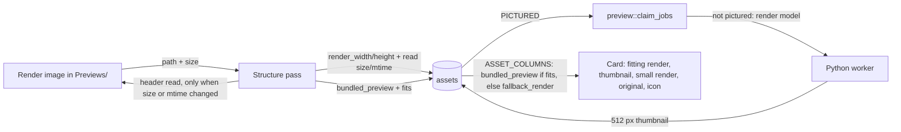

# Small bundled previews: render the model when its render is too small

Status: draft for review, 2026-10-19. Shaped in a three-round interview (D1-D12 below). Once this
plan merges, Mission Control slices it into tickets.

## Problem

Under plan C12 (`smarter-big-collections`), an image in a `Previews`, `Preview` or `Renders`
folder becomes its model's card image, and C15 keeps that model off the preview queue. Kenney's
renders are tiny:

- 3,741 of the 3,745 images in render folders under `~/Documents/Kenney/Assets` are **64x64**,
  across 45 kits. The other 4 (`Animated Characters Bundle/Preview/*.png`, 918x515) render no
  model.
- Cards are at least 180, 220 or 280 CSS px wide (`TILE_MIN`), use `object-fit: cover`, and
  pixelate enlarged images by default (`imageScaling: 'pixelated'`). So a 64 px render is
  enlarged 3 to 9 times and looks blocky.
- The worker's own render of the model is 1024x1024, stored as a 512x512 thumbnail
  (`THUMB_SIZE`).
- All 3,741 models with a bundled preview already have such a thumbnail on disk
  (`preview_status = done`), because they were rendered before C12. Members' thumbnails stay on
  disk. Only 1 is `none`. The golden bench snapshot is the same.

## Decisions

| # | Question | Answer |
|---|---|---|
| D1 | Cutoff | A render whose **shorter side is under 512 px** (`preview::THUMB_SIZE`) is too small. A render whose sides are both 512 px or more **fits**. Shorter side, because cards use `object-fit: cover`. |
| D2 | A setting? | No. A constant in Rust (the existing `THUMB_SIZE`). |
| D3 | What a too-small render becomes | It stays a hidden `model_preview` support file tied to its model. Delete, rename and Show hidden files work as today. Only the card stops preferring it, and the model goes back on the preview queue. |
| D4 | Format groups | The card shows the main item's rendered thumbnail, as for a group with no render (GLB > glTF > FBX > Blend > OBJ), with the usual stand-in when the main item takes no preview. When several renders match an item, the first by path that fits wins. A small render never beats one that fits. |
| D5 | Learning a render's size | The pass reads the header (`image::image_dimensions`) of only the images it makes `model_preview`. It caches width and height in `assets` columns with the file size and mtime it read them at, as it does for license files. A rerun reads only renders whose size or mtime changed. |
| D6 | Existing libraries | The pass's normal run at library open. Thumbnails already on disk are reused. No `library_meta` flag and no re-render. |
| D7 | Where the small render still shows | Only as the card and list-row fallback while the model has no thumbnail. The order is: render that fits > thumbnail > small render > original > icon. It does not go in the detail panel or the pack gallery. |
| D8 | Storing the tie | `bundled_preview` keeps naming the item's render. The render's cached size decides whether the card uses it. `ASSET_COLUMNS` sends a small render as a separate fallback field, not as `bundledPreview`. |
| D9 | Unreadable header | It counts as too small and records no read, so the next pass tries again, as with an unreadable license file. |
| D10 | Verification | Reproduce first. Flip U11 so that a Kenney model card must show its own 512 px thumbnail, run it on the unfixed code, and record it failing on the 64 px render. Then fix and show it passing. Add unit tests for the new card order, Rust unit tests, one `checks` run, and one timing run compared with the gpu-shm baseline. The golden snapshot is not re-warmed or replaced. Timing drift is reported, not re-baselined. |
| D11 | TS test runner | `bun:test`, in the existing `components/AssetGrid/tileState.test.ts`. The verify answer said `node:test`, but every TypeScript test here uses `bun:test` and CI runs only `bun test`. |
| D12 | Recording the change to C12/C15 | In this plan, plus the "Bundled previews" invariant in `CLAUDE.md`. `smarter-big-collections/plan.md` stays as history, unedited. |

## Supersedes

This plan narrows two contracts of `docs/plans/smarter-big-collections/plan.md`:

- **C12 (card order):** a render shows first only when it fits. A small render drops below the
  thumbnail, to fallback (D7).
- **C15 (queue skip):** the preview queue skips only models whose render fits. A model whose render
  is small is queued like any other item, and its group gets a stand-in when its main item takes no
  preview.

The rest of C12 is unchanged: which images are renders, their `model_preview` role, and the tie
recorded in `bundled_preview`.

## Behaviour

**C1. The fit rule.** A render fits when its cached width and height are both at least
`THUMB_SIZE` (512). No cached size (never read, or the read failed) means it doesn't fit (D1, D9).
Rust (`structure::derive`) and SQL apply this one rule. In SQL it is a single fragment, `PICTURED`,
true when an item's `bundled_preview` names a render that fits. It lives beside `MAIN_OR_SINGLE` in
`commands/asset.rs`, and `ASSET_COLUMNS` and `preview::claim_jobs` use it.

**C2. The size cache.** Four `assets` columns, written only by the structure pass, on the render's
own row:

- `render_width` and `render_height`, from the header;
- `render_read_bytes` and `render_read_mtime`, the `size_bytes` and `modified_at` they were read
  at.

The pass reads a render's header only when the render has no cached read, or when its size or
mtime differs from the read. Reads happen off the runtime, as license reads do. A failed read
sets all four columns to `NULL`, so SQL sees the render as too small and the next pass reads it
again. Writes go in 200-row transactions. A file that stops being a render keeps its stale
columns. They are harmless, because only a `bundled_preview` that names the file reads them.
`add_structure_columns` in `db.rs` adds the columns to existing libraries.

**C3. Which render an item names.** `bundled_preview` names the item's best render: the first by
path, ignoring case, among the renders that fit. When none fits, it names the first by path, as
today (D4, D8). `structure::derive` takes each render's cached size through a lookup, as it takes
license text. `rebuild` derives once with the cached sizes and notes the renders that need a read.
It reads those, then derives again, the same two steps it already uses for licenses. `Structure`
also says, for each item, whether its render fits.

**C4. The preview queue.** "Pictured" now means "has a render that fits":

- `structure::apply_previews` keeps only pictured items off the queue.
- `preview_stand_ins` skips only pictured groups.
- `claim_jobs` claims an item's job unless it is pictured, both in its own term and in
  `STANDS_IN`.

An item whose render is small and whose `preview_status` is `none` goes on the queue. One that
already has a thumbnail (`done`) keeps it, and nothing is re-rendered (D6).

**C5. What the backend sends.** `ASSET_COLUMNS` sends `bundled_preview` only when the item is
`PICTURED`. Otherwise it sends the render as `fallback_render`. In both cases the picture is the
render's own thumbnail if it has one, else the render itself. The Rust and TypeScript `Asset` both
gain `fallbackRender`.

**C6. The card order.** `tileMedia` picks `bundled` (a render that fits), then `thumbnail`, then a
new `fallback` (the small render), then `original`, then `video` or `none`. When one fails to load,
the tile falls back to the next in that order. Grid cards and list rows both use it.

- `tileImage` maps `fallback` to `fallbackRender`.
- `AssetCard` and `AssetListRow` reset their media when `fallbackRender` changes.
- `itemFileCount` counts the render when either field is set.
- `updateAssetPreview` patches cached items showing a finished render as `fallbackRender` the same
  way it already patches `bundledPreview`.

**C7. Unchanged.** These all behave as today:

- the `model_preview` role and Show hidden files;
- `item_files`, so delete and rename move the small render with its model;
- metadata writes, which skip the render;
- the detail panel, which never showed the render;
- the pack gallery.

**C8. Existing libraries.** On the first open after the upgrade, `add_structure_columns` adds the
columns. The pass at open reads the 3,745 render headers once, and its rerun reads none. On Kenney
that means 3,741 cards switch to the thumbnails already on disk, and 1 model is queued. A library
first indexed after C12 has `none` on those models, so they all get queued and rendered in the
background.

## Flow

Before this change the pass never opened a render, every item with a `bundled_preview` stayed off
the queue, and the card always showed the render first.

## Implementation (one pull request)

1. **Reproduce.** Flip U11 in `src/dev/uiChecks.ts` (around line 1347) first. Each Car Kit model
   card must show its own thumbnail (`src` is `asset.thumbnailPath`), loaded at 512 px or more on
   its shorter side. Run `BENCH_CHECKS=U11 apps/desktop/scripts/scroll-bench.sh checks` on the
   unfixed code and keep the failing report and screenshot.
2. **Schema.** Add the four C2 columns to `add_structure_columns` (`db.rs`) and to
   `migrations/002_library_schema.sql`.
3. **Pass.** In `structure.rs`, apply C3:
   - `derive` takes render sizes, picks renders by fit and reports fits per item;
   - `rebuild` reads stale headers off the runtime, then a new `apply_render_sizes` writes the C2
     columns;
   - `apply_previews` and `preview_stand_ins` use fits (C4);
   - the info log line gains render headers read and renders too small;
   - the module doc names the new columns.
4. **SQL.** Add `PICTURED` (C1) and use it in `ASSET_COLUMNS` (C5), in `claim_jobs` and in
   `STANDS_IN` (C4).
5. **Model.** Add `fallback_render` to `RawAssetRow`, `row_to_asset` and `models.rs`, and
   `fallbackRender?: string` to `types/index.ts`.
6. **Frontend.** Change `tileState.ts` (`tileMedia`, `tileImage`), the `AssetCard` and
   `AssetListRow` effect dependencies, `itemFileCount` in `format.ts`, and `updateAssetPreview`
   in `store/index.ts` (C6).
7. **Tests** (below), then **docs**:
   - the `CLAUDE.md` "Bundled previews" and "Structure is derived" invariants (the fit rule, the
     fallback and the new pass-written columns);
   - U11's text in `docs/agents/running-the-app.md`.

## Verification

- **Rust** (`cargo nextest run <filter>`):
  - `structure::tests`:
    - a 64 px render is still the item's `bundled_preview` but doesn't fit;
    - a fitting render beats a smaller one that sorts first;
    - a second `rebuild` reads no header, and one after a size or mtime change reads exactly that
      render;
    - an unreadable render doesn't fit, gets `NULL` sizes and is read again on the next pass;
    - a model whose render is small and that has no thumbnail is queued, one with a thumbnail is
      left alone, and one whose render fits stays off the queue;
    - a `.blend` group with a small render gets a stand-in.
  - `preview::tests`: `claim_jobs` claims a small-render item's job and still skips a fitting
    one's.
  - `commands::asset::tests`: `ASSET_COLUMNS` sends `bundled_preview` for a render that fits and
    `fallback_render` for a small one, and delete and rename still reach a small render.
  - Existing tests that expect a pictured item, such as
    `the_preview_queue_skips_members_and_models_with_a_bundled_preview` and
    `claiming_skips_a_job_for_an_item_with_a_bundled_preview`, seed a fitting cached size, so they
    keep testing a render that fits.
- **Golden** (ignored, needs a copy of the snapshot DB):
  `golden_snapshot_renders_are_the_bundled_previews_of_their_models`. Its first pass reads the
  3,745 headers within its 10 s bound, and the rerun reads none and writes 0 rows. All 3,741
  renders are tied and none fits. Every affected model has a thumbnail or waits for a job, which
  replaces today's "no model with one waits".
- **TypeScript** (`bun test`):
  - `tileState.test.ts` covers the full D7 order and each fallback step (D11);
  - `format.test.ts` covers `itemFileCount` with `fallbackRender`;
  - `assetStore.test.ts` covers `updateAssetPreview` patching `fallbackRender`.
- **Bench** (under `scripts/memory-cap.sh`, which the script applies itself, and only when
  `pgrep -f '^bash .*scroll-bench\.sh'` finds nothing):
  - U11 failing before the fix and passing after;
  - one full `checks` run;
  - one timing run, compared with `~/.cache/opendam-bench/kenney-golden-baseline-gpu-shm.json`.
  An OOM kill is a finding, not a flake.

## Acceptance criteria

- **A1:** On a copy of the golden snapshot, every Car Kit model card shows its own 512 px
  thumbnail, not the 64 px render. The flipped U11 fails on `main` and passes with the change.
- **A2:** A pass after the first reads no render header and writes 0 rows.
- **A3:** A model whose render is too small and that has no thumbnail is queued and gets rendered.
  Until then its card shows the small render, not an icon.
- **A4:** A render that fits is still the card image, and its model stays off the queue.
- **A5:** Delete and rename of a model still move its small render, and Show hidden files still
  shows it.
- **A6:** The full `checks` run passes. The timing run is reported against the gpu-shm baseline
  with any drift explained.

## Known gaps and trade-offs

- **More renders in fresh libraries.** A Kenney library indexed from scratch now renders the 3,741
  models that C15 used to skip.
- **A fitting render still shows by its own thumbnail,** at most 512 px on its longer side, as
  today. A wide render that fits can therefore be under 512 px tall on a card.
- **Unreadable renders are re-read on every pass** until they can be read, as unreadable license
  files are.
- **The bench never exercises the fallback.** Every Kenney model already has a thumbnail, so only
  unit tests cover the small-render fallback.
