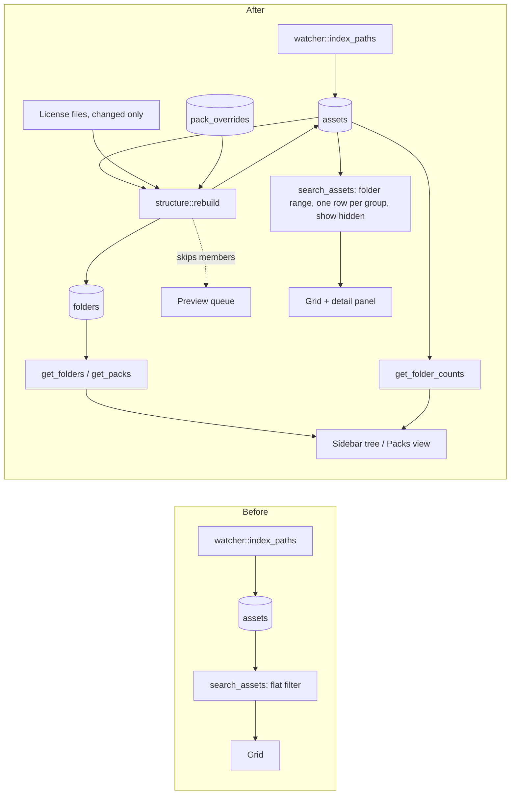

# Smarter big collections: folder tree, packs and grouped files

Status: approved 2026-10-18. Shaped in a four-round interview (D1-D23) and approved at review, where
you kept the Readme refinement to D9. Once this plan merges, Mission Control slices it into
dependency-linked tickets.

Revised 2026-10-18 after Plan Validation repair round 1. These close gaps inside the approved
decisions. No decision changed:

- **Tagging a model reaches three files, not four.** The bundled preview is a support file, not a
  group member, so metadata writes skip it (C20). Only delete and rename include it (C21). Step 3's
  check now says three files for tagging, and four for rename.
- **Packs whose files are all hidden.** A folder gets a row when at least one indexed file lies below
  it, hidden support files included.
  - The 11 zip-only folders in `Archive/` have no indexed file, so they get no row and appear nowhere.
  - 24 of the 254 packs hold only hidden files, and they show as cards labelled "No visible items"
    (C16, C17).
- **Step 2 adds what it needs.** Step 2 needs the `support_role` column and the support-file half
  of the grid rule, with `showHidden`, so it now adds them itself. Step 3 adds `group_id`,
  `bundled_preview` and the group half (C4, C5).
- **The items-and-files status bar (C24) lands in step 2,** which is where the two numbers first
  differ.

## Problem

Your one library, `~/Documents/Kenney/Assets` (the Kenney All-in-1 bundle), shows as one flat grid
of 83,095 files. Its structure is lost:

- **No folders or packs.** About 250 packs sit under folders such as `3D assets/Platformer Kit/`,
  but the sidebar shows only the library root, and nothing marks where a pack starts.
- **Every 3D model appears four times.** Each one ships as `.glb`, `.fbx` and `.obj`, plus Kenney's
  own render in `Previews/<name>.png`. That makes 18.6k model files for about 5.5k models.
- **Pack files show as assets.** `License.txt`, `Preview.png` and `Sample.png` appear among the
  assets in the grid.
- **2D packs repeat images.** The same sprite ships at several scales (`Default`, `Double`,
  `Retina`) and as PNG and SVG.

## What OpenDAM offers today

OpenDAM treats a library as a flat catalog. Paths below are relative to `apps/desktop/src-tauri/`
and `apps/desktop/src/`.

- **Indexing:**
  - Indexing walks every subfolder (`watcher.rs:191-201`), but the structure survives only as each
    row's relative `file_path`.
  - There is no folder, pack or parent column (`migrations/002_library_schema.sql:26-42`).
  - The `dir_mtimes` table exists, but nothing reads or writes it.
- **Sidebar:** lists library roots only (`LibrariesSection.tsx:131-183`). There is no folder tree,
  breadcrumb or per-folder count.
- **Folder filter:** the only folder-aware tool is the Smart Filter's "Directory Path" field.
  - It runs a substring `LIKE '%dir%'` (`asset.rs:465-467`).
  - Its Browse button stores an absolute path that never matches the relative paths
    (`SmartFilterModal.tsx:125-129`).
  - `isFilterEmpty` ignores the field (`sidebarHelpers.ts:45-57`).
- **Search:** indexes `file_name`, `description` and `metadata` only, so "platformer" doesn't find
  files under `Platformer Kit/`.
- **Collections:** can nest (`parent_id`), but you fill them one card at a time by drag or from the
  detail panel. There is no bulk add.
- **Tags:** tags have a `parent_id`, but the sidebar shows them as a flat list. You have no tags or
  collections yet.
- **Siblings and duplicates:** there is no concept of either. License, preview and sample files are
  indexed as ordinary assets.
- **Auto-tagging:** sees each file's relative path (`autotag/provider.rs:34-42`), but a run can't be
  scoped to a folder.
- **Detail panel:** shows the absolute path and "Reveal in file manager".

## How other tools handle it

The full research notes, with a source for every claim, are in [Research sources](#research-sources).

| Tool | What it does with nested collections |
|---|---|
| Eagle | Imports a folder tree as folders. "Show subfolder content" is a per-folder toggle, off by default. Auto-tags whatever is added to a folder. Has smart folders and folder covers. |
| Lightroom Classic, Bridge | Folder tree with counts. "Show items from subfolders" is a flat view. **Stacks** collapse variants behind a count badge, and a RAW+JPEG pair shows as one item. |
| Blender Asset Browser | Hierarchical catalogs, independent of disk. Selecting a catalog also shows its child catalogs' assets. |
| Asset Inventory (Unity) | The closest match. It turns folders into **packages** by depth (root, first or second level) and shows package cards with a cover and license, with sidecar overrides. A "hierarchy browser" counts the results per package, folder and type. |
| AssetHoard | Collapses **variants** into one tile and tracks a license per pack. |
| Allusion | A folder in the tree acts as a search filter you can combine with tags, and you can exclude subfolders. |
| Unity "My Assets", Fab | The pack or product is the unit: a cover, the formats it includes, its license, and a contents browser. |

No tool found detects packs from marker files such as `License.txt`. The rule below is our own,
kept simple and backed by manual overrides.

## What the rules do to your library

A read-only simulation of this plan's final rules over your live library DB (0.7 s in Python):

| Rule | Result |
|---|---|
| Files indexed today | 83,095 |
| Packs detected (C8) | **254**, all at `<category>/<pack>/`. `Goodies/Wallpapers` is correctly not a pack, and no category folder is one. 24 of the 254 hold only hidden files (C17). |
| Format groups (C11) | 5,515 groups covering 18,828 files. This includes the `Models/*/Textures/colormap.png` copies. |
| Bundled model previews (C12) | All 3,741 `Previews/*.png` files match a model in the same pack. |
| Pack cover images and docs (C10) | 506 images, 297 docs |
| 2D stacks of scale and format copies (C13) | 9,998 stacks covering 24,097 files |
| **Grid items at the library root** | **51,139** (from 83,095) |

Two rules were rejected, because the simulation showed them misfiring:

- **Every same-named image in a pack as one stack.** `Tiles/tile_0000.png` and
  `Tiles/Characters/tile_0000.png` are different pictures.
- **Readme files as pack markers.** `Archive/` and `Early access/` each hold only a `Readme.txt`.
  As markers they would turn both category folders into single packs and swallow the six packs
  inside them that have indexed files. This refines D9 (see below).

## Decisions

D1-D4 come from round 1 of the interview, D5-D17 from round 2, D18-D21 from round 3, and D22-D23
from round 4.

| # | Decision | Your answer |
|---|---|---|
| D1 | Scope of this plan | Folder tree, auto-detected packs, hidden pack support files, search on folder names, one item per model across formats, facet counts, 2D variant stacks, actions on a whole folder or pack. Not included: turning folder names into tags or collections. |
| D2 | Structural model | One folder tree that mirrors disk. Folders detected as packs carry pack info. |
| D3 | Collections the rules must handle | Kenney (All-in-1 and single packs), Quaternius/KayKit/itch packs, Synty and Unity/Unreal store exports, Poly Haven-style single assets. |
| D4 | How you update the bundle | You extract over the same folder, so packs, groups and overrides are identified by relative path. |
| D5 | Packaging | One plan, built in ordered steps that each ship alone. |
| D6 | Where the tree lives | Under each library: the library row expands into its folders. |
| D7 | Selecting a folder | Shows everything below it, recursively, with no toggle. |
| D8 | Folders that contain packs | Show pack cards, with a Packs/Assets toggle. A search shows assets. |
| D9 | Pack detection | Marker files, plus the sibling rule, plus manual "Mark as pack" / "Not a pack". The outermost marked folder wins. **Refinement from the simulation:** a Readme doesn't mark a pack (C8). It is still a support file inside one. |
| D10 | What a pack shows | Cover, a gallery of its Preview and Sample images, its parsed license with a button to open the file, Kenney-style name, version and author, counts by kind and total size, and an editable name, license, source URL and cover. |
| D11 | Support files | Hidden from the grid and shown on the pack. A "Show hidden files" filter reveals them. |
| D12 | A format group's main item | Chosen in the fixed order GLB > glTF > FBX > Blend > OBJ > others. A group matches a format filter if any member does. |
| D13 | Which 2D variants stack | Scale copies (`Default`/`Double`/`Retina`/`1x`/`2x`/`HD`/`(2×)`) and format copies (PNG vs Vector/SVG). Style and color variants stay separate. |
| D14 | Reaching group members | The detail panel lists them, with thumbnails. Click one to view it. |
| D15 | Facet counts | Shown in the existing sidebar. While a search or filter is on, the tree and the Types and format filters show result counts. |
| D16 | Folder and pack actions | Auto-tag, add everything to a collection, add a tag to everything, reveal in file manager. |
| D17 | Search and folders | Each asset's folder path is indexed. |
| D18 | Metadata on a group | Tags, ratings, favorites and collections go to every member file. Auto-tag sends only the main item. |
| D19 | Pack card clicks | A click selects the card and shows the pack's info. Double-click or Enter opens the pack. |
| D20 | Packs view scope | Every pack below the selected folder, flat and sorted by name, with its category as a subtitle. |
| D21 | Tree depth | Every folder, including those inside packs. Pack nodes start collapsed. |
| D22 | Delete and rename on a group | Apply to every member file plus the bundled preview. The confirm dialog says how many files. |
| D23 | Filters in the Packs view | Any active filter switches to Assets, as search does. Clearing it returns to Packs. |

## Choices this plan makes on its own

These weren't asked in the interview. They follow from the decisions or the code. Change any of
them at review.

| # | Choice | Why |
|---|---|---|
| C1 | **Structure is derived data, recomputed by one pass after every index run.** `structure::rebuild` runs at the end of `watcher::index_paths` (at startup, on add and on refresh), under the same index lock. It reads every asset row, derives folders, packs, groups and roles in memory, and writes only the rows that changed. | No second disk walk: the paths are already in the DB. Existing libraries get their structure on their next open with no backfill flag. A rerun on unchanged files writes nothing. |
| C2 | **The derivation is a pure function,** `structure::derive(rows, overrides, license_texts) -> Structure`. A thin `structure::apply` diffs the result against the DB and writes it in 200-row transactions. | The rules can be tested on plain path lists modeled on each source in D3, with no database. Writes follow the batched-writes invariant. |
| C3 | **New tables.** `folders(path PK, parent_path, name, is_pack, item_count, hidden_count, pack_json)` is derived and rewritten by the pass. `pack_overrides(path PK, mark, name, license, source_url, cover_path, updated_at)` is your data, and the pass never deletes it. The library root is the row with `path = ''`, so a library that is itself one pack works. | Derived and user data stay apart. Because overrides are keyed by relative path, an in-place update (D4) that removes a folder and brings it back keeps its edits. |
| C4 | **New asset columns.** `group_id` holds the main item's id on every member, the main item included, and is `NULL` for a file on its own. `support_role` is one of `doc`, `cover` or `model_preview`, or `NULL`. `bundled_preview` is the relative path of a matched render. They are added with idempotent `ALTER`s in `connect_library_sqlite`, following `add_tag_description_column`: they fail loudly unless the column is already there. `support_role` arrives in step 2, `group_id` and `bundled_preview` in step 3. Indexes are chosen with `EXPLAIN QUERY PLAN` in the step that adds each column. | Grouping and hiding live on the rows the windowed grid already pages through, so pages by index, sorting and the page cache work unchanged. |
| C5 | **Grid visibility.** The grid shows a row when `(group_id IS NULL OR group_id = id)` and `support_role IS NULL` both hold. With "Show hidden files" on, the `support_role` condition is dropped. Members never appear in the grid, even with that filter on. Step 2 adds the `support_role` half, with `showHidden` in `search_filter`, and step 3 adds the group half. | One grid item per group. The filter (D11) reveals support files, not group members. |
| C6 | **Matching a group.** File-level filters (kind, extension, folder, name prefix and suffix) match a group if any member matches, through `EXISTS (... m.group_id = a.id ...)`. Metadata filters read the main item, since D18 keeps members equal. Search text matches the main item's index row, because members share its name. Sort keys come from the main item. | This applies D12's "any member matches a format filter" to every file-level filter, so selecting `Models/FBX format/` still shows the kit's models. |
| C7 | **Folder filter.** `SearchQuery.folder = { libraryId, path }` becomes the range `file_path >= 'p/' AND file_path < 'p0'` on the unique `file_path` index. The Smart Filter's `directory` field becomes this prefix-anchored relative path. Its Browse button strips the library root, which fixes the absolute-path bug, and `isFilterEmpty` counts the field. | A range uses the index and needs no `LIKE` escaping. No smart filters exist on this machine, so changing the field's meaning breaks nothing. |
| C8 | **The pack rule, in order:**  1. A folder is **marked** if a doc (`txt`, `md`, `pdf`) or an image directly inside it has a stem starting with `license`, `licence`, `preview` or `sample` (case-insensitive).  2. The outermost marked folder is the pack.  3. **Sibling rule:** a folder that isn't inside a pack is also a pack when its parent has at least 2 pack children and packs are more than half of its child folders.  4. Overrides apply last. "Mark as pack" always wins, and can nest a pack inside a pack. "Not a pack" removes a detection. | This is D9 with the refinement the simulation forced: Readme files don't mark a pack. It yields 254 packs on your library, with no false category packs. |
| C9 | **Pack info is computed by the pass.**  - **Cover:** override > `Preview*` > `Sample*` > the pack's first image by path.  - **Gallery:** every `cover`-role image.  - **License:** the first `License*` file, which the pass reads only when its size or mtime changed. It recognizes CC0, CC-BY, CC-BY-SA, MIT, Apache-2.0 and OFL by URL or name, and anything else shows as "unknown".  - **Header:** the Kenney header gives the name and version from line 1 (`Car Kit (3.1)`) and the author from `Created/distributed by ...`.  - **Name shown:** override > header > folder name.  - **Counts:** by kind, plus total size, over every file in the pack. | This is D10. Reading only changed license files keeps reruns free of disk reads, which matters on network shares. |
| C10 | **Support roles.** In a pack root, or in any marked folder inside a pack, docs get `doc` and `Preview*`/`Sample*` images get `cover`. Bundled renders get `model_preview` (C12). | This is D11. A Readme inside a pack is still hidden as a doc. |
| C11 | **Format groups.**  - **3D models:** grouped when the lowercase stem is equal and so is the directory once format folders are removed. Format folders are one case-insensitive table: `glb`, `gltf`, `fbx`, `obj`, `blend`, `dae`, `stl`, `3ds`, `usd`, `usdz`, `ply`, each with an optional ` format` or ` files`, plus `fbx(unity)` and `fbx (unity)`. Files in the same folder with the same stem group as well.  - **Main item:** by D12's order, with ties broken by path, NOCASE.  - **Non-model files under format folders:** grouped by equal stem and extension. This collapses the three `colormap.png` copies, and the copy under the highest-priority format folder becomes the main item. | This covers Kenney (`Models/GLB format/`), Quaternius (`<Ship>/FBX/`), KayKit (`Assets/gltf/`, `fbx(unity)`) and Poly Haven (`<slug>_1k.gltf` next to `<slug>_1k.fbx`). Retro Fantasy Kit's `GLTF format/` folder holds `.glb` copies, and the tie-break makes that harmless. |
| C12 | **Bundled previews.** An image in a folder named `Previews`, `Preview` or `Renders` is a model's preview when a model below that folder's parent has the same stem. The image gets `model_preview`, and that model's main item gets `bundled_preview`. Cards pick their picture in this order: `bundled_preview` > `thumbnail_path` > the original (the existing rule by extension). | Kenney's renders are free and better than ours. The preview queue skips these models (C15). |
| C13 | **2D stacks.**  - **Who stacks:** images (kind `texture` or `image`) that are not grouped, not support files, and have an equal lowercase stem and an equal directory once scale and format folders are removed.  - **Scale and format folders:** one table, `Default`, `Default size`, `Double`, `Retina`, `HD`, `1x`-`4x`, `x2`, `PNG`, `SVG`, `Vector`, `Vectors`, each with an optional parenthesized note (`Default (64px)`, `Large (2×)`). A trailing ` X2`, ` HD` or ` (2×)` is also stripped from a folder name (`Sprites X2`, `Poses HD`).  - **Main item:** a PNG before other formats, then the default scale (no scale folder, `Default`, `Default size`, `1x`) before larger ones.  - They reuse `group_id`. | This is D13. Style and color folders are not in the table, so `Dark`/`Light` and `Blue`/`Red` stay separate items. |
| C14 | **Metadata when a group forms or grows.** Every member receives the union of the group's tags and collections, plus the main item's rating, color label, favorite and description. A dissolved group's files keep what they had. | This is D18. No tag is lost when a new format joins, or when the main item changes after an update. |
| C15 | **The preview queue skips non-main members and models with a bundled preview.** It leaves them at `preview_status = 'none'`. Members' existing rendered `_thumb` files stay on disk. A member that becomes a main item without a picture gets a job from the pass. | This saves about 13k renders on a fresh index of a library like yours. Thumbnail deletion stays limited to `owned_thumb_file`. |
| C16 | **Tree.**  - `get_folders(libraryId, parentPath)` returns the children of one node: name, path, `isPack`, item and hidden counts, `hasChildren` and cover, sorted NOCASE.  - Nodes load lazily as they expand. Expanded nodes are kept per library for the session and refetched on `library:updated`.  - Pack nodes get a pack icon and start collapsed. Folders with no visible items hide unless "Show hidden files" is on, but pack nodes always show.  - The selected folder goes into `SearchQuery.folder`, and the status bar shows its path. | This is D6, D7 and D21. Lazy loading keeps a 2,234-folder tree cheap. |
| C17 | **Packs view.**  - **The toggle:** a Packs/Assets toggle in the toolbar appears when the selected node has packs below it, and starts on Packs. Any search text or filter shows Assets (D23), and clearing it returns to the toggle's state, which lasts the session.  - **Data:** `get_packs(libraryIds, underPath)` returns the packs flat, NOCASE by name, each with its parent folder path as the subtitle (D20).  - **Rendering:** a windowed grid of pack cards in `components/AssetGrid/`. A pack whose files are all hidden still shows, labelled "No visible items". On your library that is 24 of the 254: 16 Audio packs (audio isn't indexed), 5 `Isometric Miniature *` packs (a `.zip` plus previews) and 3 under `Other/`. Folders with no indexed file at all have no row, so they never show. | 254 cards load at once, with no paging. Living in `AssetGrid/`, the cards are covered by `gridStyles.test.ts`, so no `backdrop-filter` gets in. |
| C18 | **Pack detail.**  - **Clicks:** a click on a pack card selects it, and the detail panel shows the pack. Double-click or Enter selects the pack in the tree (D19).  - **Inside a pack:** with no asset selected, the panel shows that pack.  - **Contents:** cover, gallery, license with "Open license", header fields, counts and size, and source URL with "Open".  - **Editing:** an edit form for name, license and source URL. "Use as pack cover" in the context menu of any image inside a pack sets the cover override. | This is D10 and D19. Every edit writes `pack_overrides`. |
| C19 | **Group card and group detail.**  - **Card badge:** a corner badge shows the formats of a 3D group (`GLB +2`, with every format in its tooltip) or the member count of a 2D stack (`x3`). The badge has a solid background.  - **Detail panel:** lists the members with format, folder and size, plus Open, Reveal and Copy path. 2D members show their image.  - **Members:** clicking one shows its file details with "Back to group", while the grid selection stays on the card.  - **Main item:** Open, drag-out and QuickLook on the card use it. | This is D14. Nothing expands inside the grid, so indices never shift. |
| C20 | **Group writes.** Every command that writes metadata expands the asset id to its members in the same transaction, through one helper, `group_members(pool, id)`. That covers `update_asset` (rating, color label, favorite, description), tag and collection add and remove, and auto-tag apply. The bundled preview is a support file, not a member, so these writes don't reach it. Only delete and rename include it (C21). | This is D18, which gives metadata to every member file. |
| C21 | **Delete and rename on a group.**  - **Delete:** one confirm dialog ("Move 4 files to the trash"), then every member and the bundled preview go to the trash. A trash failure stops there and reports which files remain, as `delete_asset_with` does for one file.  - **Rename:** every member and the bundled preview take the new stem, each keeping its extension and folder. A pre-check refuses if any target exists, and a failure midway reverts the renames already done. | This is D22. |
| C22 | **Folder and pack actions.** The context menu of a tree node or pack card offers:  - **Auto-tag:** `AutotagScope` gains `{ kind: 'folder', libraryId, path, allAssets }`. The run covers the visible items below the folder (main items and single files, not support files), and only untagged ones unless `allAssets` is set, as the library scope does.  - **Add everything to a collection, Add a tag to everything:** new bulk commands that take `(libraryId, folderPath)` and write every file below, members included, in 200-row transactions.  - **Reveal in file manager:** the existing opener. | This is D16. |
| C23 | **Live counts.**  - **When:** while search text or any filter is active.  - **Tree:** `get_folder_counts(query, libraryId, parentPaths)` returns, for the children of each expanded node, the number of matching visible items. It uses the same `SqlFilter` plus a `GROUP BY` on the child path segment.  - **Types and formats:** the sidebar's Types filter and the FilterBar's format filter get one `GROUP BY kind` and one `GROUP BY extension`.  - **Display:** folders with zero matches dim. Counts are computed once per query, like the total. | This is D15. Counts follow the same visibility and group rules as the grid, so they always add up. |
| C24 | **Status bar.** It shows items and files, `51,139 items (83,095 files)`, and the footer's visible range counts items. Step 1 adds the selected folder's path. Step 2 adds the items-and-files count and the footer change, and steps 3 and 4 lower the item count. | Once support files are hidden, the two numbers differ, and both are useful. |
| C25 | **Several libraries.** The tree is per library. "All libraries" shows the Packs view across every library that has packs. A folder filter always names one library. | This keeps the existing rule that every caller names a library or iterates all of them. |
| C26 | **"Show hidden files"** is a checkbox in the sidebar's Filters section (`FilterSpec.showHidden`). It counts as a filter, so it switches the Packs view to Assets. | You turn it on to see files, so Assets is the useful view. |

## Design

### Data flow

The structure pass is a new stage between indexing and every read. Queries gain a folder range, the
group visibility rule and three new commands.

### The structure pass (`src/structure.rs`)

1. **Read.** One query returns every asset row: `id, file_path, extension, kind, size_bytes` and its
   current `group_id, support_role, bundled_preview`. A second query returns `pack_overrides`.
2. **Derive** (C2). Each step reads only the results of the steps before it:
   1. **Folders:** every ancestor of every `file_path`, plus the root. A folder gets a row when at
      least one indexed file lies below it, hidden support files included. Folders with no indexed
      file at all, such as the 11 zip-only folders in `Archive/`, get no row and appear nowhere.
   2. **Packs** (C8), then **pack info** (C9), which reads the license files that changed.
   3. **Support roles** (C10).
   4. **Format groups** (C11), then **bundled previews** (C12).
   5. **2D stacks** (C13).
   6. **Counts:** `item_count` and `hidden_count` per folder, recursive.
3. **Apply.** The pass diffs against the current rows and writes only what changed, in 200-row
   transactions:
   - the asset columns;
   - `folders`, by upsert and delete;
   - group metadata unions (C14);
   - preview jobs for new main items that have no picture (C15).

   The caller already emits `library:updated`, which refreshes the grid.

### Search backend (`commands/asset.rs`, `migrations/002_library_schema.sql`)

- **`search_filter`:** gains the visibility rule (C5), the folder range (C7) and any-member
  matching for file-level filters (C6). Every `ORDER BY` keeps its `a.rowid` tie-break, and the
  multi-library merge is unchanged.
- **FTS** (D17):
  - `assets_fts` gains `file_path`, so the tokenizer indexes folder names.
  - The `AFTER UPDATE` trigger narrows to `UPDATE OF file_name, description, metadata, file_path`,
    so the pass's column writes never touch the full-text index.
  - Existing libraries rebuild the index once, recorded in `library_meta` as `fts_file_path`.
- **New commands:** `get_folders`, `get_packs`, `get_folder_counts`, `set_pack_override`, the
  group-aware `delete_assets` and `rename_asset`, and the bulk folder commands from C22.

### Frontend

- **`LibrariesSection.tsx`:** the library row expands into the tree (C16). `useAssetStore`'s query
  gains `folder` and `showHidden`, and changing either refetches, as a filter change does today.
- **New view:** `PacksView` in `components/AssetGrid/`, plus the toolbar's Packs/Assets toggle
  (C17).
- **`DetailPanel`:** gains a pack mode (C18) and a group section (C19).
- **`AssetCard` and `AssetListRow`:** show the group badge and choose their picture in C12's order.
- **`SmartFilterModal`:** gets the relative folder field with a working Browse button (C7).

## Steps

Each step ships alone and leaves the app working. D5 fixed the order.

### Step 1: Folders, tree and folder search

Covers D6, D7, D17, D21, C1-C3 (folders only), C7, C16, C24 (folder path) and C25.

- Add `structure.rs` with folders and counts only. Every file counts as one item in this step.
- Add the `folders` table and `get_folders`.
- Build the tree under each library row, with the selected folder in the query and its path in the
  status bar.
- Add the folder range filter, and fix the Smart Filter's Directory field.
- Index `file_path` in FTS, with the narrowed trigger and the one-time rebuild.

**Done when:** the steps below work on a copy of the golden snapshot.

- The library row expands into its top-level folders.
- Selecting `3D assets/Platformer Kit` shows exactly the files whose path starts with it, checked
  against a SQL count.
- A search for "platformer" returns files from every pack with "Platformer" in its folder name.
- UI check U9 passes.

### Step 2: Packs and support files

Covers D8-D11, D19, D20, D23, C3 (overrides), C4 (`support_role` only), C5 (the `support_role`
half), C8-C10, C17, C18, C24 (items and files) and C26.

- Add the `support_role` column, plus the support-file half of the grid rule, with `showHidden`
  in `search_filter`.
- Detect packs, parse pack info and set support roles.
- Add `pack_overrides` with the "Mark as pack" and "Not a pack" menu items.
- Add the "Show hidden files" filter.
- Build the Packs view with its toggle, the pack cards and the pack detail.
- Show items and files in the status bar, and count items in the footer's range.

**Done when:**

- The library root's Packs view shows 254 cards with covers. That includes the 24 packs whose
  files are all hidden, which are labelled "No visible items". The 11 zip-only folders in
  `Archive/` don't appear.
- `License.txt` and `Preview.png` no longer appear in the grid, and "Show hidden files" brings them
  back.
- Editing a pack's name survives a refresh.
- UI check U10 passes.

### Step 3: Format groups and bundled previews

Covers D12, D14, D18, D22, C4 (`group_id`, `bundled_preview`), C5 (the group half), C6, C11, C12,
C14, C15 and C19-C21.

- Add the `group_id` and `bundled_preview` columns and group derivation, and match bundled
  previews.
- Apply the group half of the visibility rule and the any-member rules in `search_filter`.
- Add the card badge and the detail panel's member list.
- Make group writes expand to members, union metadata when groups form, and add group delete and
  rename.
- Make the preview queue skip members and models with a bundled preview.

**Done when:**

- Each Kenney kit model shows once, as GLB, with Kenney's render.
- Filtering by FBX still lists the models.
- Tagging a model tags its three format files (GLB, FBX, OBJ). The bundled preview isn't a member
  and gets no tag (C20).
- Renaming a model renames all four files, its bundled preview included (C21).
- UI check U11 passes.

### Step 4: 2D stacks

Covers D13 and C13. It reuses step 3's group machinery.

**Done when:**

- UI pack sprites show once each, with an `x3` badge where they ship as `Default`, `Double` and
  `Vector`.
- `Tiles/tile_0000.png` and `Tiles/Characters/tile_0000.png` stay separate.
- The library root shows 51,139 items (A3).
- UI check U12 passes.

### Step 5: Live counts

Covers D15 and C23. It needs step 1. It uses the same visibility rule, so the counts stay right as
steps 3 and 4 land.

**Done when:**

- A search for "tree" shows counts on the expanded tree nodes and on the Types and format filters.
- Every count equals the grid's total for that folder or type.
- UI check U13 passes.

### Step 6: Folder and pack actions

Covers D16 and C22. It needs step 1 for folders and step 3 so group writes reach every member.

**Done when:**

- Each action works on a pack from its context menu: auto-tag, add to collection, add tag and
  reveal.
- A folder auto-tag run queues one item per group.

## Acceptance targets

All measured on a fresh copy of the golden snapshot (`docs/agents/running-the-app.md`, "Bench
data"). Never on the live library.

| # | Target |
|---|---|
| A1 | **Pass speed:** the first structure pass, writes included, finishes in under 10 s. A rerun with no file changes writes 0 rows and finishes in under 2 s. |
| A2 | **Packs:** 254 packs are detected, all at `<category>/<pack>/`, including the 24 whose files are all hidden. No category folder is a pack. |
| A3 | **Grid items:** the library root's Assets view shows 51,139 items. If a rule is tuned, the pull request explains the new number. |
| A4 | **Previews:** all 3,741 Kenney renders are bundled previews, and no `Previews/` file shows in the grid without "Show hidden files". |
| A5 | **Query speed:** the first page of the library root, and of `3D assets`, takes no more than 1.2x today's time for the same query, as logged by a debug-only timer around `search_assets`. `get_folders` takes under 50 ms for any node, and `get_folder_counts` under 300 ms for a one-word search. |
| A6 | **No regressions:** the scroll bench's UI checks (U1-U8) and its memory check (M1) still pass. The timing scenarios' p95 frame interval stays within 10% of the latest report. |
| A7 | **New UI checks:** U9-U13 pass, with screenshots in `.evidence/scroll-bench/`. |

## Tests

Run by file locally, as `AGENTS.md` says. CI runs the rest.

- **`structure.rs` unit tests** run on plain path lists, with no DB (C2). There is one fixture per
  layout in [Research sources](#research-sources):
  - Kenney 3D kit, Kenney 2D in the current and old styles, and the UI pack.
  - `Archive/` and `Early access/`, which hold only a Readme.
  - Holiday Pack 2016, whose inner Readmes must not split it.
  - Quaternius per-model folders, and KayKit with `fbx(unity)`.
  - A Poly Haven asset, and a Synty-like export with no markers (the sibling rule).
  - Overrides, including a nested "Mark as pack".
  - Retro Fantasy Kit's `GLTF format/` folder of `.glb` copies.
  - The `tile_0000.png` names that must not stack.
- **`asset.rs` search tests** use `db::memory_library_pool()`. They cover:
  - the folder range;
  - any-member matching for extension and folder;
  - members never shown, and support files shown only with `showHidden`;
  - FTS on folder names;
  - sorting by the main item.
- **Group write tests:**
  - `update_asset` and tag and collection writes reach every member, and not the bundled preview.
  - The union when a group forms.
  - Delete and rename of every member, the rename's pre-check, and its rollback on a failure.
- **License parsing** runs on Kenney, KayKit and MIT texts.
- **TypeScript tests:**
  - the Packs/Assets switching rule (D23);
  - `isFilterEmpty` with `folder` and `showHidden`;
  - the tree store's lazy loading and its refetch on `library:updated`.
- **UI checks U9-U13** in `src/dev/uiChecks.ts`, one per step's "done when".

## Docs and invariants

New `AGENTS.md` architecture invariants:

- **Structure is derived.**
  - `folders` and the asset columns `group_id`, `support_role` and `bundled_preview` are recomputed
    by `structure.rs` after every index run.
  - Your edits live only in `pack_overrides`, keyed by relative path. Never write derived columns
    anywhere else.
- **One grid item per group.**
  - The grid shows main items and single files, never members, and support files only with "Show
    hidden files".
  - File-level filters match a group if any member matches.
  - Metadata is equal across members, so every metadata write goes through `group_members`.

`docs/agents/running-the-app.md` lists U9-U13.

## Risks and known gaps

- **Heuristics misfire on new layouts.** "Mark as pack" and "Not a pack" are the escape hatch, and
  each misfire found becomes a fixture.
- **Zip-only packs are invisible.** 11 folders in `Archive/` hold only a `.zip`, and archives
  aren't indexed, so these folders get no row. Some packs hold a `.zip`, audio, fonts or Construct
  projects next to their previews: the 5 `Isometric Miniature *` packs, the 16 Audio packs, and 3
  packs under `Other/`. They show as cards labelled "No visible items", because their only indexed
  files are hidden previews and docs.
- **The first pass on a network share writes about 45k rows,** and the FTS rebuild rewrites the
  whole index once. Both run in the background, in batches.
- **Metadata unions can surprise.** A tag added to `barrel.fbx` before grouping existed appears on
  the GLB too (C14).
- **A group rename isn't atomic if the app is killed midway.** The renames done so far stay, and
  the next index run regroups whatever it finds.
- **Some variants aren't grouped:** Poly Haven resolutions (`_1k`, `_2k`) and texture map sets
  (diffuse, normal, roughness).

## Out of scope

- Turning folder or pack names into tags or collections (D1).
- An ignore or exclude list for folders.
- Indexing inside archives.
- Style and color stacks (D13).
- Slicing spritesheets.
- A separate facet panel (D15).
- Natural sort.
- Live filesystem watching.
- Reading Kenney's `assets.json`. The generic rules already find all 254 packs.

## Research sources

Gathered 2026-10-18:

- **Kenney layouts** come from four zips, downloaded and listed, plus your live library.
- **Quaternius** layout comes from one zip from the OpenGameArt mirror.
- **KayKit** layout comes from its GitHub mirror.
- **Poly Haven** layout comes from its public API.

- Eagle: [importing](https://docs-en.eagle.cool/article/521-importing-files),
  [sidebar](https://docs-en.eagle.cool/article/475-interface-sidebar),
  [subfolder contents](https://docs-en.eagle.cool/article/812-show-subfolder-contents),
  [auto tagging](https://en.eagle.cool/article/494-auto-tagging),
  [smart folders](https://docs-en.eagle.cool/article/559-smart-folders).
- Adobe: [Bridge views](https://helpx.adobe.com/bridge/using/view-files-bridge.html),
  [Lightroom stacks](https://helpx.adobe.com/lightroom-classic/desktop/organize-photos-in-lightroom-classic/grouping-photos-stacks.html),
  [RAW+JPEG](https://helpx.adobe.com/lightroom-classic/desktop/import-photos/file-import-formats-settings.html).
- Blender: [catalogs](https://docs.blender.org/manual/en/latest/files/asset_libraries/catalogs.html),
  [asset browser](https://docs.blender.org/manual/en/4.4/editors/asset_browser.html).
- Unity: [package import](https://docs.unity3d.com/Manual/upm-ui-import). Epic:
  [Fab window](https://dev.epicgames.com/documentation/en-us/unreal-engine/fab-window-in-unreal-engine).
- Asset Inventory: [user guide 4.9.0](https://www.wetzold.com/tools/assetinventory/documentation.pdf).
  AssetHoard: [site](https://assethoard.com). Allusion:
  [source](https://github.com/allusion-app/Allusion). TagSpaces:
  [folder customizations](https://docs.tagspaces.org/tutorials/folder-customizations/).
- Kenney: [3D import advice](https://kenney.nl/knowledge-base/game-assets-3d/importing-3d-models-into-game-engines),
  [All-in-1](https://kenney.itch.io/kenney-game-assets). KayKit:
  [City Builder Bits](https://github.com/KayKit-Game-Assets/KayKit-City-Builder-Bits-1.0).
  Poly Haven: [files API](https://api.polyhaven.com/files/wooden_table_02).
