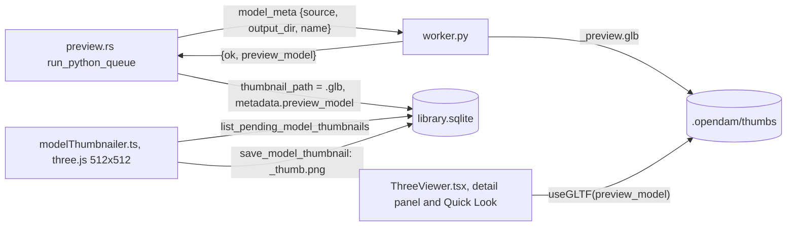
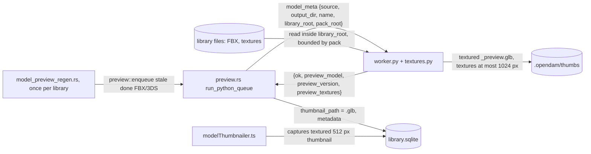

# Textured FBX previews

Status: shaped 2026-10-21 in a two-round interview (D1-D18 below) and approved at final review.
Once this plan merges, Mission Control slices it into tickets. One phase.

Revised 2026-10-21 after the plan validation workflow's review. No decision changed:

- **pytest arrives with the first Python tests.** Step 1 now adds pytest, the `tests/` folder,
  and the `make test` and CI hooks, so its `test_textures.py` runs by file and in CI. Step 2 only
  adds its own two test files.

## Problem

FBX and 3DS models preview as plain gray. `model_meta` in `packages/preview-engine/worker.py`
loads them with `assimp_py` and builds `trimesh.Trimesh(vertices=v, faces=f)` per mesh, which
drops UVs, normals, materials and textures. It also ignores the node tree, so two more defects
come with it:

- **Misplaced and rotated parts.** In a sample of 250 FBX, 12 have parts at the wrong place, such
  as the lid of Kenney's coffin sitting at the origin. 18 of 137 Unity models stand on their side,
  because their Z-up root rotation is dropped.
- **Overlapping LODs and collision meshes.** 47 of 50 Stylarts FBX, and NatureManufacture's trees,
  hold `LOD0` to `LOD3` and `*_ConvexHulls` nodes, and all of them are drawn on top of each other.

## How previews are made today

- The worker's `scene.save_image` never succeeds, because pyglet isn't installed. It sits in a
  bare `try/except`, so the worker only ever returns `preview_model`.
- Rust stores that GLB as `thumbnail_path`. The frontend's `modelThumbnailer.ts` polls for
  `thumbnail_path LIKE '%.glb'` and renders each GLB with three.js `GLTFLoader` at 512x512, lit by
  `RoomEnvironment` plus one directional light. `save_model_thumbnail` writes that render as
  `<id>_thumb.png`.
- The detail panel and Quick Look show the same GLB through drei's `useGLTF`.
- So **a textured GLB gives a textured thumbnail and a textured 3D view without any rendering
  change.** A rerun job that returns only a GLB deletes the old `_thumb.png`, sets
  `thumbnail_path` back to the `.glb`, and the frontend captures a new thumbnail.

## What the research found

**assimp_py 1.2.0** (assimp 6.0.5, released 2026-09-09) exposes:

- per mesh: `normals`, `texcoords` (one flat buffer per UV channel, `num_uv_components` floats per
  vertex) and `material_index`;
- the node tree: `root_node`, `children`, `mesh_indices`, `name`, and `transformation` as a
  row-major 4x4 tuple;
- per material: a dict with `NAME`, `COLOR_DIFFUSE`, `OPACITY` and `TEXTURES`, which is
  `{slot: [path, ...]}`. Slot 1 is diffuse, 12 base color, 6 normal.

It can't:

- read embedded textures, because `aiScene.mTextures` isn't exposed;
- report PBR factors (`$clr.base`, metallic, roughness all collapse into one `NONE` key);
- take import options;
- load animation-only FBX, which raise `RuntimeError` with an empty message.

Do not use `TEXTURE_BASE`: it is the last texture property of any slot, not the base color.

**Your libraries.**

- **No embedded textures.** A scan of all 10,758 FBX for `Video` nodes with `Content` found none.
- **Pack roots are marked.** Every pack root in all three libraries has `folders.is_pack = 1`:
  Kenney `3D assets/<Pack>`, Unity `<Publisher>/<Pack>`, Stylarts `<Pack>`. Each library root
  holds its own `.opendam/`.

Survey of 474 sampled FBX in 27 packs, by each file's first diffuse reference:

| Outcome | Kenney (80) | Unity (333) | Stylarts (61) |
|---|---|---|---|
| Relative path exists, exact case | 40 | 28 | 0 |
| Relative path exists, ignoring case | - | 2 | 21 |
| By file name, the FBX's own folder | - | 2 | - |
| By file name, a `Textures` folder up to 2 levels up | - | 106 | 19 |
| By file name, only by searching the whole pack | - | 18 | - |
| Reference found nowhere | - | 60 | - |
| References only a normal map | - | - | 4 |
| No texture reference | 34 | 113 | 17 |
| Load error (animation-only) | 6 | 4 | 0 |

- **Reference shapes.**
  - Kenney's modern kits all point at `Textures\colormap.png`.
  - Kenney's color-only kits (1,454 of 5,146 FBX) carry only material colors.
  - Unity references are authoring paths, such as `U:\Dropbox\SyntyStudios\...`, `..\Textures\X.psd`
    or `.tif`.
  - Stylarts references say `.png` while the files on disk are `.PNG`, and flattening broke their
    relative depth.
- **Name heuristics, on files with no reference or a broken one.**
  - Material name match: Stylarts 11 of 17, GameAssetFactory 20 of 20, TriForge, and Kenney
    Racing's `tankco`.
  - Reference stem prefix match: Synty, 34 of 40 once `_Texture` is dropped.
  - FBX file-name prefix match: Runemark, and Triplebrick 8 of 20.
- **Traps.**
  - Every Kenney kit has `Previews/<stem>.png` (64 px renders), `Isometric/` and `Sprites/`.
  - GameAssetFactory ships identical Built-In and URP trees.
  - Unreal placeholders such as `T_Fill_B` are referenced but never shipped.
  - Tropical Studio's textures are named after other models.
- **Texture sizes.** Most are 1K and 2K, with 592 Unity and 109 Stylarts textures at 4K and 6
  above 4K.

**OBJ+MTL already works.** trimesh embeds each `map_Kd` texture, keeps UVs and the Kd color, and
falls back to the color when a texture is missing. All 4,004 Kenney `map_Kd` paths resolve.
trimesh never downscales, though: a 4K texture made a 50 MB GLB.

**Memory and time.** A 98 MB FBX imports in 0.7 s at about 610 MB peak RSS. The worker has no
memory cap, and each job has a 60 s timeout in `run_python_queue`.

## Decisions

| # | Question | Answer |
|---|---|---|
| D1 | FBX/3DS loader | Keep **assimp_py** and build the GLB ourselves with trimesh. No new dependency. pyassimp needs the system library and is unmaintained. The `assimp` CLI and Blender each need a subprocess per file, and Blender peaks at 1.5 GB. |
| D2 | Embedded textures (goal 2) | **Dropped, recorded as a known gap.** assimp_py can't read them, and none of your 10,758 FBX has one. |
| D3 | Geometry | **Apply node transforms** by walking the node tree. Draw only LOD0, and no collision meshes (rule in C2). |
| D4 | Maps | **Base color only**, with an alpha cutout when the texture has transparent pixels. At 512 px under room light, normal and metallic/roughness maps barely show and double the texture cost. Foliage without cutout shows as opaque quads, which does show. |
| D5 | Texture size in the GLB | Longest side **1024 px**. **JPEG** when opaque, **PNG** when it has alpha. |
| D6 | Downscale in the trimesh branch (OBJ, glTF, GLB, ...) | **Yes, for new previews only.** Existing ones are not regenerated, since their thumbnails would look the same. A manual Re-generate picks it up. |
| D7 | Regenerating existing previews | A **per-asset preview version** in `metadata.preview_version`. A **one-time library pass** keyed in `library_meta` requeues FBX/3DS items whose `done` preview predates it, under the normal queue rules. A future bump reuses the pass. |
| D8 | Errored previews | Not retried by the pass. **Only `done` previews** are. |
| D9 | Worker memory | **In-process limits.** Read a texture's size from its header first, skip it past a pixel cap, decode one at a time, and cache per request. No rlimit and no systemd scope. |
| D10 | Measurement | A **script runs the worker on sampled FBX into a scratch folder** and reports textured or not, and why. Plus before-and-after app screenshots under `scripts/memory-cap.sh`. |
| D11 | `.3dm` | Out of scope. |
| D12 | Literal lookups | All three, in order: the **path as given** (absolute, inside the library root), then **relative to the model** (`\` as `/`, case-insensitive per component, inside the library root), then **by file name** (case-insensitive, same stem with any texture extension, exact extension first, nearest folder first). |
| D13 | By-name scope | **Walk up from the model's folder to its pack root.** At each level, check the folder and its `textures`/`materials`/`maps` subfolders recursively. **Then the whole pack.** The nearest by folder distance wins, ties by path ignoring case. Without a pack, walk up at most 2 levels and skip the whole-pack step. Never go above the library root. Skip `Previews`, `Preview`, `Renders`, `Isometric` and `Sprites`. |
| D14 | Name heuristics, after the literal lookups fail | All three, in this order: **material name** match, **reference stem prefix** match, **FBX file-name prefix** match (single-material meshes only). Diffuse suffixes only, default material names skipped. |
| D15 | Extensions | png, jpg, jpeg, tga, tif, tiff, bmp, webp, and **psd last**: a PSD only when no other format has the stem. |
| D16 | Base color factor | **White when a texture is found**, else the material's diffuse color. |
| D17 | Reporting | The worker returns a short **`preview_textures` summary**, and Rust stores it in `metadata`. No UI. |
| D18 | OBJ fallback to our resolver | **No.** All Kenney `map_Kd` paths resolve. |

## Behaviour

The flow after this plan. New arrows: the regeneration pass, the two new params, the worker
reading textures inside the library, and the new result fields.

**C1. Worker request.** `run_python_queue` adds two params to `model_meta`:

- `library_root`: the library's absolute root.
- `pack_root`: the absolute path of the innermost `folders` row with `is_pack = 1` whose path is
  the model's folder or one of its ancestors, or absent when there is none. It is matched with
  `substr` and `path || '/'`, not `LIKE`, since paths hold `_` and `%`.

The JSON-over-stdio protocol and the one persistent process stay as they are. A worker that gets
neither param still works: it searches only the model's folder and the 2 levels above it.

**C2. FBX/3DS scene.** Import with `Process_Triangulate | Process_GenNormals |
Process_JoinIdenticalVertices | Process_SortByPType`. Then walk `root_node` depth-first, multiplying
each node's `transformation` into its parent's.

- For each mesh index in a drawn node, add one trimesh geometry to a `trimesh.Scene` with its world
  transform. A mesh used by several nodes is drawn at each of them.
- Each geometry carries vertices, triangle faces, normals, UV channel 0 when present, and the
  material from C4. Meshes without triangles (points, lines) are skipped.
- **Skip a node and its subtree** when its name, ignoring case, matches any of:
  - `_LOD[1-9]\d*$` or `^LOD[1-9]\d*$`;
  - a `UCX_`, `UBX_`, `USP_` or `UCP_` prefix;
  - `ConvexHull`.
- **If skipping leaves nothing**, for example a file holding only `LOD1`, draw everything instead.
- `poly_count` and `object_count` count what is drawn.
- An import error or a scene with no drawable mesh fails as today, with `preview_error`.

**C3. Texture resolution** (`resolve_texture`, in a new `packages/preview-engine/textures.py`). For
each material, the reference is the first path in `TEXTURES[1]` (diffuse), else in `TEXTURES[12]`
(base color). A `*N` (embedded) reference counts as missing (D2). The steps, first hit wins:

1. **As given:** an absolute path that exists and is inside `library_root`.
2. **Relative:** the path, with `\` read as `/`, joined to the model's folder. Each component is
   matched ignoring case. The result is kept only if it resolves inside `library_root`, so `..`
   can't leave it.
3. **By name:** the reference's stem, ignoring case, with the exact extension first, then the
   others in C5's order.
   - Search order: the model's folder; that folder's `textures`, `materials` and `maps` subfolders
     (any case, recursively); then the same at each parent up to `pack_root`; then the whole pack.
   - Without a pack: the model's folder and at most 2 levels up, never above `library_root`, and
     no whole-tree step.
   - Each level is an ordered tier. Within a tier, the shortest folder distance from the model
     wins, then the path ignoring case.
   - Folders named `Previews`, `Preview`, `Renders`, `Isometric` or `Sprites` (any case) and
     `.opendam` are never searched.
4. **Heuristics** (D14), over the same tiers, only when steps 1-3 found nothing or there was no
   reference. Each looks only at files whose stem ends in a **diffuse suffix**: `_BC`, `_B`, `_C`,
   `_D`, `_basecolor`, `_base_color`, `_albedo`, `_albedotransparency`, `_color`, `_colour`,
   `_diffuse` or `_diff`, any case. They match that stem with the suffix and a `T_`/`TX_` prefix
   removed.
   1. **Material name:** strip `MI_`, `M_`, `MAT_` and a trailing `.NNN`. Skip default names:
      `lambert*`, `phong*`, `blinn*`, `DefaultMaterial`, `Material`, `Material.NNN`, `No Name`,
      `skin`, and names under 3 characters.
   2. **Reference stem prefix:** drop `_Texture`, then trailing `_parts` one at a time, until a
      file stem (its trailing `_parts` dropped the same way) equals it. Atlas variants such as
      `PolygonCity_01_A` lose to the plain `PolygonCity_01`.
   3. **FBX file-name prefix,** only when the model has exactly one material: strip `SM_` and
      `_LODn`, then drop trailing `_parts` the same way.
5. **Nothing found:** no texture. The material keeps its color (C4).

The worker builds each root's file list once and caches it in an LRU of 4 roots, valid 5 minutes,
capped at 50,000 entries per root. A capped root is searched only as far as it got. Resolution
reads no file outside `library_root` and follows no symlink out of it.

**C4. Material.** Each assimp material becomes a trimesh `PBRMaterial`, exported as glTF
`pbrMetallicRoughness`, with `metallicFactor` 0 and `roughnessFactor` 0.9.

- **With a texture:** `baseColorTexture` is the image from C5, and `baseColorFactor` is white (D16).
- **Without one:** `baseColorFactor` is `COLOR_DIFFUSE`, or 0.8 gray when absent, with `OPACITY` as
  its alpha.
- **Cutout:** when the image has any pixel with alpha below 255, `alphaMode` is `MASK`,
  `alphaCutoff` 0.5 and `doubleSided` true.
- Otherwise `alphaMode` is `OPAQUE`.
- A mesh with a texture but no UVs gets the color, not the texture.

**C5. Texture images** (`load_texture`, in `textures.py`).

- **Formats:** extensions in lookup order are png, jpg, jpeg, tga, tif, tiff, bmp, webp, then psd.
  A PSD is used only when no other format has the stem, and read as Pillow's flattened composite.
- **Size check first.** Open with Pillow and read the size from the header. A texture over
  8192 px on either side is skipped (`too_large`). That bounds one decode at 256 MB RGBA.
- **Downscale:** decode with `draft` for JPEG, convert to RGB or RGBA, and shrink with LANCZOS to
  1024 px on the longest side.
- **Encoding in the GLB:** JPEG at quality 85 when the image has no alpha below 255, otherwise PNG.
  If trimesh's exporter re-encodes as PNG regardless, embed the encoded bytes so the chosen format
  is kept.
- **Caching:** textures are decoded one at a time, and one request caches the result by resolved
  path, so an atlas shared by many materials is decoded once. The cache is cleared when the
  request ends.
- **Failures:** an unreadable, truncated or unsupported file, including a PSD without a composite,
  is `unreadable`, and the material falls back to its color. **No texture failure ever fails the
  preview.**

**C6. Downscale in the trimesh branch** (D6). After `trimesh.load`, each geometry whose material
holds an image larger than 1024 px gets that image replaced through `load_texture`'s downscale and
encode. The rest of the branch is unchanged.

**C7. Worker result.** `model_meta` adds two fields for every model it exports:

- `preview_version: 2`;
- `preview_textures`, for FBX/3DS only. For example:
  `{"materials": 3, "textured": 2, "via": {"relative": 1, "name": 1}, "missing": ["T_Fill_B"], "unreadable": [], "too_large": [], "no_uv": 0, "drawn_nodes": 4, "skipped_nodes": 6}`.
  - `via` counts the step that found each texture: `given`, `relative`, `name`, `material_name`,
    `ref_prefix` or `file_prefix`.
  - `missing` lists at most 10 reference stems, or `material:<name>` for a material with no
    reference that no heuristic matched.

**C8. Storing the result.** `complete_job` stores `preview_version` and `preview_textures` in
`metadata`, with `json_set`, beside `preview_model`. A job without them stores neither and leaves
any earlier value out, so an old installed engine's result reads as version 1.

**C9. Regenerating existing previews** (`model_preview_regen.rs`, modelled on `thumb_cleanup.rs`).

- **Trigger:** it runs once per library, at startup and when a library is added, right after
  `thumb_cleanup`. A Rust constant `MODEL_PREVIEW_VERSION = 2` is recorded under the
  `library_meta` key `model_preview_version` when the pass completes. A library whose recorded
  value is at least the constant is skipped.
- **Candidates:**
  - `lower(extension) IN ('fbx', '3ds')`;
  - `preview_status = 'done'`;
  - `coalesce(json_extract(metadata, '$.preview_version'), 1) < MODEL_PREVIEW_VERSION`;
  - no active job;
  - **queueable under the queue rules:** a main item or file on its own (`MAIN_OR_SINGLE`) that is
    not `pictured`, or a group's preview stand-in. These are the predicates `claim_jobs` uses,
    shared rather than copied.
  - Members, support files, pictured items and errored previews are never touched (D8).
- **Requeue:** candidates go back on the queue through `preview::enqueue`, in 200-row
  transactions, `ORDER BY rowid`. The pass records the key after the last batch, logs its count,
  and emits `library:updated`. An interrupted pass redoes the uncommitted batch at the next open.
- **What the user sees:** each requeued FBX keeps its old thumbnail until the worker reruns it.
  Then, as today, the old `_thumb.png` is deleted, the card briefly shows no thumbnail, and the
  frontend captures the textured one.
- **Cost:** about every `done` FBX preview, since each gains normals, colors, transforms or LOD
  filtering. Knowing which wouldn't change costs the same parse.

**C10. 3D view refresh.** drei's `useGLTF` caches by URL, and a rerun overwrites the same
`<id>_preview.glb`. On `preview:done` with a `previewModel`, the frontend calls `useGLTF.clear`
for that URL, so an open detail panel or Quick Look shows the new GLB. The thumbnailer loads each
GLB fresh and needs nothing.

**C11. Tests** (by file; CI runs them).

- **Python:** add `pytest` to the dev group (`uv add --dev pytest`) and put tests in
  `packages/preview-engine/tests/`. Small fixtures are generated in `tmp_path`: tiny PNG, TGA, JPEG
  and PSD images, plus folder trees. FBX scenes are faked as assimp-like objects, so no binary FBX
  is committed.
  - `test_textures.py`:
    - relative path, with a case mismatch and with `\` separators;
    - as-given absolute inside the root, and one outside the root that is ignored;
    - `..` escaping the library root, which is ignored;
    - by name in the model's folder, in `Textures/` one level up, and only in the whole pack;
    - nearest-wins, including a Built-In vs URP tie;
    - `Previews/` excluded;
    - other extension, and psd last;
    - each heuristic, a default material name skipped, and file-prefix refused with 2 materials;
    - not found;
    - no pack (2-level bound);
    - an `*0` embedded reference counted missing;
    - unreadable, too large, and alpha versus opaque encoding;
    - downscale to 1024.
  - `test_fbx_scene.py`:
    - node transforms applied, including a Z-up root rotation and a mesh instanced twice;
    - LOD1+ and `UCX_`/`ConvexHull` skipped;
    - everything-skipped fallback;
    - UVs and normals kept;
    - textured versus colored material;
    - a missing texture leaving an untextured but valid GLB.
  - `test_worker_protocol.py`: one `model_meta` request over stdio, on a generated OBJ+MTL, returns
    `preview_version`, and the GLB's texture is no larger than 1024 px.
- **CI and make:** `make test` and the CI test job add `cd packages/preview-engine && uv run
  --frozen pytest`. `make install` also copies `textures.py`.
- **Rust:**
  - `preview.rs`: `pack_root` picks the innermost pack, survives `_` and `%` in names, and is
    absent outside a pack. `complete_job` stores and clears `preview_version` and
    `preview_textures`.
  - `model_preview_regen.rs`: it requeues stale `done` FBX/3DS main items. It leaves members,
    support files, pictured items, errors, OBJ and current-version rows alone. It requeues a
    stand-in. It records the key, and a second run is a no-op.
- **TypeScript:** the `useGLTF.clear` call on `preview:done`.

**C12. Measurement** (D10). `packages/preview-engine/tools/measure_textures.py` takes a library
root, pack folders and a sample size. For each sampled FBX it runs `model_meta`, with the same
`library_root` and `pack_root` the app would send, into a scratch output folder, and never writes
under the library. It prints one row per pack:

- sampled, loaded and textured, all materials or some;
- color only;
- `via` counts;
- untextured reasons: no reference, missing, unreadable, too large, or no UVs;
- the top missing names;
- per-file time and peak RSS.

The implementation PR reports the counts for 3 packs from each of Kenney, Unity and Stylarts, 40
FBX each at most. It explains each untextured class against this plan's survey and includes
before-and-after screenshots of a few cards and the 3D view, from an app run under
`scripts/memory-cap.sh`. The Stylarts `.glb` packs are spot-checked to confirm they still preview
textured.

**C13. Invariants.** `AGENTS.md` (which `CLAUDE.md` links to) gains a "Textured model previews"
invariant. It covers:

- the worker resolves textures only inside the library root, bounded by the pack;
- textures are downscaled to 1024 px;
- a texture failure never fails a preview;
- `metadata.preview_version` and the `model_preview_version` pass are how a preview change reaches
  existing libraries.

## Steps (one phase)

1. Python test setup, then `textures.py`.
   - `pytest` added to the dev group through `uv add --dev pytest`, with the lockfile committed.
   - The `packages/preview-engine/tests/` folder.
   - `uv run --frozen pytest` in `make test` and in CI's test job.
   - `textures.py`: the resolver (C3), image loading and encoding (C5), and the root index cache.
   - `make install` copies `textures.py`.
   - Tests in `test_textures.py`, which this step's own setup runs by file and in CI.
2. `worker.py`: the FBX/3DS scene from the node tree (C2) and materials (C4). The trimesh-branch
   downscale (C6). Result fields (C7). Tests in `test_fbx_scene.py` and
   `test_worker_protocol.py`, which run under step 1's setup.
3. `preview.rs`: the `library_root` and `pack_root` params (C1), and storing the result (C8).
4. `model_preview_regen.rs` and its wiring in `lib.rs` and `commands/library.rs` (C9).
5. Frontend `useGLTF.clear` on `preview:done` (C10).
6. `measure_textures.py` and the measurement run (C12). `AGENTS.md` invariant (C13).
7. `uv run ruff format`, `bun run format`, `cargo fmt`, and `make lint`, before each commit.

## Acceptance criteria

- **AC1.** An FBX whose diffuse reference resolves by any C3 step previews with that texture,
  downscaled to at most 1024 px, in both the thumbnail and the 3D view.
- **AC2.** A missing, unreadable or too-large texture leaves a valid, untextured or colored preview,
  never an error.
- **AC3.** No lookup reads outside the library root. The by-name search stays within the pack, or
  2 levels up without one.
- **AC4.** Multi-part and Z-up FBX are drawn with their node transforms, and LOD1+ and collision
  nodes are not drawn.
- **AC5.** Existing libraries requeue only `done` FBX/3DS items the queue rules allow, once.
  Nothing else is reprocessed.
- **AC6.** New OBJ, glTF and GLB previews keep their textures, with each one at most 1024 px.
- **AC7.** The worker stays one process speaking the same protocol, and its peak RSS on the
  largest sampled FBX is reported.
- **AC8.** The PR reports textured counts per sampled pack and why the others aren't.

## Known gaps

- **Embedded FBX textures** aren't read (D2). None exist in your libraries today.
- **Not guessable:**
  - Kenney's character `skin` material, whose 70+ skins sit in `Skins/`;
  - Tropical Studio, whose textures are named after other models;
  - Unreal placeholders such as `T_Fill_B`;
  - materials that reference only a normal map, unless a heuristic matches them.
- **Unity `.mat`/`.meta` routes** are out of scope. They belong to your extraction scripts.
- **Existing OBJ, glTF and GLB previews** keep full-size textures until regenerated by hand (D6).
- **Normal and metallic/roughness maps** aren't used (D4).
- **`.3dm`** stays untextured (D11).
- **A heuristic can pick the wrong texture.** `preview_textures.via` records which step chose each
  one, so a wrong pick can be traced.
