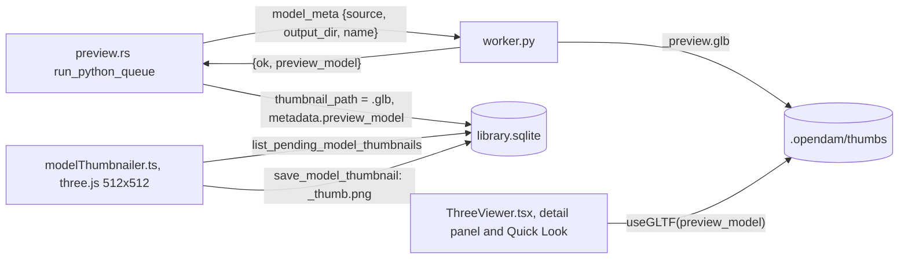
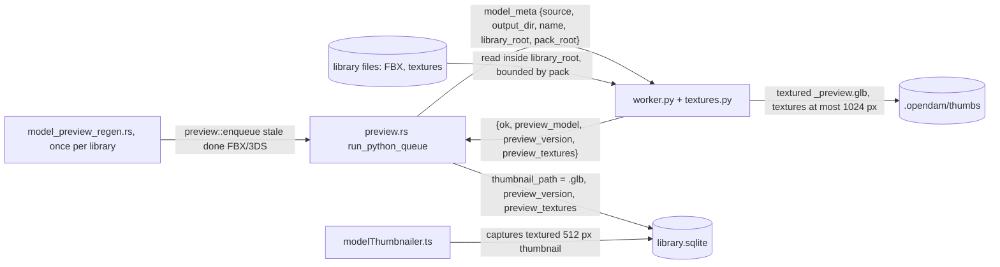

# Textured FBX previews

Status: shaped 2026-10-21 in a two-round interview (D1-D18 below) and approved at final review.
Once this plan merges, Mission Control slices it into tickets. One phase.

Revised 2026-10-21 after the plan validation workflow's review. No decision changed:

- **pytest arrives with the first Python tests.** Step 1 now adds pytest, the `tests/` folder,
  and the `make test` and CI hooks, so its `test_textures.py` runs by file and in CI. Step 2 only
  adds its own two test files.

Revised again 2026-10-21 after the plan validation workflow's feasibility review. No decision
changed:

- **No app run touches your libraries.** C12's before-and-after screenshots come from a scratch
  library of copied packs, opened under a throwaway `XDG_DATA_HOME`. The measurement script reads
  library DBs read-only.
- **The regeneration pass waits for a current engine.** C9 runs only when the worker that would
  serve the queue declares `PREVIEW_VERSION` of at least `MODEL_PREVIEW_VERSION`. Otherwise it
  leaves the key unset, so an old installed engine can't spend the pass.
- **JPEG and PNG in the GLB are settled and tested.** C5 now says how the format survives
  trimesh's exporter, and C11 checks each exported image's `mimeType` and size.
- **The largest files are measured.** C12 also runs the 3 largest FBX of each library and reports
  their time and peak RSS against the 60 s job timeout.

Revised a third time 2026-10-21 after the feasibility review of revision 3. No decision changed:

- **No root, no lookup.** A `model_meta` request without `library_root`, or whose source isn't
  inside it, now reads no texture file at all. Before, it searched the model's folder and 2 levels
  up with no root bound. This case arises when an app that doesn't send the param drives the new
  worker. C1, C3, C11 and AC3 say so.
- **AC6 matches C6.** Only images the worker downscales are re-encoded, so AC6 no longer claims
  every opaque OBJ or GLB texture becomes JPEG.

Revised a fourth time 2026-10-21 after GitHub Inspector's review of PR #145. No decision changed:

- **The gate asks the running worker, not a file on disk.** Revision 3 read `PREVIEW_VERSION`
  from the `worker.py` that `find_preview_worker` resolves. That function never reports "not
  found", and its search roots live inside `start_preview_worker`. The file can also be newer than
  the long-lived process that actually runs the jobs. Now the queue asks its own worker process
  for its version (`engine_info`) each time it starts one, and C9 gates on that answer.
- **The key waits for the work.** The pass records its key only once no stale FBX/3DS preview is
  left, done or waiting. A run whose jobs an older process served is therefore redone on a later
  start, instead of being lost.

Revised a fifth time 2026-10-22 after GitHub Inspector's second review of PR #145. No decision
changed:

- **Before the first answer, the pass waits silently.** The published engine version starts as
  "none yet". A pass that sees it returns without requeueing, recording a key, or warning, and the
  first publish runs it (C9).
- **Extension precedence is explicit.** Within each tier, the exact extension comes first, but a
  PSD is a last resort across the whole lookup. A non-PSD file anywhere in steps 1-3 beats any
  PSD, and the nearer tier beats the exact extension (C3). This refines how D12's "exact extension
  first" and D15's "psd last" combine.

Revised a sixth time 2026-10-22 after GitHub Inspector's third review of PR #145. No decision
changed:

- **A late `engine_info` reply can't land on a job.** `PythonWorker::execute` returns the first
  JSON line it reads. So C9 now kills the process when `engine_info` times out, as the queue
  already does after a job timeout. `execute` also skips any reply whose `id` doesn't match its
  request.
- **The LOD rule matches the names your packs use.** A scan of 1,200 sampled FBX found
  NatureManufacture's `MapleSpringTree04LOD3`, with no separator, which the old rule missed. C2's
  rule now also takes leading zeros, an optional `_`, and assimp's `$AssimpFbx$` helper suffixes.

Revised a seventh time 2026-10-22 after GitHub Inspector's fourth review of PR #145. No decision
changed:

- **The Synty heuristic can find the plain atlas.** The diffuse-suffix filter now applies only to
  the two name-guess heuristics (material name, FBX file name). The reference stem prefix
  heuristic starts from a reference already in a diffuse slot. So it takes any texture except
  one with a non-diffuse map suffix, and prefers the stem with the fewest extra parts, which
  makes `PolygonCity_01` beat `PolygonCity_01_A`. This narrows D14's "diffuse suffixes only" to
  the heuristics that guess from names.
- **`_B`, `_C` and `_D` count as diffuse only after a `T_` or `TX_` prefix**, the Unreal-style
  naming Stylarts uses. So the A/B/C atlas variants don't read as diffuse maps.

Revised an eighth time 2026-10-22 after GitHub Inspector's fifth review of PR #145. No decision
changed:

- **Cutout only for alpha that looks like a cutout.** Alpha that is uniformly 0, or mostly
  mid-range like a smoothness map, is ignored. The texture is treated as opaque, and
  `preview_textures` says so (C4, C5).
- **An `engine_info` timeout no longer stalls regeneration.** The queue restarts the worker at
  once, with a capped backoff, instead of waiting for a job. "None yet" stays published until a
  process actually answers (C9).

Revised a ninth time 2026-10-22 after GitHub Inspector's sixth review of PR #145. No decision
changed:

- **The prefix heuristics have a floor.** Both work on a core stem with any `T_`, `TX_` or `SM_`
  prefix removed, on file stems as well as references. They stop dropping `_parts` before the
  core falls under 6 characters or becomes only digits. So `T_Fill_B` can't shrink to `T` and
  grab an unrelated `T_*` texture: it stays `missing`.

Revised a tenth time 2026-10-22 after GitHub Inspector's seventh review of PR #145. No decision
changed:

- **C6 names every image slot it downscales**, so AC6 holds for glTF and GLB sources with normal,
  metallic/roughness, emissive or occlusion maps, not only base color.

Revised an eleventh time 2026-10-22 after GitHub Inspector's eighth review of PR #145. No decision
changed:

- **The version and the texture report get their own columns.** `assets.metadata` is indexed by
  `assets_fts`, so a report stored there would make searches for `name`, `none`, `rock` or `fill`
  match nearly every FBX. They now go in two new `assets` columns, `preview_version` and
  `preview_textures`, which search doesn't index (C8). D7 and D17 said "in `metadata`". The
  values are the same, only their place changes.

Revised a twelfth time 2026-10-22 after GitHub Inspector's ninth review of PR #145. No decision
changed:

- **D7 and D17 name the new columns**, so the Decisions table and C8 state the storage rule the
  same way.
- **An open 3D view reloads the new GLB.** Clearing drei's cache alone leaves a mounted viewer
  showing the old scene. C10 now clears the key `ThreeViewer` actually caches under,
  `convertFileSrc(previewModel)`, and remounts the viewer's model through a per-path revision
  bumped on `preview:done`. C11 tests the reload, and C12 checks it in the app.

## Problem

FBX and 3DS models preview as plain gray. `model_meta` in `packages/preview-engine/worker.py`
loads them with `assimp_py` and builds `trimesh.Trimesh(vertices=v, faces=f)` per mesh, which
drops UVs, normals, materials and textures. It also ignores the node tree, so two more defects
come with it:

- **Misplaced and rotated parts.** In a sample of 250 FBX, 12 have parts at the wrong place, such
  as the lid of Kenney's coffin sitting at the origin. 18 of 137 Unity models stand on their side,
  because their Z-up root rotation is dropped.
- **Overlapping LODs and collision meshes.** 47 of 50 Stylarts FBX, and NatureManufacture's trees,
  hold `LOD0` to `LOD3` and `*_ConvexHulls` nodes, and all of them are drawn on top of each other.

## How previews are made today

- The worker's `scene.save_image` never succeeds, because pyglet isn't installed. It sits in a
  bare `try/except`, so the worker only ever returns `preview_model`.
- Rust stores that GLB as `thumbnail_path`. The frontend's `modelThumbnailer.ts` polls for
  `thumbnail_path LIKE '%.glb'` and renders each GLB with three.js `GLTFLoader` at 512x512, lit by
  `RoomEnvironment` plus one directional light. `save_model_thumbnail` writes that render as
  `<id>_thumb.png`.
- The detail panel and Quick Look show the same GLB through drei's `useGLTF`.
- So **a textured GLB gives a textured thumbnail and a textured 3D view without any rendering
  change.** A rerun job that returns only a GLB deletes the old `_thumb.png`, sets
  `thumbnail_path` back to the `.glb`, and the frontend captures a new thumbnail.

## What the research found

**assimp_py 1.2.0** (assimp 6.0.5, released 2026-09-09) exposes:

- per mesh: `normals`, `texcoords` (one flat buffer per UV channel, `num_uv_components` floats per
  vertex) and `material_index`;
- the node tree: `root_node`, `children`, `mesh_indices`, `name`, and `transformation` as a
  row-major 4x4 tuple;
- per material: a dict with `NAME`, `COLOR_DIFFUSE`, `OPACITY` and `TEXTURES`, which is
  `{slot: [path, ...]}`. Slot 1 is diffuse, 12 base color, 6 normal.

It can't:

- read embedded textures, because `aiScene.mTextures` isn't exposed;
- report PBR factors (`$clr.base`, metallic, roughness all collapse into one `NONE` key);
- take import options;
- load animation-only FBX, which raise `RuntimeError` with an empty message.

Do not use `TEXTURE_BASE`: it is the last texture property of any slot, not the base color.

**Your libraries.**

- **No embedded textures.** A scan of all 10,758 FBX for `Video` nodes with `Content` found none.
- **Pack roots are marked.** Every pack root in all three libraries has `folders.is_pack = 1`:
  Kenney `3D assets/<Pack>`, Unity `<Publisher>/<Pack>`, Stylarts `<Pack>`. Each library root
  holds its own `.opendam/`.

Survey of 474 sampled FBX in 27 packs, by each file's first diffuse reference:

| Outcome | Kenney (80) | Unity (333) | Stylarts (61) |
|---|---|---|---|
| Relative path exists, exact case | 40 | 28 | 0 |
| Relative path exists, ignoring case | - | 2 | 21 |
| By file name, the FBX's own folder | - | 2 | - |
| By file name, a `Textures` folder up to 2 levels up | - | 106 | 19 |
| By file name, only by searching the whole pack | - | 18 | - |
| Reference found nowhere | - | 60 | - |
| References only a normal map | - | - | 4 |
| No texture reference | 34 | 113 | 17 |
| Load error (animation-only) | 6 | 4 | 0 |

- **Reference shapes.**
  - Kenney's modern kits all point at `Textures\colormap.png`.
  - Kenney's color-only kits (1,454 of 5,146 FBX) carry only material colors.
  - Unity references are authoring paths, such as `U:\Dropbox\SyntyStudios\...`, `..\Textures\X.psd`
    or `.tif`.
  - Stylarts references say `.png` while the files on disk are `.PNG`, and flattening broke their
    relative depth.
- **Name heuristics, on files with no reference or a broken one.**
  - Material name match: Stylarts 11 of 17, GameAssetFactory 20 of 20, TriForge, and Kenney
    Racing's `tankco`.
  - Reference stem prefix match: Synty, 34 of 40 once `_Texture` is dropped.
  - FBX file-name prefix match: Runemark, and Triplebrick 8 of 20.
- **Traps.**
  - Every Kenney kit has `Previews/<stem>.png` (64 px renders), `Isometric/` and `Sprites/`.
  - GameAssetFactory ships identical Built-In and URP trees.
  - Unreal placeholders such as `T_Fill_B` are referenced but never shipped.
  - Tropical Studio's textures are named after other models.
- **Texture sizes.** Most are 1K and 2K, with 592 Unity and 109 Stylarts textures at 4K and 6
  above 4K.

**OBJ+MTL already works.** trimesh embeds each `map_Kd` texture, keeps UVs and the Kd color, and
falls back to the color when a texture is missing. All 4,004 Kenney `map_Kd` paths resolve.
trimesh never downscales, though: a 4K texture made a 50 MB GLB.

**Memory and time.** A 98 MB FBX imports in 0.7 s at about 610 MB peak RSS. The worker has no
memory cap, and each job has a 60 s timeout in `run_python_queue`.

## Decisions

| # | Question | Answer |
|---|---|---|
| D1 | FBX/3DS loader | Keep **assimp_py** and build the GLB ourselves with trimesh. No new dependency. pyassimp needs the system library and is unmaintained. The `assimp` CLI and Blender each need a subprocess per file, and Blender peaks at 1.5 GB. |
| D2 | Embedded textures (goal 2) | **Dropped, recorded as a known gap.** assimp_py can't read them, and none of your 10,758 FBX has one. |
| D3 | Geometry | **Apply node transforms** by walking the node tree. Draw only LOD0, and no collision meshes (rule in C2). |
| D4 | Maps | **Base color only**, with an alpha cutout when the texture has transparent pixels. At 512 px under room light, normal and metallic/roughness maps barely show and double the texture cost. Foliage without cutout shows as opaque quads, which does show. |
| D5 | Texture size in the GLB | Longest side **1024 px**. **JPEG** when opaque, **PNG** when it has alpha. |
| D6 | Downscale in the trimesh branch (OBJ, glTF, GLB, ...) | **Yes, for new previews only.** Existing ones are not regenerated, since their thumbnails would look the same. A manual Re-generate picks it up. |
| D7 | Regenerating existing previews | A **per-asset preview version** in the `assets.preview_version` column (C8). A **one-time library pass** keyed in `library_meta` requeues FBX/3DS items whose `done` preview predates it, under the normal queue rules. A future bump reuses the pass. |
| D8 | Errored previews | Not retried by the pass. **Only `done` previews** are. |
| D9 | Worker memory | **In-process limits.** Read a texture's size from its header first, skip it past a pixel cap, decode one at a time, and cache per request. No rlimit and no systemd scope. |
| D10 | Measurement | A **script runs the worker on sampled FBX into a scratch folder** and reports textured or not, and why. Plus before-and-after app screenshots under `scripts/memory-cap.sh`, from a scratch library of copied packs (C12). |
| D11 | `.3dm` | Out of scope. |
| D12 | Literal lookups | All three, in order: the **path as given** (absolute, inside the library root), then **relative to the model** (`\` as `/`, case-insensitive per component, inside the library root), then **by file name** (case-insensitive, same stem with any texture extension, exact extension first, nearest folder first). |
| D13 | By-name scope | **Walk up from the model's folder to its pack root.** At each level, check the folder and its `textures`/`materials`/`maps` subfolders recursively. **Then the whole pack.** The nearest by folder distance wins, ties by path ignoring case. Without a pack, walk up at most 2 levels and skip the whole-pack step. Never go above the library root. Skip `Previews`, `Preview`, `Renders`, `Isometric` and `Sprites`. |
| D14 | Name heuristics, after the literal lookups fail | All three, in this order: **material name** match, **reference stem prefix** match, **FBX file-name prefix** match (single-material meshes only). Diffuse suffixes only, default material names skipped. |
| D15 | Extensions | png, jpg, jpeg, tga, tif, tiff, bmp, webp, and **psd last**: a PSD only when no other format has the stem. |
| D16 | Base color factor | **White when a texture is found**, else the material's diffuse color. |
| D17 | Reporting | The worker returns a short **`preview_textures` summary**, and Rust stores it in the `assets.preview_textures` column (C8), outside the searched `metadata`. No UI. |
| D18 | OBJ fallback to our resolver | **No.** All Kenney `map_Kd` paths resolve. |

## Behaviour

The flow after this plan. New arrows: the regeneration pass, the two new params, the worker
reading textures inside the library, and the new result fields.

**C1. Worker request.** `run_python_queue` adds two params to `model_meta`:

- `library_root`: the library's absolute root.
- `pack_root`: the absolute path of the innermost `folders` row with `is_pack = 1` whose path is
  the model's folder or one of its ancestors, or absent when there is none. It is matched with
  `substr` and `path || '/'`, not `LIKE`, since paths hold `_` and `%`.

The JSON-over-stdio protocol and the one persistent process stay as they are.

**Without a root, no lookup.** A request can lack `library_root`, or name a `library_root` that
doesn't contain `source`, for example:

- between the step 2 and step 3 tickets;
- when an older checkout's app drives a newly installed engine.

Then the worker reads no texture file. The FBX still previews, with its transforms, UVs and each
material's diffuse color (C4), and `preview_textures` records `"no_root": true`. Every C3 step
needs the root to bound it, so skipping them is the only way to never read outside it. A
`pack_root` that isn't inside `library_root` is ignored, as if absent.

**C2. FBX/3DS scene.** Import with `Process_Triangulate | Process_GenNormals |
Process_JoinIdenticalVertices | Process_SortByPType`. Then walk `root_node` depth-first, multiplying
each node's `transformation` into its parent's.

- For each mesh index in a drawn node, add one trimesh geometry to a `trimesh.Scene` with its world
  transform. A mesh used by several nodes is drawn at each of them.
- Each geometry carries vertices, triangle faces, normals, UV channel 0 when present, and the
  material from C4. Meshes without triangles (points, lines) are skipped.
- **Skip a node and its subtree** when its name matches any of the following, after a trailing
  `_$AssimpFbx$_...` helper suffix is removed:
  - **An LOD number of 1 or more at the end:** `LOD`, then an optional `_`, optional zeros, and a
    number from 1. The `LOD` is any case at the start of the name or after a non-letter, and
    uppercase after a letter.
    - Skipped: `Tree_LOD1`, `Tree_LOD01`, `Tree_LOD_2`, `MapleSpringTree04LOD3` and `TreeLOD2`.
    - Drawn: `Tree_LOD0`, `Tree_LOD00`, `SH_Shield_E_LOD` (no number) and `Ballod2` (`lod` inside
      a word).
  - a `UCX_`, `UBX_`, `USP_` or `UCP_` prefix, any case;
  - `ConvexHull`, any case.
- **LOD names in your libraries.** A scan of 1,200 sampled FBX found:
  - 1,214 Stylarts nodes named `_LODn`;
  - Unity `_LODn`, plus NatureManufacture's `MapleSpringTree04LOD3`;
  - one `SH_Shield_E_LOD` with no number, and assimp `$AssimpFbx$` helper nodes;
  - no zero-padded names, which the rule accepts anyway.
- **If skipping leaves nothing**, for example a file holding only `LOD1`, draw everything instead.
- `poly_count` and `object_count` count what is drawn.
- An import error or a scene with no drawable mesh fails as today, with `preview_error`.

**C3. Texture resolution** (`resolve_texture`, in a new `packages/preview-engine/textures.py`). For
each material, the reference is the first path in `TEXTURES[1]` (diffuse), else in `TEXTURES[12]`
(base color). A `*N` (embedded) reference counts as missing (D2). Resolution runs only with a
`library_root` that contains the model (C1). The steps, first hit wins:

1. **As given:** an absolute path that exists and is inside `library_root`.
2. **Relative:** the path, with `\` read as `/`, joined to the model's folder. Each component is
   matched ignoring case. The result is kept only if it resolves inside `library_root`, so `..`
   can't leave it.
3. **By name:** the reference's stem, ignoring case, with the exact extension first, then the
   others in C5's order.
   - Search order: the model's folder; that folder's `textures`, `materials` and `maps` subfolders
     (any case, recursively); then the same at each parent up to `pack_root`; then the whole pack.
   - Without a pack: the model's folder and at most 2 levels up, never above `library_root`, and
     no whole-tree step.
   - Each level is an ordered tier. Within a tier, the shortest folder distance from the model
     wins, then the path ignoring case.
   - Folders named `Previews`, `Preview`, `Renders`, `Isometric` or `Sprites` (any case) and
     `.opendam` are never searched.
4. **Heuristics** (D14), over the same tiers, only when steps 1-3 found nothing or there was no
   reference. They are described below.
5. **Nothing found:** no texture. The material keeps its color (C4).

**Step 4 heuristics.** Two suffix lists apply, any case.

- **Diffuse suffixes:** `_BC`, `_basecolor`, `_base_color`, `_albedo`, `_albedotransparency`,
  `_color`, `_colour`, `_diffuse` and `_diff`. Also `_B`, `_C` and `_D`, but only on a stem that
  starts with `T_` or `TX_`: the single letters mean base color only in that naming, and
  elsewhere they are atlas variants.
- **Non-diffuse suffixes:** `_N`, `_normal`, `_normals`, `_nrm`, `_ORM`, `_AORM`, `_R`,
  `_roughness`, `_M`, `_metallic`, `_metallicsmoothness`, `_mask`, `_maskmap`, `_E`, `_emission`,
  `_emissive`, `_AO`, `_height`, `_specular`, `_SmMetAO`.

**Core stems.** The prefix heuristics (2 and 3) compare core stems.

- **What a core stem is:** a stem with a leading `T_`, `TX_` or `SM_` removed. This applies to
  file stems and references alike.
- **When dropping stops:** heuristics 2 and 3 drop trailing `_parts` one at a time, but never
  once the next drop would leave a core under 6 characters, or one made only of digits and `_`.
- **No match:** when nothing matches before that floor, the material counts as `missing`.

The heuristics run in this order:

1. **Material name.**
   - Strip `MI_`, `M_`, `MAT_` and a trailing `.NNN` from the material name.
   - Skip default names: `lambert*`, `phong*`, `blinn*`, `DefaultMaterial`, `Material`,
     `Material.NNN`, `No Name`, `skin`, and names under 3 characters.
   - Look only at files whose stem ends in a diffuse suffix. The name matches a file whose stem,
     with that suffix and a `T_`/`TX_` prefix removed, equals it.
2. **Reference stem prefix.** The reference was in a diffuse slot, so the file's own suffix isn't
   required to say "diffuse". Any texture file counts unless its stem ends in a non-diffuse
   suffix.
   - Take the reference's core stem and drop a `_Texture` part.
   - Try that core, then drop trailing `_parts` one at a time down to the floor, until some
     candidate core stem equals it, or starts with it followed by `_`.
   - Among those candidates, the stem with the fewest extra `_parts` wins, then the tier, then the
     path ignoring case.
   - So `PolygonCity_Texture` becomes `PolygonCity` and picks `PolygonCity_01` over
     `PolygonCity_01_A`, `_B` and `_C`. A `PolygonCity_01_Normal` is never a candidate.
   - And `T_Fill_B` becomes the core `Fill_B`, whose next drop, `Fill`, is under the floor. With
     no file core equal to `Fill_B` or starting with `Fill_B_`, it stays `missing`, even when the
     pack is full of other `T_*` textures.
3. **FBX file-name prefix,** only when the model has exactly one material.
   - Take the FBX's core stem, without `_LODn`. Try it, then drop trailing `_parts` one at a
     time down to the floor.
   - Each try uses heuristic 1's rule: diffuse-suffix files only, matched after the suffix and a
     `T_`/`TX_` prefix are removed.

**Precedence across steps, tiers and extensions.**

- **Non-PSD files first.** Steps 1-3 look for non-PSD files first, in step order, then tier
  order within step 3. A nearer tier beats an exact extension further away.
- **Within one tier,** the reference's own extension comes first unless it is `.psd`. The other
  extensions follow in C5's order. Ties go to folder distance, then path ignoring case.
- **A PSD is held, not used.** Steps 1 and 2 hitting an existing `.psd`, or step 3 finding one,
  only remember it, the first in that same order. The lookup goes on.
- **The held PSD is the last literal result.** It is used only when steps 1-3 find no non-PSD
  file, and it still comes before the heuristics.
- **The heuristics follow the same rule:** a non-PSD match in any tier first, then a PSD.

For example, a reference to `..\Textures\X.psd` with both `X.psd` and `X.png` in that folder
takes `X.png`. With only `X.psd` there, it takes `X.psd`. A `.tga` reference with an exact `.tga`
only elsewhere in the pack, and a `.png` of the same stem next to the model, takes the `.png`.

The worker builds each root's file list once and caches it in an LRU of 4 roots, valid 5 minutes,
capped at 50,000 entries per root. A capped root is searched only as far as it got. Resolution
reads no file outside `library_root` and follows no symlink out of it.

**C4. Material.** Each assimp material becomes a trimesh `PBRMaterial`, exported as glTF
`pbrMetallicRoughness`, with `metallicFactor` 0 and `roughnessFactor` 0.9.

- **With a texture:** `baseColorTexture` is the image from C5, and `baseColorFactor` is white (D16).
- **Without one:** `baseColorFactor` is `COLOR_DIFFUSE`, or 0.8 gray when absent, with `OPACITY` as
  its alpha.
- **Cutout:** `alphaMode` is `MASK`, `alphaCutoff` 0.5 and `doubleSided` true only when the
  texture's alpha looks like a cutout. The check runs on the downscaled image:
  - at least 1% of pixels have alpha below 128;
  - at least 10% have alpha at 128 or above;
  - fewer than 25% sit in the mid range 16-239.
- **Ignored alpha.** Any other alpha below 255 is ignored, and the texture is treated as opaque.
  This covers a channel that is uniformly 0, exported by some 32-bit TGA and PNG tools, and
  Unity smoothness stored in the albedo alpha, which is mostly mid-range. Without the rule, the
  first would hide the whole mesh and the second would punch holes in it.
- **Recorded.** `preview_textures.alpha` counts each textured material as `cutout`, `ignored`
  or `none`.
- Otherwise `alphaMode` is `OPAQUE`.
- A mesh with a texture but no UVs gets the color, not the texture.

**C5. Texture images** (`load_texture`, in `textures.py`).

- **Formats:** extensions in lookup order are png, jpg, jpeg, tga, tif, tiff, bmp, webp, then psd.
  A PSD is used only when no other format has the stem, and read as Pillow's flattened composite.
- **Size check first.** Open with Pillow and read the size from the header. A texture over
  8192 px on either side is skipped (`too_large`). That bounds one decode at 256 MB RGBA.
- **Downscale:** decode with `draft` for JPEG, convert to RGB or RGBA, and shrink with LANCZOS to
  1024 px on the longest side.
- **Encoding in the GLB:** PNG for a texture C4 uses as a cutout, JPEG for everything else,
  including a texture whose alpha C4 ignores, which drops that alpha. In the trimesh branch (C6),
  any image with alpha below 255 stays PNG, because the source material decides how its alpha is
  used.
  - trimesh 5.1.1's exporter (`trimesh.exchange.gltf._append_image`) writes an image as JPEG only
    when its Pillow `format` is `"JPEG"`, and as PNG otherwise, with a matching `mimeType`.
  - So `load_texture` saves an opaque image as JPEG at quality 85 into memory and reopens those
    bytes with Pillow. The exporter then writes it as `image/jpeg`. It saves it again at Pillow's
    default quality, a second lossy pass that is fine for a 1024 px preview.
  - A cutout image stays a plain Pillow RGBA image and is written as `image/png`.
  - C11's tests read the exported GLB and fail if either rule breaks, for example after a trimesh
    upgrade.
- **Caching:** textures are decoded one at a time, and one request caches the result by resolved
  path, so an atlas shared by many materials is decoded once. The cache is cleared when the
  request ends.
- **Failures:** an unreadable, truncated or unsupported file, including a PSD without a composite,
  is `unreadable`, and the material falls back to its color. **No texture failure ever fails the
  preview.**

**C6. Downscale in the trimesh branch** (D6). After `trimesh.load`, every image a geometry's
material holds is checked, and any image larger than 1024 px on a side is replaced through
`load_texture`'s downscale and encode. The rest of the branch is unchanged.

- **The slots checked:** `SimpleMaterial.image` (OBJ+MTL), and on a `PBRMaterial` (glTF, GLB) all
  five texture slots: `baseColorTexture`, `normalTexture`, `metallicRoughnessTexture`,
  `emissiveTexture` and `occlusionTexture`.
- **Encoding:** every slot follows the same rule. An image with any alpha below 255 stays PNG,
  any other becomes JPEG.
- **Shared images:** an image object several slots or materials share is downscaled once and the
  result reused, so the GLB holds it once.

**C7. Worker result.** A new `engine_info` method, on the same JSON-over-stdio protocol, returns
`{"preview_version": PREVIEW_VERSION}` and loads nothing. An older worker answers it with
`Unknown method`, which counts as version 1 (C9). `model_meta` adds two fields for every model it
exports:

- `preview_version`: the value of a module constant `PREVIEW_VERSION = 2` at the top of
  `worker.py`;
- `preview_textures`, for FBX/3DS only. For example:
  `{"materials": 3, "textured": 2, "via": {"relative": 1, "name": 1}, "missing": ["T_Fill_B"], "unreadable": [], "too_large": [], "no_uv": 0, "drawn_nodes": 4, "skipped_nodes": 6}`.
  - `via` counts the step that found each texture: `given`, `relative`, `name`, `material_name`,
    `ref_prefix` or `file_prefix`.
  - `missing` lists at most 10 reference stems, or `material:<name>` for a material with no
    reference that no heuristic matched.

**C8. Storing the result.** `complete_job` stores the two fields in two new `assets` columns:
`preview_version INTEGER` and `preview_textures TEXT` (the JSON summary).

- **Not in `metadata`.** That column is indexed by `assets_fts` (`003_assets_fts.sql`), and the
  report's words and missing texture names would otherwise match searches.
- **Existing libraries.** `db::add_preview_columns` adds the two columns when a library opens,
  the way `add_structure_columns` adds its own. Older rows read as `NULL`.
- **Old engines.** A job without these fields sets both columns to `NULL`, so an old installed
  engine's result reads as version 1.
- **Search untouched.** No FTS trigger or `search_assets` query changes.

**C9. Regenerating existing previews** (`model_preview_regen.rs`, modelled on `thumb_cleanup.rs`).

- **Trigger:** a Rust constant `MODEL_PREVIEW_VERSION = 2` and the `library_meta` key
  `model_preview_version`. A library whose recorded value is at least the constant is skipped.
  Every other open library gets the pass:
  - at startup and when a library is added, right after `thumb_cleanup`;
  - again each time the queue's worker declares a current version, as below.
- **Engine gate.** An older engine would rerun the requeued jobs without textures. `AGENTS.md`
  notes that `make dev` runs the installed engine after `make install`. An installed engine can
  also change on disk while an older worker process keeps running. So the gate asks the process
  that actually serves the queue, and never reads a file:
  - `run_python_queue` starts its worker when the queue starts, rather than on the first job, and
    again after every restart.
  - Each new process first gets an `engine_info` request (C7), with a 10 s timeout. Its answer is
    published in `AppState` as the running engine's version.
  - **An error reply** (an older worker's `Unknown method`) publishes version 1, and the process
    keeps serving jobs.
  - **A timeout** kills the process, exactly as a 60 s job timeout does (`worker.kill()`, then
    `py_worker = None`). A late reply therefore never stays on a live process's stdout.
    - It publishes nothing: the state stays "none yet". A slow first start, with cold imports or
      `.pyc` compiling, is not an old engine.
    - The queue starts a new process at once, without waiting for a job. If that one also times
      out, it backs off: 10 s, 30 s, 60 s, then every 5 minutes.
    - Only a real reply, a version or an error, publishes. A library with no queued jobs
      therefore still gets its pass once a process answers.
  - **Replies are matched by `id`.** `PythonWorker::execute` reads lines until one parses as JSON
    with the request's own `id`, and skips any other. A stray reply can never be taken as another
    request's result.
  - **Before any answer** (at startup, while a restarted process is starting, after a timeout
    until a new process answers, or when no worker could be spawned) the published state is
    "none yet". A pass that sees it returns at once. It does not requeue, record a key, or log a
    warning. The next publish runs it.
  - The pass requeues only while the published version is at least `MODEL_PREVIEW_VERSION`.
    With a published version below it, the pass requeues nothing, records no key, and logs one
    warning naming the worker path.
  - Publishing a current version runs the pass again for every open library still below the
    constant. A later restart onto a current engine therefore picks up what an older process left.
  - A Rust test reads the checkout's `worker.py` with `include_str!` and checks that its
    `PREVIEW_VERSION` equals `MODEL_PREVIEW_VERSION`, so the two can't drift apart.
- **Candidates:**
  - `lower(extension) IN ('fbx', '3ds')`;
  - `preview_status = 'done'`;
  - `coalesce(preview_version, 1) < MODEL_PREVIEW_VERSION`;
  - no active job;
  - **queueable under the queue rules:** a main item or file on its own (`MAIN_OR_SINGLE`) that is
    not `pictured`, or a group's preview stand-in. These are the predicates `claim_jobs` uses,
    shared rather than copied.
  - Members, support files, pictured items and errored previews are never touched (D8).
- **Requeue:** candidates go back on the queue through `preview::enqueue`, in 200-row
  transactions, `ORDER BY rowid`. The pass logs its count and emits `library:updated`. An
  interrupted pass redoes the uncommitted batch at the next run.
- **Recording the key.** The pass records the key only when a run finds nothing left to do: no
  FBX/3DS item the queue rules allow whose `preview_version` is below the constant, with its
  preview `done` or a job waiting. Until then the next trigger runs the pass again, which is
  cheap: one query and no requeues while jobs wait.
  - A job an older process served stays stale, so a later pass under a current engine requeues
    it.
  - A brand-new FBX waiting for its first preview also holds the key back until it is done.
    This is harmless.
- **What the user sees:** each requeued FBX keeps its old thumbnail until the worker reruns it.
  Then, as today, the old `_thumb.png` is deleted, the card briefly shows no thumbnail, and the
  frontend captures the textured one.
- **Cost:** about every `done` FBX preview, since each gains normals, colors, transforms or LOD
  filtering. Knowing which wouldn't change costs the same parse.

**C10. 3D view refresh.** A rerun overwrites the same `<id>_preview.glb`, and two things would
keep an open detail panel or Quick Look on the old one:

- **drei's cache.** `useGLTF` caches by the URL it was given, and `ThreeViewer`'s `Model` gives it
  `convertFileSrc(url)`, not the raw path. So on `preview:done` with a `previewModel`, the
  frontend calls `useGLTF.clear(convertFileSrc(previewModel))`. Clearing the raw path would
  miss the entry.
- **The mounted scene.** Clearing only drops the cache entry. A mounted `Model` keeps its old
  `scene`, and its `url` prop hasn't changed, so nothing re-renders it.
  - The asset store keeps a revision number per preview model path, bumped by the same
    `preview:done` handler after the clear.
  - `ThreeViewer` reads the revision for its `modelPath` and passes it as the `key` of `Model`.
  - A bump therefore remounts `Model`, which suspends, loads the new GLB, and shows it.
  - Paths that were never rerun have no revision, and their viewers are untouched.

The thumbnailer creates a new `GLTFLoader` for each capture, without drei's cache, and needs
nothing.

**C11. Tests** (by file; CI runs them).

- **Python:** add `pytest` to the dev group (`uv add --dev pytest`) and put tests in
  `packages/preview-engine/tests/`. Small fixtures are generated in `tmp_path`: tiny PNG, TGA, JPEG
  and PSD images, plus folder trees. FBX scenes are faked as assimp-like objects, so no binary FBX
  is committed.
  - `test_textures.py`:
    - relative path, with a case mismatch and with `\` separators;
    - as-given absolute inside the root, and one outside the root that is ignored;
    - `..` escaping the library root, which is ignored;
    - by name in the model's folder, in `Textures/` one level up, and only in the whole pack;
    - nearest-wins, including a Built-In vs URP tie;
    - `Previews/` excluded;
    - other extension, and psd last;
    - a `.psd` reference with a `.png` sibling takes the `.png`, and one with only the `.psd`
      takes the `.psd`;
    - a nearer different-extension file beats an exact extension further away in the pack;
    - a PSD found by a literal step beats a heuristic match;
    - each heuristic, a default material name skipped, and file-prefix refused with 2 materials;
    - **Synty case:** a `PolygonCity_Texture.psd` reference, with `PolygonCity_01`,
      `PolygonCity_01_A`, `_B`, `_C` and `PolygonCity_01_Normal` in `Textures/`, takes
      `PolygonCity_01`;
    - `T_Stone_Trim_B` is matched by material `MI_Stone_Trim`, while a `Stone_Trim_B` without
      the prefix is not taken as a diffuse map;
    - a `T_Fill_B` reference, in a pack holding `T_Rock_BC`, `T_Fill_Wall_N` and other `T_*`
      files, resolves to `missing`, and the same holds for an FBX named `SM_A_01`;
    - not found;
    - no pack (2-level bound);
    - no `library_root`, and a `library_root` that doesn't contain the model: a texture sitting next
      to the model is not read, the material keeps its color, and `no_root` is true;
    - a `pack_root` outside `library_root` is ignored;
    - an `*0` embedded reference counted missing;
    - unreadable, too large, and alpha versus opaque encoding;
    - the alpha classification: a TGA whose alpha is all 0 is `ignored` and encoded as JPEG; a
      smooth gradient alpha (smoothness-like) is `ignored`; a binary foliage alpha is `cutout`
      and stays PNG;
    - downscale to 1024.
  - `test_fbx_scene.py`:
    - node transforms applied, including a Z-up root rotation and a mesh instanced twice;
    - LOD1+ and `UCX_`/`ConvexHull` skipped, with each name in C2's skipped and drawn lists,
      including one carrying a `_$AssimpFbx$_PreRotation` suffix;
    - everything-skipped fallback;
    - UVs and normals kept;
    - textured versus colored material;
    - a material whose texture alpha is all 0 is `OPAQUE`, and one with a foliage cutout is
      `MASK`;
    - a missing texture leaving an untextured but valid GLB;
    - the exported GLB, read back from its JSON chunk: an opaque texture is `image/jpeg`, a texture
      with alpha is `image/png` with `alphaMode` `MASK`, and each image's decoded size is at most
      1024 px.
  - `test_worker_protocol.py`:
    - `engine_info` returns `PREVIEW_VERSION`;
    - a generated glTF with a 2048 px base color, a 2048 px normal map and a 2048 px
      metallic/roughness map comes back with all three at most 1024 px, and a texture shared
      by two materials is stored once;
    - one `model_meta` request over stdio, on a generated OBJ+MTL with a 2048 px opaque texture,
      returns `preview_version` equal to `PREVIEW_VERSION`, and the GLB's image is `image/jpeg`
      and at most 1024 px.
- **CI and make:** `make test` and the CI test job add `cd packages/preview-engine && uv run
  --frozen pytest`. `make install` also copies `textures.py`.
- **Rust:**
  - `preview.rs`: `pack_root` picks the innermost pack, survives `_` and `%` in names, and is
    absent outside a pack. `complete_job` stores and clears the `preview_version` and
    `preview_textures` columns.
  - **Search stays clean.** An FBX row carrying a `preview_textures` report with
    `missing: ["T_Rock_BC"]` is not returned by a search for `rock`, `none`, `name` or
    `textured`. Folder and facet counts for those searches don't include it.
  - `db::add_preview_columns` adds the columns to a library made before them, and running it
    twice is a no-op.
  - `model_preview_regen.rs`: it requeues stale `done` FBX/3DS main items. It leaves members,
    support files, pictured items, errors, OBJ and current-version rows alone. It requeues a
    stand-in.
  - **The key:** it is not recorded while requeued jobs wait. It is recorded on the run after
    they complete at version 2. If they complete at version 1, as from an older process, the
    next run requeues them again and records nothing.
  - **The engine gate:**
    - "None yet" returns silently: nothing is requeued, no key is recorded, and no warning is
      logged.
    - A published version of 1 requeues nothing, leaves the key unset, and logs the warning.
    - Publishing 2 afterwards runs the pass for every open library still below the constant.
    - The checkout's `worker.py` declares `MODEL_PREVIEW_VERSION`.
  - **Engine version,** with a stub worker script:
    - `run_python_queue` publishes the version from `engine_info`, and 1 for a worker that
      answers `Unknown method`;
    - a stub that answers `engine_info` after the timeout is killed, and "none yet" stays
      published. With an empty queue, a new process starts at once, answers 2, and the pass
      runs. The next job gets its own result;
    - a stub that always times out is restarted on the 10 s, 30 s, 60 s, 5 min backoff and
      never publishes 1;
    - `execute` given a stray line with another `id` before the real reply returns the real one.
- **TypeScript:**
  - a `preview:done` with a `previewModel` clears `convertFileSrc(previewModel)`, not the raw
    path, and bumps that path's revision;
  - a mounted `ThreeViewer` for that path remounts its `Model` and loads the GLB again, while a
    viewer for another path does not.

**C12. Measurement** (D10). Your three libraries are read only. Nothing in this section writes to
them or to their `.opendam/` folders.

**The script.** `packages/preview-engine/tools/measure_textures.py` takes a library root, pack
folders and a sample size.

- It finds each FBX's `pack_root` the way the app would, from the library's `folders` table,
  opened read-only (`file:...?mode=ro`).
- It runs `model_meta` on each sampled FBX with the same `library_root` and `pack_root` the app
  would send. One persistent worker process serves every request, as in the app. Output goes to
  a scratch folder under the session's scratchpad.
- It runs under `scripts/memory-cap.sh`. A run the cap kills is reported as a finding and not
  rerun.
- It prints one row per pack:
  - sampled, loaded and textured, all materials or some;
  - color only;
  - `via` counts;
  - untextured reasons: no reference, missing, unreadable, too large, or no UVs;
  - the top missing names;
  - per-file time and the worker's peak RSS.

**Large files.** The script also runs the 3 largest FBX of each library by size, wherever they
sit; Stylarts' include the 98 MB `Stylized Elven Valley/Meshes/SM_Railing_2.fbx`. For each
it reports:

- the time, against the app's 60 s job timeout;
- the worker's peak RSS;
- whether the preview was textured.

**What the PR reports.** The implementation PR reports:

- the counts for 3 packs from each of Kenney, Unity and Stylarts, 40 FBX each at most;
- the large-file rows;
- an explanation of each untextured class against this plan's survey.

**App screenshots.** Before-and-after screenshots of a few cards and the 3D view come from a
scratch library, never from your registered libraries:

1. Copy one sampled pack from each library into a folder in the session's scratchpad, keeping
   each pack's folder layout.
2. Follow `docs/agents/running-the-app.md` ("Fresh data" and "Scratch library"): point
   `XDG_DATA_HOME` at a new temp dir, and register only the scratch folder in that throwaway
   master DB. The app then never opens `~/.local/share/com.opendam.desktop/opendam.sqlite` or
   any library it lists.
3. **Before:** start a build of the base commit (`origin/main` in a temporary worktree) with
   `OPENDAM_WORKER` and `OPENDAM_PYTHON` pointing at that worktree's worker. Let it index the
   scratch library and capture its thumbnails, then take the shots.
4. **After:** start the new build on the same `XDG_DATA_HOME`, with the two variables pointing at
   this branch's worker. Its regeneration pass (C9) requeues the scratch copies' FBX previews.
   Take the same shots once they are recaptured. Keep the detail panel open on one requeued FBX
   while its rerun completes, and screenshot it switching to the textured GLB without being
   closed (C10).
5. Every app run goes through `scripts/memory-cap.sh`. The temp dir and copies are deleted
   afterwards.

The Stylarts `.glb` packs are spot-checked the same way, in the scratch library, to confirm they
still preview textured.

**C13. Invariants.** `AGENTS.md` (which `CLAUDE.md` links to) gains a "Textured model previews"
invariant. It covers:

- the worker resolves textures only inside the library root, bounded by the pack;
- textures are downscaled to 1024 px;
- a texture failure never fails a preview;
- the `assets.preview_version` column and the `model_preview_version` pass are how a preview change
  reaches existing libraries;
- preview bookkeeping (`preview_version`, `preview_textures`) stays out of `metadata`, so search
  never matches it;
- the pass requeues only while the running worker process has declared, through `engine_info`, a
  version of at least `MODEL_PREVIEW_VERSION`;
- it records its key only once no stale FBX/3DS preview is left.

## Steps (one phase)

1. Python test setup, then `textures.py`.
   - `pytest` added to the dev group through `uv add --dev pytest`, with the lockfile committed.
   - The `packages/preview-engine/tests/` folder.
   - `uv run --frozen pytest` in `make test` and in CI's test job.
   - `textures.py`: the resolver (C3), image loading and encoding (C5), and the root index cache.
   - `make install` copies `textures.py`.
   - Tests in `test_textures.py`, which this step's own setup runs by file and in CI.
2. `worker.py`: the FBX/3DS scene from the node tree (C2) and materials (C4). The trimesh-branch
   downscale (C6). The `PREVIEW_VERSION` constant, `engine_info` and the result fields (C7). Tests in
   `test_fbx_scene.py` and `test_worker_protocol.py`, which run under step 1's setup.
3. `preview.rs`: the `library_root` and `pack_root` params (C1), and storing the result in the
   new columns, with `db::add_preview_columns` (C8).
   The queue starts its worker eagerly and publishes the `engine_info` version (C9).
4. `model_preview_regen.rs`, its engine gate and key rule, and its wiring in `lib.rs`,
   `commands/library.rs` and the queue's version publication (C9).
5. Frontend: on `preview:done`, `useGLTF.clear` with the converted URL and the per-path revision
   that remounts the viewer's model (C10).
6. `measure_textures.py` and the measurement run (C12). `AGENTS.md` invariant (C13).
7. `uv run ruff format`, `bun run format`, `cargo fmt`, and `make lint`, before each commit.

## Acceptance criteria

- **AC1.** An FBX whose diffuse reference resolves by any C3 step previews with that texture,
  downscaled to at most 1024 px, in both the thumbnail and the 3D view.
- **AC2.** A missing, unreadable or too-large texture leaves a valid, untextured or colored preview,
  never an error.
- **AC3.** No lookup reads outside the library root. The by-name search stays within the pack, or
  2 levels up without one. A request without a `library_root` that contains the model reads no
  texture file.
- **AC4.** Multi-part and Z-up FBX are drawn with their node transforms, and LOD1+ and collision
  nodes are not drawn.
- **AC5.** Existing libraries requeue only `done` FBX/3DS items the queue rules allow. They do so
  only while the running worker process has declared a current version, and again only for
  items an older process left stale. Nothing else is reprocessed.
- **AC6.** New OBJ, glTF and GLB previews keep their textures, with each one at most 1024 px.
  - An image the worker downscales (C6) is stored as `image/jpeg` when opaque and as `image/png`
    with alpha.
  - An image already at most 1024 px keeps trimesh's own encoding.
  - Every FBX/3DS texture goes through C5, so it always follows the JPEG/PNG rule.
- **AC7.** The worker stays one process speaking the same protocol. The time and peak RSS on the
  3 largest FBX of each library are reported, against the 60 s job timeout.
- **AC8.** The PR reports textured counts per sampled pack and why the others aren't.
- **AC9.** No validation step writes to your three libraries or their `.opendam/` folders. App
  screenshots come from a scratch library under a throwaway `XDG_DATA_HOME`.

## Known gaps

- **Embedded FBX textures** aren't read (D2). None exist in your libraries today.
- **Not guessable:**
  - Kenney's character `skin` material, whose 70+ skins sit in `Skins/`;
  - Tropical Studio, whose textures are named after other models;
  - Unreal placeholders such as `T_Fill_B`;
  - materials that reference only a normal map, unless a heuristic matches them.
- **Unity `.mat`/`.meta` routes** are out of scope. They belong to your extraction scripts.
- **Existing OBJ, glTF and GLB previews** keep full-size textures until regenerated by hand (D6).
- **Normal and metallic/roughness maps** aren't used (D4).
- **`.3dm`** stays untextured (D11).
- **A heuristic can pick the wrong texture.** `preview_textures.via` records which step chose each
  one, so a wrong pick can be traced.
